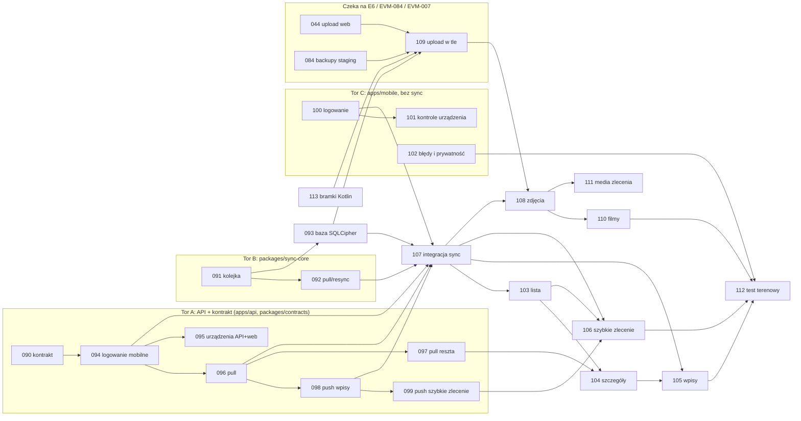

# M2 — MVP „Teren” (wydanie 1.1): plan i indeks historyjek

> Dokument żywy. Właściciel: `product-owner`; decyzje: Konrad. Stan: **plan z 2026-10-27 po konsultacjach (architekt, security, UX) — wszystkie historyjki `draft`**, czekają na decyzje Konrada (sekcja „Rekomendowane domyślne decyzje”) i akceptację. Konsultacja UX: [`16-m2-uzupelnienia-teren-i-urzadzenia.md`](../../ux/flows/16-m2-uzupelnienia-teren-i-urzadzenia.md); ADR-0021 (zakres, wejście/wyjście z zakresu, resync; status Proponowana) w przygotowaniu. Zakres: [`roadmap.md`](../../product/roadmap.md) → M2, epiki E9–E14. Wejścia: [ADR-0005](../../architecture/adr/0005-uwierzytelnianie-i-mfa.md), [ADR-0007](../../architecture/adr/0007-aplikacja-mobilna-expo-react-native.md), [ADR-0008](../../architecture/adr/0008-synchronizacja-offline.md), [ADR-0009](../../architecture/adr/0009-storage-i-przetwarzanie-mediow.md), [ADR-0019](../../architecture/adr/0019-dystrybucja-androida-mvp-apk-z-ci-podpis-lokalny.md), [ADR-0020](../../architecture/adr/0020-android-upload-w-tle-wlasny-modul-expo.md), [`offline-sync.md`](../../architecture/offline-sync.md), makiety M-01…M-10 ([`docs/ux/flows/`](../../ux/flows/README.md)), spike [EVM-011](../M0/EVM-011-spike-kolejka-offline-i-upload-w-tle.md) i szkielet [EVM-009](../M0/EVM-009-szkielet-aplikacji-mobilnej.md).

## Cel M2
Technik dokumentuje zlecenie zdjęciami, filmami i wpisami także bez zasięgu; wszystko trafia do archiwum zlecenia automatycznie, bez duplikatów i strat. **Tylko Android** (iOS odłożony — ADR-0015); dystrybucja: APK z CI, podpis lokalny (ADR-0019).

## Punkt wyjścia (stan repozytorium 2026-10-27)
- **Aplikacja** (`apps/mobile`, EVM-009 `in-review`): powłoka S-01 / „Kolejka” / S-02, sprawdzenie zdrowia i minimalnej wersji, bezpieczny magazyn tokenów (bez logowania), biblioteka komponentów mobilnych, i18n `pl`, Maestro, APK z CI. **Brak:** logowania, lokalnej bazy, kolejki, synchronizacji, aparatu.
- **Spike uploadu** (EVM-011 `done`): protokół uploadu plików i własny moduł Kotlin (ADR-0020) — kod w `spikes/`, nie produkcyjny.
- **API** (M1 w większości `done`): zlecenia, klienci, lokalizacje, strony, procesy i etapy, dziennik (wpisy), płatności, katalog, tożsamość z **sesjami cookie dla panelu**. **Brak:** logowania mobilnego (tokeny, rejestr urządzeń), `sync/changes`, `sync/mutations`, dziennika zmian; media (E6: EVM-044…) w statusie `ready` i zależne od staging (EVM-007 `in-progress`, EVM-084).
- **Brak pakietu** `packages/sync-core` (ADR-0007 — czysty TypeScript, próg pokrycia 95%).
- **Makiety:** są M-01…M-10; M-11 (prywatność i pomoc), M-12 (pierwsze pobranie danych), W-17 (urządzenia w panelu) i sekcja „Urządzenia” w W-15 są opisane w przepływie 16 (specyfikacja tekstowa, bez blokady nocnej pracy).

## Zasady planu
- **Fundament przed funkcjami:** wspólny rdzeń (kontrakt + silnik kolejki + lokalna baza) to ścieżka krytyczna; po nim funkcje E10, E12, E13 są niezależnymi plasterkami.
- **Równoległość przez porty:** `sync-core` jest czystym TS z portami (magazyn, transport, zegar, generator ID) i **nie importuje kontraktu OpenAPI** — jego typy ładunków wynikają z [`offline-sync.md`](../../architecture/offline-sync.md); adapter do wygenerowanego klienta powstaje w EVM-107. Ekrany logowania (EVM-100) powstają względem portu `AuthClient` z atrapą. Ryzyko rozjazdu z kontraktem EVM-090 ogranicza EVM-107 (integracja + testy kontraktowe).
- **Append-only:** w MVP telefon tylko tworzy (wpisy, komentarze, media, szybkie zlecenie) — bez konfliktów (offline-sync.md, zasada 4).
- **Ścieżka `pelna`** dla uwierzytelniania, urządzeń, synchronizacji, danych na urządzeniu; `lekka` tylko dla czystych ekranów nad gotową warstwą danych. Model `sonnet`.
- **Rozmiar:** ≤ 8 AC (pełna), ≤ 6 (lekka). Nowe ID od EVM-090 (najwyższe dotąd: EVM-089); EVM-113 dodany po konsultacji architekta.
- **ADR-0021:** EVM-096 i EVM-097 (a pośrednio 090, 092) zależą od ADR-0021; status „Proponowana” musi zmienić się na „Zaakceptowana” przed `ready`.

## Historyjki
| ID | Tytuł | Epik | Typ | Prio | Ścieżka | `depends_on` | Faza |
|---|---|---|---|---|---|---|---|
| [EVM-090](EVM-090-kontrakt-sync-i-urzadzen-mobilnych.md) | Kontrakt OpenAPI: logowanie mobilne, urządzenia i synchronizacja | E9/E10 | enabler | P0 | pelna | — | 1 |
| [EVM-091](EVM-091-sync-core-kolejka-mutacji.md) | `sync-core`: trwała kolejka mutacji i wysyłka | E12 | enabler | P0 | pelna | — | 1 |
| [EVM-092](EVM-092-sync-core-pobieranie-zmian-i-resync.md) | `sync-core`: pobieranie zmian, resync i obiekty oczekujące | E10 | enabler | P0 | pelna | EVM-091 | 1 |
| [EVM-094](EVM-094-api-logowanie-mobilne-i-urzadzenia.md) | API: logowanie mobilne i rejestr urządzeń | E9 | story | P0 | pelna | EVM-090 | 1 |
| [EVM-096](EVM-096-api-sync-pobieranie-zmian.md) | API: dziennik zmian i pobieranie zmian (zlecenia, klienci, lokalizacje) | E10 | story | P0 | pelna | EVM-090, EVM-094 | 1 |
| [EVM-098](EVM-098-api-sync-wysylanie-wpisow-i-komentarzy.md) | API: wysyłanie mutacji — wpisy i komentarze | E12 | story | P1 | pelna | EVM-090, EVM-094, EVM-096 | 1 |
| [EVM-100](EVM-100-mobile-logowanie-i-stany-urzadzenia.md) | Aplikacja: logowanie (hasło + kod) i stany urządzenia | E9 | story | P0 | pelna | EVM-009 | 1 |
| [EVM-101](EVM-101-mobile-kontrole-urzadzenia-i-czyszczenie-danych.md) | Aplikacja: kontrole urządzenia, ukrycie danych po 7 dniach, wyczyszczenie danych | E9/E14 | story | P1 | pelna | EVM-100 | 1 |
| [EVM-102](EVM-102-mobile-raportowanie-bledow-i-prywatnosc.md) | Aplikacja: raportowanie błędów bez danych osobowych i ekran prywatności | E14 | story | P2 | pelna | EVM-009, EVM-063 | 1 |
| [EVM-095](EVM-095-urzadzenia-lista-i-zdalne-wylogowanie.md) | Urządzenia: lista, zdalne wylogowanie, „Zablokuj i wyczyść” (API + panel) | E9 | story | P1 | pelna | EVM-094, EVM-029 | 2 |
| [EVM-097](EVM-097-api-sync-pozostale-encje-i-zakres.md) | API: pobieranie pozostałych encji, wejście i wyjście z zakresu | E10 | story | P1 | pelna | EVM-096 | 2 |
| [EVM-099](EVM-099-api-sync-szybkie-zlecenie.md) | API: wysyłanie szybkiego zlecenia (`CreateQuickWorkOrder`) | E13 | story | P1 | pelna | EVM-098 | 2 |
| [EVM-093](EVM-093-mobile-szyfrowana-baza-lokalna.md) | Aplikacja: szyfrowana baza lokalna i adapter magazynu | E10 | enabler | P0 | pelna | EVM-091 | 2 |
| [EVM-107](EVM-107-mobile-integracja-synchronizacji.md) | Aplikacja: integracja synchronizacji — pierwsze pobranie, wskaźnik, Kolejka, „Wymaga uwagi” | E10/E12 | story | P0 | pelna | EVM-092, EVM-093, EVM-094, EVM-096, EVM-098, EVM-100 | 2 |
| [EVM-103](EVM-103-mobile-lista-zlecen-offline-i-wyszukiwanie.md) | Aplikacja: lista zleceń offline i wyszukiwanie | E10 | story | P1 | lekka | EVM-107 | 3 |
| [EVM-104](EVM-104-mobile-szczegoly-zlecenia-offline.md) | Aplikacja: szczegóły zlecenia offline | E10 | story | P1 | lekka | EVM-103, EVM-097 | 3 |
| [EVM-105](EVM-105-mobile-wpisy-i-komentarze-offline.md) | Aplikacja: wpisy i komentarze offline | E12 | story | P1 | pelna | EVM-104, EVM-107 | 3 |
| [EVM-106](EVM-106-mobile-szybkie-zlecenie.md) | Aplikacja: szybkie zlecenie z telefonu | E13 | story | P1 | pelna | EVM-099, EVM-103, EVM-107 | 3 |
| [EVM-109](EVM-109-mobile-upload-w-tle-android.md) | Aplikacja: wysyłanie plików w tle (moduł natywny Android) | E11 | story | P1 | pelna | EVM-093, EVM-044, EVM-084 | 4 |
| [EVM-108](EVM-108-mobile-zdjecia-aparat-i-kolejka.md) | Aplikacja: zdjęcia — aparat, kategoria, opis, kolejka plików | E11 | story | P1 | pelna | EVM-107, EVM-109 | 4 |
| [EVM-110](EVM-110-mobile-filmy-i-wifi.md) | Aplikacja: filmy i „filmy tylko przez Wi-Fi” | E11 | story | P1 | pelna | EVM-108, EVM-046 | 4 |
| [EVM-111](EVM-111-mobile-media-zlecenia.md) | Aplikacja: media zlecenia i status każdego pliku | E11 | story | P2 | **pelna** (było lekka) | EVM-108, EVM-045, EVM-068 | 4 |
| [EVM-112](EVM-112-test-terenowy-i-masvs.md) | Test terenowy w garażu i przegląd MASVS | E11/E14 | story | P1 | pelna | EVM-105, EVM-106, EVM-110, EVM-102 | 5 |
| [EVM-113](EVM-113-bramki-kotlin.md) | Bramki Kotlin: ktlint, JUnit, pokrycie dla modułu uploadu | E14 | enabler | P1 | pelna | EVM-009 | 4 (przed EVM-109) |

Zmiany po konsultacjach: EVM-109 `depends_on` + EVM-113 (oraz decyzja o właścicielu odświeżania tokenów); EVM-111 → `pelna` (miniatury poza bazą szyfrowaną); EVM-103 i EVM-104 zostają `lekka`. EVM-100 zależy od EVM-009 (`in-review`) — **start toru C wymaga akceptacji EVM-009**. EVM-096 i EVM-097 wymagają ADR-0021 Zaakceptowanej.

Fazy 4–5 to **szkice bez szczegółowych AC** (3–5 AC ramowych) — doprecyzowanie po EVM-044/084 i po wynikach faz 1–3. Liczby AC po konsultacjach: 090: 7, 091: 7, 092: 7, 093: 7, 094: 8, 095: 7, 096: 8, 097: 5, 098: 7, 099: 6, 100: 6, 101: 8, 102: 6, 103: 5, 104: 4, 105: 5, 106: 4, 107: 8, 108: 4, 109: 5, 110: 3, 111: 4, 112: 4, 113: 5 (limit pełnej: 8; lekkiej: 6).

## Graf zależności

**Ścieżka krytyczna:** 090 → 094 → 096 → 098 (tor A) i 091 → 093 (tor B) → **107** → 103/104/105/106 → 108 → 110 → 112. Węzeł zbiegu to EVM-107: dopiero tam spotykają się trzy tory.

## Co nie zależy od E6 / EVM-084 / staging (start od razu)
Fazy 1–3 (EVM-090…107) — wpisy, komentarze, lista, szczegóły, szybkie zlecenie, logowanie, urządzenia, błędy i prywatność. Nie potrzebują mediów, storage ani staging; testy na lokalnym API w kontenerze (backend) i emulatorze (Maestro).

## Co zależy od E6 / EVM-084
EVM-109 (upload w tle: endpointy sesji uploadu z EVM-044, storage i bucket na staging z EVM-084/007; dodatkowo EVM-113 i decyzja o właścicielu odświeżania tokenów), a przez nie 108, 110, 111, 112. Dodatkowo: EVM-110 (filmy: EVM-046), EVM-111 (galeria/miniatury: EVM-045, EVM-068). Aparat bez wysyłki nie daje wartości, więc EVM-108 czeka na 109.

## Propozycja torów na noc (maks. 3 kodowe, osobne klony i gałęzie od `main`)
**Warunki wstępne:** ADR-0021 Zaakceptowana (EVM-096/097; tor A może zacząć od EVM-090 i 094 przed akceptacją, ale 096 czeka); EVM-009 zaakceptowany (tor C); decyzje 4, 5, 8, 17 z tabeli poniżej dla EVM-094, 100, 101 (tor C bez EVM-101 do czasu decyzji 5).

| Tor | Gałąź (nazwa wg workflow) | Historyjki (kolejność) | Zakres zapisu |
|---|---|---|---|
| **A — API i kontrakt** | `feature/queue-2026-10-27-m2-api` | **EVM-090 samodzielnie (osobny, krótki PR kontraktu)** → EVM-094 → EVM-096 → EVM-098 (5. opcjonalnie EVM-095, jeśli starczy czasu) | `apps/api` (moduły `identity`, nowy `sync`, migracje), `packages/contracts`; EVM-095 także `apps/web` |
| **B — silnik synchronizacji** | `feature/EVM-091-092-sync-core` | EVM-091 → EVM-092 | wyłącznie nowy `packages/sync-core` (+ wpisy workspace) |
| **C — aplikacja bez synchronizacji** | `feature/queue-2026-10-27-m2-mobile-auth` | EVM-100 → EVM-101 → EVM-102 | wyłącznie `apps/mobile` (+ testy Maestro w `apps/mobile/e2e`) |

**Rozłączność:** tory A, B, C zapisują do rozłącznych katalogów (`apps/api`+`packages/contracts` / `packages/sync-core` / `apps/mobile`). Zależności między nimi są tylko „wiring” w EVM-107 (po scaleniu wszystkich trzech). Wspólne punkty konfliktu, które Tech Lead rozwiązuje przy scalaniu (nie blokują startu): `pnpm-lock.yaml` (tor B bez zależności runtime — rekomendowane; tor C dodaje m.in. moduł sprawdzania blokady ekranu i bibliotekę raportowania błędów; tor A raczej bez nowych), `CHANGELOG.md`, `docs/security/threat-model.md` i `requirements.md` (znane z EVM-009/026 — edytować różne wiersze i numerować RR dopiero przy scalaniu), `docs/ops/*`. **Kontrakt OpenAPI współdzielony:** zmienia go wyłącznie tor A (EVM-090 jako pierwsza historyjka toru; pozostałe historyjki toru dopisują tylko swoje pliki `paths/*.yaml`); tory B i C nie dotykają `packages/contracts`.
**Kolejność startu — dwie opcje (rekomendacja: opcja 1):**
1. **EVM-090 najpierw, samodzielnie.** Tory B i C ruszają równolegle z resztą toru A dopiero, gdy kontrakt 090 jest na `main` (typy, przykłady odpowiedzi i atrapa są źródłem fixture'ów `sync-core` oraz atrapy `AuthClient`). Koszt: opóźnienie startu B i C o czas jednego krótkiego PR-a; zysk: zero rozjazdu kontraktu w trzech torach.
2. **Wszystkie trzy tory od razu, B i C na atrapach.** Maksymalna równoległość, ale ryzyko rozjazdu typów i kopert (poprawki w EVM-107/AC7 zamiast w 090); lockfile i `.dependency-cruiser.cjs` tak samo kolidują.

**Kolejność scalania rekomendowana: 090 → B → A (reszta) → C → faza 2.** Jeśli 090 nie jest scalana osobno: B → A → C (C po A, bo atrapa `AuthClient` ma odpowiadać kontraktowi). Wspólne pliki: `pnpm-lock.yaml` (po rebase zawsze `pnpm install` + `backend-install`, lockfile nigdy ręcznie), `pnpm-workspace.yaml` (tor C, jeśli zależność ma skrypt instalacyjny), `.dependency-cruiser.cjs` (A: reguły `sync`; B: czystość `sync-core` — różne miejsca pliku), `tools/repo-policy`, `coverage-thresholds.json`, `tools/ci-changes` i `testing-strategy.md` (tylko B), migracje i `.env.example` (tylko A).

**Tor EVM-007/084/085 nie dodaje migracji tej nocy** (kolizja numeracji z torem A); pozostałe prace infrastrukturalne bez migracji są rozłączne z torami M2.

**Dlaczego nie 4 tory ani więcej historyjek w A:** limit ok. 5 historyjek na PR (workflow → „Kolejki historyjek”), a wszystkie historyjki A to `pelna` z migracjami i testami PostgreSQL (kontener) — ciężki przebieg CI. EVM-095 i EVM-097 wchodzą w następnej kolejce A2 po scaleniu A.

**Inne tory dostępne w nocy (poza M2):** domykanie EVM-007 (infra, staging) — rozłączne z powyższymi, pod warunkiem braku migracji.

## Plan faz po nocy 1
- **Faza 2 (po scaleniu A, B, C):** kolejka A2 = EVM-095, 097, 099 (API + panel); kolejka M = EVM-093 → EVM-107 (aplikacja + `sync-core`, jedna gałąź, bo 107 zależy od 093; 093 może ruszyć równolegle z A2, 107 czeka na scalenie A).
- **Faza 3:** EVM-103 → 104 → 105 → 106 (jedna gałąź, `apps/mobile`).
- **Faza 4:** po EVM-044/084/007 i EVM-113 — 109 → 108 → 110 → 111; konsultacje i spike przeglądu telemetrii `expo-camera` (EVM-011 → „Przed M2”).
- **Faza 5:** EVM-112 — test terenowy (Konrad, fizyczny telefon).

## Kryteria wyjścia M2 (z roadmapy)
Test terenowy w garażu podziemnym bez zasięgu: min. 30 zdjęć, 3 filmy, 2 wpisy; po wyjściu na zasięg wszystko w właściwym zleceniu, bez duplikatów i strat, także po wymuszonym zamknięciu aplikacji w trakcie uploadu (EVM-112); weryfikacja MASVS i security sign-off; aplikacja zainstalowana na telefonach firmowych z Androidem (APK podpisany lokalnie, ADR-0019). Pokrycie scenariuszy „nic nie ginie” 1–6 z `offline-sync.md`: kliencka część w EVM-092, serwerowa w EVM-096/097/098, E2E w EVM-107/112.

## Poza zakresem M2
iOS; push i biometria jako wiązanie kluczy; edycja istniejących danych z telefonu (`UpdateStageStatus` — po MVP); rola Monter i „Moje zlecenia” wg przypisania (M4); Google Play / EAS (ADR-0019); wyszukiwanie pełnotekstowe; zdalne zarządzanie telefonem (MDM).

## Konsultacje przed `ready` (wykonane 2026-10-27, wyniki naniesione w historyjkach)
Zakres konsultacji:
- **UX:** M-11 (prywatność i pomoc), W-17 (urządzenia w panelu), ekran pierwszego pobrania danych, lista „Wymaga uwagi” (M-07), wyszukiwanie w M-05 offline, stany błędów synchronizacji — szczegóły w raporcie.
- **Security:** kolejka po `session_revoked` / `device_wipe_required`, tokeny i sekret instalacji, SQLCipher/Keystore, tryb 7 dni i manipulacja zegarem, kontrola blokady ekranu, raportowanie błędów (PII), auth natywnego workera (ADR-0020), MASVS.
- **Architekt:** luki ADR-0008 / `offline-sync.md` („Otwarte — EVM-011” pkt 2–6, 8–12), ścieżki endpointów i kontrakt mobilnego logowania, dziennik zmian (trigger vs port), nowy moduł `sync`, uwierzytelnianie workera.

## Rekomendowane domyślne decyzje (czekają na Konrada)
Wszystkie pytania z konsultacji w jednym miejscu; jeśli Konrad nie zdecyduje inaczej, obowiązuje rekomendacja. Odpowiedzi wpisujemy po decyzji.

| # | Decyzja | Rekomendacja | Źródło | Wpływ na historyjki |
|---|---|---|---|---|
| 1 | Akceptacja ADR-0021 (pkt 4, 11, 12 `offline-sync.md`: wyjście z zakresu, kontrolny resync „w cieniu”, wejście do zakresu jednym mechanizmem sterowanym klientem) oraz wyzwalacza `sync.record_change` zamiast portu w `platform` | Zaakceptować | architekt | Blokuje `ready` EVM-096, 097; wpływa na 090 (AC3), 092 (AC1, AC4, AC5) |
| 2 | EVM-090 scalona osobno przed torami B i C | Tak; kolejność 090 → B → A → C (alternatywa: wszystkie tory od razu na atrapach, ryzyko rozjazdu) | architekt | Tory nocne, EVM-107 AC7 |
| 3 | EVM-113 „Bramki Kotlin” jako osobny enabler przed EVM-109 | Tak (devops-engineer + mobile-developer) | architekt | EVM-109 `depends_on` EVM-113; wejdzie do fazy 1, jeśli czas monotoniczny/podpis urządzenia mają być w Kotlin |
| 4 | Telefony firmowe czy prywatne (BYOD)? README mówi „firmowe”, P7/RR-08/`rodo.md` zakładają prywatne | Ustalić; przy wyłącznie firmowych — spis floty i tryb „blokuj” dla starych poprawek (P7) przed testem terenowym | security | EVM-101, 112; polityki P7, `rodo.md` |
| 5 | `FLAG_SECURE` na całym oknie w wydaniu (technicy tracą zrzuty ekranu) czy tylko ekrany z danymi + wyłączony zrzut w „Ostatnich” | Całe okno w wydaniu; kompilacje testowe bez flagi | security | EVM-100, 101 (AC7) |
| 6 | Filmy domyślnie bez dźwięku (dźwięk = nagrywanie rozmów klientów) | Tak | security | EVM-110 AC1; `rodo.md` |
| 7 | Mapy źródeł Sentry (token vs brak sekretów w CI dla APK) | Konrad wysyła mapy lokalnie przy podpisie albo pilotaż bez map | security | EVM-102 |
| 8 | Refresh token bez powiązania z urządzeniem: nowe RR na M2 (z kompensacjami) + historyjka powiązania kluczem urządzenia w backlogu po EVM-109 | Tak (alternatywa: powiązanie od razu, wymaga Kotlin przed EVM-094) | security | EVM-090 (opcjonalne `devicePublicKey`), 094 (AC4); `threat-model.md` przy scaleniu |
| 9 | `pendingItemsReported` minimalnie w M2 (zgodnie z P2/SR-MOB-04) — zastępuje pytanie 9 z pierwszej wersji planu | Tak (alternatywa: odstępstwo od P2 z RR) | security | EVM-090, 094, 095 (AC4–AC5), 107 (AC2) |
| 10 | Skąd technik bierze nową wersję APK: link w panelu; do czasu decyzji M-02 mówi „poproś administratora” | Tak | UX | EVM-100 (AC3), 112 (AC3) |
| 11 | Numer telefonu biura w M-11 (numer funkcyjny z konfiguracji) | Tak | UX | EVM-102 (AC4) |
| 12 | Chipy M-05 w M2: „Wszystkie” i „Niewysłane (n)” zamiast „Wszystkie/Moje/Czekamy na…” (odstępstwo od makiety, wpis w changelogu styleguide'u) | Tak | UX | EVM-103 (AC5) |
| 13 | „Utwórz ponownie” przenosi zależne elementy do nowego zlecenia | Tak (automatycznie) | UX | EVM-106 (AC4), 091 (ponowne wskazanie celu) |
| 14 | N = 30 dni zamkniętych zleceń w zakresie (konfigurowalne; pomiar w EVM-107, nieblokujący) — pkt 3 | Tak | architekt | EVM-096 (AC2), 097 (AC4), 107 |
| 15 | Wyszukiwanie duplikatów klientów lokalnie (E.164 + nazwa bez polskich znaków), bez deduplikacji na serwerze (pkt 9) | Tak; scalanie poza v1 | architekt | EVM-099, 106 (AC2) |
| 16 | Wcześniejsze 11 decyzji z pierwszej wersji planu | Zostają bez zmian (tabela niżej; pytanie 9 zastąpione decyzją 9 powyżej) | product-owner | Cały plan |
| 17 | Właściciel odświeżania tokenów po stronie telefonu: jeden właściciel natywny (opcja (a) ADR-0020; adnotacja ADR-0020a, aktualizacja SR-SESS-09) | Opcja (a) | security | Blokuje `ready` EVM-094, 100, 109 (090 przy opcji (b)); tokeny za portem w EVM-091/100 |

## Pytania do Konrada — pierwsza wersja planu
Odpowiedzi wpisujemy tu po decyzji Konrada (stan: otwarte; pytanie 9 zastąpione decyzją 9 wyżej).
| # | Pytanie | Rekomendacja |
|---|---|---|
| 1 | Zaczynamy od fundamentu (kontrakt + `sync-core`) i logowania, a aplikacja korzysta z atrap do czasu EVM-107? | Tak — bez tego nie ma równoległości; ryzyko rozjazdu łapie EVM-107 |
| 2 | Rola Tylko odczyt nie korzysta z aplikacji (`403 channel_not_allowed`)? | Tak (zgodnie z makietami) |
| 3 | W v1 „Moje zlecenia” = wszystkie zlecenia w zakresie (bez przypisania do technika)? | Tak (RR-13, rola Monter w M4) |
| 4 | Zamknięte zlecenia zostają na telefonie 30 dni? | Tak, parametr konfigurowalny; pomiar w EVM-107 |
| 5 | Raportowanie błędów (Sentry UE) włączone domyślnie na telefonach firmowych, bez danych osobowych? | Tak |
| 6 | Blokada aplikacji po 5 min w tle (systemowy PIN/biometria) włączona domyślnie? | Tak, bramka UI wg P7 |
| 7 | Wyszukiwanie offline ignoruje polskie znaki? | Tak |
| 8 | Limit 2 aktywnych telefonów na użytkownika (SR-SESS-04) wystarcza? | Tak na pilotaż; podnieść konfiguracją |
| 9 | Liczba niewysłanych elementów urządzenia widoczna dla Administratora (ADR-0007) — osobna historyjka po M2-faza 3? | Tak, poza fazami 1–3 |
| 10 | Test terenowy (EVM-112): kto i jaki telefon? | Konrad + technik; Samsung SM-G781B (Android 13) z EVM-011 oraz drugi model z Androidem 14+ |

## Dziennik
- 2026-10-27 — szkic planu M2 i historyjek EVM-090…112 w `draft` (product-owner)
- 2026-10-27 — naniesiono konsultacje (architekt, security, UX); dodano EVM-113; tabela decyzji i tory na noc zaktualizowane (product-owner)
