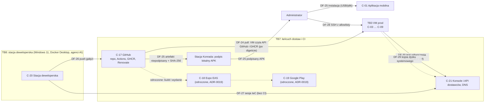

# Model zagrożeń EVia Manager — v1

> Dokument żywy (EVM-005). Właściciel: `security-engineer`. Wersja **v1 (M0), 2026-10-03** (**aktualizacja 2026-10-20, EVM-009 / ADR-0019 (zaakceptowana przez Konrada 2026-10-21):** dystrybucja Androida na MVP to APK z CI bez klucza + podpis lokalny przez Konrada, sideload; EAS i Google Play odroczone — C-18 i C-19 poza zakresem MVP, DF-25 przepisany, TM-58 i TM-59 ocenione od nowa, TM-92 z nowymi mitygacjami, RR-12 zamknięte w MVP, nowe RR-32 (podpis lokalny i utrata klucza), zaakceptowane przez Konrada 2026-10-21; uzupełnienie 2026-10-21: A-07 — klucz podpisu APK lokalny u Konrada zamiast klucza uploadu, RR-21 — klucz podpisu poza GitHubem, CI bez sekretów) (**aktualizacja 2026-10-13, EVM-063:** W-19 „Prywatność i pomoc” jako publiczna trasa SPA `/privacy` — treść statyczna w bundlu, bez nowego endpointu, bez nowych elementów C-xx i przepływów DF-xx; TM-10 i TM-08 pokryte kontrolami: układ panelu tylko przy potwierdzonej sesji `active`, 401 daje układ publiczny bez danych poprzedniej sesji, bez `returnTo`, treść renderowana z danych bez HTML, bez magazynów przeglądarki; CSP bez zmian; ryzyka rezydualne bez zmian, brak nowego RR) — ryzyka rezydualne i polityki **zaakceptowane przez Konrada 2026-10-03** na demo EVM-005. Wejścia: C4 L2, mapa modułów i ADR-0001…0015 ([`../architecture/README.md`](../architecture/README.md)), model domeny z EVM-002 ([`../architecture/domain-model.md`](../architecture/domain-model.md), [`../architecture/offline-sync.md`](../architecture/offline-sync.md), [`../architecture/api-guidelines.md`](../architecture/api-guidelines.md)). Wymagania `SR-…`: [`requirements.md`](requirements.md); polityki P1–P12: [`policies.md`](policies.md); RODO: [`rodo.md`](rodo.md); baseline: [`README.md`](README.md). **Aktualizacja 2026-10-05 (EVM-013):** TM-103…TM-105 (wyjście walidatora dokumentacji w CI) i RR-22; RR-22 zaakceptowane przez Konrada 2026-10-05 („Decyzje” 10 w EVM-013). **Aktualizacja 2026-10-05 (EVM-008):** weryfikacje AB-02 (lint `channels`) i AB-06 (macierz ról z IDOR) przeniesione do EVM-016 zgodnie z zawężeniem zakresu EVM-008 (decyzja Konrada 2026-10-05); bez nowych RR. **Aktualizacja 2026-10-07 (EVM-020):** pierwsze dane klientów w API (`searchCustomers`, `createCustomer`) — weryfikacje integracyjne dla TM-17 i AB-13 (`id` UUIDv7 z klienta tylko `INSERT`, `409 id_conflict` bez danych istniejącego zasobu), TM-18 (macierz ról, `read_only_field` dla wszystkich pól serwera), TM-19 i AB-18 (escapowanie `%`, `_`, `\`, fraza 3–100 znaków), TM-22 (60 wyszukiwań/min per użytkownik, limit 20 wyników, rekord idempotencji dopiero po authz i walidacji), AB-09 w web (klucz wiązany z użytkownikiem, urządzeniem i operacją; metryki `idempotency_mismatch`, `idempotency_in_progress`) i AB-16 (fraza tylko w treści `POST`); bez nowych elementów, przepływów i RR. Uwaga: znacznik czasu w UUIDv7 wybiera klient — kolejność i kursory opieramy na `created_at` serwera, nie na `id`. **Aktualizacja 2026-10-07 (EVM-021):** lokalizacje i strony w API (`searchSites`, `createSite`, `searchParties`, `createParty`; kanał web) — te same weryfikacje co w EVM-020 dla TM-17, TM-18, TM-19, AB-09, AB-13 i AB-18; AB-06 i TM-17: strona usunięta i nieistniejąca w polu `…PartyId` dają ten sam kod `unknown_party`, a strona złego rodzaju `wrong_party_kind` bez faktycznego rodzaju (brak wyroczni istnienia i rodzaju), kontrola rodzaju w transakcji zapisu, FK `ON DELETE RESTRICT`; TM-22 i P10: osobne kubełki 60 wyszukiwań/min dla klientów, lokalizacji i stron (łącznie 180/min) kompensuje wspólny licznik masowego odczytu sumujący wyniki wszystkich trzech wyszukiwań; SR-DATA-03: wyniki wyszukiwania bez PPE, mocy, notatek, telefonu, e-maila i osoby kontaktowej, `search_text` bez PPE, notatek, telefonu i e-maila; TM-08 i TM-86: audyt `site.created` i `party.created` bez wartości danych osobowych; TM-10: formularze panelu tylko w pamięci karty. Ryzyko niskie (backlog, bez RR): wyścig między sprawdzeniem strony a jej przyszłym soft delete — do rozwiązania (`SELECT … FOR KEY SHARE`) przy EVM-036 / EVM-060, gdy powstanie usuwanie stron; bez nowych elementów, przepływów i RR. **Aktualizacja 2026-10-07 (EVM-022):** utworzenie zlecenia z szablonu (`createWorkOrder`, kanał web, A i E) i lista opiekunów (`listAssignableUsers` — tylko `id` i `displayName`, SR-DATA-03) — te same weryfikacje co w EVM-020 dla TM-17, TM-18, AB-09 i AB-13; TM-17 i T6: klient i lokalizacja przez fasady modułów w transakcji zapisu, usunięte i nieistniejące = ten sam `404` dla każdej roli, szablon wycofany i nieistniejący = ten sam `422 template_unavailable`, opiekun nieistniejący / zaproszony / dezaktywowany / usunięty = jeden kod `assignee_unavailable`; SR-API-06 i TM-25: kontrybutorzy kompozycji (port bez implementacji do EVM-031 / EVM-053) w tej samej transakcji, bez zewnętrznego I/O (brak SSRF i długich blokad) — wymóg do weryfikacji w przeglądach EVM-031 i EVM-053; SR-API-07: licznik roczny w tabeli (`INSERT … ON CONFLICT … RETURNING`), rok wg `Europe/Warsaw`, bez luk i wyścigów (test 20 równoległych); TM-08 i TM-86: audyt `work_order.created` bez tytułu, opisu i nazw. Ryzyka niskie (backlog, bez RR): wyścig sprawdzenia klienta / szablonu z przyszłym soft delete (jak dla stron — przy EVM-039 – EVM-041 i edycji szablonów); TM-22: blokada wiersza licznika szereguje tworzenie zleceń, a limit 300 żądań/min/użytkownika z SR-API-02 nie jest jeszcze wdrożony dla operacji zapisu (jest limit globalny per IP) — nadużycie wymaga konta A lub E; bez nowych elementów, przepływów i RR. **Aktualizacja 2026-10-08 (EVM-018):** odczyt szczegółów zlecenia (W-06) — `getWorkOrder`, `listWorkOrderScopeItems`, `getWorkOrderCustomer`, `getWorkOrderSite` (A, E, R; kanał web) — weryfikacje TM-17 i AB-06: zlecenie rozwiązywane najpierw polityką odczytu w zapytaniu, `customer_id` i `site_id` kart wyłącznie z wiersza zlecenia (parametr zapytania bez wpływu), pozycje zakresu z `work_order_id` w tym samym zapytaniu; nieistniejące i usunięte = ten sam `404` dla każdej roli; cztery odczyty w macierzy ról z przypadkiem IDOR na istniejącym, usuniętym zleceniu. SR-DATA-03: kontrakty z `additionalProperties: false`, odpowiedź parsowana schematem kontraktu przed wysłaniem; telefon i e-mail tylko w karcie „Klient”, PPE i notatki tylko w karcie „Lokalizacja”, strony jako `{id, displayName}`. TM-08 i SR-WEB-03: notatki renderowane jako tekst React, linki tylko `https:` (bez danych logowania w URL), `tel:` i `mailto:` (bez zapytania — brak dopisywania odbiorców), odrzucanie znaków sterujących i formatujących, `rel="noopener noreferrer"`. TM-10 i SR-WEB-05: dane tylko w pamięci karty (karty osób `gcTime: 0`), `404` usuwa wpisy zlecenia, tytuł karty bez nazwiska i adresu. Ryzyko niskie (backlog, bez RR): odczyty kart nie zasilają licznika masowego odczytu P10 — reguła „> 300 różnych klientów w 1 h” obejmująca szczegóły jest w EVM-039 i musi uwzględnić `getWorkOrderCustomer` i `getWorkOrderSite`; bez nowych elementów, przepływów i RR. **Aktualizacja 2026-10-09 (EVM-039):** klienci w panelu (W-14) — `listCustomers`, `getCustomer`, `updateCustomer`, `searchCustomers` z kursorem, filtr `customerId` w `listWorkOrders` (A, E, R; edycja A, E; kanał web). Weryfikacje: TM-17 i AB-06 — nieistniejący i usunięty klient to ta sama `404` dla każdej roli, w `PATCH` polityka odczytu pod blokadą `SELECT … FOR UPDATE` przed porównaniem wersji (usunięty z nieaktualnym `If-Match` → `404`, nie `412`; brak `If-Match` → `428`, zniekształcony → `400` niezależnie od istnienia), pięć nowych komórek IDOR w macierzy ról; TM-18 i AB-13 — `CustomerPatch` ścisły także w zagnieżdżonym adresie (`unknown_field`), każde pole serwera łącznie z `id` → `read_only_field`, R → `403` przed walidacją, CSRF → `403 csrf_failed`, token mobilny odrzucony; SR-AUTHZ-03 — lista, wyszukiwanie i historia zleceń filtrują warunkiem w zapytaniu; AB-09 (web) — klucz idempotencji `PATCH` związany z klientem (ten sam klucz i treść dla innego klienta → `422`), powtórka czytana ponownie z polityką odczytu; AB-16 i TM-19 — kursor keyset zawiera tylko `id` (wcześniej planowana nazwa klienta trafiłaby do query string i dziennika dostępu Caddy), związany z operacją, użytkownikiem i frazą, fraza wyłącznie w treści `POST` (E2E: brak frazy w adresie, historii, tytule i magazynach przeglądarki); TM-22 — keyset bez OFFSET, `limit` 1–100, indeksy częściowe migracji 0017 (test planu zapytania, p95 przy 10 000 klientów); AB-08 i RR-13 — wdrożony drugi próg P10: licznik różnych klientów per użytkownik (nie per sesja), okno przesuwne 60 min, alert `bulk_read_customers` przy 301. kliencie raz na okno (log bez identyfikatorów i danych osobowych, audyt `bulk_read.alerted` z `objectType: customer`), zasilany tylko odpowiedziami `2xx` listy, wyszukiwania, szczegółów i karty „Klient” zlecenia, pamięć ograniczona (301 identyfikatorów na użytkownika, 10 000 użytkowników, wypierany najdawniej aktywny); szczegóły zasilają też licznik rekordów (`429` z `Retry-After`); TM-08 i TM-86 — audyt `customer.updated` bez nazw pól i wartości, logi bez frazy, telefonu, e-maila i notatek (testy także dla `PATCH` i odrzuconych wartości); TM-10 i SR-WEB-05 — dane klienta tylko w pamięci karty (`gcTime: 0`, czyszczenie przy wylogowaniu i `401`), tytuł karty bez nazwiska, odpowiedź `412` bez bieżących wartości (panel czyta je ponownie i pokazuje jako zwykły tekst); SR-WEB-03 — `tel:` i `mailto:` z zakodowanych wartości przez `safeHref`. Ryzyka niskie (backlog, bez RR): karta „Lokalizacja” zlecenia (`getWorkOrderSite`, adres posesji klienta) nie zasila żadnego licznika P10 (decyzja w EVM-039 — „to lokalizacje”); licznik P10 w pamięci procesu zerowany restartem (zaakceptowane w `apps/api/README.md`); metryka `bulk_read_alert` wspólna dla obu progów (rozróżnia je `alertCode` w logu). Bez nowych elementów, przepływów i RR; RR-13 bez zmian (każdy Edytor widzi wszystkich klientów do M4). **Aktualizacja 2026-10-09 (EVM-032):** status etapu — `transitionProcedureStage` (komenda przejścia, A i E, kanał web, audyt) i „Zmień, na kogo czekamy…” w `updateProcedureStage`. Weryfikacje: SR-API-07 i TM-18 — status zmienia wyłącznie wiersz tabeli przejść (16 wierszy wykonanych przez A i E, każde przejście spoza tabeli `409`), `status` w treści `PATCH` i przejścia → `read_only_field`, pola innego celu → `not_allowed`, „Cofnij” to zwykłe przejście bez przywracania pól; TM-17 i AB-06 — zlecenie i etap pod blokadą `SELECT … FOR UPDATE`, etap wyszukiwany warunkiem `id AND work_order_id` (etap zlecenia B ścieżką zlecenia A, nieistniejący i usunięty = ta sama `404` przed `If-Match` i treścią), dwie nowe komórki IDOR w macierzy ról, R → `403` na każdym wierszu tabeli; AB-09 — klucz idempotencji związany z etapem, rekord bez powodu blokady i strony; strona „czekamy na” sprawdzana przez fasadę `parties` z blokadą `FOR SHARE` w transakcji zapisu (domyka dla tej ścieżki ryzyko niskie z EVM-021 — wyścig z soft delete strony), nieistniejąca i usunięta = jeden kod `unknown_party`, strona usunięta później → `waitingParty: null` w odpowiedzi; SR-DATA-02 i TM-08 / TM-86 — `blockedReason` (pole swobodne, 1–500 znaków, NFC, bez znaków sterujących, podpowiedź w UI) tylko w kolumnie etapu, nigdy w audycie (`procedure_stage.transitioned` bez powodu, strony i dat), logach, błędach i rekordzie idempotencji; strona jako `{id, displayName}`; SR-WEB-03 — powód i nazwa strony renderowane jako tekst React. Bez nowych elementów, przepływów i RR. **Aktualizacja 2026-10-11 (EVM-037):** dziennik zlecenia — `listTimelineEntries`, `getTimelineEntry` (A, E, R) i `createTimelineEntry` (wpis, komentarz, poprawka; A i E; kanał web; audyt `timeline_entry.created`). Weryfikacje: TM-17 i AB-06 — zlecenie rozwiązywane polityką odczytu w zapytaniu, każde zapytanie o wpis, etap i poprawiany wpis z `id AND work_order_id`; etap i poprawiany wpis innego zlecenia, nieistniejący i usunięty to jedna odpowiedź (`400`, `unknown_stage` / `unknown_entry`), wpis zlecenia B ścieżką zlecenia A i zlecenie usunięte to ta sama `404` dla każdej roli, osiem nowych komórek IDOR w macierzy ról, złożone klucze obce `(procedure_stage_id, work_order_id)` i `(supersedes_entry_id, work_order_id, kind)` w bazie; TM-18 i AB-13 — treść ścisła, pola serwera (`author`, `createdAt`, `origin`, `capturedAt`, `supersededByEntryId`, `redactedAt`, `version`, `workOrderId`, `createdBy`) → `read_only_field`, `kind: event` → `400`, `id` od klienta tylko `INSERT` (`409 id_conflict` bez danych istniejącego wpisu, także wpisu innego zlecenia); AB-09 — klucz wymagany i związany z użytkownikiem, metodą, szablonem ścieżki i zleceniem (ten sam klucz i treść na innym zleceniu → `422`), rekord powstaje w transakcji po authn, authz i walidacji i zawiera tylko identyfikator wpisu, powtórka czytana ponownie z polityką odczytu; TM-08 i SR-INPUT-05 — NFC, CRLF → LF, usunięcie znaków C0 i C1 (także NUL, który baza odrzuca), znaków sterujących kierunkiem tekstu (U+202A–U+202E, U+2066–U+2069 — zamyka po stronie zapisu niskie ryzyko Trojan Source) i separatorów wiersza i akapitu, samotny surogat UTF-16 → `400 invalid_characters` (nie `500` z bazy), długość w punktach kodowych po normalizacji; TM-86 — treść poza audytem (obiekt to identyfikator wpisu), logami, błędami i rekordem idempotencji (testy także dla żądań odrzuconych); naruszenie zasady „tylko do dopisywania” — rola aplikacji bez DELETE i TRUNCATE, wyzwalacz bazy odrzuca zmianę każdej kolumny poza `deleted_at`, `deleted_by` i `version` (treść niezmienna bez wyjątku do EVM-040), brak PATCH, PUT i DELETE w kontrakcie; wyścig dwóch poprawek → `409 entry_superseded` (UNIQUE `supersedes_entry_id` i blokada `FOR UPDATE`), nigdy `500` z nazwą ograniczenia; TM-22 — ciało trasy do 64 KB (`413`), `limit` ≤ 100, stała liczba zapytań na stronę, kursor związany z operacją, zleceniem, użytkownikiem i filtrami. Ograniczenie: tabela audytu ma stały zestaw kolumn, więc zlecenie, rodzaj i poprawiany wpis są w samym wpisie (tylko do dopisywania) i odczytuje się je po identyfikatorze z audytu — dodanie kolumn audytu byłoby zmianą współdzielonego modelu (decyzja architekta). Ryzyka niskie (backlog, bez RR): limit 300 mutacji na minutę na użytkownika (SR-API-02) nadal niewdrożony — spam dziennika wymaga konta A lub E; `409 id_conflict` jako wyrocznia istnienia UUIDv7 (precedens AB-13, ryzyko pomijalne); odczyty dziennika (`listTimelineEntries`, `getTimelineEntry` — treść swobodna, może zawierać dane osobowe) nie zasilają licznika masowego odczytu P10 — kandydat do progu „wpisy dziennika” razem z EVM-038 / EVM-040. Panel (przegląd bezpieczeństwa 2026-10-11, runda 1): SR-WEB-03 — treść jako tekst React (`LinkedText` + `safeHref`: aktywne tylko `https:`, `tel:`, `mailto:`; `<script>` i `javascript:` jako tekst — testy komponentu i Playwright), `dir="auto"` na akapicie treści; SR-WEB-05 i TM-10 — szkic wpisu w `draft-store` (pamięć karty, właściciel `userId`, czyszczony przy wylogowaniu), dziennik `gcTime: 0` i usuwany z pamięci przy `404` zlecenia (klucz w `WORK_ORDER_KEYS`), test E2E: brak treści w `localStorage`, `sessionStorage`, IndexedDB, adresie i tytule karty; R bez pola nowego wpisu i menu „Popraw wpis” (kontrola UI — decyduje `403` API); ponowienie z tym samym `id` i `Idempotency-Key`. Bez nowych elementów, przepływów i RR. **Aktualizacja 2026-10-11 (EVM-038, przegląd bezpieczeństwa runda 1):** zdarzenia dziennika (`kind = event`) — subskrybent w procesie (`JournalEventRecorder`) zapisuje wpis w transakcji zmiany zlecenia lub etapu; filtr `eventGroup=status_changes` w `listTimelineEntries` (A, E, R; kanał web). Weryfikacje: SR-API-06 (T, R — utrata śladu) — magistrala synchroniczna, błąd zapisu zdarzenia cofa zmianę, audyt i rekord idempotencji (testy AC5 dla przejścia i `PATCH` etapu, przejścia i utworzenia zlecenia); TM-18 i AB-13 — zdarzenie tworzy wyłącznie serwer: `kind: event`, `origin`, `event`, `eventCode` i `event_payload` w treści → `400 validation_failed`, poprawka wskazująca zdarzenie → `400 unknown_entry` (`lockCorrectable` tylko `note` / `comment`), brak trasy zmiany; CHECK `(origin = 'system') = (kind = 'event')` zostaje, a wyzwalacz tylko do dopisywania obejmuje `event_code` i `event_payload` (migracja 0021, `create or replace` zachowuje `REVOKE` i atrybuty funkcji); SR-LOG-03, SR-DATA-01 i TM-86 (I) — ładunek z zamkniętej listy kluczy na kod, parsowany ścisłym schematem przed zapisem (bez powodów wstrzymania, anulowania i blokady, nazw, dat i identyfikatora osoby odpowiedzialnej — testy na surowym wierszu), odczyt tolerancyjny z odrzuceniem nieznanych kluczy, nowe typy zdarzeń domenowych poza audytem; TM-17 i AB-06 — złożony klucz `(procedure_stage_id, work_order_id)` przypina zdarzenie etapu do zlecenia, nazwa i rodzaj strony z bieżących danych przez fasadę `parties` z polityką odczytu wywołującego (strona usunięta → `name` i `kind` = `null`), kursor związany z `eventGroup`, zdarzenia zlecenia B nie pojawiają się w dzienniku A; SR-WEB-03 — zdania zdarzeń jako tekst React, słowniki etykiet przez `Object.hasOwn` (brak kluczy prototypu), kod i status nieznany → tekst neutralny. Uwaga RODO: ładunek zawiera identyfikatory (strona — może być osobą fizyczną, aktor w `created_by`); anonimizacja strony lub użytkownika zmienia wyświetlaną nazwę bez zmiany zdarzeń. Ryzyka niskie (backlog, bez RR): odczyty dziennika nadal poza licznikiem masowego odczytu P10 (jak w EVM-037). Bez nowych elementów, przepływów i RR. **Aktualizacja 2026-10-11 (EVM-035, przegląd bezpieczeństwa runda 1):** edycja danych i zakresu zlecenia — `updateWorkOrder` (`PATCH`), `createWorkOrderScopeItem`, `getWorkOrderScopeItem` (także R), `updateWorkOrderScopeItem` i `deleteWorkOrderScopeItem` (pierwszy `DELETE` w API, soft delete); zmiany A i E, kanał web, audyt. Weryfikacje: TM-17 i AB-06 — zlecenie pod blokadą `SELECT … FOR UPDATE` z polityką odczytu w zapytaniu, pozycja wyszukiwana warunkiem `id AND work_order_id` (pozycja zlecenia B ścieżką zlecenia A, nieistniejąca, usunięta i zlecenie usunięte = ta sama `404` przed `If-Match` i treścią — także test IDOR odczytu pojedynczej pozycji z „Uwag do rozważenia”), 11 nowych komórek IDOR w macierzy ról, `id` pozycji innego zlecenia jako `id` nowej pozycji → `409 id_conflict` (tylko `INSERT`, bez nadpisania); TM-18 i AB-13 — treści ścisłe, pola serwera (`number`, `status`, `customerId`, `siteId`, `version`; `code`, `name`, `parameterSetCode`, `position`, `quantity`, `sourceCatalogItemId`) → `read_only_field`, zestaw parametrów zawsze z pozycji katalogu albo migawki zapisanej w pozycji (nigdy od klienta), R → `403` przed walidacją, token mobilny → `403`; TM-19 (prototype pollution) — `__proto__`, `constructor` i `prototype` w `parameters` → `400 unknown_field`, sprawdzane na surowej treści przed schematem; SR-INPUT-02 i SR-DATA-02 — parametry wg ścisłego schematu zestawu (brak pól na PPE, numery liczników i nazwiska), rozmiar ≤ 16 KB sprawdzany przed schematem; `notes` (także opis „Innej usługi”) w typowanej kolumnie (migracja 0022, CHECK 1–1000), zwykły tekst (NFC, bez znaków `Cc`, `Cf`, `Zl`, `Zp`), poza JSONB; AB-09 — klucz idempotencji związany z użytkownikiem, metodą, szablonem ścieżki, zleceniem i pozycją (ten sam klucz i treść na innym zleceniu lub pozycji → `422`), powtórka czytana ponownie z warunkiem zlecenia z URL; SR-API-06 i SR-API-07 — jedna transakcja (pozycja, procesy przez port `procedures` bez zewnętrznego I/O, audyt, dziennik, rekord idempotencji; błąd uczestnika lub dziennika cofa całość), wyścigi: dwa dodania przy 49 pozycjach → dokładnie jedno `201`, zamknięcie zlecenia kontra zmiana → nigdy zmiana w zleceniu zamkniętym, `409 work_order_closed` przed `412`; TM-22 i SR-API-02 — limity 50 pozycji i 30 procesów (`422 limit_exceeded`), `listWorkOrderScopeItems` z `maxItems: 50` w kontrakcie i `LIMIT 50` w zapytaniu, ciało trasy 32 KB (`PATCH` zlecenia) i 64 KB (pozycja) → `413`; TM-08, TM-86 i SR-LOG-03 — audyt `work_order.updated`, `scope_item.created`, `scope_item.updated`, `scope_item.deleted` bez nazw pól i wartości, zdarzenia dziennika `work_order_fields_changed`, `scope_item_added`, `scope_item_updated`, `scope_item_removed` z zamkniętą listą kluczy (kody, identyfikatory, nazwy pól — bez tytułu, opisu, notatek, parametrów i opiekuna; testy na surowym wierszu); opiekun nieistniejący, zaproszony, dezaktywowany i usunięty = jeden kod `assignee_unavailable`; SR-WEB-03 — notatki i opis jako tekst React, etykiety parametrów przez `Object.hasOwn`; TM-10 — formularze w stanie komponentu, zmiana nie używa magazynów przeglądarki. Ryzyka niskie (backlog, bez RR): brak testów „logi bez wartości” (tytuł, opis, notatki, odrzucone parametry) dla pięciu nowych operacji (wzorzec EVM-031, EVM-036, EVM-037) i testów `413` dla tras pozycji zakresu; limit 300 mutacji na minutę na użytkownika (SR-API-02) nadal niewdrożony; `getWorkOrderScopeItem` i `listWorkOrderScopeItems` (notatki — pole swobodne) poza licznikiem masowego odczytu P10 (jak dziennik). Bez nowych elementów, przepływów i RR. **Aktualizacja 2026-10-12 (EVM-033):** szybkie dodanie strony przy „Czekamy na…” w panelu — bez nowych endpointów, kontraktu i migracji, korzysta z `createParty`, `searchParties`, `getParty`, `getWorkOrderSite`, `listProcedureTemplates` i `transitionProcedureStage` / `updateProcedureStage` (EVM-018/021/031/032/036). Weryfikacje: SR-AUTHZ-05 (ASVS V4.1.1) — menu etapu i „Dodaj stronę” tylko A i E, `createParty`: R `403` przed walidacją, brak sesji `401`, kanał mobile `403`, brak CSRF `403 csrf_failed` (`parties-create.test.ts`), UI niczego nie odblokowuje na podstawie danych szablonu; SR-INPUT-02 (ASVS V5.1.3) — domyślny wybór i podpowiedzi wskazują wyłącznie `id` z karty „Lokalizacja”, strona usunięta to `null` na karcie, nie wychodzi w wyszukiwaniu, a przy przejściu i edycji etapu `400 unknown_party` (jeden komunikat przy polu, bez ujawniania, czy strona istniała); SR-DATA-03 — podpowiedzi niosą wyłącznie `{id, displayName}` (i rodzaj), `getParty` zarządcy służy tylko do odczytu `kind` (`gcTime: 0`, tylko przy otwartym oknie „Czekamy na…”, bez renderowania kontaktu i notatek); TM-10 / ASVS V8.2.1 — wpisane dane strony i etapu tylko w stanie React (bez localStorage, sessionStorage, IndexedDB, adresu i historii; offline „Dodaj stronę” wyłączone, dane zostają); SR-API-05 — ponowienie zapisu strony wysyła to samo `id` i `Idempotency-Key`, zmiana treści daje nowy klucz; SR-DATA-02 — ostrzeżenie przy notatkach z W-05 w tym samym formularzu; SR-WEB-03 — nazwa strony i rodzaj jako tekst React. Ryzyka niskie (bez RR): dodatkowy pojedynczy odczyt `getParty` zarządcy nie jest audytowany ani liczony do progu P10 (jak w EVM-036) — przy zmianie kontraktu warto dodać `kind` do `SitePartyRef` i wyeliminować ten odczyt. Bez nowych elementów, przepływów i RR. **Aktualizacja 2026-10-13 (ADR-0018 — wdrożenia na GitHub Free, zaakceptowany przez Konrada 2026-10-13; `security-engineer`):** kanał pull z weryfikacją na VM (V0–V6), hermetyczny `publish`, zero sekretów w GitHubie, IaC tylko w sesjach, test odtworzenia z VM środowiska w projekcie `evia-restore*`, zatwierdzenie prod przez konsolę Scaleway z urządzenia bez agentów, wspólny stos Grafana i organizacja Sentry. Zmienione: C-13, C-14, C-17, C-21; DF-24, DF-27, DF-30 (i diagram); TM-54, TM-63, TM-91, TM-94, TM-97 (→ 1×1 Low), TM-99 (→ 1×1 Low), TM-100 (→ RR-19), TM-101; **TM-98 — N/A** (brak klucza wdrożeniowego SSH); AB-27; RR-02, RR-04 (źródło), RR-06, RR-11 (bez obniżenia — 3 Medium), RR-19, RR-20 (orkiestracja z VM, ocena w ramach RR-19), RR-21 (przegląd przed planem EVM-007 zamknięty). Nowe: TM-112 (zatrucie cache Actions w zakresie `main`), TM-113 (zatrucie obrazu bazowego lub warstwy z GHCR), TM-114 (wspólny stos obserwowalności); RR-23 (własny weryfikator i API GitHub — P1 × W3 = 3 Medium) i RR-24 (wspólny stos Grafana i organizacja Sentry — P1 × W2 = 2 Low pod warunkami) — oba zaakceptowane przez Konrada 2026-10-13. Podsumowanie ryzyka (rozdział 7) przeliczone z tabeli STRIDE — obejmuje też TM-106…TM-111 z EVM-034, których wcześniej nie doliczono. **Aktualizacja 2026-10-14 (EVM-056, przegląd bezpieczeństwa runda 1):** sygnały płatności na liście zleceń (W-10) i kafel „Płatności” (W-06) — bez nowych endpointów; addytywnie `sort=urgency`, widoki `overdue_payments` i `unpaid`, pole `payment` w `listWorkOrders` i `searchWorkOrders`, pole `PaymentMilestone.overdueDays`; migracja `0031` (trzy kolumny projekcji `overview`, bez zmiany uprawnień). Weryfikacje: TM-111 i SR-DATA-01 — projekcja dostaje wyłącznie liczniki i najwcześniejszy termin transz wystawionych, bez kwot (port systemowy `payments` bez kwot i nazw; sumy liczy fasada `PaymentTotalsDirectory` jednym zapytaniem na stronę; `rodo.md` zaktualizowane); TM-106, TM-107 i SR-AUTHZ-03 — widoki i „Najpilniejsze” liczone w jednym zapytaniu z `workOrderReadCondition`, sumy tylko dla zleceń strony, które przeszły partię tytułów `work-orders` (wzorzec C′: fasada sum bez własnej polityki zlecenia, import dozwolony wyłącznie z warstwy aplikacji `overview` — reguła dependency-cruiser `api-payment-totals-only-from-overview`, limit 100 identyfikatorów); test AC6 (zlecenie usunięte z najstarszą zaległą transzą i największą kwotą nie zmienia kolejności, sum ani granic stron dla A, E, R); kursor keyset `(grupa, dzień, id)` z parametrami wiązanymi, `scope` obejmuje wariant bez płatności, `asOf` z kursora (bez `now()` w SQL); TM-108 i SR-AUTHZ-05 — nowy klucz manifestu `x-evia-authz.restrictedParams` (polityka `paymentMilestone.read`, zamknięty słownik, generator odrzuca parametr, wartość i pole spoza operacji); predykat `canReadPayments` (wyczerpujący `switch`, wartość spoza ról → odmowa) równy rolom `listPaymentMilestones` (test), widok płatności bez prawa → `403` bez echa wartości po walidacji i przed licznikiem P10, pole `payment` nieobecne, fasada sum fail-closed; macierz ról: każda wartość z `restrictedParams` × A, E, R → `200`, niezalogowany `401`, kanał mobile `403`; TM-18 — `payment` w treści wyszukiwania i `overdueDays` w zapisie transzy → `400 read_only_field`; TM-10 — kwoty tylko w pamięci karty (ostatnia strona offline wiązana z filtrami). Waluta inna niż PLN → `500` bez kwoty w komunikacie. Operacyjnie: `rebuild` zaraz po `migrate` (runbook projekcji) — do tego czasu widoki płatności są puste (dostępność sygnałów, nie poufność). Skany lokalne zielone (gitleaks, Semgrep, OSV, Trivy, zizmor). Bez nowych elementów, przepływów, TM i RR. **Aktualizacja 2026-10-14 (EVM-057, przegląd bezpieczeństwa runda 1):** korekty płatności Administratora ze step-upem — cztery przejścia korekty w `transitionPaymentMilestone` (`invoiced → planned`, `invoiced → cancelled`, `paid → invoiced`, `cancelled → planned`), korekta kwoty transzy `invoiced` / `paid` w `updatePaymentMilestone` i skutek `deletePaymentMilestone` (soft delete z przenumerowaniem pozycji); bez nowych endpointów i migracji. Weryfikacje AB-17 (T7) i SR-AUTHZ-10: jedna polityka korekty (`correctionAccess` — rola przed step-upem: Edytor `403 forbidden`, Administrator bez klucza dostępu w ostatnich 15 min `403 step_up_required`), świeżość z tej samej funkcji `stepUpFresh` (`identity`) i zegara co guard; `DELETE` — rola i step-up w guardzie z `x-evia-authz`; kwota transzy `cancelled` → `403` dla każdego; test tabeli: żaden wiersz poza korektami nie prowadzi wstecz, test ścieżek grafu i sekwencji Edytora, TOCTOU (zmiana kwoty na wersji „planned” po wystawieniu → `403` na zablokowanym wierszu), brak trasy usunięcia zlecenia; SR-API-07 i CWE-915 — korekta przyjmuje tylko `to` (inne pola, także `reason`, → `400 not_allowed`), czyszczone kolumny ustala serwer; TM-17, AB-06 i CWE-639 — transza z warunkiem `id AND work_order_id AND deleted_at IS NULL` pod blokadą zlecenia, transza zlecenia B ścieżką A, usunięta i nieistniejąca = ta sama `404`, generator macierzy ról dostał komórkę IDOR dla operacji ze step-upem (Administrator ze świeżym kluczem → `404`; uwaga 1 z przeglądu EVM-054 zamknięta); AB-09 i SR-API-05 — `403` cofa transakcję bez rekordu idempotencji (ponowienie tym samym kluczem po W-04 wykonuje korektę raz — test), klucz `DELETE` związany ze zleceniem i transzą; SR-LOG-03 i SR-DATA-01 — audyt `payment_milestone.invoice_withdrawn|invoice_cancelled|payment_undone|restored|amount_corrected|deleted` z kwotą przed/po i kodami statusów, bez nazwy, numeru faktury i powodu; dziennik `payment_milestone_deleted` bez kwoty i nazwy (nazwa usuniętej transzy niedostępna przez `PaymentMilestoneDirectory`); soft delete znika ze wszystkich odczytów (lista, sumy, W-11, projekcja `overview` przeliczana zdarzeniem w tej samej transakcji); panel — korekty tylko w kanale web, offline wyłączone, W-04 raz na żądanie (bez pętli), dane wyłącznie w pamięci karty. Ryzyko niskie (backlog, bez RR — P2 × W1 = 2 Low, do akceptacji Konrada w historyjce): odmowy `403` korekt i innych operacji ze step-upem nie zostawiają wpisu audytu ani metryki per użytkownik (SR-LOG-06, ASVS V16.3.3) — luka platformowa, kandydat na historyjkę E1. Skany lokalne zielone (gitleaks, Semgrep, OSV, Trivy, zizmor, actionlint, licencje). Bez nowych elementów, przepływów, TM i RR. **Aktualizacja 2026-10-14 (EVM-082):** limit 300 żądań/min na zalogowanego użytkownika (SR-API-02, ADR-0004) w decyzji dostępu guardu, zaraz po ustaleniu sesji — klucz to identyfikator użytkownika (wszystkie sesje i oba kanały jeden licznik), liczone `400` z walidacji schematu i parametrów zapytania oraz `403`, nie `401`, operacje anonimowe i `GET /api/health`; błędy parsowania treści (`400`/`413`/`415`) przed guardem — limit per IP; odrzucone `429` bez skutków ubocznych, `429` z `Retry-After` w kontrakcie każdej operacji z sesją. Zmieniony TM-22 (mitygacja; ocena bez zmian — 2 Low) z ryzykami rezydualnymi Low: wspólna ograniczona mapa liczników użytkowników i adresów IP (propozycja do backlogu — osobna mapa dla `consumeSubject`) oraz wyczerpanie limitu ofiary przejętą sesją, także blokada `logout` na ≤ 60 s (zaakceptowane przez Konrada 2026-10-14 — `logout` objęty limitem, AC2 bez zmian). Bez nowych elementów C-xx, przepływów DF-xx i RR; podsumowanie ryzyka (rozdział 7) bez zmian.

## Spis treści
1. [Zakres i metoda](#1-zakres-i-metoda)
2. [Aktywa](#2-aktywa)
3. [Aktorzy zagrożeń](#3-aktorzy-zagrożeń)
4. [Granice, elementy i przepływy](#4-granice-elementy-i-przepływy)
5. [Analiza STRIDE](#5-analiza-stride)
6. [Przypadki nadużyć](#6-przypadki-nadużyć)
7. [Podsumowanie ryzyka](#7-podsumowanie-ryzyka)
8. [Ryzyka rezydualne do akceptacji (AC6)](#8-ryzyka-rezydualne-do-akceptacji-ac6)
9. [Aktualizacja modelu](#9-aktualizacja-modelu)
10. [Źródła](#10-źródła)

## 1. Zakres i metoda
- **Zakres v1:** cały system z C4 L2 (panel web, aplikacja mobilna Android — iOS odłożony wg ADR-0015, API, worker, baza, przetwarzanie mediów, dostawcy) oraz łańcuch dostaw i stacja deweloperska z agentami AI. Poza zakresem: integracje M5+ (tylko zasady — AB-12), komputery biura i telefony jako całe urządzenia (tylko wymagania wobec nich — P7, `rodo.md`).
- **Metoda:** STRIDE (S — podszycie, T — modyfikacja, R — wyparcie się, I — ujawnienie informacji, D — odmowa usługi, E — podniesienie uprawnień) dla **każdego elementu i każdego przepływu** z C4 L2 (identyfikatory 1:1 z diagramu) oraz elementów i przepływów spoza diagramu (Pwned Passwords, Let's Encrypt, łańcuch dostaw, stacja deweloperska). Do tego przypadki nadużyć `AB-xx` — scenariusze z perspektywy napastnika, które przecinają kilka elementów.
- **Ryzyko bazowe** = przed wdrożeniem mitygacji z kolumny „Mitygacje”; **ryzyko rezydualne** = po wdrożeniu mitygacji i rekomendacji z [`policies.md`](policies.md). Mitygacje to decyzje z ADR i wymagania `SR-…` z [`requirements.md`](requirements.md) (każde ma moduł, epik i sposób weryfikacji).

**Skala ryzyka 3 × 3**
| Wartość | Prawdopodobieństwo (P) w ciągu roku | Wpływ (W) |
|---|---|---|
| 1 | mało prawdopodobne — wymaga kilku warunków naraz lub ukierunkowanego ataku z dużym nakładem | ograniczony — pojedyncze rekordy bez danych wrażliwych, przestój < 1 h, łatwo odwracalne |
| 2 | możliwe — znany wzorzec ataku lub zdarzenie spotykane w małych firmach | znaczący — dane osobowe wielu osób lub dokumenty, naruszenie do zgłoszenia UODO, przestój do 1 dnia, utrata części danych z terenu |
| 3 | prawdopodobne — ataki masowe i automatyczne albo częste zdarzenia (np. zgubiony telefon) | poważny — masowy wyciek archiwum lub dokumentów `identity_data`, przejęcie systemu albo kont administracyjnych, trwała utrata danych, przestój > 1 dnia |

| Wynik P × W | Ocena | Klasyfikacja ustalenia w przeglądzie |
|---|---|---|
| 1–2 | **Low** | minor (backlog) |
| 3–4 | **Medium** | major (naprawa przed wydaniem albo ryzyko zaakceptowane przez Konrada i zapisane) |
| 6 | **High** | blocker |
| 9 | **Critical** | blocker |

## 2. Aktywa
Klasy danych z klasyfikacji EVM-002 ([`domain-model.md` → „Klasyfikacja danych”](../architecture/domain-model.md#klasyfikacja-danych)) oraz aktywa niebędące danymi.

| ID | Aktywo | Klasa | Gdzie | Dlaczego ważne |
|---|---|---|---|---|
| A-01 | Dane osobowe klientów (imię i nazwisko, telefon, e-mail, adres, PPE, miejsce postojowe, notatki) | DO-K | baza, telefon (projekcja), backupy | RODO; zaufanie klientów |
| A-02 | Dane osób trzecich (osoby kontaktowe stron, osoby i tablice rejestracyjne na zdjęciach) | DO-3 | baza, media | RODO; brak relacji umownej |
| A-03 | Dane pracowników (konta, sesje, IP, urządzenia, przypisania, autorstwo) | DO-P | baza, audyt, logi | RODO; BYOD |
| A-04 | Media i dokumenty — oryginały zdjęć i filmów (wnętrza posesji, garaże), dokumenty `identity_data` (PESEL, nr dowodu, podpis), `building_security` (projekty, ekspertyzy, opinie ppoż) | DO-K, DO-3, WF | Scaleway, Storage Box, telefon (oczekujące) | największy wolumen danych osobowych; bezpieczeństwo budynków |
| A-05 | Dane wrażliwe dla firmy (płatności, zakres i parametry, statusy, katalog) | WF, KONF | baza | rozliczenia, konkurencja |
| A-06 | Konta i sesje (hasła, sekrety TOTP, passkeys, kody odzyskiwania, tokeny) | SEK | baza (skróty, szyfrowane), Keystore | przejęcie konta = dostęp do wszystkiego w roli |
| A-07 | Klucze i sekrety infrastruktury (LUKS, pgBackRest, `rclone crypt`, `platform/crypto`, klucze S3, klucz podpisu APK, SSH, tokeny CI i dostawców) | SEK | VM, menedżer haseł Konrada (klucz podpisu APK — Bitwarden z MFA i kopia offline, poza repozytorium i GitHubem, ADR-0019), menedżer sekretów; w GitHubie bez sekretów (K7, ADR-0018, ADR-0019) | jeden klucz = dostęp do całej klasy danych |
| A-08 | Kopie zapasowe (PITR bazy, kopia mediów) | wszystkie | Scaleway (object lock), Storage Box | odtworzenie po ransomware |
| A-09 | Dostępność i „nic nie ginie” (praca biura, kolejka offline) | — | VM, telefony | ciągłość pracy, dane z terenu |
| A-10 | Integralność audytu, płatności i statusów | WF, DO-P | baza | rozliczalność, oszustwa |
| A-11 | Kod, obrazy, aplikacja mobilna i łańcuch dostaw | WEW | GitHub, GHCR, stacja Konrada (podpis APK); EAS i Google Play odroczone (ADR-0019) | złośliwa wersja = dostęp do wszystkich danych |
| A-12 | Domena, DNS i certyfikaty | WEW | rejestrator, Let's Encrypt | podszycie pod panel, przechwycenie poczty |

## 3. Aktorzy zagrożeń
| ID | Aktor | Motywacja i możliwości |
|---|---|---|
| TA-1 | Napastnik zewnętrzny, w tym phishing | masowe ataki na logowanie (credential stuffing), skanowanie podatności, phishing pracowników (fałszywe zaproszenia, strony logowania, przechwycenie TOTP w czasie rzeczywistym) |
| TA-2 | Złodziej lub znalazca telefonu | dostęp fizyczny do telefonu (często po pierwszym odblokowaniu), czasem znajomość PIN-u podpatrzonego przez ramię |
| TA-3 | Były pracownik | zna system i procesy; może mieć aktywną sesję, telefon z danymi, zapisane hasło lub kopie plików |
| TA-4 | Insider z rolą Edytor albo Tylko odczyt | legalny dostęp; ciekawość, sprzedaż danych, zemsta; masowe przeglądanie i pobieranie |
| TA-5 | Skompromitowany dostawca lub zależność | złośliwy pakiet npm, przejęta akcja GitHub lub narzędzie CI (wzorzec CVE-2026-33634 — Trivy, marzec 2026), obraz kontenera, dostęp dostawcy chmury lub organów państwa (CLOUD Act) |
| TA-6 | Nadawca złośliwego pliku | klient lub strona przekazuje plik (e-mail → biuro → upload), plik z telefonu z zainfekowanym systemem; exploit w parserze obrazów, wideo, PDF, Office |
| TA-7 | Przejęta stacja deweloperska albo agent AI w trybie bypass | dostęp do kodu, tokenów CLI (GitHub), Dockera, odtworzonego na czas podpisu keystore'a APK i haseł w sesji; może wypchnąć złośliwy kod lub wysłać sekrety na zewnątrz |

## 4. Granice, elementy i przepływy
Elementy `C-01…C-14` i przepływy `DF-01…DF-19` odpowiadają 1:1 węzłom i krawędziom C4 L2 ([`../architecture/README.md` → „C4 — poziom 2”](../architecture/README.md#c4--poziom-2-kontenery-granice-zaufania-i-przepływy-danych)). `C-15…C-21` i `DF-20…DF-30` uzupełniają diagram o C4 L1 (Pwned Passwords), certyfikaty, łańcuch dostaw (TB7), stację deweloperską (TB8) i test odtworzenia kopii.

**Granice zaufania**
| ID | Granica | Źródło |
|---|---|---|
| TB1 | Urządzenie mobilne (niezaufane) | C4 L2 |
| TB2 | Przeglądarka (niezaufana) | C4 L2 |
| TB3 | VM prod Hetzner — sieć wewnętrzna Docker, firewall 80/443 | C4 L2 |
| TB4 | Piaskownica bez sieci (`media-processor`, `clamd`) | C4 L2 |
| TB5 | Dostawcy zewnętrzni z UE (Scaleway, Hetzner Storage Box) | C4 L2 |
| TB6 | Dostawcy spoza UE z regionem UE (Sentry, Grafana) oraz usługi spoza UE bez danych osobowych (Pwned Passwords, Let's Encrypt) | C4 L2, C4 L1 |
| TB7 | Łańcuch dostaw i CI — GitHub (repozytorium, Actions, GHCR, Renovate), stacja Konrada (podpis lokalny APK, ADR-0019), konsole i API dostawców; Expo EAS i Google Play odroczone w MVP (ADR-0012, ADR-0019) | ten dokument |
| TB8 | Stacja deweloperska z agentami AI — Windows 11, Docker Desktop, Claude Code (ADR-0015) | ten dokument |

**Elementy**
| ID | Element (węzeł C4) | Granica | Dane | Decyzje |
|---|---|---|---|---|
| C-01 | Aplikacja mobilna (`mobile`) — Expo/React Native, baza SQLCipher, kolejka mutacji i uploadu | TB1 | projekcja DO-K, DO-3, DO-P; media oczekujące; refresh token | ADR-0005, 0007, 0008 |
| C-02 | Panel web SPA (`spa`) — React + Vite | TB2 | wszystkie klasy wg roli | ADR-0005, 0006 |
| C-03 | Reverse proxy Caddy (`proxy`) | TB3 | ruch TLS, logi dostępowe (IP) | ADR-0011 |
| C-04 | API NestJS (`api`) — uwierzytelnianie, autoryzacja, audyt | TB3 | wszystkie | ADR-0001, 0002, 0004, 0005 |
| C-05 | Worker pg-boss (`worker`) | TB3 | identyfikatory zadań, pliki w obróbce, e-maile | ADR-0009, 0010 |
| C-06 | PostgreSQL 18 na wolumenie LUKS (`db`) | TB3 | wszystkie dane, audyt, kolejka, dziennik zmian | ADR-0003 |
| C-07 | freshclam (`fresh`) | TB3 | sygnatury AV | ADR-0009 |
| C-08 | media-processor (`proc`) — sharp + ffmpeg | TB4 | pliki w obróbce | ADR-0009 |
| C-09 | clamd ClamAV (`clamd`) | TB4 | pliki w skanie | ADR-0009 |
| C-10 | Scaleway Object Storage `pl-waw` (`s3`) | TB5 | media, dokumenty, kopie bazy | ADR-0009, 0011 |
| C-11 | Scaleway TEM (`tem`) | TB5 | e-maile do pracowników | ADR-0005, 0011 |
| C-12 | Hetzner Storage Box FI (`box`) | TB5 | kopia mediów (szyfrogram) | ADR-0009, 0011 |
| C-13 | Sentry UE (`sentry`) — jedna organizacja dla staging i prod, projekty per komponent, DSN per środowisko (ADR-0018) | TB6 | telemetria po redakcji | ADR-0013, 0018 |
| C-14 | Grafana Cloud UE (`grafana`) — jeden stos dla staging i prod, tokeny zapisu per środowisko, etykieta `env` (ADR-0018) | TB6 | logi i metryki po redakcji | ADR-0013, 0018 |
| C-15 | Pwned Passwords (C4 L1) | TB6 | 5 znaków skrótu SHA-1 hasła | ADR-0005 |
| C-16 | Let's Encrypt (ACME) | TB6 | nazwy domen | ADR-0011 |
| C-17 | GitHub — repozytorium, Actions, GHCR, Renovate | TB7 | kod, dane syntetyczne, obrazy (GHCR), artefakty `release-manifest`; bez sekretów wdrożeniowych, IaC, backupu i testu odtworzenia (ADR-0018) | ADR-0012, 0018 |
| C-18 | Expo EAS (Build, Submit) — **odroczone w MVP** (ADR-0019; wraca z decyzją o Google Play) | TB7 | kod mobilny, klucz uploadu | ADR-0007, 0012, 0019 |
| C-19 | Google Play (ścieżka testów wewnętrznych, Play App Signing) — **odroczone w MVP** (ADR-0019) | TB7 | aplikacja, e-maile testerów | ADR-0007, 0012, 0019 |
| C-20 | Stacja deweloperska Konrada z agentami AI | TB8 | kod, syntetyczne sekrety dev, tokeny CLI | ADR-0015 |
| C-21 | Konsole i API dostawców (Hetzner, Scaleway), DNS i rejestrator, stan OpenTofu, bucket zatwierdzeń prod, projekty `evia-restore*` | TB7 | konfiguracja infrastruktury, kopie dysku systemowego VM, obiekt zatwierdzenia prod | ADR-0011, 0018 |

**Przepływy**
| ID | Z → do (krawędź C4) | Dane | Ochrona | Decyzje |
|---|---|---|---|---|
| DF-01 | `spa` → `proxy`: HTTPS `/api`, ciasteczko sesji | DO | TLS, `__Host-` cookie, CSRF | ADR-0005, 0006 |
| DF-02 | `mobile` → `proxy`: HTTPS `/api`, token, mutacje i kursory | DO | TLS, token nieprzezroczysty, idempotencja | ADR-0005, 0008 |
| DF-03 | `proxy` → `api` | DO | sieć wewnętrzna Docker | ADR-0011 |
| DF-04 | `api` → `db`: SQL, rola `evia_app` | DO | sieć wewnętrzna, role bazy | ADR-0003 |
| DF-05 | `worker` → `db`: zadania z samymi ID | DO (ID) | jak wyżej | ADR-0010 |
| DF-06 | `api` → `s3`: multipart create/complete, podpisy | metadane | TLS, klucz API | ADR-0009 |
| DF-07 | `mobile` → `s3`: `PUT` części, `GET` podpisane URL-e | M | TLS, URL części 60 min | ADR-0009 |
| DF-08 | `spa` → `s3`: `PUT` części, `GET` podpisane URL-e | M | TLS, URL pobrania ≤ 5 min | ADR-0009 |
| DF-09 | `worker` → `s3`: oryginał do skanu, zapis pochodnych | M | TLS, klucz workera | ADR-0009 |
| DF-10 | `worker` → `proc`: plik przez gniazdo Unix | M | gniazdo, wolumen współdzielony | ADR-0009 |
| DF-11 | `worker` → `clamd`: INSTREAM przez gniazdo Unix | M | gniazdo | ADR-0009 |
| DF-12 | `fresh` → `clamd`: sygnatury, wolumen tylko do odczytu | sygnatury | wolumen `:ro` | ADR-0009 |
| DF-13 | `worker` → `tem`: e-mail | DO-P | TLS | ADR-0005 |
| DF-14 | `db` → `s3`: pgBackRest WAL i backupy, szyfrowane | DO | szyfrowanie pgBackRest + SSE, object lock | ADR-0003, 0011 |
| DF-15 | `worker` → `box`: `rclone sync` nocą, szyfrowane | M | `rclone crypt`, SFTP | ADR-0009, 0011 |
| DF-16 | `api` → `sentry`: błędy | T | TLS, scrubbing | ADR-0013 |
| DF-17 | `mobile` → `sentry`: błędy | T | TLS, scrubbing | ADR-0013 |
| DF-18 | `spa` → `sentry`: błędy | T | TLS, scrubbing | ADR-0013 |
| DF-19 | `worker` → `grafana`: logi i metryki przez Alloy | T | TLS, redakcja | ADR-0013 |
| DF-20 | `api` → Pwned Passwords | prefiks skrótu | TLS, k-anonimowość | ADR-0005 |
| DF-21 | `proxy` ↔ Let's Encrypt (ACME) | nazwy domen | ACME | ADR-0011 |
| DF-22 | `fresh` → mirrory ClamAV | sygnatury | TLS, podpis CVD | ADR-0009 |
| DF-23 | `tem` → skrzynki pracowników (zaproszenia, reset, alerty) | DO-P, linki | TLS, SPF/DKIM/DMARC | ADR-0005 |
| DF-24 | GitHub → VM środowiska (pull, staging i prod; ADR-0018): agent na VM czyta API GitHub (Activity `main`, historia, PR, przebiegi `ci.yml`, artefakt `release-manifest`, plik Compose z commita) i pobiera z GHCR obrazy po digeście; prod dodatkowo czyta obiekt zatwierdzenia Konrada z bucketu zatwierdzeń (zapis przez konsolę Scaleway z urządzenia bez agentów) | obrazy, digesty, manifest, metadane repozytorium; poświadczenia kanału (PAT-y tylko do odczytu, klucz odczytu zatwierdzeń) wyłącznie na VM | zero sekretów w GitHubie, hermetyczny `publish`, weryfikator V0–V6 fail-closed, zatwierdzenie prod poza GitHubem, brak portów przychodzących (SR-INFRA-13, SR-INFRA-14) | ADR-0011, 0012, 0018 |
| DF-25 | GitHub Actions (job `mobile-apk`: artefakt **niepodpisany**, SHA-256, gałąź i commit w podsumowaniu) → stacja Konrada (podpis lokalny, klucz z Bitwarden poza repozytorium) → administrator → telefon (USB/plik); EAS i Google Play odroczone | aplikacja, klucz podpisu (tylko na stacji Konrada, na czas podpisu) | wejście podpisu związane z SHA-256 z przebiegu na `main`, przypięty odcisk certyfikatu, hasła tylko przez zmienne środowiskowe, instalacja wyłącznie przez administratora | ADR-0019 |
| DF-26 | Stacja deweloperska → GitHub (push gałęzi, PR) | kod | ruleset `main`, gitleaks | ADR-0012, 0015 |
| DF-27 | Sesja IaC (stacja Konrada, kontener `iac` z czystego `main`) → API dostawców; CI wykonuje tylko kontrole bez poświadczeń (`tofu fmt`, `validate`, Trivy) | konfiguracja, tokeny IaC (sesyjne) | tokeny tworzone przed sesją i unieważniane po niej (≤ 24 h), zawężone do projektu środowiska, w pliku montowanym do kontenera (agent go nie czyta); prod — wyłącznie Konrad bez działających agentów; szyfrowany stan | ADR-0011, 0018 |
| DF-28 | Administrator → VM (SSH, tunel do bazy) | dostęp administracyjny | allowlista IP, klucze | ADR-0003, 0011 |
| DF-29 | VM → Hetzner Backups (dysk systemowy) | system, konfiguracja, plik klucza LUKS | u dostawcy VM | ADR-0003, 0011 |
| DF-30 | VM środowiska (timer systemd: co miesiąc i przed wdrożeniem prod) → API Hetzner projektu `evia-restore` / `evia-restore-staging` → tymczasowa VM → kopie bazy, rejestr usunięć i próbka kopii mediów (odczyt) | token projektu `evia-restore*` i klucze odczytu kopii tylko na VM środowiska i w `user-data` tymczasowej VM; dane prod wyłącznie na tymczasowej VM; wynik bez danych przez jednorazowy podpisany `PUT`, stan lokalnie na VM | projekt bez zasobów środowiska, klucze tylko do odczytu, VM bez portów przychodzących, usuwana przez agenta i sprzątacz (alert > 24 h), poza GitHubem (SR-INFRA-07, RR-20) | ADR-0003, 0011, 0018 |

## 5. Analiza STRIDE
Kolumny: P, W — ryzyko bazowe; „Rezyd.” — ryzyko rezydualne po mitygacjach (P × W = wynik, ocena); `RR` — ryzyko rezydualne do akceptacji w [rozdziale 8](#8-ryzyka-rezydualne-do-akceptacji-ac6).

| TM | Element / przepływ | STRIDE | Zagrożenie | P | W | Ryzyko | Mitygacje (ADR · SR) | Rezyd. | RR |
|---|---|---|---|---|---|---|---|---|---|
| TM-01 | C-01 | I | Kradzież lub zgubienie telefonu: odczyt bazy offline, miniatur i mediów oczekujących (także narzędziami śledczymi w stanie po pierwszym odblokowaniu) | 3 | 2 | 6 High | ADR-0007 SQLCipher + Keystore, ADR-0005 limit offline · SR-MOB-01, SR-MOB-03, SR-MOB-04, SR-MOB-05, SR-MOB-06, SR-SYNC-04 | 2×2=4 Medium | RR-07, RR-08 |
| TM-02 | C-01 | S | Użycie skradzionych tokenów, sekretu instalacji lub telefonu po unieważnieniu (replay żądań, podszycie pod zarejestrowane urządzenie) | 2 | 2 | 4 Medium | ADR-0005 tokeny nieprzezroczyste · SR-SESS-09, SR-SYNC-01, SR-SYNC-03, SR-MOB-04 (sekret instalacji działa tylko przy pełnym logowaniu z hasłem i MFA) | 1×2=2 Low | — |
| TM-03 | C-01 | T | Zmodyfikowana aplikacja albo telefon z rootem omija kontrole po stronie klienta | 1 | 2 | 2 Low | ADR-0001 autoryzacja tylko na serwerze · SR-AUTHZ-01, SR-SYNC-02, SR-MOB-11 | 1×2=2 Low | — |
| TM-04 | C-01 | I | Wyciek przez kopię zapasową telefonu, galerię, logi systemowe, zrzuty ekranu lub powiadomienia | 2 | 2 | 4 Medium | ADR-0007 · SR-MOB-02, SR-MOB-08, SR-LOG-08 | 1×2=2 Low | — |
| TM-05 | C-01 | E | Deep link lub intencja innej aplikacji wywołuje akcję bez wiedzy użytkownika | 1 | 2 | 2 Low | ADR-0007 · SR-MOB-07 | 1×1=1 Low | — |
| TM-06 | C-01 | D | Utrata niewysłanych zdjęć i wpisów (czyszczenie przy unieważnieniu, fałszywe wykrycie ponownego użycia refresh tokenu przy wyścigu odświeżeń albo utraconej odpowiedzi, nowy `deviceId` po ponownym logowaniu — zaległe mutacje jako `id_conflict` i upload od nowa, brak miejsca, usunięcie oryginału przed potwierdzeniem) | 2 | 2 | 4 Medium | ADR-0007, 0008 · SR-MOB-04 (P2: tryby unieważnienia, ten sam `deviceId`), SR-SESS-09 (jeden proces odświeżania, okno tolerancji), SR-SYNC-03, SR-SYNC-08 | 1×2=2 Low | — |
| TM-07 | C-01 | R | Technik zaprzecza wykonaniu zdjęcia albo manipuluje czasem telefonu | 2 | 1 | 2 Low | ADR-0008 czas serwera · SR-SYNC-05, SR-LOG-03 | 1×1=1 Low | — |
| TM-08 | C-02 | E | XSS przez treść wpisu, opis, nazwę pliku lub dane strony → działania w sesji ofiary | 2 | 3 | 6 High | ADR-0006 CSP · SR-WEB-01, SR-WEB-03, SR-WEB-04, SR-INPUT-05 | 1×3=3 Medium | RR-10 |
| TM-09 | C-02 | S | CSRF i clickjacking | 2 | 2 | 4 Medium | ADR-0005 `SameSite=Strict` + token · SR-SESS-10, SR-WEB-01 | 1×2=2 Low | — |
| TM-10 | C-02 | I | Dane w przeglądarce współdzielonego komputera biura (niewylogowana sesja, cache, magazyny) | 2 | 2 | 4 Medium | SR-SESS-03, SR-SESS-05, SR-WEB-05, SR-API-03 | 1×2=2 Low | — |
| TM-11 | C-02 | T | Przejęty komputer biura lub złośliwe rozszerzenie przeglądarki (kradzież sesji, keylogger) | 2 | 3 | 6 High | SR-AUTH-06 (passkey), SR-SESS-03, SR-SESS-08, SR-LOG-07; środki organizacyjne z `rodo.md` | 1×3=3 Medium | RR-17 |
| TM-12 | C-03 | I | Słaba konfiguracja TLS, brak HSTS, atak downgrade | 1 | 2 | 2 Low | ADR-0011 · SR-COMM-01, SR-WEB-02, SR-API-10 | 1×1=1 Low | — |
| TM-13 | C-03 | D | Zalew żądań, slowloris, nadużycie uploadu | 2 | 2 | 4 Medium | ochrona DDoS Hetzner, limity Caddy · SR-API-02, SR-INFRA-11 | 1×2=2 Low | — |
| TM-14 | C-03 | T | Request smuggling, sfałszowany `X-Forwarded-For` (obejście limitów per IP, fałszywe IP w audycie) | 2 | 1 | 2 Low | SR-API-09, SR-API-11 | 1×1=1 Low | — |
| TM-15 | C-03 | I | Ujawnienie `.git`, map źródeł, listingu katalogów, wersji serwera | 2 | 1 | 2 Low | SR-INFRA-06, SR-API-12 | 1×1=1 Low | — |
| TM-16 | C-04 | S | Credential stuffing, brute force i enumeracja kont | 3 | 3 | 9 Critical | ADR-0005 · SR-AUTH-02, SR-AUTH-05, SR-AUTH-06, SR-LOG-07 | 1×3=3 Medium | RR-17 |
| TM-17 | C-04 | E | IDOR/BOLA: UUID z klienta, obiekt innej kotwicy w ścieżce zagnieżdżonej (T1 z EVM-002); od EVM-042 także dodanie etapu do procesu i przywrócenie procesu lub etapu innego zlecenia oraz lista usuniętych (`404` przed `If-Match` i treścią, identyczne jak dla obiektu nieistniejącego; przywracanie i lista tylko dla Administratora) | 3 | 3 | 9 Critical | ADR-0001, 0004 · SR-AUTHZ-02, SR-AUTHZ-03, SR-AUTHZ-05 | 1×3=3 Medium | RR-10 |
| TM-18 | C-04 | E | Endpoint bez polityki, BOPLA, mass assignment, obejście ról sekwencją przejść lub soft delete; wyszukiwanie zleceń po nazwisku klienta usuniętego (EVM-072): warunek `deleted_at IS NULL` w zapytaniu fasady klientów (ta sama polityka dla `searchIds` i `displayNamesOf`), więc usunięty klient nie jest znajdowany po nazwisku, a element zlecenia niesie `customer: { deleted: true }` bez `id` i nazwy | 2 | 3 | 6 High | ADR-0001, 0004 · SR-AUTHZ-01, SR-AUTHZ-04, SR-AUTHZ-05, SR-AUTHZ-10, SR-API-07 | 1×3=3 Medium | RR-10 |
| TM-19 | C-04 | T | Wstrzyknięcia: SQL przez sortowanie, filtr lub `LIKE`, prototype pollution, HTTP parameter pollution (T8); wyszukiwanie zleceń (EVM-072): fraza tylko przez `searchTextMatches` (escapowanie po `f_unaccent`), zbiory identyfikatorów jako jeden parametr tablicowy `uuid[]`, treść ścisła, NUL i znaki sterujące → `400` przed bazą | 2 | 3 | 6 High | ADR-0002, 0003 · SR-INPUT-01, SR-INPUT-03, SR-INPUT-06, SR-INPUT-08 | 1×3=3 Medium | RR-10 |
| TM-20 | C-04 | I | Dane w komunikatach błędów, nagłówkach, URL i logach (T5); wyszukiwanie zleceń (EVM-072): fraza tylko w treści `POST`, poza logami, metrykami (`work_order_search_rate_limited` bez etykiet), `errors[]`, `detail` i kursorem (tylko skrót w `scope`); lista pokazuje miasto, ulicę, numer budynku i (EVM-043) kod typu obiektu — bez kodu pocztowego i numeru lokalu | 2 | 2 | 4 Medium | ADR-0004 · SR-API-01, SR-API-03, SR-API-04, SR-LOG-02 | 1×2=2 Low | — |
| TM-21 | C-04 | R | Brak rozliczalności: kto zmienił kwotę, pobrał dokument, unieważnił urządzenie; od EVM-042 także kto usunął lub przywrócił proces albo etap (osobne akcje audytu `procedure.deleted`, `procedure_stage.restored` …, bez nazw) | 2 | 2 | 4 Medium | ADR-0001 · SR-LOG-03, SR-LOG-04 | 1×1=1 Low | — |
| TM-22 | C-04 | D | Kosztowne operacje (trigramy, duże strony, eksporty, zalew kluczy idempotencji); wyszukiwanie zleceń (EVM-072): rozgałęzienie na trzy fasady z `LIMIT` 10 001 i `too_broad` przed zapytaniem o projekcję, kubełek `search-work-orders` 60/min, limit 300 żądań/min na zalogowanego użytkownika (EVM-082: klucz to identyfikator użytkownika — wszystkie sesje i oba kanały jeden licznik; liczone także `400` z walidacji schematu i parametrów zapytania oraz `403`, nie `401`, operacje anonimowe i `health`; błędy parsowania treści (`400`/`413`/`415`) są odrzucane przed guardem i podlegają limitowi per IP), `statement_timeout` 2 s puli aplikacji, licznik masowego odczytu P10 | 2 | 2 | 4 Medium | ADR-0004 · SR-API-02, SR-INFRA-11, SR-FILE-09, SR-FILE-10 | 1×2=2 Low | Ryzyka rezydualne (Low, EVM-082): (a) liczniki użytkowników (`consumeSubject`: kubełek `user` i kubełki wyszukiwań) i adresów IP dzielą jedną ograniczoną mapę w pamięci (`MAX_TRACKED_KEYS` 50 000; przy przepełnieniu sprzątanie wygasłych okien, potem wypchnięcie najstarszego klucza) — zalew żądaniami z wielu adresów (każdy prefiks IPv6 /64 to nowy klucz per IP) może wypchnąć licznik użytkownika i wyzerować jego okno, więc napastnik z kontem i dużą pulą prefiksów może obejść własny limit (wymaga dziesiątek tysięcy nowych prefiksów na minutę). Propozycja do backlogu: osobna ograniczona mapa dla kluczy `consumeSubject` (liczba kluczy ograniczona liczbą kont — ruch anonimowy ich nie wypycha); (b) przejęta sesja może celowo wyczerpać limit ofiary — licznik jest wspólny dla wszystkich sesji i kanałów konta, więc ofiara dostaje `429` wszędzie do końca okna (≤ 60 s, powtarzalnie, dopóki napastnik ma sesję); dotyczy to także `logout` (operacja z sesją, liczona), więc w tym oknie ofiara nie może się wylogować. Dostęp napastnika nie rośnie (to skutek przejęcia sesji, nie limitu). **Ryzyko (b) zaakceptowane przez Konrada 2026-10-14** (decyzja przekazana przez orkiestratora; zapis w EVM-082): `logout` zostaje objęty limitem na użytkownika, AC2 bez zmian — zwolnienie `logout` flagą polityki w kontrakcie wymagałoby `/refine`. Ponadto reset przy restarcie i brak licznika rozproszonego (R6). Mobile (M2): partia ≤ 50 mutacji to jedno żądanie — do ponownej oceny przy synchronizacji; klient respektuje `Retry-After` bez gubienia kolejki (idempotencja). |
| TM-23 | C-04 | S | Przejęcie sesji (kradzież ciasteczka lub tokenu), session fixation | 2 | 3 | 6 High | ADR-0005 · SR-SESS-01, SR-SESS-02, SR-SESS-09 | 1×3=3 Medium | RR-17, RR-27 |
| TM-24 | C-04 | E | Edytor lub Tylko odczyt wykonuje operację Administratora; operacja wrażliwa bez step-upu | 2 | 3 | 6 High | ADR-0005 · SR-AUTHZ-01, SR-AUTHZ-06, SR-AUTHZ-11, SR-SESS-08 | 1×3=3 Medium | RR-10 |
| TM-25 | C-05 | T | Zadanie wykonane dla obiektu bez uprawnień lub powtórzone ze skutkiem ubocznym | 1 | 2 | 2 Low | ADR-0010 (ID w ładunku, zadania idempotentne) · SR-API-06 | 1×1=1 Low | — |
| TM-26 | C-05 | I | Dane osobowe w tabelach kolejki, DLQ i logach zadań | 2 | 2 | 4 Medium | ADR-0010 · SR-LOG-02 | 1×1=1 Low | — |
| TM-27 | C-05 | E | Exploit w kodzie workera czytającym nagłówki plików → dostęp do bazy i kluczy S3 | 1 | 3 | 3 Medium | ADR-0009 (parsowanie w piaskownicy) · SR-FILE-06, SR-INFRA-03 | 1×3=3 Medium | RR-19 |
| TM-28 | C-05 | D | Zatrute lub bardzo długie zadania blokują kolejkę | 2 | 1 | 2 Low | ADR-0010 limity współbieżności, DLQ · SR-INFRA-11, SR-LOG-07 | 1×1=1 Low | — |
| TM-29 | C-06 | I | Wyciek bazy: publiczny port, dostęp z sieci, kopia wolumenu u dostawcy | 2 | 3 | 6 High | ADR-0003, 0011 · SR-INFRA-01, SR-DATA-04 | 1×3=3 Medium | RR-05 |
| TM-30 | C-06 | T | Modyfikacja lub usunięcie audytu (aplikacja, napastnik z rolą `evia_app`) | 2 | 2 | 4 Medium | ADR-0003 role + trigger · SR-LOG-04 | 1×2=2 Low | — |
| TM-31 | C-06 | E | Nadmierne uprawnienia ról bazy (DDL w `evia_app`, dane w `evia_readonly`) | 2 | 3 | 6 High | ADR-0003 · SR-INFRA-03 (P12) | 1×2=2 Low | — |
| TM-32 | C-06 | D | Utrata danych: awaria, błąd migracji, uszkodzenie | 2 | 3 | 6 High | ADR-0003 PITR, ADR-0011 · SR-INFRA-07 | 1×2=2 Low | — |
| TM-33 | C-07 | T | Podmienione sygnatury (przejęty mirror) → fałszywe negatywy | 1 | 2 | 2 Low | podpisane bazy CVD, TLS · SR-FILE-05, SR-INFRA-01 | 1×1=1 Low | — |
| TM-34 | C-07 | D | Przestarzałe sygnatury przepuszczają nowe złośliwe pliki | 2 | 2 | 4 Medium | ADR-0009 alert > 24 h · P5, SR-LOG-07 | 1×2=2 Low | — |
| TM-35 | C-08 | E | Exploit w libvips lub ffmpeg (złośliwy obraz lub film) | 2 | 3 | 6 High | ADR-0009 piaskownica · SR-FILE-06, SR-INPUT-04, SR-SUPPLY-02 | 1×2=2 Low | — |
| TM-36 | C-08 | D | Bomba dekompresyjna, gigantyczna rozdzielczość, bardzo długi film | 2 | 1 | 2 Low | ADR-0009 limity · SR-FILE-04 | 1×1=1 Low | — |
| TM-37 | C-09 | E | Exploit w parserach ClamAV | 2 | 2 | 4 Medium | ADR-0009 piaskownica · SR-FILE-06, SR-SUPPLY-02 | 1×2=2 Low | — |
| TM-38 | C-09 | I | Obejście skanu: plik ponad limit, zagnieżdżone archiwum, nowe malware bez sygnatur | 2 | 2 | 4 Medium | P5 · SR-FILE-03, SR-FILE-05, SR-FILE-07, SR-FILE-12, SR-WEB-04 | 1×2=2 Low | — |
| TM-39 | C-10 | I | Publiczny bucket albo błędna polityka bucketu | 2 | 3 | 6 High | ADR-0009 · SR-INFRA-02 (bramka po wdrożeniu) | 1×3=3 Medium | RR-18 |
| TM-40 | C-10 | I | Dostęp dostawcy lub organów do treści (SSE-ONE — klucze po stronie dostawcy) | 1 | 3 | 3 Medium | ADR-0009, 0011 (spółka z UE, DPA) · SR-PRIV-06 | 1×3=3 Medium | RR-18 |
| TM-41 | C-10 | T | Usunięcie lub nadpisanie obiektów kluczem API/workera (ransomware) | 2 | 3 | 6 High | ADR-0009 wersjonowanie, object lock, kopia w Storage Box · SR-INFRA-03, SR-INFRA-07 | 1×2=2 Low | — |
| TM-42 | C-10 | S | Wyciek kluczy S3 (VM, logi, repozytorium) → dostęp do całego bucketu | 1 | 3 | 3 Medium | SR-INFRA-05, SR-LOG-02, SR-SUPPLY-07 (gitleaks) | 1×3=3 Medium | RR-19 |
| TM-43 | C-11 | S | Podszycie pod e-maile systemu (brak SPF/DKIM/DMARC) | 2 | 2 | 4 Medium | SR-INFRA-12 | 1×2=2 Low | — |
| TM-44 | C-11 | I | Przechwycenie linku resetu lub zaproszenia z e-maila | 2 | 2 | 4 Medium | ADR-0005 TTL, jednorazowość · SR-AUTH-11, SR-AUTH-12, SR-AUTH-06 | 1×2=2 Low | — |
| TM-45 | C-12 | I | Dostęp do kopii mediów (dostawca, wyciek poświadczeń SFTP) | 1 | 3 | 3 Medium | ADR-0009 `rclone crypt` (dostawca widzi szyfrogram) · SR-DATA-04 | 1×1=1 Low | — |
| TM-46 | C-12 | T | Usunięcie kopii z przejętej VM (poświadczenia SFTP na VM) | 2 | 2 | 4 Medium | ADR-0011 snapshoty zarządzane poza VM · SR-INFRA-07 | 1×2=2 Low | — |
| TM-47 | C-13 | I | Dane osobowe w raportach błędów (wartości w wyjątkach, breadcrumbs, nagłówki) | 2 | 2 | 4 Medium | ADR-0013 scrubbing · SR-PRIV-09, SR-LOG-02 | 1×2=2 Low | RR-15 |
| TM-48 | C-13 | I | Dostęp organów USA do telemetrii (CLOUD Act) | 1 | 1 | 1 Low | ADR-0011, 0013 (region UE, redakcja, DPA + SCC/DPF) · SR-PRIV-06 | 1×1=1 Low | RR-01 |
| TM-49 | C-14 | I | Dane osobowe i pełne IP w logach wysyłanych do Grafana | 2 | 2 | 4 Medium | ADR-0013 · SR-LOG-02 (P9) | 1×2=2 Low | RR-15 |
| TM-50 | C-14 | R | Przejęte konto Grafana — wyłączenie alertów, usunięcie śladów | 1 | 2 | 2 Low | SR-INFRA-09 (MFA), audyt w bazie niezależny (SR-LOG-04) | 1×1=1 Low | — |
| TM-51 | C-15 | I | Ujawnienie hasła przez zapytanie do Pwned Passwords | 1 | 2 | 2 Low | ADR-0005 k-anonimowość · SR-AUTH-02 | 1×1=1 Low | — |
| TM-52 | C-15 | D | Niedostępność Pwned Passwords — brak sprawdzenia haseł z wycieków | 2 | 1 | 2 Low | ADR-0005 fallback lokalny · SR-ERR-02 | 2×1=2 Low | — |
| TM-53 | C-16 | S | Certyfikat dla naszej domeny wystawiony napastnikowi (przejęty DNS lub rejestrator) → MITM, fałszywy panel | 1 | 3 | 3 Medium | SR-INFRA-12 (CAA, DNSSEC, monitoring CT, MFA u rejestratora) · P8 | 1×3=3 Medium | RR-06 |
| TM-54 | C-17 | T | Złośliwa zmiana w `main` (przejęte konto, agent, obejście rulesetu; na GitHub Free — bezpośredni push lub scalenie przy czerwonym CI) | 2 | 3 | 6 High | ADR-0012 ruleset bez obejść; na Free (ADR-0016) kontrole K1–K7 z `main-integrity` (K6); dla wdrażanego kodu blokada w kanale V0–V3 i hermetyczny `publish` (ADR-0018) · SR-SUPPLY-05, SR-SUPPLY-07, SR-INFRA-14 | 1×3=3 Medium | RR-11, RR-21 |
| TM-55 | C-17 | E | Przejęta akcja lub narzędzie CI kradnie sekrety (wzorzec CVE-2026-33634) | 2 | 3 | 6 High | ADR-0012 SHA akcji, karencja Renovate · SR-SUPPLY-04, SR-SUPPLY-01 | 1×3=3 Medium | RR-04 |
| TM-56 | C-17 | I | Sekrety w repozytorium, historii lub logach CI | 2 | 3 | 6 High | ADR-0012, 0015 · SR-INFRA-05, SR-SUPPLY-07 (gitleaks pre-commit i CI) | 1×2=2 Low | — |
| TM-57 | C-17 | T | Podmiana obrazu w GHCR przed wdrożeniem | 1 | 3 | 3 Medium | ADR-0012 wdrożenie po digeście · SR-SUPPLY-03, SR-SUPPLY-04 | 1×2=2 Low | — |
| TM-58 | C-17, DF-25 | T | Przejęta stacja Konrada (TA-7, TA-1) albo kradzież keystore'a lub haseł → podpis złośliwego APK kluczem firmy, który zainstaluje się jako aktualizacja; utrata klucza blokuje aktualizacje (odinstalowanie kasuje bazę i kolejkę offline) | 1 | 3 | 3 Medium | ADR-0019: klucz w Bitwarden z MFA + kopia offline, odtwarzany poza repozytorium na czas podpisu i usuwany, brak odblokowanego `bw` na stacji agentów, agenci nie podpisują, `sign` odmawia keystore'a w drzewie git, hasła tylko przez `env:`, brak klucza w GitHubie · SR-SUPPLY-08, SR-MOB-11, SR-INFRA-05 | 1×3=3 Medium | RR-32 |
| TM-59 | DF-25 | S | Fałszywe APK z phishingu (link, „nowa wersja”); bez Google Play sideload jest jedynym kanałem | 2 | 2 | 4 Medium | ADR-0019: instalacja wyłącznie przez administratora (USB/plik), technik nigdy nie instaluje APK z linku, cofnięcie uprawnienia „Instalowanie nieznanych aplikacji” po instalacji, porównanie SHA-256 pliku i certyfikatu, Play Protect, ekran aktualizacji bez adresu pobrania · SR-PRIV-10, SR-MOB-07 | 1×2=2 Low | — |
| TM-60 | C-20 | I | Agent AI w trybie bypass czyta tokeny i sekrety z hosta i wysyła je na zewnątrz albo wykonuje destrukcyjne operacje (R1) | 2 | 3 | 6 High | ADR-0015 (sekrety poza repo, `deny`) · SR-SUPPLY-09 | 1×3=3 Medium | RR-02 |
| TM-61 | C-20 | E | Gniazdo Dockera w kontenerze testowym = kontrola nad maszyną Dockera (R2) | 1 | 3 | 3 Medium | ADR-0015 · SR-SUPPLY-09 | 1×3=3 Medium | RR-03 |
| TM-62 | C-20 | T | Złośliwy pakiet npm uruchamia skrypt instalacyjny na hoście Windows | 2 | 3 | 6 High | ADR-0015 pnpm 11 · SR-SUPPLY-01, SR-SUPPLY-06 | 1×3=3 Medium | RR-04 |
| TM-63 | C-21 | E | Przejęcie konta konsoli albo tokenu API dostawcy → usunięcie infrastruktury, dostęp do danych | 1 | 3 | 3 Medium | ADR-0011 MFA, kopie u drugiego dostawcy; ADR-0018 — w CI brak tokenów dostawców, tokeny IaC tylko sesyjne (≤ 24 h, unieważniane po sesji), tokeny `evia-restore*` tylko na VM · SR-INFRA-09, SR-INFRA-05, SR-INFRA-07 | 1×3=3 Medium | RR-06 |
| TM-64 | C-21 | I | Wyciek stanu OpenTofu z atrybutami wrażliwymi | 1 | 2 | 2 Low | ADR-0011 szyfrowany stan · SR-INFRA-05 | 1×1=1 Low | — |
| TM-65 | TB3 (VM) | E | Przejęcie roota na VM (luka w usłudze lub obrazie) → baza, klucze S3, pgBackRest, `rclone` | 1 | 3 | 3 Medium | ADR-0011 ekspozycja 80/443 · SR-INFRA-01, SR-INFRA-10, SR-COMM-05, SR-SUPPLY-02 | 1×3=3 Medium | RR-19 |
| TM-66 | TB3 (VM) | D | Awaria jedynej VM albo niedostępność jedynego Administratora w czasie incydentu | 2 | 2 | 4 Medium | ADR-0011 RTO ≤ 8 h, IaC · SR-INFRA-07, SR-AUTH-13 (P1) | 2×2=4 Medium | RR-16 |
| TM-67 | DF-01 | I | Podsłuch lub modyfikacja ruchu w sieci biura | 1 | 2 | 2 Low | SR-COMM-01, SR-WEB-02 | 1×1=1 Low | — |
| TM-68 | DF-02 | I | MITM w sieci publicznej (fałszywe Wi-Fi, certyfikat CA dodany przez użytkownika) | 2 | 2 | 4 Medium | ADR-0007 · SR-COMM-04 (P8) | 1×2=2 Low | — |
| TM-69 | DF-02 | S | Replay partii mutacji, podszycie pod urządzenie (T9) | 2 | 2 | 4 Medium | ADR-0008 · SR-SYNC-01, SR-SYNC-03, SR-API-05 | 1×1=1 Low | — |
| TM-70 | DF-03 | T | Ruch omijający proxy (API dostępne bezpośrednio z sieci) | 1 | 2 | 2 Low | ADR-0011 · SR-INFRA-01, SR-API-09 | 1×1=1 Low | — |
| TM-71 | DF-04 | I | Przechwycenie ruchu SQL na hoście (sieć Docker bez TLS) | 1 | 2 | 2 Low | SR-COMM-03 | 1×2=2 Low | — |
| TM-72 | DF-05 | I | Dane osobowe w ładunkach zadań | 2 | 1 | 2 Low | ADR-0010 · SR-LOG-02 | 1×1=1 Low | — |
| TM-73 | DF-06 | E | Podpis wystawiony dla obiektu bez uprawnień, zbyt długi TTL, podpis bez ograniczenia klucza i rozmiaru | 2 | 3 | 6 High | ADR-0009 · SR-FILE-02, SR-FILE-07, SR-AUTHZ-02 | 1×3=3 Medium | RR-10 |
| TM-74 | DF-07 | T | Przechwycony URL części (60 min) użyty do wgrania podmienionej treści | 1 | 2 | 2 Low | ADR-0009 · SR-FILE-02, SR-FILE-05 (`clean` tylko przy zgodnym SHA-256) | 1×1=1 Low | — |
| TM-75 | DF-08 | I | Wyciek podpisanego URL-a pobrania (historia, czat, nagłówek Referer) | 2 | 2 | 4 Medium | ADR-0009 TTL ≤ 5 min · SR-FILE-07, SR-API-03, SR-WEB-08 | 1×2=2 Low | — |
| TM-76 | DF-09 | T | Podmiana oryginału między skanem a przetwarzaniem, zapis pochodnej pod cudzy klucz | 1 | 2 | 2 Low | deterministyczne klucze, zapis tylko przez workera · SR-FILE-05, SR-INFRA-03 | 1×1=1 Low | — |
| TM-77 | DF-10 | E | Wyjście poza zadanie przez wolumen współdzielony (dostęp do plików innych zadań) | 1 | 2 | 2 Low | SR-FILE-06 (katalog roboczy per zadanie) | 1×1=1 Low | — |
| TM-78 | DF-11 | T | Wynik skanu zignorowany przy błędzie (fail-open) | 1 | 2 | 2 Low | SR-ERR-01, SR-FILE-05 | 1×1=1 Low | — |
| TM-79 | DF-12 | T | Zatrute sygnatury przez wolumen | 1 | 1 | 1 Low | wolumen `:ro` dla `clamd`, podpis CVD · SR-FILE-06 | 1×1=1 Low | — |
| TM-80 | DF-13 | I | Dane osobowe w treści e-maili, wysyłka na zły adres | 2 | 1 | 2 Low | SR-INPUT-07 | 1×1=1 Low | — |
| TM-81 | DF-14 | I | Kopie bazy odczytane albo usunięte | 1 | 3 | 3 Medium | ADR-0003, 0011 szyfrowanie + object lock compliance · SR-INFRA-07, SR-DATA-04 | 1×2=2 Low | — |
| TM-82 | DF-15 | I | Kopia mediów przechwycona w drodze lub u dostawcy | 1 | 2 | 2 Low | ADR-0009 `rclone crypt` · SR-COMM-02 | 1×1=1 Low | — |
| TM-83 | DF-16 | I | Nagłówki, treści żądań lub wartości pól w zdarzeniach API wysyłanych do Sentry | 2 | 2 | 4 Medium | ADR-0013 · SR-PRIV-09 | 1×2=2 Low | RR-15 |
| TM-84 | DF-17 | I | Zrzuty ekranu, breadcrumbs z danymi klientów, identyfikatory urządzenia z aplikacji | 2 | 2 | 4 Medium | ADR-0007, 0013 · SR-LOG-08, SR-PRIV-09 | 1×2=2 Low | RR-15 |
| TM-85 | DF-18 | I | URL-e, treści formularzy i replay sesji z panelu | 2 | 2 | 4 Medium | ADR-0013 · SR-PRIV-09 | 1×2=2 Low | RR-15 |
| TM-86 | DF-19 | I | Dane osobowe w logach i etykietach metryk | 2 | 2 | 4 Medium | ADR-0013 · SR-LOG-02 (P9) | 1×2=2 Low | RR-15 |
| TM-87 | DF-20 | I | Metadane zapytań do Pwned Passwords (czas, IP serwera) | 1 | 1 | 1 Low | ADR-0005 dopełnienie odpowiedzi · SR-AUTH-02 | 1×1=1 Low | — |
| TM-88 | DF-21 | D | Nieodnowiony certyfikat — panel i aplikacja bez połączenia | 2 | 2 | 4 Medium | ADR-0013 alert < 14 dni · SR-COMM-01 | 1×2=2 Low | — |
| TM-89 | DF-22 | D | Blokada mirrorów ClamAV (limity CDN) | 2 | 1 | 2 Low | ADR-0009 alert wieku sygnatur · P5, SR-FILE-05, SR-LOG-07 | 2×1=2 Low | — |
| TM-90 | DF-23 | S | Phishing podszywający się pod zaproszenie lub reset (fałszywa strona logowania, przechwycenie TOTP) | 2 | 3 | 6 High | SR-INFRA-12, SR-AUTH-06 (passkey), SR-AUTHZ-12, SR-WEB-06, SR-PRIV-10, SR-API-02, SR-FILE-10 (P10) — ścieżki jak AB-02 | 2×2=4 Medium | RR-17 |
| TM-91 | DF-24 | E | Wdrożenie prod wyzwolone przez nieuprawnioną osobę lub token; obraz niesprawdzony na staging | 1 | 3 | 3 Medium | ADR-0012, 0018 (zatwierdzenie prod poza GitHubem — konsola Scaleway z MFA z urządzenia bez agentów, zapis tylko `user_id` Konrada; V5 — ten sam skrót manifestu zweryfikowany na staging) · SR-INFRA-13, SR-INFRA-14, SR-SUPPLY-05 | 1×3=3 Medium | RR-11 |
| TM-92 | DF-25 | T | Złośliwa wersja aplikacji w kanale dystrybucji (m.in. artefakt CI z gałęzi o tej samej nazwie podpisany przez pomyłkę) | 1 | 3 | 3 Medium | ADR-0019: podpis wyłącznie z przebiegu na `main` z zielonym `ci-gate`, `--expect-sha256` z podsumowania przebiegu, kontrola `verify` przed podpisem, odmowa podpisu paczki już podpisanej (także debug), przypięty odcisk certyfikatu · SR-SUPPLY-08 | 1×3=3 Medium | RR-32 |
| TM-93 | DF-26 | T | Wypchnięcie złośliwych zmian lub sekretów ze stacji deweloperskiej | 2 | 2 | 4 Medium | ADR-0012, 0015 · SR-SUPPLY-05, SR-SUPPLY-07, SR-SUPPLY-09 | 1×2=2 Low | — |
| TM-94 | DF-27 | E | Token IaC (pełne uprawnienia projektu Hetzner) użyty poza IaC — także przez agenta AI na stacji w czasie sesji IaC staging | 1 | 3 | 3 Medium | ADR-0011, 0018 (token sesyjny tworzony i unieważniany przez Konrada, ≤ 24 h, zawężony do `evia-staging`, plik montowany do kontenera `iac` — agent go nie czyta, reguły `deny`; prod — sesja wyłącznie Konrada bez działających agentów; w CI brak tokenu) · SR-INFRA-05, SR-INFRA-03, SR-SUPPLY-04, SR-SUPPLY-09 | 1×3=3 Medium | RR-06, RR-02 |
| TM-95 | DF-28 | S | Przejęty klucz SSH administratora albo brute force SSH | 1 | 3 | 3 Medium | ADR-0011 · SR-COMM-05, SR-INFRA-09 | 1×3=3 Medium | RR-19 |
| TM-96 | DF-29 | I | Kopia dysku systemowego zawiera plik klucza LUKS i sekrety VM | 1 | 3 | 3 Medium | ADR-0003 (ryzyko opisane) · SR-INFRA-05 | 1×3=3 Medium | RR-05 |
| TM-97 | DF-24 | S | Podszycie pod kanał wdrożenia: obraz lub manifest spoza scalonego PR Konrada (workflow z gałęzi z podniesionym `GITHUB_TOKEN` — `packages: write`, push lub force push na `main`, `workflow_dispatch`, check o nazwie `ci-gate`) albo kradzież poświadczeń kanału (z CI, przez przejętą akcję lub ze stacji deweloperskiej) pozwala wdrożyć dowolny obraz | 2 | 3 | 6 High | ADR-0018 (w GitHubie brak poświadczeń kanału — PAT-y tylko do odczytu wyłącznie na VM; weryfikator V0–V4 fail-closed: Activity `main` po numerycznym ID Konrada, squash PR z przebiegiem `ci.yml` po ID workflowu, manifest z przebiegu `push` na `main`, digesty tylko z dozwolonych repozytoriów; prod — zatwierdzenie poza GitHubem) · SR-INFRA-14, SR-INFRA-13, SR-SUPPLY-04, SR-SUPPLY-05, SR-LOG-07 (e-mail o wdrożeniu) | 1×1=1 Low (błąd weryfikatora — RR-23) | RR-23 |
| TM-98 | DF-24 | I | Klucz wdrożeniowy z powłoką lub w grupie `docker` (= root na VM) ujawnia bazę, klucze S3, pgBackRest, `rclone` i `platform/crypto`. **N/A od 2026-10-13 (ADR-0018):** kanał pull nie ma klucza wdrożeniowego SSH ani użytkownika wdrożeniowego na VM (push przez SSH zakazany); poświadczenia kanału na VM są tylko do odczytu (TM-97, RR-19) | — | — | N/A | ADR-0018 · SR-INFRA-14 | N/A | — |
| TM-99 | DF-24 | E | Kanał wdrożenia poszerza ekspozycję: port 22 otwarty na zakresy IP GitHub Actions (dostępne dla każdego runnera GitHub, także cudzego) albo reguła tymczasowa dla runnera; token Hetzner z pełnymi uprawnieniami projektu w jobie wdrożenia | 2 | 3 | 6 High | ADR-0011, 0018 (pull bez portów przychodzących; w CI brak tokenu Hetzner i jakichkolwiek poświadczeń kanału) · SR-INFRA-14 (port 22 i reguły firewalla dla CI zakazane), SR-INFRA-01, SR-COMM-05, bramki 5 i 10 (port 22 niedostępny z runnera) | 1×1=1 Low | — |
| TM-100 | DF-30 | I | Kradzież sekretów testu odtworzenia (token Hetzner `evia-restore`, klucze odczytu kopii bazy, rejestru usunięć i subkonta Storage Box, hasło szyfrowania pgBackRest, klucz `rclone crypt`) → odczyt wszystkich kopii, czyli wszystkich danych prod | 2 | 3 | 6 High | ADR-0011, 0018 (orkiestracja z timera na VM środowiska, nie z CI — w GitHubie brak sekretów testu; sekrety tylko na VM i w `user-data` tymczasowej VM bez portów przychodzących; wynik przez jednorazowy podpisany `PUT`; projekt `evia-restore` bez zasobów prod; klucze tylko do odczytu) · SR-INFRA-07, SR-INFRA-05, SR-SUPPLY-04 | 1×3=3 Medium (jedyna ścieżka — przejęcie VM, RR-19) | RR-19, RR-20 |
| TM-101 | DF-30 | I | Dane prod poza projektem prod: odtworzenie na runnerze GitHub (podmiot z USA) albo na staging, pozostawiona tymczasowa VM z odtworzoną bazą, dane w logach, metrykach lub artefaktach | 2 | 2 | 4 Medium | ADR-0011, 0018 (odtworzenie wyłącznie na tymczasowej VM w projekcie `evia-restore`, region UE; orkiestracja z VM, nie z CI) · SR-INFRA-07 (VM bez portów przychodzących, usuwana przez agenta i sprzątacz — także snapshoty, obrazy, wolumeny, IP; odmowa drugiej VM; alert > 24 h; wynik bez danych), SR-INFRA-08 | 1×2=2 Low | — |
| TM-102 | DF-30 | D | Comiesięczny test niszczy kopie prod (scenariusz z usuwaniem obiektów wykonywany na prod) albo zmienia konfigurację bucketu kopii | 1 | 3 | 3 Medium | ADR-0011 (scenariusz z usuwaniem w runbooku i corocznym ćwiczeniu DR) · SR-INFRA-07 (na prod kontrola nieniszcząca na obiekcie kontrolnym, pełny scenariusz na staging) | 1×1=1 Low | — |
| TM-103 | C-17 | T | Wstrzyknięcie do logu i podsumowania przebiegu CI przez nazwę pliku lub wartość pola dokumentu wypisaną przez walidator dokumentacji (bramka 11): polecenie runnera w formacie V2 (`::` na początku linii) albo **w formacie V1 (`##[` w dowolnym miejscu linii, także w środku linii ostrzeżenia)** daje fałszywą adnotację, `add-mask` (zamaskowany wynik) albo `stop-commands`; Markdown i HTML w podsumowaniu (link, obraz, podrobiony „Wynik”, nagłówek K3) wprowadza w błąd Konrada, który decyduje o scaleniu na podstawie `ci-gate` i podsumowania (K2, K3). Aktor: osoba lub agent z prawem zapisu, także po prompt injection | 2 | 1 | 2 Low | ADR-0012, ADR-0016 · SR-SUPPLY-11 (każda linia stdout i stderr, także komunikat `ToolError`, przez `safeLine`: znaki sterujące escapowane, `::` na początku linii i każde `##[` zneutralizowane; podsumowanie o stałej strukturze, wartości tylko w bloku kodu z dłuższym płotkiem, 100 pozycji i 400 KiB na blok; krok bez `if`, `continue-on-error`, `env` i wyrażeń, pilnowany testem `tools/repo-policy`), SR-LOG-05, SR-PRIV-08 | 1×1=1 Low | — |
| TM-104 | C-17 | D | Zawieszenie bramki dokumentacji złośliwie zbudowanym plikiem `.md` (ReDoS, CWE-1333): job wisi do limitu czasu i zużywa pulę minut Actions — 2000 min/mies. na GitHub Free; przy limicie wydatków 0 USD **CI staje dla wszystkich gałęzi** do końca okresu rozliczeniowego (potwierdzone na kodzie sprzed EVM-013: pole z ok. 200 KB odstępów i U+2028 — pół minuty i więcej, nagłówek roadmapy — ponad 20 s już dla 5000 spacji) | 2 | 2 | 4 Medium | SR-SUPPLY-11 (wyrażenia frontmattera i nagłówków w czasie liniowym, testy 200 KB w wątku z twardym terminem, `timeout-minutes: 2` na kroku zamiast 20 min joba); zostaje wyczerpanie puli samymi pushami osoby z prawem zapisu (RR-21, K1–K7, miesięczny przegląd zużycia — `docs/ops/github-i-ci.md`) | 1×2=2 Low | — |
| TM-105 | C-20 | E | Wskazówka `git rm --cached -- '<ścieżka>'` z walidatora (plik roboczy widoczny dla gita) wklejona przez Konrada do Windows PowerShell 5.1 albo cmd.exe wykonuje kod z nazwy pliku: cytowanie POSIX chroni w bash i sh, ale w PowerShell apostrofem jest też U+2018–U+201B, a `$(` w argumencie jest wykonywane, w cmd.exe — `&`, `<`, `>`, `^` i potok (CWE-78). Wymaga prawa zapisu do repozytorium, pliku w `.scratch/` dodanego do gita i ręcznego wklejenia wskazówki | 1 | 3 | 3 Medium | SR-SUPPLY-11 (cytowanie POSIX `'…'`, `'` → `'\''`; test wykonuje wskazówkę w `sh` na wyjściu `check` i `--summary`; wskazówka tylko dla ścieżek z `.scratch/`) | 1×3=3 Medium | RR-22 |
| TM-106 | C-04, C-06 | I | Rozjazd kolumny autoryzacyjnej projekcji listy (`overview.work_order_summaries.deleted_at` ≠ `work_orders.deleted_at`): zlecenie usunięte widoczne na liście — pominięty handler zdarzenia, transakcja otwarta poza `runInTransaction`, zapis SQL z pominięciem serwisów | 2 | 2 | 4 Medium | ADR-0017 W2, W11 · SR-AUTHZ-03 (jedna funkcja warunku polityki w `authorization`, stosowana w zapytaniu; transakcje tylko przez `runInTransaction`, handler bez rejestru rzuca błąd — test; test „każdy typ zdarzenia ma handler”; test 8 „projekcja = przeliczenie” po każdym teście integracyjnym; `verify`: rozbieżność `deleted_at` to alert `projection_authz_drift`; obrona w głąb: tytuł z `work-orders` pod polityką wołającego, wiersz pomijany i metryka `projection_authz_drift`) | 1×2=2 Low | — |
| TM-107 | C-04 | I | Wyrocznia przez sortowanie, filtr i kursor listy: kolejność, „+n” albo wynik filtra „dłużej niż X dni” ujawnia istnienie lub dane zlecenia spoza polityki; zmanipulowany, cudzy albo wygasły kursor, podmieniony `asOf` | 2 | 2 | 4 Medium | ADR-0017 W2, W7, W8 · SR-AUTHZ-03, SR-API-01, SR-API-04 (polityka w jednym zapytaniu z widokiem, filtrami i kursorem — bez filtrowania po odczycie; test AC6 dla A/E/R; kursor AES-256-GCM z `asOf` w zaszyfrowanej pozycji, `scope` obejmuje `view`, `sort`, `waitingOn`, rodzaj strony i X, użytkownik i wygaśnięcie → jedno `400 invalid_cursor`; X 1–365, parametry w URL tylko kody i liczby; ORDER BY tylko ze stałych) | 1×2=2 Low | — |
| TM-108 | C-04 | I | Agregaty „+n”, liczba oczekiwań i terminy przy polityce drobniejszej niż kotwica (polityka per proces, etap albo ukrywanie pól per rola — M4): projekcja pokazywałaby dzieci niewidoczne dla roli | 1 | 2 | 2 Low | ADR-0017 W3 (niezmiennik: autoryzacja na poziomie zlecenia; zmiana polityki to wyzwalacz rewizji ADR i przeglądu `security-engineer`; sygnały liczone tylko z dzieci nieusuniętych) | 1×2=2 Low | — |
| TM-109 | C-04, C-06 | T | Zgubione aktualizacje projekcji przy przebudowie (`rebuild`) równoległej z zapisem albo przy dwóch komendach na różnych etapach tego samego zlecenia (READ COMMITTED) | 2 | 2 | 4 Medium | ADR-0017 „Współbieżność” · SR-DATA-08 (kolejność rosnąca po `work_order_id`, blokada wiersza projekcji przed odczytem źródeł, źródła czytane po blokadzie; komendy blokują zlecenie `FOR NO KEY UPDATE`; `rebuild` te same blokady, partie po 500, współbieżność 1; test 6 przeplotem na dwóch połączeniach) | 1×2=2 Low | — |
| TM-110 | C-04, C-06 | D | Przeliczenie blokuje komendy użytkowników albo kosztowne `EXISTS` i sortowanie przy 10 tys. zleceń wyczerpują bazę (masowy odczyt, żądania w pętli) | 2 | 2 | 4 Medium | ADR-0017 W12 · SR-API-02 (`lock_timeout` 5 s w przeliczeniu — błąd cofa komendę i daje `500` z `traceId` bez SQL; `statement_timeout` 2 s; limit 100 pozycji, 300/min i licznik masowego odczytu P10; indeksy po `EXPLAIN`; test p95 < 300 ms z ≥ 50 pomiarami; czas partii `rebuild` poniżej `lock_timeout`) | 1×2=2 Low | — |
| TM-111 | C-06 | I | Projekcja jako kolejne miejsce danych pseudonimowych (DO-K `customerId`/`siteId`, DO-P opiekun, DO-3 `partyId`): wyciek przez kopię, konto `evia_readonly` albo dopisaną kolumnę z nazwą, tytułem czy kwotą | 2 | 2 | 4 Medium | ADR-0017 W1, W10 · SR-DATA-01, SR-DATA-02, SR-DATA-08 (zamknięta lista kolumn sprawdzana z `information_schema`, tekst tylko jako kody pod CHECK, bez triggerów, `evia_app` tylko DML, `evia_readonly` bez uprawnień, kaskada purge; wpis w `rodo.md`; logi i raport `rebuild`/`verify` tylko liczby i identyfikatory) | 1×2=2 Low | — |
| TM-112 | C-17, DF-24 | T | Zatrucie cache Actions w zakresie `main`: workflow z gałęzi podnosi `GITHUB_TOKEN` (`contents: write`, `actions: write`), wypycha commit na `main` i cofa go force pushem albo wyzwala `workflow_dispatch` na `main`, zapisując cache (pnpm, buildx `gha`) czytany przez kolejne przebiegi `main` → złośliwy obraz z `publish` z poprawnym manifestem przechodzi V1–V5 | 2 | 3 | 6 High | ADR-0018 (hermetyczny `publish` bez żadnego cache — test `tools/repo-policy`, `ci.yml` plikiem wrażliwym K3; V0 — Activity `main` wyłącznie `pr_merge` Konrada, ponowne sprawdzenie okresu już wdrożonego, zdarzenie wykryte po wdrożeniu = alert i rollback; runbook „blokada V0” z usunięciem wszystkich cache Actions i nowym przebiegiem `publish`) · SR-INFRA-14, SR-SUPPLY-04, SR-SUPPLY-05 | 1×3=3 Medium | RR-21, RR-23 |
| TM-113 | DF-24 | T | Zatrucie obrazu bazowego lub warstwy: `publish` pobiera obraz bazowy po tagu, obraz `ghcr.io/konradkluz/…` (który workflow z gałęzi z `packages: write` może nadpisać) jako warstwę bazową lub źródło `COPY --from` albo artefakt innego joba jako wejście budowy → złośliwa warstwa w obrazie wdrażanym na staging i prod | 2 | 3 | 6 High | ADR-0018 (obrazy bazowe wyłącznie po digeście; nic z `ghcr.io/konradkluz/…` po tagu ani jako warstwa bazowa; bez `download-artifact` i wyjść innych jobów (n4) — test `tools/repo-policy`; V3 — tylko digesty z manifestu przebiegu `push` na `main`) · SR-INFRA-14, SR-SUPPLY-01, SR-SUPPLY-03, SR-SUPPLY-04, bramka 6 (Trivy, SBOM) | 1×3=3 Medium | RR-04 |
| TM-114 | C-13, C-14 | T | Wspólny stos Grafana i organizacja Sentry (ADR-0018): przejęta VM staging zapisuje serie i zdarzenia z `env="prod"` (fałszywe dane, zalanie albo zagłuszenie alertów prod) albo wyczerpuje wspólne limity (10 tys. serii, 50 GB logów, 5 tys. błędów) → monitoring i alerty bezpieczeństwa prod przestają działać | 2 | 2 | 4 Medium | ADR-0018 (odstępstwo od ADR-0011: tokeny zapisu i DSN per środowisko bez zakresów odczytu, unieważniane niezależnie; żadna decyzja wdrożeniowa ani blokada nie korzysta z danych Grafany; alert „brak danych” prod i alert zużycia limitów; spike protection Sentry; limity szybkości w Alloy i niższe próbkowanie na staging; rotacja tokenu staging po incydencie) · SR-INFRA-08, SR-LOG-07 | 1×2=2 Low | RR-24 |

**Uwagi do zmian z ADR-0018 (`security-engineer`, 2026-10-13).** TM-97 i TM-99 spadają do 1×1 Low, bo w GitHubie nie ma poświadczeń kanału, a VM nie ma portów przychodzących dla CI; resztkowy scenariusz TM-97 — błąd logiki weryfikatora — jest ryzykiem RR-23. TM-98 jest N/A (brak klucza wdrożeniowego SSH) i nie wchodzi do podsumowania. TM-100 przechodzi do RR-19: sekrety testu odtworzenia leżą tylko na VM środowiska i tymczasowej VM, więc ich kradzież wymaga przejęcia VM, która i tak ma dostęp do danych. TM-112 jest powodem, dla którego `publish` musi być hermetyczny: zatruty cache zapisany przez cofnięty force pushem commit albo `workflow_dispatch` na `main` daje obraz z poprawnym manifestem i przechodzi V1–V5 — wykrywa go tylko V0 (Activity), a nie dopuszcza brak cache (przegląd ADR-0018, B1). TM-112 i TM-113 zostają na 3 Medium (W3 nieredukowalne): pokrywają je RR-21, RR-23 i RR-04. TM-114 — Low pod warunkami RR-24; niespełnienie warunku (np. decyzja wdrożeniowa oparta na metryce z Grafany) = ponowna ocena.

**Uwagi do TM-106…TM-111 (EVM-034, implementacja ADR-0017).** Wszystkie pozycje po mitygacjach to Low; żadna nie wymaga nowego ryzyka rezydualnego. TM-106 i TM-107 są powierzchnią autoryzacji listy — kontrolę stanowi jedna funkcja `workOrderReadCondition` (moduł `authorization`) w zapytaniu `work-orders` i `overview`, a nie filtr po odczycie. Kontrola wykrywająca działa **nocą**: zadanie `overview.verify-projection` (pg-boss, proces `worker`, 03:30 `Europe/Warsaw`) uruchamia `verify` i zostawia wpis w logu z polami `metric: "projection_drift_total"`, `value` i `traceId`; rozbieżność `deleted_at` daje alert `projection_authz_drift`. Ograniczenia, bez ich zacierania: (a) eksporter metryki `projection_drift_total` przychodzi w EVM-007 — dziś to licznik w procesie i stały wpis w logu; (b) alert dociera przez skrzynkę alertów emitowaną przez proces API, więc wymaga działającego API; (c) logi workera muszą trafiać do kolektora (wymaganie dla EVM-007 i EVM-076); (d) brak przebiegu nie jest dziś alarmowany (alarm przy braku udanego przebiegu powyżej 26 h — EVM-007), a ostatni przebieg sprawdza się zapytaniem z runbooka; cron operatora w runbooku zostaje zapasem. **Nowa powierzchnia (C-05 i DF-05 przestają być teoretyczne, TM-25, TM-26, TM-28, TM-72):** schemat `pgboss` z tabelami kolejki zawiera wyłącznie identyfikatory (UUID) i liczby (ładunek `{ ids: [UUID] }` walidowany `strict` przy `send` i w handlerze, `output` tylko liczby, błędy zastąpione stałym kodem `projection_verify_failed` / `job_failed`, retencja zakończonych zadań 7 dni); tabele są zapisywalne wyłącznie dla roli `evia_app` (DML, bez CREATE; schemat tworzy migracja `0024` jako migrator), rola `evia_readonly` nie ma dostępu; kolejka ma limit ponowień (2), wygasanie zadań, kolejkę martwych listów, współbieżność 1 i harmonogram w jednym wykonaniu; log workera zawiera rodzaj błędu i liczby, nigdy komunikatu sterownika ani ciągu połączenia; zależność `pg-boss` objęta SR-SUPPLY-06 (aktualizacja tylko z migracją schematu, bez automatycznego scalania). Wąskie wyścigi (np. zdarzenie lokalizacji mapowane przez `site_id` z projekcji w chwili zmiany lokalizacji zlecenia) wykrywa dopiero kolejne `verify`.

**Uwagi do TM-103…TM-105 (EVM-013, `security-engineer`, 2026-10-05).** Runner GitHub Actions szuka poleceń w każdej linii stdout i stderr kroku: format V2 (`::`) tylko na początku linii po usunięciu białych znaków, format V1 (`##[`) w dowolnym miejscu linii — dlatego neutralizowane są oba, a test sprawdza także notatkę z `##[` w środku nazwy w przebiegu z kodem 0 (fałszywa adnotacja w zielonym przebiegu). **Znane, nieobjęte (Low, P1 × W1):** dopasowywacze problemów rejestrowane przez `actions/setup-node` (`tsc`, `eslint-stylish`, `eslint-compact`) działają także w kroku walidatora — nazwa pliku w rodzaju `a(1,1): error TS1: x.md` daje linii logu kształt diagnostyki i fałszywą adnotację (kosmetyczną: nie maskuje, nie wstrzymuje poleceń, nie zmienia `ci-gate`); poprawka na później — `remove-matcher` dla tych trzech właścicieli w kroku (razem ze zmianą `DOCS_CHECK_SCRIPT` i jego testu) albo świadoma akceptacja. **Poza zakresem EVM-013 (backlog P3):** L5 — krok K3 w jobie `security` wpisuje ścieżki z `git diff` do podsumowania bez escapowania Markdown; L6 — brak zakazu `continue-on-error` w jobach `backend`, `security` i `coverage` (dla `quality` wprowadza go EVM-013). Osłabienie walidatora albo `lifecycle.config.json` w tej samej gałęzi jest możliwe jak przy każdej bramce CI — chronią przegląd kodu, K3 dla `ci.yml` i test spójności polityki z konfiguracją.

## 6. Przypadki nadużyć
Każdy przypadek: aktor, scenariusz, warunki, wpływ, ocena, mitygacje, wykrywanie (alerty z ADR-0013) i weryfikacja (rodzaj testu, epik). Odwołania `T1–T9` — zagrożenia z konsultacji EVM-002, `R1–R3` — ryzyka z ADR-0015.

### AB-01 — Przejęcie konta przez credential stuffing i brute force
- **Aktor:** TA-1. **Cel:** A-06, A-01.
- **Scenariusz:** automat próbuje par e-mail/hasło z wycieków i popularnych haseł na `/api/v1/auth/login`, rozpraszając próby po adresach IP.
- **Warunki:** pracownik używa hasła z innego serwisu; brak MFA na koncie.
- **Wpływ:** dostęp do wszystkich zleceń, klientów i mediów w roli ofiary (Edytor widzi wszystko do M4).
- **Ocena:** P3 × W3 = 9 Critical → rezydualnie 1 × 3 = 3 Medium (RR-17; okno konfiguracji drugiego kroku po resecie — RR-27, EVM-027: przez 24 h sesja `mfa_enrollment` z samego hasła, tylko do rejestracji czynnika).
- **Mitygacje:** SR-AUTH-02, SR-AUTH-05, SR-AUTH-06 (MFA dla wszystkich — P1), SR-AUTH-15, SR-LOG-07.
- **Wykrywanie:** alert „skok nieudanych logowań (per konto i IP)”, „blokady kont”.
- **Weryfikacja:** testy integracyjne limitów, blokady i braku enumeracji (E1); ZAP (E8).

### AB-02 — Phishing: fałszywa strona logowania, przechwycenie TOTP, podszyte zaproszenie
- **Aktor:** TA-1. **Cel:** A-06.
- **Scenariusz:** e-mail „Zaproszenie do EVia Manager” albo „Reset hasła” prowadzi do kopii panelu, która w czasie rzeczywistym przekazuje hasło i kod TOTP do prawdziwego panelu (atak typu AiTM). Wariant: napastnik zbiera hasło i kod TOTP Administratora (panel wymaga od niego passkey) i od razu loguje się nimi w kanale mobilnym — dostaje refresh token na 30 dni.
- **Warunki:** domena podobna do naszej, brak SPF/DKIM/DMARC, logowanie kodem TOTP zamiast passkey; kanał `mobile` z dostępem do operacji panelu.
- **Wpływ:** przejęcie sesji ofiary w granicach jej roli i kanału. Bez SR-AUTHZ-12 Administrator w aplikacji = cały system: operacje Administratora przez 30 dni, a przez pierwsze 15 min także ze step-upem (np. zaproszenie własnego konta Administratora).
- **Ocena:** P2 × W3 = 6 High → rezydualnie 2 × 2 = 4 Medium (RR-17) — najwyższa z ocen ścieżek:
  - Administrator w panelu (passkey): 1 × 3 = 3 Medium — passkey jest związany z originem, więc przekazanie w czasie rzeczywistym nie działa; zostaje przejęty komputer biura (TM-11).
  - Administrator w aplikacji (hasło + TOTP): 2 × 2 = 4 Medium — TOTP nie chroni przed AiTM, ale kanał `mobile` nie ma funkcji administracyjnych, step-upu, eksportów ani oryginałów (SR-AUTHZ-12); skutek jak przejęcie telefonu technika: zakres urządzenia do 30 dni albo do unieważnienia po alercie. Bez SR-AUTHZ-12: 2 × 3 = 6 High.
  - Edytor (panel, aplikacja) i Tylko odczyt (panel), hasło + TOTP: 2 × 2 = 4 Medium — uprawnienia roli bez funkcji administracyjnych; eksport danych tylko Administrator, masowe pobranie ograniczają limity i alerty P10 (jak AB-08).
- **Mitygacje:** SR-AUTH-06 (passkey obowiązkowy dla Administratora w panelu — odporny na phishing), SR-AUTHZ-12 (funkcje administracyjne i operacje ze step-upem tylko w kanale `web`), SR-INFRA-12 (DMARC `p=reject`), SR-WEB-06, SR-SESS-08 (step-up dla operacji wrażliwych), SR-API-02 i SR-FILE-10 (limity P10), SR-PRIV-10 (instrukcja). Opcja: wariant F z P1 (Administrator tylko w panelu) zamyka ścieżkę mobilną Administratora także przy błędzie w oznaczeniu kanałów.
- **Wykrywanie:** alert „logowanie Administratora z nowego urządzenia”, e-mail o logowaniu z nowego urządzenia (SR-AUTH-15), alerty masowego odczytu i pobrań (P10).
- **Weryfikacja:** przegląd konfiguracji DNS i poczty (EVM-007), test wymuszenia passkey dla Administratora (E1), lint `channels` i macierz ról z wymiarem kanału — operacja administracyjna tokenem mobilnym Administratora → `403 channel_not_allowed` (EVM-016, E1, E9; przeniesione z EVM-008 decyzją Konrada 2026-10-05).

### AB-03 — Były pracownik z aktywną sesją lub urządzeniem
- **Aktor:** TA-3. **Cel:** A-01, A-04.
- **Scenariusz:** po odejściu pracownik loguje się z zapamiętanej sesji w przeglądarce domowej albo używa prywatnego telefonu (BYOD) z danymi offline i kolejką.
- **Warunki:** konto nie zostało dezaktywowane albo urządzenie nie zostało unieważnione; telefon offline.
- **Wpływ:** wgląd w dane klientów po zakończeniu współpracy; wysyłanie zmian.
- **Ocena:** P2 × W3 = 6 High → 1 × 2 = 2 Low.
- **Mitygacje:** SR-SESS-06 (dezaktywacja unieważnia wszystko natychmiast; urządzenia dostają `401 device_wipe_required`), SR-SESS-07, SR-MOB-04 („Zablokuj i wyczyść”), SR-MOB-05 (7 dni offline), SR-SYNC-01; procedura odejścia pracownika w P7.
- **Wykrywanie:** lista urządzeń z ostatnim kontaktem i liczbą niewysłanych elementów; audyt `user.deactivated`, `device.revoked`.
- **Weryfikacja:** integracyjne (żądanie po dezaktywacji → `401 session_revoked` z sesji web, `401 device_wipe_required` z urządzenia), E2E Android (czyszczenie po sygnale) — E1, E9.

### AB-04 — Kradzież telefonu z danymi offline
- **Aktor:** TA-2. **Cel:** A-01, A-04.
- **Scenariusz:** telefon technika zostaje skradziony w samochodzie; złodziej zna PIN albo używa narzędzi śledczych na telefonie w stanie po pierwszym odblokowaniu i wyłącza sieć, żeby sygnał czyszczenia nie dotarł.
- **Warunki:** telefon włączony od ostatniego odblokowania; brak blokady ekranu albo słaby PIN; nieaktualny system.
- **Wpływ:** dane niezamkniętych zleceń z projekcji (imię i nazwisko, telefon, adres klienta, notatki zlecenia, miniatury) i zdjęcia oczekujące na wysłanie.
- **Ocena:** P3 × W2 = 6 High → 2 × 2 = 4 Medium (RR-07, RR-08).
- **Mitygacje:** SR-MOB-01, SR-MOB-03, SR-MOB-04, SR-MOB-05, SR-MOB-06 (blokada ekranu wymagana przy logowaniu i sprawdzana przy każdym uruchomieniu i wznowieniu; poziom poprawek — na start ostrzeżenie, blokada po spisie floty — P7), SR-SYNC-04 (projekcja bez płatności, PPE, e-maili, dokumentów i oryginałów).
- **Wykrywanie:** zgłoszenie pracownika (P7: od razu); urządzenie bez kontaktu > 7 dni na liście urządzeń.
- **Weryfikacja:** E2E Android (unieważnienie, czyszczenie, ukrycie po 7 dniach), przegląd MASVS (E9, E10).

### AB-05 — Złośliwy plik w uploadzie
- **Aktor:** TA-6. **Cel:** A-09, A-04, A-07.
- **Scenariusz:** biuro wgrywa „projekt.pdf” od strony trzeciej, który jest plikiem HTML albo zawiera exploit na parser; film z telefonu z zainfekowanym systemem; obraz-bomba (bardzo duża rozdzielczość).
- **Warunki:** typ ustalany po rozszerzeniu; parser poza piaskownicą; serwowanie z originu aplikacji.
- **Wpływ:** wykonanie kodu na serwerze, XSS w kontekście panelu, zarażenie komputera pobierającego, przestój workera.
- **Ocena:** P2 × W3 = 6 High → 1 × 2 = 2 Low.
- **Mitygacje:** SR-FILE-01, SR-FILE-03, SR-FILE-04, SR-FILE-05 (P5), SR-FILE-06, SR-FILE-07, SR-FILE-12, SR-WEB-04.
- **Wykrywanie:** alert „plik w kwarantannie”, metryka liczby plików w kwarantannie i błędów przetwarzania.
- **Weryfikacja:** integracyjne i E2E z plikiem EICAR, plikiem o podmienionym rozszerzeniu i obrazem-bombą (E6, E11).

### AB-06 — IDOR na zleceniach i mediach (T1)
- **Aktor:** TA-4 albo TA-1 z przejętym kontem. **Cel:** A-01, A-04.
- **Scenariusz:** użytkownik podmienia identyfikator w URL (`/work-orders/{A}/media-assets/{B z innego zlecenia}`) albo odgaduje UUIDv7 (część czasowa jest przewidywalna).
- **Warunki:** kontrola tylko na poziomie roli; brak sprawdzenia, czy dziecko należy do rodzica z URL.
- **Wpływ:** od M4 (Monter, partnerzy) — dostęp do cudzych zleceń; w MVP — obejście przyszłych ograniczeń i ról (np. Tylko odczyt do oryginałów).
- **Ocena:** P3 × W3 = 9 Critical → 1 × 3 = 3 Medium (RR-10).
- **Mitygacje:** SR-AUTHZ-02, SR-AUTHZ-03, SR-AUTHZ-05 (przypadek IDOR generowany dla każdej operacji), SR-FILE-07, SR-SYNC-02.
- **Wykrywanie:** metryka `404`/`403` z polityk per użytkownik (SR-LOG-06).
- **Weryfikacja:** macierz ról z przypadkiem IDOR (bramka CI) — od EVM-016 (pierwsza operacja z sesją; przeniesione z EVM-008 decyzją Konrada 2026-10-05) i każda historyjka z endpointem.

### AB-07 — Wyciek podpisanego URL-a
- **Aktor:** TA-1, TA-4. **Cel:** A-04.
- **Scenariusz:** pracownik wkleja link do zdjęcia w komunikatorze; URL trafia do historii przeglądarki, logów proxy firmy lub nagłówka Referer.
- **Warunki:** długi TTL, podpis bez związania z obiektem, logowanie query stringów.
- **Wpływ:** pojedynczy plik dostępny dla osoby postronnej.
- **Ocena:** P2 × W2 = 4 Medium → 1 × 2 = 2 Low.
- **Mitygacje:** SR-FILE-07 (TTL ≤ 5 min, podpis per obiekt, audyt pobrań oryginałów), SR-WEB-08 (`Referrer-Policy: no-referrer`), SR-LOG-02 (bez query z podpisami).
- **Wykrywanie:** audyt pobrań oryginałów i dokumentów.
- **Weryfikacja:** integracyjne — URL po 5 min zwraca `403` (E6).

### AB-08 — Masowe pobranie archiwum przez insidera (T6)
- **Aktor:** TA-4 (Edytor przed odejściem). **Cel:** A-01, A-04.
- **Scenariusz:** pracownik przegląda wszystkie zlecenia i pobiera oryginały zdjęć oraz dokumenty, żeby założyć konkurencyjną firmę albo sprzedać bazę klientów.
- **Warunki:** każdy Edytor widzi wszystkie zlecenia (do M4); brak limitów i alertów.
- **Wpływ:** masowy wyciek danych klientów i dokumentacji.
- **Ocena:** P2 × W3 = 6 High → 2 × 2 = 4 Medium (RR-13).
- **Mitygacje:** SR-FILE-09 (eksport ZIP mediów z limitami, step-upem i e-mailem do Administratorów; eksport danych tylko Administrator — P6), SR-FILE-10 (limity podpisanych URL-i — P10), SR-API-02 (limit masowego odczytu — P10), SR-AUTHZ-06, SR-LOG-03.
- **Wykrywanie:** alert „masowe pobrania” i „masowy odczyt” (P10), e-mail o każdym eksporcie.
- **Weryfikacja:** integracyjne (limity i alerty), alerty testowe w EVM-007, E6. Wdrożone: limit i alert rekordów (EVM-017), alert „> 300 różnych klientów w 1 h” per użytkownik (EVM-039); od EVM-072 licznik różnych klientów zasilają też lista (`GET`) i wyszukiwanie zleceń (klienci wymienieni w odpowiedzi; usunięty nie jest liczony, lokalizacje nie zasilają licznika).

### AB-09 — Replay kolejki offline i podszycie pod urządzenie (T9)
- **Aktor:** TA-1, TA-2, TA-3. **Cel:** A-10, A-09.
- **Scenariusz:** napastnik przechwytuje partię mutacji i wysyła ją ponownie albo z innego urządzenia; po unieważnieniu urządzenia próbuje dosłać kolejkę; używa sekretu instalacji wyciągniętego z telefonu, żeby podpiąć się pod zarejestrowane urządzenie.
- **Warunki:** brak idempotencji powiązanej z urządzeniem; `deviceId` z nagłówka.
- **Wpływ:** duplikaty, wpisy w cudzym imieniu, zapis po odwołaniu dostępu.
- **Ocena:** P2 × W2 = 4 Medium → 1 × 1 = 1 Low.
- **Mitygacje:** SR-SYNC-01, SR-SYNC-03, SR-API-05, SR-SESS-09 (wykrycie ponownego użycia refresh tokenu; okno tolerancji 30 s tylko dla bezpośrednio poprzedniego tokenu, dopóki żaden następnik nie został użyty), SR-MOB-04 (sekret instalacji przypina sesję do `deviceId` wyłącznie przy pełnym logowaniu z hasłem i MFA; na serwerze tylko skrót).
- **Wykrywanie:** alert „ponowne użycie refresh tokenu”; metryka `idempotency_mismatch`.
- **Weryfikacja:** testy `sync-core` i serwera (powtórzona partia, partia po unieważnieniu, logowanie z niezgodnym sekretem instalacji → nowe urządzenie) — EVM-011, E9, E11–E13.

### AB-10 — Publiczny bucket
- **Aktor:** TA-1 (skanery bucketów). **Cel:** A-04, A-08.
- **Scenariusz:** zmiana IaC albo ręczna zmiana w konsoli ustawia publiczny odczyt lub politykę dopuszczającą obce klucze.
- **Warunki:** brak testu po wdrożeniu; zmiany ręczne w konsoli.
- **Wpływ:** całe archiwum mediów i dokumentów publicznie dostępne.
- **Ocena:** P2 × W3 = 6 High → 1 × 3 = 3 Medium (RR-18).
- **Mitygacje:** SR-INFRA-02 (test „anonimowy `GET` = 403” jako bramka po każdej zmianie IaC i wdrożeniu), SR-INFRA-03, SR-INFRA-09; klucze z nazw obiektów bez danych (SR-FILE-02).
- **Wykrywanie:** wynik bramki wdrożenia; skan konfiguracji IaC (Trivy).
- **Weryfikacja:** test wdrożenia (EVM-007), E6.

### AB-11 — Podatna lub złośliwa zależność
- **Aktor:** TA-5. **Cel:** A-11, A-07, A-01.
- **Scenariusz:** pakiet npm z podatnością (np. w parserze) albo przejęty pakiet ze skryptem instalacyjnym kradnącym tokeny; nowa wersja zależności z backdoorem.
- **Warunki:** automatyczne aktualizacje bez karencji, skrypty instalacyjne dozwolone dla wszystkich, brak SCA.
- **Wpływ:** wykonanie kodu w CI, na stacji deweloperskiej lub na produkcji.
- **Ocena:** P2 × W3 = 6 High → 1 × 3 = 3 Medium (RR-04).
- **Mitygacje:** SR-SUPPLY-01, SR-SUPPLY-02, SR-SUPPLY-03, SR-SUPPLY-06, SR-SUPPLY-07 (OSV-Scanner, w tym pakiety złośliwe `MAL-`).
- **Wykrywanie:** nocny skan zależności i wdrożonych obrazów; Renovate.
- **Weryfikacja:** bramka CI — celowo dodana podatna zależność daje czerwony check (EVM-006).

### AB-12 — SSRF z integracji (M5 — zasady na przyszłość)
- **Aktor:** TA-1, TA-6. **Cel:** A-07, C-21.
- **Scenariusz:** przyszła integracja (webhook systemu fakturowego, import z URL, podgląd linku) pobiera adres podany przez użytkownika i trafia w adres wewnętrzny (metadane chmury, panel administracyjny, baza).
- **Warunki:** adres docelowy z danych użytkownika, podążanie za przekierowaniami, brak listy dozwolonych hostów.
- **Wpływ:** odczyt poświadczeń, skanowanie sieci wewnętrznej.
- **Ocena:** P2 × W3 = 6 High (gdyby integracja powstała bez zasad) → 1 × 2 = 2 Low (z SR-API-13).
- **Mitygacje:** SR-API-13 (lista dozwolonych hostów, bez przekierowań, adres nigdy z danych użytkownika), SR-INFRA-01 (ograniczony ruch wychodzący).
- **Wykrywanie:** odrzucone żądania wychodzące w logach.
- **Weryfikacja:** przegląd `security-engineer` każdej integracji M5; testy jednostkowe listy hostów.

### AB-13 — Mass assignment i nadpisanie przez identyfikator z klienta (T2)
- **Aktor:** TA-4. **Cel:** A-10, A-05.
- **Scenariusz:** żądanie `PATCH` z polem `status`, `number`, `version` albo `work_order_id`; `CreateNote` z `id` istniejącego cudzego wpisu w nadziei na upsert.
- **Warunki:** schematy nieścisłe, upsert po `id`.
- **Wpływ:** zmiana statusów i powiązań z pominięciem reguł; nadpisanie cudzych danych.
- **Ocena:** P2 × W2 = 4 Medium → 1 × 2 = 2 Low.
- **Mitygacje:** SR-AUTHZ-04, SR-INPUT-01, SR-SYNC-03 (`Create*` tylko `INSERT`, `id_conflict`).
- **Wykrywanie:** metryka `read_only_field` i `id_conflict`.
- **Weryfikacja:** testy kontraktowe i integracyjne (E3, E11–E13).

### AB-14 — Nadmiar danych na telefonach BYOD (T3)
- **Aktor:** TA-2, TA-3. **Cel:** A-01, A-05.
- **Scenariusz:** prywatny telefon technika zawiera płatności, PPE, e-maile i NIP-y klientów oraz pliki dokumentów — dostępne po kradzieży lub odejściu.
- **Warunki:** synchronizacja „wszystkiego” bez projekcji pól.
- **Wpływ:** wyciek większej ilości danych niż potrzebna w terenie.
- **Ocena:** P2 × W2 = 4 Medium → 1 × 2 = 2 Low (RR-08).
- **Mitygacje:** SR-SYNC-04 (projekcja i zakres z EVM-002, bez płatności — P6), SR-AUTHZ-06 (Tylko odczyt bez aplikacji), SR-MOB-05.
- **Wykrywanie:** — (zapobieganie).
- **Weryfikacja:** integracyjne (zawartość strony zmian dla urządzenia), E10.

### AB-15 — Niemożność usunięcia danych: append-only a art. 17 RODO (T4)
- **Aktor:** — (ryzyko zgodności). **Cel:** A-01, A-02.
- **Scenariusz:** klient żąda usunięcia danych, a wpisy dziennika, audyt i dziennik zmian są tylko do dopisywania; kopie zapasowe są niezmienne przez 37 dni.
- **Warunki:** wartości danych osobowych w audycie i dziennikach technicznych; brak procedury.
- **Wpływ:** naruszenie art. 17, skarga do UODO.
- **Ocena:** P2 × W2 = 4 Medium → 1 × 1 = 1 Low (RR-14 dla kopii zapasowych).
- **Mitygacje:** SR-DATA-08, SR-PRIV-02, SR-PRIV-03 (redakcja i purge), SR-PRIV-04 (rejestr usunięć po odtworzeniu), SR-LOG-03 (audyt bez wartości).
- **Wykrywanie:** rejestr żądań osób (poza repozytorium).
- **Weryfikacja:** ćwiczenie procedury przed produkcją (E8); integracyjne redakcji (E5).

### AB-16 — Dane osobowe w URL (T5)
- **Aktor:** TA-1, TA-4. **Cel:** A-01.
- **Scenariusz:** wyszukiwanie `?q=Kowalski` albo `?phone=…` trafia do logów proxy, historii przeglądarki, Sentry i Grafana.
- **Warunki:** parametry wyszukiwania w query.
- **Wpływ:** dane osobowe w systemach z dłuższą lub mniej kontrolowaną retencją.
- **Ocena:** P2 × W2 = 4 Medium → 1 × 1 = 1 Low.
- **Mitygacje:** SR-API-04 (`POST …/search`, lint nazw parametrów), SR-LOG-02, SR-PRIV-09.
- **Wykrywanie:** przegląd próbek logów przed wydaniem.
- **Weryfikacja:** bramka lint kontraktu (EVM-008), E2, E3. Wdrożone w EVM-072 (`POST /api/v1/work-orders/search`): test integracyjny przechwytuje logger i metryki dla ścieżek 200, 400 i 429 (`work-orders-search.test.ts`), a panel nie trzyma frazy w URL, tytule karty ani w storage (test Playwright).

### AB-17 — Oszustwo na płatnościach (T7)
- **Aktor:** TA-4. **Cel:** A-10, A-05.
- **Scenariusz:** Edytor oznacza transzę jako opłaconą bez wpłaty, zmienia kwotę po wystawieniu faktury albo ukrywa transze przez soft delete zlecenia.
- **Warunki:** zmiana statusu edycją pola; ścieżki omijające rolę; audyt bez kwot.
- **Wpływ:** zafałszowane zestawienia nieopłaconych, ukrycie należności.
- **Ocena:** P2 × W2 = 4 Medium → 1 × 2 = 2 Low.
- **Mitygacje:** SR-API-07 (tylko komendy przejść), SR-AUTHZ-10 (korekty i soft delete zlecenia z transzami — Administrator ze step-upem), SR-LOG-03 (audyt z kwotą przed i po), SR-AUTHZ-05 (testy ścieżek).
- **Wykrywanie:** audyt `payment_milestone.*`; przegląd zestawień przez Administratora.
- **Weryfikacja:** macierz ról ze ścieżkami przejść (E7) — EVM-054 (przejścia, ścieżki grafu) i EVM-057 (korekty: polityka `correctionAccess`, testy ścieżek i sekwencji Edytora, TOCTOU, IDOR ze step-upem, audyt z kwotą przed i po) oraz EVM-060 (soft delete zlecenia: tylko Administrator, transza `invoiced` → `409 has_active_dependents`, transza `paid` → świeży step-up; decyzja pod blokadą wiersza zlecenia szeregowaną z komendami płatności, fail closed przy braku uczestnika; testy ścieżek (a)–(d): po usunięciu każda komenda na transzach to `404`, przywrócenie nie zmienia transz; audyt `work_order.deleted` z kodem `step_up_verified` i `work_order.undeleted`; przywrócenie bez step-upu — do potwierdzenia na demo EVM-060). Luka wykrywania: odmowy `403` korekt i usunięcia zlecenia bez audytu i metryki (SR-LOG-06 — backlog E1).

### AB-18 — Wstrzyknięcia przez sortowanie i `LIKE`, DoS przez trigramy (T8)
- **Aktor:** TA-1 z kontem, TA-4. **Cel:** A-01, A-09.
- **Scenariusz:** `sort=name;DROP…`, fraza `%%%%%` lub bardzo długa fraza w wyszukiwaniu trigramowym; regex z katastrofalnym backtrackingiem.
- **Warunki:** sortowanie budowane z parametru, brak escapowania, brak limitów długości.
- **Wpływ:** odczyt lub modyfikacja danych, przeciążenie bazy.
- **Ocena:** P2 × W3 = 6 High → 1 × 3 = 3 Medium (RR-10).
- **Mitygacje:** SR-INPUT-03, SR-INPUT-08, SR-API-02 (fraza 3–100 znaków, osobny limit wyszukiwania).
- **Wykrywanie:** metryka czasu zapytań (p95), alert p95 > 1 s.
- **Weryfikacja:** SAST (bramka), integracyjne z frazami brzegowymi, Schemathesis (E2, E3). Wyszukiwanie zleceń (EVM-072): fan-out trzech fasad (zlecenia, klienci, lokalizacje) ograniczony `LIMIT` 10 001 i kodem `too_broad` zwracanym przed zapytaniem o projekcję (ADR-0017 W6); wszystkie zapytania idą przez pulę aplikacji z `statement_timeout` 2 s; testy z `%`, `_`, `\` i odpowiednikami pełnej szerokości dopasowanymi literalnie; p95 < 300 ms na 10 000 zleceń z planem EXPLAIN trzech indeksów GIN (`work-orders-search-performance.test.ts`).

### AB-19 — IDOR przez historię lokalizacji (`siteId`, uwaga 5 z EVM-002)
- **Aktor:** TA-4. **Cel:** A-04.
- **Scenariusz:** w drugim zleceniu w tej samej lokalizacji (np. dla nowego właściciela miejsca postojowego) panel pokazuje dokumenty i zdjęcia poprzedniego klienta, w tym pełnomocnictwo z PESEL.
- **Warunki:** autoryzacja przez `siteId` zamiast kotwicy zlecenia źródłowego.
- **Wpływ:** ujawnienie danych poprzedniego klienta, w tym `identity_data`.
- **Ocena:** P2 × W3 = 6 High → 1 × 2 = 2 Low.
- **Mitygacje:** SR-AUTHZ-08 (kotwica zlecenia źródłowego, bez `identity_data`, tylko panel, przegląd security przy `/refine`).
- **Wykrywanie:** —.
- **Weryfikacja:** macierz ról z przypadkiem „IDOR przez `siteId`” (E3/E6). Wdrożone częściowo w EVM-036 (metadane innych zleceń, kotwica zlecenia, tylko panel): `GET /work-orders/{id}/site-orders` bierze `siteId` wyłącznie z wiersza zlecenia po polityce odczytu, zwraca `id`, `number`, `title`, `status`, `closedAt` i nie ma tras `/sites/{siteId}/…` do mediów, dokumentów, zleceń i klientów; test IDOR przez `siteId` w `site-orders.test.ts`. Pełna historia lokalizacji (dokumenty i zdjęcia) — M3, z przeglądem `security-engineer`; oceny bez zmian.

### AB-20 — Skan dowodu jako dokument `other` lub zdjęcie dokumentu tożsamości (uwaga 8)
- **Aktor:** pracownik (błąd), TA-4. **Cel:** A-04.
- **Scenariusz:** skan dowodu osobistego wgrany jako „Inny dokument” (`standard`) albo zdjęcie dowodu zrobione w aplikacji; dokument jest dostępny dla roli Tylko odczyt.
- **Warunki:** poufność tylko per rodzaj dokumentu.
- **Wpływ:** PESEL i numer dowodu dostępne szerzej, niż potrzeba.
- **Ocena:** P2 × W2 = 4 Medium → 2 × 1 = 2 Low.
- **Mitygacje:** SR-AUTHZ-07 (podniesienie klasy pojedynczego dokumentu, nigdy obniżenie — P6), SR-PRIV-10 (nie fotografujemy dokumentów tożsamości), SR-DATA-08 (purge pliku przez Administratora).
- **Wykrywanie:** pytanie UI przy rodzaju `other`; przegląd dokumentów `other` przez Administratora.
- **Weryfikacja:** integracyjne i macierz ról (E6).

### AB-21 — Ransomware i usunięcie backupów z przejętej VM
- **Aktor:** TA-1. **Cel:** A-08, A-09.
- **Scenariusz:** napastnik z rootem na VM szyfruje bazę, kasuje obiekty w bucketach kluczami z VM i próbuje usunąć kopie pgBackRest i Storage Box.
- **Warunki:** klucz z VM może usuwać wersje; snapshoty zarządzane z VM; brak testu odtworzenia.
- **Wpływ:** trwała utrata danych; okup.
- **Ocena:** P2 × W3 = 6 High → 1 × 2 = 2 Low (dostępność); poufność — RR-19.
- **Mitygacje:** SR-INFRA-07 (object lock compliance 37 dni, snapshoty poza VM; na prod co miesiąc nieniszcząca kontrola niezmienności, pełny scenariusz „backup usunięty z przejętej VM” co miesiąc na staging i w corocznym ćwiczeniu DR na prod), SR-INFRA-03, SR-INFRA-01, SR-INFRA-10, SR-PRIV-04 (rejestr usunięć poza bazą — po odtworzeniu usunięte dane nie wracają).
- **Wykrywanie:** alert „brak udanego backupu / WAL starszy niż 15 min”, nieudany test odtworzenia.
- **Weryfikacja:** test niezmienności backupu i odtworzenia — scenariusz z usuwaniem na staging (EVM-007), na prod nieniszcząco co miesiąc i przed każdym wydaniem (E8), coroczne ćwiczenie DR.

### AB-22 — Utrata MFA Administratora
- **Aktor:** — (zdarzenie). **Cel:** A-06, A-09.
- **Scenariusz:** jedyny Administrator gubi telefon z TOTP i nie ma kodów odzyskiwania; nikt nie może zarządzać kontami ani unieważnić urządzenia skradzionego innemu pracownikowi.
- **Warunki:** jeden Administrator, kody odzyskiwania niezapisane.
- **Wpływ:** brak zarządzania systemem do czasu odzyskania; opóźniona reakcja na incydent.
- **Ocena:** P2 × W2 = 4 Medium → 1 × 2 = 2 Low przy dwóch Administratorach (RR-16, gdy Administrator jest jeden).
- **Mitygacje:** SR-AUTH-08, SR-AUTH-13 (procedura P1: drugi Administrator albo klucz awaryjny, runbook).
- **Wykrywanie:** —.
- **Weryfikacja:** ćwiczenie runbooka odzyskiwania (E8).

### AB-23 — Wyciek danych do telemetrii
- **Aktor:** — (błąd), TA-5. **Cel:** A-01, A-03.
- **Scenariusz:** wyjątek walidacji zawiera numer telefonu klienta; breadcrumb z URL zawiera identyfikator i frazę; log z pełnym IP i e-mailem trafia do Grafana Cloud.
- **Warunki:** brak redakcji, domyślne ustawienia SDK.
- **Wpływ:** dane osobowe u podmiotu z USA (region UE), dłuższa retencja.
- **Ocena:** P2 × W2 = 4 Medium → 1 × 2 = 2 Low (RR-15, RR-01).
- **Mitygacje:** SR-PRIV-09, SR-LOG-02, SR-LOG-08, SR-API-01 (błędy bez wartości), SR-API-04.
- **Wykrywanie:** przegląd próbek zdarzeń i logów przed każdym wydaniem.
- **Weryfikacja:** testy jednostkowe redakcji (EVM-008), checklista wydania (E8, E14).

### AB-24 — Agent AI w trybie bypass i przejęta stacja deweloperska (R1)
- **Aktor:** TA-7. **Cel:** A-07, A-11.
- **Scenariusz:** agent działający bez potwierdzeń (prompt injection z zależności, dokumentu albo strony) odczytuje tokeny CLI z profilu użytkownika (GitHub) albo odtworzony keystore APK poleceniem powłoki i wysyła je na zewnątrz albo wypycha zmianę do gałęzi i scala PR.
- **Warunki:** sekrety na hoście dostępne dla procesu agenta; token Konrada z prawem scalania i wyzwalania workflowów.
- **Wpływ:** złośliwa zmiana w `main`, wdrożenie, kradzież kluczy podpisu.
- **Ocena:** P2 × W3 = 6 High → 1 × 3 = 3 Medium (RR-02).
- **Mitygacje:** SR-SUPPLY-09 (sekrety usług poza repo, `deny`, tokeny agentów bez uprawnień administracyjnych i `actions: write`), SR-SUPPLY-05 (ruleset), SR-INFRA-13; propozycja: osobna tożsamość GitHub dla agentów (GitHub App tylko w tym repozytorium) i wymagana akceptacja PR przez Konrada (RR-02, RR-11).
- **Wykrywanie:** e-mail o każdym wdrożeniu prod; powiadomienia GitHub o scaleniach.
- **Weryfikacja:** przegląd konfiguracji (EVM-006).

### AB-25 — Gniazdo Dockera w kontenerze testowym (R2)
- **Aktor:** TA-7, TA-5 (złośliwa zależność w testach). **Cel:** C-20.
- **Scenariusz:** testy integracyjne z Testcontainers wymagają gniazda Dockera; kod w kontenerze uruchamia kontener z montażem katalogu domowego hosta.
- **Warunki:** gniazdo zamontowane w `backend-tests` albo dodane do reguł `allow`.
- **Wpływ:** pełna kontrola nad maszyną Dockera i współdzielonymi katalogami hosta.
- **Ocena:** P1 × W3 = 3 Medium → 1 × 3 = 3 Medium (RR-03).
- **Mitygacje:** SR-SUPPLY-09 (gniazdo nigdy w `backend-tests` ani `allow`; lokalnie usługi Compose, Testcontainers tylko w CI; ewentualnie socket-proxy za zgodą Konrada).
- **Wykrywanie:** przegląd `compose.yaml` (CODEOWNERS).
- **Weryfikacja:** przegląd konfiguracji (EVM-006).

### AB-26 — Obraz lub narzędzie bez weryfikacji podpisu (R3, wzorzec CVE-2026-33634)
- **Aktor:** TA-5. **Cel:** A-07, A-11.
- **Scenariusz:** jak w marcu 2026 (Trivy): przejęte konto opiekuna przepisuje tagi akcji i publikuje złośliwą wersję binarki; workflow z akcją po tagu kradnie sekrety CI; obraz bazowy po tagu zostaje podmieniony.
- **Warunki:** akcje i narzędzia po tagu, sekrety dostępne w jobie skanu, brak karencji.
- **Wpływ:** kradzież sekretów CI (wdrożenie, IaC), złośliwy obraz na produkcji.
- **Ocena:** P2 × W3 = 6 High → 1 × 3 = 3 Medium (RR-04).
- **Mitygacje:** SR-SUPPLY-04 (SHA, suma kontrolna lub digest, joby skanów bez sekretów), SR-SUPPLY-01 (karencja), SR-SUPPLY-03; propozycja: weryfikacja podpisów (cosign) — [`requirements.md` → „Propozycje”](requirements.md#propozycje-poza-adr-0012--do-decyzji-architekta-i-konrada).
- **Wykrywanie:** Renovate (nowa wersja), komunikaty bezpieczeństwa dostawców narzędzi.
- **Weryfikacja:** przegląd workflowów (EVM-006).

### AB-27 — Nieautoryzowane wdrożenie produkcyjne
- **Aktor:** TA-1 (przejęte konto Konrada), TA-7. **Cel:** A-11, A-01.
- **Scenariusz:** z przejętego konta lub tokenu Konrada napastnik scala złośliwy PR (przechodzi V0–V4, bo to `pr_merge` Konrada); od ADR-0018 wdrożenie prod wymaga jeszcze zatwierdzenia `commit` + `manifestSha256` zapisanego przez konsolę Scaleway (MFA) — napastnik potrzebuje także konta Scaleway Konrada albo urządzenia, z którego Konrad zatwierdza.
- **Warunki:** jedna osoba z dwoma kontami (GitHub, Scaleway) i bez drugiej osoby zatwierdzającej; przejęta stacja z agentami nie wystarcza, gdy Konrad zatwierdza z urządzenia bez agentów (ADR-0018).
- **Wpływ:** złośliwy kod na produkcji.
- **Ocena:** P1 × W3 = 3 Medium → 1 × 3 = 3 Medium (RR-11).
- **Mitygacje:** SR-INFRA-13 (zatwierdzenie poza GitHubem, V5), SR-INFRA-14 (zero poświadczeń kanału w GitHubie, V0–V4), SR-SUPPLY-05, SR-INFRA-09 (MFA), SR-SUPPLY-09; RR-11 (ADR-0018).
- **Wykrywanie:** e-mail o każdym wdrożeniu prod (SR-LOG-07).
- **Weryfikacja:** testy E8 — zatwierdzenie commita spoza `main`, z innym skrótem manifestu, `rollback` spoza rejestru albo zapis cudzym kluczem odrzucone (SR-INFRA-13); kanał staging V0–V4 — EVM-007 (007a).

## 7. Podsumowanie ryzyka
| Ocena | Bazowe — TM | Bazowe — AB | Rezydualne — TM | Rezydualne — AB |
|---|---|---|---|---|
| Critical | 2 | 2 | 0 | 0 |
| High | 25 | 13 | 0 | 0 |
| Medium | 55 | 12 | 35 | 12 |
| Low | 31 | 0 | 78 | 15 |
| **Razem** | **113** | **27** | **113** | **27** |

Stan na 2026-10-13 (ADR-0018): liczone z tabeli STRIDE — TM-01…TM-114 bez TM-98 (N/A od ADR-0018); wcześniejsza wersja nie obejmowała TM-106…TM-111 (EVM-034).

- Po mitygacjach **nie zostaje żadne ryzyko High ani Critical**. Ryzyka Medium wynikają z wpływu W3, którego nie da się obniżyć mitygacjami (prawdopodobieństwo już minimalne), albo z cech zaakceptowanych w ADR — wszystkie są w [rozdziale 8](#8-ryzyka-rezydualne-do-akceptacji-ac6).
- Największe ryzyka bazowe (Critical): credential stuffing (TM-16, AB-01) i IDOR (TM-17, AB-06) — dlatego MFA dla wszystkich (P1) i generowana macierz ról z przypadkiem IDOR są wymaganiami od pierwszego endpointu z sesją (EVM-016, E1; EVM-008 ma tylko publiczne `/api/health` i deny-by-default).
- Mitygacje zależne od decyzji Konrada (polityki P1–P12): TM-01, TM-11, TM-16, TM-38, TM-90, AB-01, AB-02, AB-04, AB-08 — przy innym wyborze ich ryzyko rezydualne rośnie (konsekwencje opisane w [`policies.md`](policies.md)).

## 8. Ryzyka rezydualne do akceptacji (AC6)
Każde ryzyko: opis, źródło, ryzyko po mitygacjach, rekomendacja (akceptacja albo dodatkowa mitygacja z kosztem), konsekwencja innego wyboru i pole decyzji Konrada. Lista obejmuje każde `TM`/`AB` z ryzykiem rezydualnym co najmniej Medium oraz ryzyka wskazane w ADR.

### RR-01 — CLOUD Act i podprocesorzy z USA
- **Opis:** Sentry i Grafana Labs (telemetria po redakcji, regiony UE), GitHub, Expo, Google (kod, dane syntetyczne, e-maile testerów) to podmioty z USA. Organy USA mogą zażądać od nich danych; błąd redakcji może ujawnić fragment danych osobowych.
- **Źródło:** ADR-0011, ADR-0013; TM-48, AB-23.
- **Ryzyko po mitygacjach:** P1 × W2 = 2 Low (dane klientów tylko u spółek z UE; do USA trafia telemetria po redakcji).
- **Rekomendacja:** **akceptuj** — regiony UE, DPA z SCC/DPF (weryfikacja przed produkcją, SR-PRIV-06), redakcja (SR-PRIV-09).
- **Konsekwencja innego wyboru:** samodzielnie hostowane GlitchTip i Grafana (plan wyjścia ADR-0013): +30–40 zł/mies. i więcej pracy utrzymaniowej; GitHub i Expo zostają.
- **Decyzja Konrada:** przyjęta rekomendacja (2026-10-03, demo EVM-005).

### RR-02 — Agenci AI w trybie bypass i sekrety na stacji deweloperskiej (R1)
- **Opis:** w trybie bypass liczą się tylko reguły `deny`, a te nie blokują poleceń powłoki — agent może odczytać tokeny CLI zapisane w profilu użytkownika (GitHub) i wysłać je na zewnątrz. Kontener testowy nie jest granicą wobec hosta.
- **Źródło:** ADR-0015 (R1); TM-60, AB-24.
- **Ryzyko po mitygacjach:** P1 × W3 = 3 Medium.
- **Rekomendacja:** **akceptuj z dodatkową mitygacją — wariant (a), koszt 0 zł, ok. 2 h konfiguracji w EVM-006:** agenci działają jako **GitHub App** zainstalowana wyłącznie w tym repozytorium. Token instalacyjny (ważny 1 h, generowany na stacji z klucza prywatnego aplikacji) ma `contents: write`, `pull_requests: write` i `metadata: read`, bez `actions` i `administration`; `workflows: write` tylko wtedy, gdy agenci mają zmieniać `.github/workflows` — wówczas sekrety wyłącznie w środowiskach ograniczonych do `main`, więc workflow z gałęzi ich nie dostanie. Klucz prywatny aplikacji poza katalogiem repozytorium (ADR-0015), rotowany wg SR-CRYPTO-04. Ruleset `main`: wymagana 1 akceptacja, odrzucanie akceptacji po nowym pushu, wymagana akceptacja ostatniego pushu, bez listy obejść; w ustawieniach repozytorium wyłączone „Allow GitHub Actions to create and approve pull requests” (workflow z gałęzi nie zaakceptuje PR). Osobisty token Konrada z pełnymi uprawnieniami nie jest zapisany w CLI na stacji agentów — akceptacje, scalanie i `workflow_dispatch` Konrad wykonuje w przeglądarce (passkey); tryb bypass tylko bez sekretów produkcyjnych na hoście.
- **Akceptacja własnego PR:** przy wymaganej akceptacji i braku listy obejść Konrad nie zaakceptuje własnego PR, więc **wszystkie PR-y zakłada tożsamość agentów** (także zmiany przygotowane przez Konrada); Renovate używa tokenu aplikacji, bo PR-y tworzone tokenem `GITHUB_TOKEN` nie uruchamiają wymaganych checków.
- **Konsekwencja innego wyboru:**
  - (b) konto maszynowe jako collaborator z **classic PAT** (`repo`, ewentualnie `workflow`) — tokenu fine-grained nie da się użyć w repozytorium, w którym konto jest tylko collaboratorem (dokumentacja GitHub, „Managing your personal access tokens”), a repozytorium jest na koncie osobistym (GitHub Pro); zakres szerszy niż w (a): pełne uprawnienia collaboratora, w tym akcje (`workflow_dispatch`, ponowne uruchomienia) — odstępstwo od SR-SUPPLY-09 („bez `actions: write`”), wdrożenie prod blokuje dopiero warunek `github.actor`; rola collaboratora nie pozwala zmienić rulesetu; 0 zł, druga tożsamość z własnym MFA;
  - (c) organizacja na GitHub Team (dopuszczona w ADR-0012) z kontem maszynowym jako członkiem i tokenem fine-grained `contents` + `pull_requests` — ok. +4 USD/mies. za miejsce konta maszynowego, przeniesienie repozytorium do organizacji;
  - bez osobnej tożsamości: agent z tokenem Konrada może scalić PR i wyzwolić wdrożenie prod (warunek `github.actor` spełniony) — RR-11 rośnie do P2 × W3 = 6 High.
- **Aktualizacja 2026-10-13 (ADR-0018):** stacja agentów nie przechowuje sekretów infrastruktury — menedżer haseł Konrada (Bitwarden) bez odblokowanego CLI `bw` ani rozszerzenia z aktywną sesją na stacji; tokeny sesji IaC staging tworzy i unieważnia Konrad (≤ 24 h, zawężone do `evia-staging`) w pliku poza repozytorium montowanym do kontenera `iac` — agent go nie czyta ani nie wypisuje (reguły `deny`); sesja IaC prod wyłącznie Konrada, bez działających agentów; zatwierdzenie prod z urządzenia bez agentów, więc agent z tokenem Konrada nie wdroży prod (punkt „bez osobnej tożsamości” wyżej nie podnosi już RR-11). Ocena bez zmian: P1 × W3 = 3 Medium (w czasie sesji IaC staging agent w trybie bypass mógłby odczytać plik tokenu poleceniem powłoki — skutek ograniczony do staging i ≤ 24 h).
- **Decyzja Konrada:** przyjęta rekomendacja (2026-10-03, demo EVM-005); aktualizacja wg ADR-0018 zaakceptowana 2026-10-13 (decyzje 3 i 4).

### RR-03 — Gniazdo Dockera (R2)
- **Opis:** dostęp do gniazda Dockera daje kontrolę nad maszyną Dockera i katalogami hosta; Testcontainers lokalnie by go wymagał.
- **Źródło:** ADR-0015 (R2); TM-61, AB-25.
- **Ryzyko po mitygacjach:** P1 × W3 = 3 Medium (gniazdo nigdy w `backend-tests` ani w `allow`; lokalnie usługi Compose, Testcontainers tylko w CI).
- **Rekomendacja:** **akceptuj** przy zasadach z ADR-0015; ewentualny `docker-socket-proxy` wyłącznie po osobnej decyzji Konrada.
- **Konsekwencja innego wyboru:** gniazdo w kontenerze testowym = złośliwa zależność w testach przejmuje host (P2 × W3 = 6 High).
- **Decyzja Konrada:** przyjęta rekomendacja (2026-10-03, demo EVM-005).

### RR-04 — Łańcuch dostaw: obrazy i narzędzia CI bez weryfikacji podpisu, złośliwe pakiety (R3)
- **Opis:** digesty i SHA chronią przed podmianą istniejącej wersji, ale nie przed złośliwą nową wersją wydaną przez przejęte konto opiekuna (CVE-2026-33634: przepisane tagi `trivy-action`, złośliwa binarka Trivy v0.69.4). Karencja Renovate (3 dni) i pnpm `minimumReleaseAge` zmniejszają, ale nie eliminują ryzyka.
- **Źródło:** ADR-0012, ADR-0015 (R3); TM-55, TM-62, TM-113 (ADR-0018), AB-11, AB-26.
- **Ryzyko po mitygacjach:** P1 × W3 = 3 Medium.
- **Rekomendacja:** **akceptuj** z SR-SUPPLY-01…07; weryfikację podpisów (cosign) i analizę workflowów rozważyć w EVM-006 jako propozycję (nowe narzędzia — decyzja architekta i Konrada).
- **Konsekwencja innego wyboru:** wdrożenie weryfikacji podpisów teraz — ok. 0,5–1 dnia pracy w EVM-006, nowe narzędzie; brak karencji — wyższe P (2 × 3 = 6 High).
- **Decyzja Konrada:** przyjęta rekomendacja (2026-10-03, demo EVM-005).

### RR-05 — Klucz LUKS na VM i w kopii dysku systemowego
- **Opis:** plik klucza LUKS musi być dostępny przy starcie VM, więc leży na dysku systemowym — a ten jest w Hetzner Backups (7 dni). LUKS chroni przed wyciekiem samego wolumenu, nie przed dostawcą z dostępem do obu ani przed rootem na VM.
- **Źródło:** ADR-0003, ADR-0011; TM-29, TM-96.
- **Ryzyko po mitygacjach:** P1 × W3 = 3 Medium.
- **Rekomendacja:** **akceptuj** (dostawca z UE, DPA, ISO 27001, MFA na konsoli). Opcja: klucz LUKS pobierany przy starcie z menedżera sekretów u innego dostawcy (np. Scaleway Secret Manager, koszt < 1 zł/mies., 1–2 dni pracy w EVM-007) — kopia dysku przestaje zawierać klucz.
- **Konsekwencja innego wyboru:** opcja dodaje zależność startu VM od drugiego dostawcy (dłuższe odtworzenie przy jego awarii).
- **Decyzja Konrada:** przyjęta rekomendacja (2026-10-03, demo EVM-005).

### RR-06 — Konta i tokeny dostawców: Hetzner bez drobnoziarnistego IAM, rejestrator i DNS
- **Opis:** token API Hetzner ma pełne uprawnienia w projekcie. Od ADR-0018 nie ma go w CI: token IaC jest sesyjny (tworzony przed sesją IaC i usuwany po niej), a tokeny projektów `evia-restore` i `evia-restore-staging` leżą tylko na VM środowiska (projekty bez zasobów prod i staging). Przejęcie konta rejestratora lub DNS pozwala wystawić certyfikat i podszyć się pod panel.
- **Źródło:** ADR-0011, ADR-0018; TM-53, TM-63, TM-94.
- **Ryzyko po mitygacjach:** P1 × W3 = 3 Medium.
- **Rekomendacja:** **akceptuj** — token Hetzner poza CI: sesyjny dla IaC (≤ 24 h, zawężony do projektu środowiska; prod — sesja Konrada bez agentów) i tokeny `evia-restore*` na VM (przejęty token nie usunie VM prod ani nie odczyta jej kopii dysku); kanał wdrożenia bez tokenu (SR-INFRA-14); DNS ręcznie przez Konrada, bez tokenu OVH w CI ani na VM; osobne projekty dla staging i prod, MFA (SR-INFRA-09), CAA, DNSSEC, monitoring CT i blokada transferu (SR-INFRA-12), kopie u drugiego dostawcy z object lock (SR-INFRA-07).
- **Konsekwencja innego wyboru:** wariant B z ADR-0011 (Scaleway z IAM) — ok. +280 zł/mies.; IaC staging z CI — tylko na GitHub Pro w środowisku ograniczonym do `main` (plan wyjścia ADR-0018); token w sekretach repozytorium na Free — czytelny dla workflowu z dowolnej gałęzi (niedopuszczalne, K0 z ADR-0018).
- **Decyzja Konrada:** przyjęta rekomendacja (2026-10-03, demo EVM-005); aktualizacja wg ADR-0018 zaakceptowana 2026-10-13 (ocena bez zmian).

### RR-07 — Klucze lokalnej bazy dostępne po pierwszym odblokowaniu
- **Opis:** żeby upload działał w tle przy zablokowanym ekranie, klucz SQLCipher i refresh token są dostępne po pierwszym odblokowaniu telefonu od startu (ADR-0007). Skradziony telefon w tym stanie może zostać odczytany narzędziami śledczymi.
- **Źródło:** ADR-0007; TM-01, AB-04.
- **Ryzyko po mitygacjach:** P2 × W2 = 4 Medium.
- **Rekomendacja:** **akceptuj** — minimalna projekcja danych (SR-SYNC-04), 7 dni offline (SR-MOB-05), blokada ekranu wymagana przy logowaniu i sprawdzana przy każdym uruchomieniu i wznowieniu (SR-MOB-06), poziom poprawek wg P7 (na start ostrzeżenie, blokada po spisie floty — do tego czasu telefony bez poprawek są łatwiejsze do odczytu narzędziami śledczymi; ponowna ocena po spisie floty), zdalne czyszczenie (SR-MOB-04), zgłoszenie utraty od razu (P7).
- **Konsekwencja innego wyboru:** klasa „tylko po odblokowaniu” — upload w tle przy zablokowanym ekranie przestaje działać (sprzeczne z celem M2).
- **Decyzja Konrada:** przyjęta rekomendacja (2026-10-03, demo EVM-005).

### RR-08 — BYOD bez MDM
- **Opis:** prywatne telefony bez zarządzania (MDM): nie wymusimy szyfrowania, aktualizacji ani zdalnego wymazania całego urządzenia; czyszczenie danych firmowych działa tylko, gdy aplikacja połączy się z serwerem.
- **Źródło:** decyzja 4 z EVM-001; TM-01, AB-04, AB-14.
- **Ryzyko po mitygacjach:** P2 × W2 = 4 Medium.
- **Rekomendacja:** **akceptuj** z P7 (blokada ekranu sprawdzana przez aplikację przy logowaniu, uruchomieniu i wznowieniu; poziom poprawek — ostrzeżenie, blokada po spisie floty; instalacja tylko z Google Play, procedura utraty i odejścia, regulamin BYOD). Ponowna ocena po spisie floty: jeśli tryb „tylko ostrzegaj” zostanie na stałe, ryzyko dla telefonów bez poprawek rośnie.
- **Konsekwencja innego wyboru:** MDM (np. Android Enterprise z profilem służbowym) — koszt licencji EMM i wdrożenia, większa ingerencja w prywatne telefony; albo tylko telefony firmowe.
- **Decyzja Konrada:** przyjęta rekomendacja (2026-10-03, demo EVM-005).

### RR-09 — iOS bez weryfikacji MASVS
- **Opis:** iOS jest odłożony (ADR-0015) — zachowania specyficzne dla iOS (Keychain, klasy ochrony plików, ATS, wykluczenie z iCloud, upload w tle) nie są testowane.
- **Źródło:** ADR-0015; tabela MASVS w [`requirements.md`](requirements.md#masvs-210--24-kontrole).
- **Ryzyko po mitygacjach:** P1 × W2 = 2 Low (dopóki nie ma buildów iOS, ryzyko jest teoretyczne).
- **Rekomendacja:** **akceptuj z warunkiem:** żadne wydanie iOS bez weryfikacji MASVS na iOS (osobny przegląd i sign-off).
- **Konsekwencja innego wyboru:** wydanie iOS bez weryfikacji — ryzyko nieznane (np. dane w kopii iCloud).
- **Decyzja Konrada:** przyjęta rekomendacja (2026-10-03, demo EVM-005).

### RR-10 — Własny kod bezpieczeństwa (identity, autoryzacja, pliki) przed zewnętrznym pentestem
- **Opis:** logowanie, MFA, sesje, polityki obiektowe i obsługa plików to własny kod (ADR-0005). Testy, przeglądy i DAST nie zastąpią niezależnego testu penetracyjnego; zostaje ryzyko błędu klasy IDOR, XSS lub obejścia autoryzacji.
- **Źródło:** ADR-0005, baseline; TM-08, TM-17, TM-18, TM-19, TM-24, TM-73, AB-06, AB-18.
- **Ryzyko po mitygacjach:** P1 × W3 = 3 Medium.
- **Rekomendacja:** **dodatkowa mitygacja:** zewnętrzny pentest przed produkcją z realnymi danymi (E8), zakres: `identity`, autoryzacja i IDOR, upload i pobieranie, synchronizacja — orientacyjnie 3–5 dni pracy testera, kilka–kilkanaście tys. zł jednorazowo (do wyceny); do tego czasu dane wyłącznie syntetyczne.
- **Konsekwencja innego wyboru:** start bez pentestu — opieramy się na testach, przeglądach i DAST; błąd wykryty dopiero przez napastnika lub w incydencie.
- **Decyzja Konrada:** przyjęta rekomendacja (2026-10-03, demo EVM-005). Pentest przed produkcją z realnymi danymi trafia do planu (E8); zamówienie i koszt wymagają osobnej zgody Konrada.

### RR-11 — Wdrożenie prod zależne od jednej osoby (konta GitHub i Scaleway Konrada)
- **Opis:** od ADR-0018 wdrożenie prod wymaga dwóch działań Konrada na dwóch kontach: scalenia PR w GitHubie (V0–V3 przyjmują wyłącznie `pr_merge` jego numerycznego ID) i zatwierdzenia `commit` + `manifestSha256` przez konsolę Scaleway (MFA) z urządzenia lub profilu bez agentów AI. Oba konta i urządzenia należą do tej samej osoby — nie ma drugiej osoby zatwierdzającej (GitHub nie ma wymaganych recenzentów środowiska w repozytorium prywatnym ani na Free, ani na Pro). Wcześniej (ADR-0012): `workflow_dispatch` z warunkiem `github.actor` — wystarczało przejęcie konta lub tokenu Konrada w GitHubie.
- **Źródło:** ADR-0012, ADR-0018; TM-54, TM-91, TM-97, TM-112, AB-27.
- **Ryzyko po mitygacjach:** P1 × W3 = 3 Medium — **bez obniżenia** (decyzja Konrada 2026-10-13): drugie konto i urządzenie bez agentów zmniejszają prawdopodobieństwo, ale jedna osoba pozostaje pojedynczym punktem (phishing obu kont, przymus, przejęcie urządzenia zatwierdzającego).
- **Rekomendacja:** **akceptuj** — MFA z passkey na GitHub i Scaleway, zatwierdzenie wyłącznie z urządzenia lub profilu bez agentów, polityka bucketu zatwierdzeń (zapis tylko `user_id` Konrada, odczyt tylko agent prod z warunkiem IP), zero sekretów prod w GitHubie, e-mail o każdym wdrożeniu prod (SR-LOG-07), alert blokady V0.
- **Konsekwencja innego wyboru:** druga osoba zatwierdzająca (drugi `user_id` z prawem zapisu i wymóg dwóch zatwierdzeń) — wymaga drugiej zaufanej osoby; GitHub Enterprise (wymagani recenzenci środowiska) — wielokrotność budżetu i nadal ta sama osoba; dawna mitygacja z RR-02 (GitHub App z wymaganą akceptacją PR) — na Free niewykonalna (RR-21).
- **Decyzja Konrada:** przyjęta rekomendacja (2026-10-03, demo EVM-005); brzmienie z ADR-0018 zaakceptowane przez Konrada 2026-10-13 — 1 × 3 = 3 Medium bez obniżenia.

### RR-12 — EAS bez raportu SOC 2 (build i klucze podpisu u dostawcy) — zamknięte w MVP (EAS odroczone, ADR-0019)
- **Opis:** Expo (plan Free) przechowuje klucz uploadu i buduje aplikację; raport SOC 2 Type 2 jest dopiero w planie Production. Przejęcie konta Expo pozwala zbudować złośliwą wersję dla techników.
- **Status (2026-10-20, EVM-009 / ADR-0019 — zaakceptowana przez Konrada 2026-10-21):** **zamknięte w MVP** — Expo EAS i Google Play są odroczone, więc ryzyko u dostawcy build/klucza nie występuje; zastępuje je RR-32 (podpis lokalny i utrata klucza). Wraca do oceny przy decyzji o EAS lub Google Play (Play App Signing, MFA, ręczna promocja wydania — poniżej).
- **Źródło:** ADR-0012; TM-58, TM-92.
- **Ryzyko po mitygacjach:** P1 × W3 = 3 Medium.
- **Rekomendacja (historyczna, 2026-10-03; punkt wyjścia ponownej oceny przy decyzji o EAS lub Google Play):** **akceptuj** — Play App Signing (klucz wydania u Google, klucz uploadu do zresetowania), MFA, minimum osób, ręczna promocja wydania przez Konrada w Play Console (SR-SUPPLY-08).
- **Konsekwencja innego wyboru (historyczna, 2026-10-03):** `eas build --local` na runnerze GitHub (plan wyjścia ADR-0012) — klucz uploadu w sekretach CI zamiast EAS; więcej konfiguracji i minut CI. Od 2026-10-20 odrzucone (ADR-0019, K0; RR-21): klucz podpisu nie trafia do sekretów CI.
- **Decyzja Konrada:** przyjęta rekomendacja (2026-10-03, demo EVM-005).

### RR-13 — Każdy Edytor widzi wszystkie zlecenia do M4 (insider)
- **Opis:** do roli Monter (M4) Edytor ma dostęp do wszystkich zleceń, klientów i mediów; insider może masowo przeglądać i pobierać dane w granicach limitów.
- **Źródło:** `offline-sync.md` (zakres), `domain-model.md` (macierz); AB-08.
- **Ryzyko po mitygacjach:** P2 × W2 = 4 Medium.
- **Rekomendacja:** **akceptuj do M4** — eksport danych tylko Administrator ze step-upem, eksport ZIP mediów z limitami i powiadomieniem Administratorów (P6, P10), limity i alerty masowego odczytu i pobrań (P10), audyt pobrań, procedura odejścia pracownika.
- **Konsekwencja innego wyboru:** przyspieszenie roli Monter (przypisane zlecenia) do M1/M2 — dodatkowe historyjki i ograniczenie elastyczności pracy biura.
- **Decyzja Konrada:** przyjęta rekomendacja (2026-10-03, demo EVM-005).

### RR-14 — Kopie zapasowe a art. 17 RODO (≤ 37 dni)
- **Opis:** dane trwale usunięte lub zanonimizowane pozostają w niezmiennych kopiach bazy do 37 dni, w starszych wersjach obiektów do 30 dni i w snapshotach Storage Boxa do 14 dni.
- **Źródło:** ADR-0003, ADR-0009, ADR-0011; AB-15.
- **Ryzyko po mitygacjach:** P1 × W1 = 1 Low.
- **Rekomendacja:** **akceptuj** — kopie poza bieżącym użyciem, szyfrowane; rejestr usunięć **poza odtwarzaną bazą** (osobny bucket, klucz aplikacji tylko do zapisu) stosowany ponownie po odtworzeniu bazy i mediów z kopii (SR-PRIV-04); informacja w klauzuli (`rodo.md`) `[PRAWNIK/IOD]`.
- **Konsekwencja innego wyboru:** krótsza niezmienność kopii — słabsza ochrona przed ransomware (AB-21); rejestr w tej samej bazie — odtworzenie PITR cofa go razem z danymi, więc usunięcia i anonimizacje wykonane po punkcie odtworzenia wracają (ryzyko rośnie do P2 × W2 = 4 Medium).
- **Decyzja Konrada:** przyjęta rekomendacja (2026-10-03, demo EVM-005).

### RR-15 — Skuteczność redakcji telemetrii
- **Opis:** redakcja w loggerze i scrubbing Sentry opierają się na listach pól i wzorcach — nowe pole lub nietypowy komunikat może przejść.
- **Źródło:** ADR-0013; TM-47, TM-49, TM-83, TM-84, TM-85, TM-86, AB-23.
- **Ryzyko po mitygacjach:** P1 × W2 = 2 Low.
- **Rekomendacja:** **akceptuj** — testy redakcji, błędy bez wartości (SR-API-01), przegląd próbek przed każdym wydaniem (SR-PRIV-09), krótka retencja (14 i 30 dni).
- **Konsekwencja innego wyboru:** samodzielnie hostowana telemetria (RR-01) albo brak Sentry na mobile — gorsza diagnostyka problemów z terenu.
- **Decyzja Konrada:** przyjęta rekomendacja (2026-10-03, demo EVM-005).

### RR-16 — Pojedyncza VM i jeden administrator
- **Opis:** jedna VM (dostępność 99,5%, RTO ≤ 8 h) i jedna osoba z pełnymi uprawnieniami: urlop lub niedostępność Konrada w czasie incydentu wydłuża reakcję; utrata MFA jedynego Administratora blokuje zarządzanie.
- **Źródło:** ADR-0001, ADR-0011; TM-66, AB-22.
- **Ryzyko po mitygacjach:** P2 × W2 = 4 Medium.
- **Rekomendacja:** **akceptuj z dodatkową mitygacją (P1):** drugie konto Administratora (druga osoba albo konto awaryjne z kluczem sprzętowym w sejfie, ok. 250–300 zł jednorazowo), runbooki odtworzenia (EVM-007), coroczne ćwiczenie DR.
- **Konsekwencja innego wyboru:** bez drugiego Administratora utrata MFA = P2 × W2 = 4 bez procedury awaryjnej; wariant HA (druga VM, replikacja) — znaczny wzrost kosztu i złożoności.
- **Decyzja Konrada:** przyjęta rekomendacja (2026-10-03, demo EVM-005). Drugie konto Administratora albo konto awaryjne z kluczem sprzętowym — zakup klucza wymaga osobnej zgody Konrada.

### RR-17 — Przejęcie konta przez phishing i przejęte urządzenia biura
- **Opis:** TOTP nie jest odporny na phishing w czasie rzeczywistym (AiTM); przejęty komputer biura może przechwycić sesję. Passkey chroni konto Administratora w panelu, a ograniczenie kanału `mobile` (SR-AUTHZ-12) sprawia, że hasło i kod TOTP przechwycone dla logowania mobilnego — także Administratora — dają najwyżej dostęp technika do zakresu urządzenia. Konta logujące się kodem TOTP (Edytor i Tylko odczyt w panelu, wszyscy w aplikacji) pozostają podatne na AiTM w granicach swojej roli.
- **Źródło:** ADR-0005; TM-11, TM-16, TM-23, TM-90, AB-01, AB-02.
- **Ryzyko po mitygacjach:** P2 × W2 = 4 Medium (ścieżki TOTP; Administrator w panelu — 1 × 3 = 3 Medium; rozbicie w AB-02).
- **Rekomendacja:** **akceptuj** z P1 (MFA dla wszystkich, passkey obowiązkowy dla Administratora w panelu, funkcje administracyjne i step-up wyłącznie w panelu — SR-AUTHZ-12), limitami i alertami P10, alertem o logowaniu Administratora z nowego urządzenia, DMARC i środkami organizacyjnymi dla komputerów biura (`rodo.md`).
- **Konsekwencja innego wyboru:**
  - bez SR-AUTHZ-12 (kanał `mobile` z operacjami panelu): przechwycone hasło i TOTP Administratora dają refresh token na 30 dni z pełnymi uprawnieniami, przez pierwsze 15 min także ze step-upem — 2 × 3 = 6 High;
  - wariant F z P1 (Administrator tylko w panelu, osobne konto Edytora do terenu): ścieżka mobilna Administratora zamknięta także przy błędzie w oznaczeniu kanałów; ryzyko bez zmian (4 Medium — ścieżki TOTP kont Edytora), druga tożsamość tej samej osoby;
  - wariant C z P1 (passkeys obowiązkowe dla wszystkich w panelu): ścieżki panelu 1 × 2 = 2 Low; ryzyko zostaje 4 Medium do passkeys natywnych w aplikacji (E9); każdy pracownik biura potrzebuje Windows Hello lub klucza;
  - MFA tylko dla Administratora — P3 × W3 = 9 Critical dla credential stuffing.
- **Decyzja Konrada:** przyjęta rekomendacja (2026-10-03, demo EVM-005).

### RR-18 — Archiwum mediów u jednego dostawcy: klucze SSE i konfiguracja bucketu
- **Opis:** SSE-ONE oznacza klucze zarządzane przez Scaleway — dostawca (lub organy francuskie na podstawie prawa UE) technicznie może odczytać pliki; błąd konfiguracji bucketu ujawniłby całe archiwum.
- **Źródło:** ADR-0009, ADR-0011; TM-39, TM-40, AB-10.
- **Ryzyko po mitygacjach:** P1 × W3 = 3 Medium.
- **Rekomendacja:** **akceptuj** — spółka z UE, DPA, test „anonimowy `GET` = 403” jako bramka (SR-INFRA-02), najmniejsze uprawnienia kluczy.
- **Konsekwencja innego wyboru:** szyfrowanie po stronie klienta (SSE-C lub aplikacyjne) — niezgodne z podpisanymi URL-ami dla telefonów i przeglądarki (ADR-0009), wymaga przebudowy przepływu mediów.
- **Decyzja Konrada:** przyjęta rekomendacja (2026-10-03, demo EVM-005).

### RR-19 — Przejęcie VM produkcyjnej daje dostęp do wszystkich danych i kluczy
- **Opis:** API, worker, baza i klucze (S3, pgBackRest, `rclone`, `platform/crypto`) są na jednej VM; root na VM czyta bazę i może podpisać URL do dowolnego obiektu. Kopie są chronione przed usunięciem (AB-21), ale nie przed odczytem. Od ADR-0018 na VM leżą też poświadczenia kanału wdrożenia (PAT-y tylko do odczytu — odczyt kodu i obrazów, mniej niż daje sama VM; przejęta VM staging może jednak wyczerpać wspólny limit API konta Konrada i wstrzymać wdrożenia prod — fail-closed, RR-23) oraz sekrety testu odtworzenia (token `evia-restore*`, klucze odczytu kopii — TM-100, RR-20); w GitHubie nie ma niczego, co daje dostęp do VM.
- **Źródło:** ADR-0001, ADR-0011, ADR-0018; TM-27, TM-42, TM-65, TM-95, TM-97, TM-100, AB-21.
- **Ryzyko po mitygacjach:** P1 × W3 = 3 Medium.
- **Rekomendacja:** **akceptuj** — minimalna ekspozycja (80/443, SSH z allowlisty), kanał wdrożenia pull z weryfikacją na VM (SR-INFRA-14, ADR-0018 — w CI nie ma klucza SSH ani poświadczeń do VM), automatyczne łatki, piaskownica dla parserów, alerty; pentest przed produkcją (RR-10).
- **Konsekwencja innego wyboru:** rozdzielenie na kilka VM lub usługi zarządzane z osobnymi tożsamościami — wyższy koszt (wariant B ADR-0011 ok. +280 zł/mies.) i złożoność.
- **Decyzja Konrada:** przyjęta rekomendacja (2026-10-03, demo EVM-005); zakres zaktualizowany wg ADR-0018 (zaakceptowany 2026-10-13), ocena bez zmian.

### RR-20 — Test odtworzenia kopii prod: orkiestracja i sekrety (od ADR-0018 — z VM środowiska, nie z CI)
- **Opis:** test odtworzenia bazy co miesiąc i przed wydaniem wymaga tokenu Hetzner do utworzenia tymczasowej VM, kluczy odczytu kopii bazy i rejestru usunięć, hasła szyfrowania pgBackRest oraz dostępu do próbki kopii mediów (subkonto Storage Box, klucz `rclone crypt`) — kto je przejmie, odczyta wszystkie kopie, czyli wszystkie dane prod. Pierwotnie (2026-10-03, wariant B) test orkiestrował GitHub Actions w środowisku ograniczonym do `main`; na GitHub Free środowisk nie ma, więc ADR-0018 przenosi orkiestrację na **timer systemd na VM środowiska** w osobnym projekcie Hetzner `evia-restore` (staging: `evia-restore-staging`). Sekrety nie opuszczają VM i tymczasowej VM (w `user-data` tylko klucze do odczytu, hasła odszyfrowania i jednorazowy podpisany `PUT` wyniku); w GitHubie nie ma sekretów testu, a dane nigdy nie trafiają do GitHuba, na runner ani na staging.
- **Źródło:** ADR-0003, ADR-0011, ADR-0012, ADR-0018; TM-100, TM-101, TM-102.
- **Ryzyko po mitygacjach:** P1 × W3 = 3 Medium — **ocena w ramach RR-19**: jedyna ścieżka do sekretów to przejęcie VM środowiska, która i tak ma dostęp do danych prod. Skutki uboczne nowego miejsca: koszt i pozostawione zasoby w `evia-restore` (sprzątacz, alert > 24 h, miesięczny przegląd kosztów) oraz zależność V5 od lokalnego stanu testu (nie od danych Grafany).
- **Rekomendacja:** **akceptuj** wg ADR-0018 — projekt `evia-restore` bez zasobów prod (token nie usunie VM prod ani nie odczyta jej kopii dysku), tymczasowa VM bez portów przychodzących, sprzątacz co godzinę (serwery > 24 h, snapshoty, obrazy, wolumeny, IP), odmowa drugiej VM, alert > 24 h, wynik bez danych przez podpisany `PUT`, stan lokalnie na VM; test przed wydaniem — udany ≤ 7 dni (inaczej uruchamiany automatycznie), `skipRestoreTest` tylko awaryjnie z uzasadnieniem i alertem. Koszt poniżej 2 zł/mies.
- **Konsekwencja innego wyboru:**
  - orkiestracja z CI (wariant B z 2026-10-03) — na Free sekrety repozytorium są czytelne dla workflowu z dowolnej gałęzi: P2 × W3 = 6 High, niedopuszczalne (K0 z ADR-0018); na GitHub Pro możliwa w środowisku ograniczonym do `main`;
  - token projektu prod zamiast `evia-restore` — przejęty token może też usunąć VM prod albo odczytać jej kopie dysku (z plikiem klucza LUKS — RR-05);
  - odtwarzanie na runnerze GitHub — dane osobowe u podmiotu z USA, sprzeczne z `rodo.md` i ADR-0011 — niedopuszczalne.
- **Decyzja Konrada:** przyjęta rekomendacja (2026-10-03, demo EVM-005 — wariant B z CI); zastąpiona orkiestracją z VM wg ADR-0018 (zaakceptowany przez Konrada 2026-10-13; decyzja 7 — test przed wydaniem = udany ≤ 7 dni).

### RR-21 — GitHub Free: brak egzekwowanej ochrony `main`, środowisk i sekretów per gałąź
- **Opis:** repozytorium prywatne na GitHub Free (decyzja Konrada 2026-10-03) nie ma rulesetów, gałęzi chronionych, sekretów środowisk ani ograniczenia gałęzi wdrożeń. Bezpośredni push na `main` (kluczem wdrożeniowym agentów albo z konta Konrada) i scalenie PR przy czerwonym CI są technicznie możliwe; każdy sekret repozytorium jest czytelny dla workflowu uruchomionego z dowolnej gałęzi.
- **Źródło:** ADR-0016 (Zaakceptowana 2026-10-04), EVM-006 (ponowna ocena `security-engineer`, sekcja C konsultacji), ADR-0018 (2026-10-13); TM-54, TM-55, TM-112, AB-24, AB-27; RR-02, RR-11, RR-23.
- **Ryzyko bazowe:** TM-54 bez rulesetu P2 × W3 = 6 High.
- **Ryzyko po mitygacjach:** P1 × W3 = 3 Medium — po K1–K7 (`docs/ops/github-i-ci.md`), w tym `main-integrity` (A1; osobny workflow bez `concurrency`) sprawdzającym po każdym pushu na `main` i co noc okno 30 najnowszych commitów `main` przez API przebiegów, przeglądzie widoku Activity przy każdym scaleniu i co tydzień (A8) i **bez sekretów z prawem zapisu w repozytorium**. W M0 faktyczny wpływ W2 (brak wdrożeń i danych produkcyjnych).
- **Zakres K6:** K6 wykrywa **obejście proceduralne** — bezpośredni push, scalenie przy czerwonym `ci-gate` albo przez kogoś innego, force push — także commit, który nie uruchomił workflowu (okno kroczące, przebieg nocny). **Obejście złośliwe** może K6 ominąć: osoba z prawem zapisu (także agent z kluczem wdrożeniowym) podnosi w workflowie gałęzi `permissions: contents: write` i wypycha commit na `main` tokenem `GITHUB_TOKEN` — push nie uruchamia workflowów, a jeśli ten sam commit zmienia `tools/main-integrity/**` albo workflowy, kolejne przebiegi K6 działają na zmienionym kodzie (log K6 wypisuje commity zmieniające `.github/`, `tools/main-integrity/`, `tools/scan/`). Takie obejście wykrywa wyłącznie widok Activity (wpis „Direct push” od `github-actions[bot]`) — stąd przegląd co tydzień, nie tylko przy scaleniu (EVM-006, przegląd `security-engineer`).
- **`RENOVATE_TOKEN` jako sekret repozytorium na Free:** P2 × W3 = 6 High — jeden push gałęzi ze zmienionym workflowem wystarcza, by wykraść PAT działający jako Konrad; nim można scalić PR, który przejdzie K6 i w widoku Activity wygląda jak scalenie Konrada (wykrycie praktycznie niemożliwe). **Nie akceptować bez mitygacji** — pytanie Q1 do rozstrzygnięcia przed dodaniem sekretu (`renovate.yml` działa dopiero po ustawieniu zmiennej `RENOVATE_ENABLED`).
- **Rekomendacja:** **akceptuj w M0** z K1–K7 i bez sekretów z prawem zapisu; przegląd przed planem EVM-007 (sekrety wdrożeniowe) i przy każdym warunku powrotu do planu płatnego z ADR-0016.
- **Przegląd przed planem EVM-007 — zamknięty przez ADR-0018 (2026-10-13):** w repozytorium zero sekretów wdrożeniowych, IaC, backupu i testu odtworzenia (K7 bez wyjątków; `RENOVATE_TOKEN` — Q1 bez zmian); obejście `main` (push, force push, zatruty cache — TM-112, check `ci-gate` z gałęzi) nie trafia na staging ani prod dzięki V0–V3 i hermetycznemu `publish`. Sama ochrona `main` pozostaje wykrywająca (K6) — ocena 3 Medium bez zmian; błąd weryfikatora — RR-23. Konrad ponownie odrzucił GitHub Pro (2026-10-13); próg ponownej decyzji — zużycie minut Actions (ADR-0018).
- **Klucz podpisu APK (EVM-009, 2026-10-20, ADR-0019 — zaakceptowana przez Konrada 2026-10-21):** wariant z kluczem w sekretach repozytorium (job `mobile-sign`) odrzucony — sekret byłby czytelny dla workflowu z dowolnej gałęzi. Ten aspekt RR-21 jest **zamknięty brakiem sekretów**: CI buduje APK niepodpisany bez żadnego sekretu (K7 bez wyjątków, `tools/repo-policy`), klucz jest lokalnie u Konrada; ryzyko klucza lokalnego — RR-32. Ocena RR-21 (3 Medium) bez zmian.
- **Konsekwencja innego wyboru:** GitHub Pro (≈ 15,50 zł/mies.) — ruleset bez listy obejść, wymagany check `ci-gate`; ryzyko wraca do oceny z RR-11.
- **Decyzja Konrada:** przyjęta rekomendacja (2026-10-04, demo EVM-006, razem z ADR-0016) — akceptacja w M0 z K1–K7, bez sekretów repozytorium z prawem zapisu. **`RENOVATE_TOKEN` (Q1): nie dodajemy** — Renovate wyłączony (`RENOVATE_ENABLED` nieustawione) do czasu mitygacji; źródłem informacji o podatnościach są alerty Dependabot i nocne OSV / `pnpm audit`.

**Ponowna ocena RR-02 i RR-11 przy GitHub Free (EVM-006, `security-engineer`; decyzje Konrada 2026-10-04, demo EVM-006):**
- **RR-02:** wariant (a) — GitHub App z wymaganą akceptacją PR — jest na Free niewykonalny (bez rulesetu nie ma wymuszonej akceptacji; token aplikacji pozwala na to samo co klucz wdrożeniowy). Ryzyko 3 Medium utrzymane wyłącznie przy K4 (agenci bez tokenów z prawem scalania, push wykonuje orkiestrator) i warunkach RR-21. Powrót do wariantu (a) — przy planie płatnym.
  - **`gh` orkiestratora a K4** (decyzja Konrada 2026-10-03; ocena `security-engineer`, EVM-006): **P1 × W2 = 2 Low — K4 i ocena RR-02 bez zmian.** Fine-grained PAT tylko do tego repozytorium (Pull requests RW, Actions R, Contents R, Metadata R; 30 dni; Windows keyring), **bez `Contents: write`** — nie wypchnie ani nie scali PR (push gałęzi daje już klucz wdrożeniowy, scala wyłącznie Konrad — K2). Skutek wycieku: do 30 dni odczyt prywatnego repozytorium i logów Actions (w M0 bez danych klientów i sekretów prod) oraz manipulacja PR-ami (tytuł, opis, gałąź bazowa, zamknięcie) — wykrywa K2 (Konrad czyta tytuł i opis przy scaleniu) i K6 (format tytułu). Główna ścieżka wycieku: `gh auth token` i `gh auth status --show-token` (`-t`) wypisują token do kontekstu agenta, czyli go kompromitują (`docs/ops/rotacja-sekretow.md`).
  - **Rekomendacja — przyjęta (Konrad, 2026-10-04):** reguły `deny` w `.claude/settings.json` dla `gh auth token` i `gh auth status --show-token` / `-t` w formach `gh`, `gh.exe` i z pełną ścieżką `C:\Program Files\GitHub CLI\gh.exe` (na stacji `gh` jest poza `PATH` powłoki agentów, więc wywołania idą przez pełną ścieżkę); wprowadza orkiestrator za zgodą Konrada (plik objęty regułą `ask`), z testem w `tools/repo-policy`. Reguły dopasowujące tekst polecenia chronią przed przypadkowym wypisaniem, nie przed celowym obejściem (RR-02: tryb bypass, odczyt magazynu poświadczeń z powłoki) — granicą są zakres tokenu, 30 dni i unieważnienie wg `docs/ops/rotacja-sekretow.md`.
  - **Wprowadzone 2026-10-04** (`devops-engineer`, monit reguły `ask` potwierdzony przez Konrada), test `tools/repo-policy` (`EVM-006 AC1 (K4, RR-02)`): `Bash(*gh* auth token*)`, `Bash(*gh* auth status *-t*)`, `Bash(*gh* auth git-credential*)` (pomocnik poświadczeń wypisuje `password=<token>`; decyzja Konrada 2026-10-04) oraz te same wzorce jako `PowerShell(…)` — narzędzie PowerShell nie podlega regułom `Bash`. `*` w dowolnym miejscu obejmuje `gh`, `gh.exe` i pełną ścieżkę (w cudzysłowie albo ze znakami ucieczki); `-t` obejmuje też `--show-token`. Skutek uboczny: odrzucane jest także polecenie, które tylko cytuje te słowa (`grep`, `echo`, treść commita lub PR w linii poleceń) — agenci używają narzędzia Grep i plików z treścią (`git commit -F`, `gh pr create --body-file`).
- **RR-11:** w M0 bez zmian (brak wdrożeń). SR-INFRA-13 i SR-INFRA-14 (sekrety środowisk ograniczonych do `main`) są na Free niewykonalne — decyzja o mechanizmie wdrożeń w osobnym ADR przed planem EVM-007 — **rozstrzygnięte w ADR-0018 (2026-10-13)**, zob. RR-11.
- **RR-03:** kontrola opiera się na regule `ask` dla `compose*.yaml` w `.claude/settings.json` i na testach `tools/repo-policy` (Docker wyłącznie przez `docker compose -f compose.yaml run --rm …`, bez gniazda Dockera). Testy sprawdzają wersję z indeksu git (to, co trafi do commita), nie kopię roboczą — zdjęcie reguły lokalnie wymaga decyzji Konrada zapisanej w „Decyzjach” historyjki, z zakresem czasowym i przywróceniem (precedens: EVM-006, 2026-10-03).

### RR-22 — Wskazówka `git rm --cached` z walidatora dokumentacji wklejona do PowerShell lub cmd (EVM-013, Q1)
- **Opis:** przy pliku roboczym widocznym dla gita (`.scratch/…`) walidator podpowiada `git rm --cached -- '<ścieżka>'` ze ścieżką cytowaną dla powłoki POSIX — bezpieczne w bash i sh. W Windows PowerShell 5.1 apostrofem jest też U+2018–U+201B, a `$(` w argumencie jest wykonywane; w cmd.exe podobny skutek dają `&`, `<`, `>`, `^` i potok. Złośliwa nazwa pliku wklejona tam przez Konrada wykona kod na jego stacji (C-20, CWE-78).
- **Źródło:** EVM-013 (konsultacja `security-engineer`, Q1; „Decyzje” 10); TM-105; SR-SUPPLY-11.
- **Ryzyko po mitygacjach:** P1 × W3 = 3 Medium (wymaga prawa zapisu do repozytorium, pliku w `.scratch/` dodanego do gita — walidator zgłasza go jako błąd — i ręcznego wklejenia wskazówki do PowerShell lub cmd).
- **Rekomendacja:** **akceptuj** — wskazówkę z nazwą pliku ze znakami specjalnymi wklejaj tylko do bash (Git Bash), nie do PowerShell ani cmd, albo wpisz polecenie ręcznie. Mitygacja na później (koszt: jedna funkcja `checkScratch` w `analyze.mjs` i jej testy): wskazówka bez ścieżki albo cytowanie dla PowerShell.
- **Konsekwencja innego wyboru:** wskazówka bez ścieżki albo cytowanie per powłoka — ryzyko spada do 1 × 1 = 1 Low.
- **Decyzja Konrada:** przyjęta — wariant B (2026-10-05, „Decyzje” 10 w EVM-013): wskazówka cytowana dla powłoki POSIX (AC4 bez zmian), ryzyko zaakceptowane.

### RR-23 — Kanał wdrożenia oparty na własnym weryfikatorze i API GitHub (ADR-0018)
- **Opis:** na GitHub Free blokada wdrożenia kodu spoza PR Konrada (push, force push, zatruty cache, check `ci-gate` z gałęzi, obraz spoza manifestu) opiera się na własnym programie na VM (V0–V6; 4–6 dni pracy, kod bezpieczeństwa do utrzymania) i na API GitHub (Activity, przebiegi, artefakty, GHCR). Błąd logiki weryfikatora = wdrożenie niezweryfikowanego kodu na staging, a po zatwierdzeniu digestu — na prod; niedostępność lub zmiana semantyki API, wygaśnięcie PAT albo wyczerpanie limitu 5000 zapytań/h (wspólnego dla PAT-ów staging, prod i `gh` orkiestratora) = wstrzymane wdrożenia (fail-closed). Kanał nie chroni przed złośliwym kodem scalonym przez Konrada — granicą zaufania jest jego przegląd PR.
- **Źródło:** ADR-0018 („Decyzja”, „Implementacja weryfikatora”, „Konsekwencje”); TM-97, TM-112, TM-113; RR-21.
- **Ryzyko po mitygacjach:** **P1 × W3 = 3 Medium.**
- **Rekomendacja:** **akceptuj** z mitygacjami — fail-closed (każde niepowodzenie = brak zmiany i alert); testy negatywne V0–V5 z danymi syntetycznymi i atrapą API (lista ataków w SR-INFRA-14) w 007a i E8; przegląd `security-engineer` kodu weryfikatora i skryptu roota przed pierwszym wdrożeniem; weryfikator przypięty po digeście i zmieniany wyłącznie sesją IaC Konrada (nigdy przez kanał), skrypt roota ponownie waliduje wynik; token API Activity tylko do odczytu (inaczej blocker i nowa rewizja ADR); backoff limitu API, alerty heartbeat, rozjazdu HEAD i wygasania PAT (≤ 30 dni); rollback z lokalnego rejestru i lokalnych obrazów.
- **Konsekwencja innego wyboru:** GitHub Pro + wariant (a) z pierwotnego SR-INFRA-14 (≈ 15,50 zł/mies., 1–2 dni) — ruleset blokuje obejście `main`, ale sekrety kanału i testu odtworzenia wracają do GitHuba (TM-100); push przez SSH — odrzucony (K0 z ADR-0018).
- **Decyzja Konrada:** zaakceptowane przez Konrada 2026-10-13 (ADR-0018, decyzja 1 — kanał (a'); ocena P1 × W3 = 3 Medium).

### RR-24 — Wspólny stos Grafana Cloud i organizacja Sentry dla staging i prod (ADR-0018)
- **Opis:** Grafana Cloud Free pozwala na jeden stos, a Sentry Developer to jedna organizacja — odstępstwo od zasady ADR-0011 „nic nie jest współdzielone między staging i prod”, wyłącznie dla narzędzi obserwowalności. Selektory etykiet działają w Grafanie tylko dla odczytu, więc przejęta VM staging może zapisywać serie z `env="prod"` (fałszywe dane, zalanie alertów) i zużyć wspólne limity (10 tys. serii, 50 GB logów; Sentry 5 tys. błędów). Poufność bez zmian (tokeny VM bez zakresów odczytu, dane po redakcji, staging z danymi syntetycznymi). Alerty bezpieczeństwa SR-LOG-07 zależą od wspólnego stosu.
- **Źródło:** ADR-0018 („Odstępstwo od ADR-0011”), ADR-0011, ADR-0013; TM-114; SR-INFRA-08, SR-LOG-07.
- **Ryzyko po mitygacjach:** **P1 × W2 = 2 Low — pod warunkami:** żadna decyzja wdrożeniowa ani blokada (V0–V6, test odtworzenia) nie korzysta z danych Grafany; alert „brak danych” dla prod i alert zużycia limitów; spike protection w Sentry; limity szybkości w Alloy i niższe próbkowanie Sentry na staging; rotacja tokenu staging po incydencie. Niespełnienie któregokolwiek warunku = ponowna ocena.
- **Rekomendacja:** **akceptuj** z warunkami (wdrożenie w 007c); dziennik audytu pozostaje w bazie (ADR-0013).
- **Konsekwencja innego wyboru:** płatne konto Grafana (do 3 stosów) albo samodzielny hosting; osobne projekty Sentry albo GlitchTip (ADR-0013) — godziny pracy, zmiana tokenów i DSN, wyższy koszt.
- **Decyzja Konrada:** zaakceptowane przez Konrada 2026-10-13 (ADR-0018, decyzja 6).

### RR-25 — Nazwa ręcznie dodanego etapu procesu: brak edycji i redakcji (EVM-042)
- **Opis:** nazwa etapu (tekst swobodny, do 120 znaków) może zawierać dane osoby, mimo ostrzeżenia w panelu. Nazwy nie można zmienić (`400 read_only_field`), a po usunięciu etapu zostaje w bazie i w dzienniku (`procedureStageName`, zdarzenie `stage_added`) widoczna dla A, E i R. Brak redakcji (inaczej niż `TimelineEntry`). Żądanie z art. 16/17 RODO w tym polu da się spełnić dopiero przez purge całego zlecenia.
- **Źródło:** EVM-042; TM-86 (analogia: dane osobowe w polach swobodnych); SR-PRIV-03; CWE-359; ASVS V8.3.
- **Ryzyko po mitygacjach:** P2 × W1 = 2 Low (ostrzeżenie w panelu, nazwa poza audytem, logami i komunikatami błędów).
- **Rekomendacja:** **akceptuj**; alternatywa: kolejna historyjka (`/refine`) — edycja `name` etapów `custom_` w PATCH (zdarzenie audytu bez wartości) i/lub redakcja nazwy przez Administratora ze step-upem wg wzorca `TimelineEntry`.
- **Konsekwencja innego wyboru:** koszt dodatkowej historyjki i migracji; do tego czasu sprostowanie = usunięcie i dodanie etapu.
- **Decyzja Konrada:** oczekuje na akceptację.

### RR-26 — Brak limitu porażek drugiego kroku (kod z aplikacji, kod odzyskiwania) na konto do czasu EVM-026 (EVM-023)
- **Opis:** drugi krok logowania (`loginTotp`, `loginRecoveryCode`) limitują dziś tylko 5 prób na `loginToken` i wspólny kubełek 20/min/IP. Napastnik znający hasło dostaje nowy `loginToken` po ponownym podaniu hasła, więc z jednego IP może zgadywać kod z aplikacji (6 cyfr, okno ±1 krok) ok. 16 razy na minutę; zgadywanie kodu odzyskiwania (20 znaków base32) jest nierealne. Brak licznika porażek (`totp_failed`, `recovery_code_failed`) na konto, więc brak opóźnienia, blokady i e-maila o blokadzie dla tego przypadku. Przy ciągłym ataku z jednego IP (ok. 23 tys. prób na dobę, szansa trafienia ok. 3 na milion na próbę) to rząd kilku procent na dobę na konto z ujawnionym hasłem — dlatego tylko do czasu EVM-026.
- **Źródło:** EVM-023 (przegląd bezpieczeństwa, major); TM-16; SR-AUTH-05; CWE-307; ASVS V2.2.
- **Ryzyko po mitygacjach:** P1 × W3 = 3 Medium (wymaga znajomości hasła; limit 20/min/IP; każde nieudane logowanie trafia do audytu, a hasła sprawdza się względem listy z wycieków).
- **Rekomendacja:** **akceptuj** do czasu EVM-026 (M1 nie zostanie zamknięty bez niej); w EVM-026 porażki drugiego kroku liczą się do opóźnienia i blokady konta, a e-mail o blokadzie obejmuje ten przypadek (propozycja zmiany AC w historyjce EVM-026, do potwierdzenia przy refine).
- **Konsekwencja innego wyboru:** licznik porażek na konto już w EVM-023 (np. >= 10 w 15 min, brak wydania nowego `loginToken`): dodatkowa tabela lub kolumny, duplikacja mechanizmu z EVM-026 i ryzyko jego rozjazdu.
- **Wygaszenie:** po wdrożeniu EVM-026 z obsługą drugiego kroku (test `EVM-026 AC#` dla `totp_failed` i `recovery_code_failed`) — wpis przenieść do zamkniętych.
- **Decyzja Konrada:** przyjęta rekomendacja — opcja (b) (2026-10-19, przegląd EVM-023).

### RR-27 — Okno konfiguracji drugiego kroku po resecie: przez 24 h samo hasło wystarcza (EVM-027)
- **Opis:** po resecie drugiego kroku przez Administratora (SR-AUTH-13) konto `active` nie ma żadnej metody, a przez 24 h (okno `mfa_setup`) poprawne hasło daje sesję `mfa_enrollment`, w której można zarejestrować nową metodę (dla konta Administratora — tylko klucz dostępu). Kto zna hasło, a zdąży przed właścicielem, rejestruje własny czynnik i przejmuje konto — dla Administratora to przejęcie systemu. Typowy przypadek: telefon zgubiony lub skradziony razem z hasłem zapisanym w przeglądarce albo w skrzynce. Reset hasła w oknie nie działa (konto bez metod nie dostaje linku — skrzynka e-mail nie jest czynnikiem), więc właściciel nie zmieni hasła już po resecie.
- **Źródło:** EVM-027 (decyzje D1, D2, D4; przegląd bezpieczeństwa); AB-01, AB-22, TM-16; SR-AUTH-13; CWE-308, CWE-640; ASVS V6.4.4.
- **Ryzyko po mitygacjach:** P1 × W3 = 3 Medium. Mitygacje: okno jednorazowe (zużywane warunkowym `UPDATE` przy pierwszej rejestracji — kto pierwszy, ten jedyny), 24 h, kończone nowym resetem i dezaktywacją; e-mail do właściciela bez linku logującego; alert do wszystkich Administratorów przy resecie konta Administratora; w oknie Administratora tylko klucz dostępu; runbook „Aktywacja i tryb awaryjny” i podpowiedź w dialogu 7 W-16 — przy podejrzeniu ujawnienia hasła użytkownik **najpierw** zmienia hasło z innego urządzenia, dopiero potem Administrator resetuje drugi krok; każda rejestracja metody wysyła e-mail i trafia do audytu.
- **Rekomendacja:** **akceptuj** na demo EVM-027; alternatywa do rozważenia w `/refine` (np. przy EVM-028): okno wymaga dodatkowo jednorazowego kodu konfiguracji, który Administrator widzi raz w dialogu resetu i przekazuje osobiście lub na wideo (wiązanie okna z weryfikacją tożsamości, nie tylko z hasłem).
- **Konsekwencja innego wyboru:** kod konfiguracji — nowe pole w W-02/W-03, zmiana kontraktu i makiet, dodatkowy stan „kod niepoprawny” z limitem prób; skrócenie okna (np. 2 h) — więcej ponownych resetów.
- **Decyzja Konrada:** oczekuje na akceptację (demo EVM-027).

### RR-32 — Podpis lokalny APK i utrata klucza (EVM-009, ADR-0019)
- **Opis:** bez konta Google Play klucz podpisu APK jest tylko u Konrada (Bitwarden z MFA i kopia offline), a CI buduje wyłącznie artefakt niepodpisany (zastępuje RR-12; unika sekretów GitHuba z RR-21). Skutki: (1) **utrata lub kompromitacja klucza** nie ma resetu — nowa aplikacja na telefonach, odinstalowanie kasuje lokalną bazę i kolejkę offline (od M2 realna utrata danych terenowych); (2) **klucz na stacji Konrada** (TA-7, TA-1) na czas podpisu: kradzież pliku lub haseł pozwala podpisać złośliwy APK; (3) **podpis zmienionego artefaktu** (artefakt z gałęzi o tej samej nazwie) albo złym kluczem; (4) sideload jedynym kanałem (TM-59) i brak automatycznych aktualizacji.
- **Źródło:** ADR-0019; TM-58, TM-59, TM-92; RR-21 (powód braku sekretów w GitHubie); decyzja Konrada 2026-10-20.
- **Ryzyko po mitygacjach:** P1 × W3 = 3 Medium. Mitygacje: keystore PKCS12 (RSA 4096 lub EC P-256, ważność ≥ 25 lat) w Bitwarden z MFA i kopią offline; odtwarzany poza repozytorium i usuwany po podpisie; agenci nigdy nie podpisują prawdziwym kluczem; hasła wyłącznie przez nazwy zmiennych środowiskowych, nigdy w argumentach ani logu; `sign` bez powłoki (`java -jar apksigner.jar`, `zipalign`), odmowa keystore'a w drzewie git (po `realpath`), wejście związane z `--expect-sha256` z przebiegu na `main`, odmowa paczki podpisanej wcześniej i niezgodnej z `verify`, przypięty odcisk certyfikatu; planowana rotacja przez linię rotacji APK Signature Scheme v3 (`apksigner rotate`); synchronizacja kolejki przed ewentualnym odinstalowaniem; jednorazowa kontrola, że w GitHubie nie ma sekretów `ANDROID_*`.
- **Rekomendacja:** **akceptuj** na MVP (kilkanaście telefonów firmy, bez kont zewnętrznych); przegląd przy decyzji o Google Play (plan wyjścia w ADR-0019: Play App Signing, ten sam klucz jako klucz aplikacji lub upload key).
- **Konsekwencja innego wyboru:** sekrety GitHuba (odrzucone: RR-21, wyciek nieodwracalny) albo Google Play z Play App Signing (konto, koszt 25 USD, zależność od Google; klucz wysyłania można zresetować).
- **Decyzja Konrada:** zaakceptowane (2026-10-21, ADR-0019).

## 9. Aktualizacja modelu
- **Kiedy:** przy `/milestone close` każdego kamienia milowego; przy nowej integracji, roli lub kanale (np. Monter, portal klienta, iOS); przy zmianie architektury (nowy ADR); po incydencie bezpieczeństwa; przy zmianie dostawcy.
- **Kto:** `security-engineer`; przegląd `solution-architect` i `devops-engineer`; akceptacja nowych ryzyk rezydualnych — Konrad.
- **Jak:** nowe elementy i przepływy dostają identyfikatory `C-xx` / `DF-xx` (bez zmiany istniejących); każde nowe zagrożenie z ryzykiem rezydualnym ≥ Medium dostaje `RR-xx`; zmiany w „Dzienniku” historyjki, która je wprowadza.
- **Następna aktualizacja:** zamknięcie M0 (wnioski z EVM-006, EVM-007, EVM-011), potem M1 przed sign-off wydania 1.0.

## 10. Źródła
Zweryfikowane 2026-10-03.
- OWASP Threat Modeling i STRIDE: https://owasp.org/www-community/Threat_Modeling_Process
- OWASP ASVS 5.0.0 (CSV, wydanie `v5.0.0_release`): https://github.com/OWASP/ASVS/releases/tag/v5.0.0_release
- OWASP MASVS 2.1.0: https://github.com/OWASP/masvs/releases/tag/v2.1.0
- CVE-2026-33634 — kompromitacja łańcucha dostaw Trivy (marzec 2026; `trivy-action` < 0.35.0, `setup-trivy` < 0.2.6, Trivy v0.69.4): https://github.com/aquasecurity/trivy/security/advisories/GHSA-69fq-xp46-6x23 , https://www.microsoft.com/en-us/security/blog/2026/03/24/detecting-investigating-defending-against-trivy-supply-chain-compromise/
- ClamAV — limity skanowania (`MaxFileSize` wewnętrznie ≤ 2 GB, opcje ≤ 4 GB): https://manpages.debian.org/unstable/clamav-daemon/clamd.conf.5.en.html
