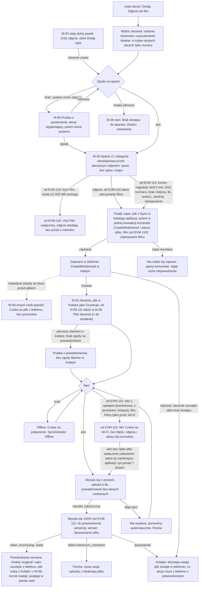

# 09 — Mobile: zdjęcie i film offline → kolejka → upload

> Dokument żywy (EVM-004) · przepływ AC2 nr 9 · kanał: mobile · ekrany: M-06 (z arkuszem wyboru zlecenia), M-07, M-08, M-08a, M-08b (od EVM-142), M-09 · indeks: [README.md](README.md)
> Źródła: styleguide § 3.12, § 4.7, § 5 (teren, SyncIndicator, stany pliku, „nic nie ginie”); `offline-sync.md` (komenda `CreateMediaAsset`, kolejka, obiekty lokalne oczekujące, „Wymaga uwagi”, punkt 7 — usuwanie lokalnego oryginału); ADR-0007 (w tym ryzyka 4 i 10 — zapis wideo, mało miejsca; komunikat „wysyłanie wstrzymane — otwórz aplikację”), ADR-0009; polityki P2, P3, P5 (bitrate filmu), P7; SR-MOB-02, -05, -06, -08, -12, -13, SR-FILE-08; szczegóły techniczne uploadu w tle — spike EVM-011.

> **Zakres wersji 1 (EVM-108, poprawka 2026-11-15) — czytaj najpierw.** Makieta opisuje cały docelowy przepływ, ale aplikacja w EVM-108 dostarcza tylko **zdjęcia**. Znaczniki w tekście:
> - **[v1]** — wchodzi do EVM-108 (zrealizowane: AC1–AC6);
> - **[od EVM-110]** — film (bez dźwięku i bez mikrofonu, limit 5 min), przełącznik „Zdjęcie / Film”, ustawienie „Filmy tylko przez Wi-Fi”, stan „Czeka na Wi-Fi” (treść zaakceptowana przez Konrada 2026-11-15; zapis w tym dokumencie: 2026-11-15, `ux-designer`). Etap, latarka, podgląd, pauza i usuwanie niewysłanego filmu **nie wchodzą** do EVM-110 (historyjka, „Poza zakresem”);
> - **[od EVM-111]** — ekran „Pliki zlecenia” (M-08, treść zaakceptowana przez Konrada 2026-11-18; zapis w tym dokumencie: 2026-11-18, `ux-designer`): **lista płaska** plików tego zlecenia z tego telefonu, które jeszcze nie dotarły („n do wysłania” / „Wszystko wysłane”), wiersz „Pliki z tego telefonu” w M-03, przyczyny błędów zwykłymi słowami i „Ponów” / „Usuń z telefonu”; **wpis o pliku znika z telefonu po potwierdzeniu serwera** — nie ma „Wysłano”, sekcji „Wysłane pliki”, „Wysłano n z m”, retencji ani miniatur (decyzje Konrada 2026-11-15). Galeria zdjęć i filmów zlecenia (miniatury z serwera, przegląd) jest **tylko w panelu web** (W-09);
> - **[propozycja]** — poza wersją 1 i bez AC (latarka); do backlogu, nie element v1.
>
> Decyzje wersji 1 (Konrad, 2026-11-15): **bez opisu zdjęcia** (RR-96 — medium z telefonu nie ma jak być poprawione z panelu, a opis mógłby zawierać dane osobowe), **bez etapu** (`procedureStageId` poza zakresem), **bez podglądu i odrzucania ujęcia**, **bez usuwania niewysłanego zdjęcia** (jedyna akcja usuwania: „Usuń z telefonu” dla „Wymaga uwagi”), wybór zlecenia w trybie ukrytych danych po numerach. Wejścia do aparatu: stały dolny pasek szczegółów zlecenia i arkusz „Dodaj” → „Zdjęcie lub film” → wybór zlecenia → aparat; **BottomNav nie ma pozycji „Dodaj”** (odstępstwo od § 3.18, kontynuacja EVM-009 — [styleguide § 8](../styleguide.md#8-changelog)); arkusz „Dodaj” otwiera przycisk „Dodaj” na liście zleceń. Etykiety stanu pliku w aplikacji: „Oczekuje” i „Wysyła się 45%” zamiast „W kolejce” i „Wysyłanie 45%” z § 5.4 (spójność z Kolejką EVM-009; to samo odstępstwo). Makiety poniżej, które pokazują BottomNav z „Dodaj” albo etykiety „W kolejce” / „Wysyłanie”, czytaj z tym zastrzeżeniem.

## Przepływ


## M-06 Aparat
- **Cel:** zrobić serię zdjęć do zlecenia w garażu bez zasięgu, w rękawicach, jedną ręką — z kategorią wybraną przed spustem i pewnością, że nic nie zginie. Film bez dźwięku, do 5 min [od EVM-110].
- **Główna akcja:** spust (`size.touch-target.shutter`).
- **Hierarchia treści [v1]:** 1) podgląd z aparatu; 2) górny pasek: zamknij, numer zlecenia (w trybie ukrytych danych: „Aparat”), SyncIndicator; 3) podpowiedź „Wybierz kategorię przed zdjęciem.” (tylko gdy kategorii nie wybrano), ewentualny alert (mało miejsca, błąd zapisu) i 7 chipów kategorii; 4) rząd sterowania: licznik serii „n zdjęć” · spust · „Gotowe”. Bez etapu, opisu, latarki, przełącznika „Zdjęcie / Film”, podglądu i odrzucania ujęcia. **[od EVM-110]** między chipami kategorii a rzędem sterowania dochodzi przełącznik „Tryb” („Zdjęcie” / „Film”), w trybie Film znacznik „Film bez dźwięku”, a w trakcie nagrania licznik „0:42 / 5:00” nad spustem (wariant poniżej).
- **Wejścia [v1]:** (a) stały dolny pasek szczegółów zlecenia (M-03): „Zrób zdjęcie” — główna akcja, `size.touch-target.field`, oraz „Dodaj wpis” — Button tertiary, drugorzędna; (b) lista zleceń → „Dodaj” → arkusz „Dodaj” → „Zdjęcie lub film” → wybór zlecenia → aparat (przełącznika „Zdjęcie / Film” w wersji 1 nie ma). Aparat zawsze otwiera się dla konkretnego zlecenia; „Gotowe”, ✕ i systemowe „wstecz” wracają do zlecenia (nie do Kolejki) i czekają na zapis w toku.

**Makieta [v1] (compact, ekran aparatu — CameraScreen, § 3.24)**
```text
┌──────────────────────────────────┐
│ ✕  ZL-2026-0042    ⟨Offline · 5⟩ │ color.bg.brand-strong; tryb ukrytych danych: „Aparat”
│                                  │
│                                  │
│      (podgląd z aparatu —        │
│       pełny ekran)               │
│                                  │
│                                  │
│      ┃ Zapisano w telefonie      │ ← toast po każdym trwale zapisanym ujęciu
├──────────────────────────────────┤
│ Wybierz kategorię przed zdjęciem.│ ← tylko do pierwszego wyboru; spust zablokowany
│ {Oględziny} {Stan przed pracami} │
│ {✓ W trakcie prac} {Po zakończeniu}│ 7 chipów kategorii (przewijane poziomo)
│ {Usterka / problem} {Pomiary} {Inne}│
│                                  │
│ 3 zdjęcia      ( ◉ )     [Gotowe]│ licznik · spust · size.touch-target.field
└──────────────────────────────────┘
 Pierwsze ujęcie w zleceniu wymaga wyboru kategorii (spust nieaktywny: obrys przerywany, ikona
 wyszarzona, powód widoczny tekstem i w opisie dostępności); kolejne ujęcia używają ostatnio
 wybranej, którą można zmienić w dowolnej chwili. Alert „Mało miejsca w telefonie: 1,2 GB.”
 (warning) albo błędu zapisu (error) stoi nad chipami (InlineAlert § 3.19).
 Poza wersją 1 (nie wprowadzać bez nowej decyzji): wiersz „Etap: …”, opis zdjęcia, latarka
 [propozycja do backlogu], podgląd i odrzucanie ujęcia. Przełącznik „Zdjęcie / Film” — od EVM-110
 (wariant niżej); etapu, opisu, latarki, podglądu i pauzy nie wprowadza także EVM-110.
```

**Wariant [od EVM-110] — tryb Film (EVM-110 AC1–AC3, AC6; bez dźwięku, bez mikrofonu, bez etapu, opisu, latarki, podglądu i pauzy)**
```text
┌──────────────────────────────────┐
│ ✕  ZL-2026-0042    ⟨Offline · 5⟩ │
│      (podgląd z aparatu)         │
│      ‹volume-off› Film bez dźwięku│ ← znacznik tylko w trybie Film
├──────────────────────────────────┤
│ {Oględziny} {Stan przed pracami} │
│ {✓ W trakcie prac} {Po zakończeniu}│ 7 chipów kategorii (wspólne dla obu trybów)
│ {Usterka / problem} {Pomiary} {Inne}│
│ Tryb: {Zdjęcie} {✓ Film}        │ grupa radio „Tryb”; po każdym otwarciu aparatu „Zdjęcie”
│                                  │
│ 3 zdjęcia      ( ■ )     [Gotowe]│ spust ‹circle› → ‹square› w trakcie nagrania
└──────────────────────────────────┘
 Nagrywanie: nad spustem licznik „0:42 / 5:00” (`text.numeric`, rola `timer`), spust
 ‹square› z nazwą „Zatrzymaj nagrywanie”; wnętrze color.action.danger.bg tylko jako sygnał
 dodatkowy (§ 3.24 — stan nie opiera się na kolorze). W trakcie nagrania chipy kategorii i
 przełącznik „Tryb” są wyłączone (obrys przerywany, bez zmiany wyboru); „Gotowe” zatrzymuje
 nagranie i zapisuje je. Licznik serii pokazuje „n filmów” wg odmiany § 6.3 po zapisie.
 Minutę przed końcem (od 4:00) na podglądzie, pod licznikiem (nie w panelu — panel ma stałą
 wysokość w czasie nagrania, spust się nie przesuwa), InlineAlert ostrzegawczy z ikoną
 `triangle-alert` (`color.feedback.warning.*`): „Za minutę koniec nagrania (limit 5 minut).”
 (tekst zatwierdzony w przeglądzie EVM-110). Licznik i „Film bez dźwięku” na podglądzie mają
 tło `color.bg.inverse`. Tryb Film bez wybranej kategorii: „Wybierz kategorię przed nagraniem.”
 (zatwierdzone; tryb Zdjęcie: „Wybierz kategorię przed zdjęciem.”). Wyłączone chipy na
 ciemnym panelu: tekst `color.text.on-brand`, obrys przerywany (§ 3.24).
 Rola `timer` licznika: ogłoszenia dla czytnika tylko na starcie („Nagrywanie rozpoczęte”),
 minutę przed końcem i po zatrzymaniu — bez ogłaszania każdej sekundy.

 Po zatrzymaniu filmu — „Zapisywanie filmu…” (do końca trwałego zapisu):
 │      Zapisywanie filmu…          │ ← na podglądzie, ogłaszane
 │ 3 zdjęcia      ( ◉ )     [Gotowe]│ spust nieaktywny
 │        [‹loader-circle› Gotowe]  │ „Gotowe” w stanie ładowania (§ 3.1)

 Za mało miejsca na film (mniej niż 200 MB wolnego przed startem) — zdjęcia działają:
 │ Tryb: {Zdjęcie}  {‹hard-drive› Film} (wyłączony) │
 │ Za mało miejsca na film. Zwolnij miejsce w telefonie. │ widoczny tekst pod przełącznikiem
 Brak przycisku akcji (nie ma ustawień „miejsca” do otwarcia); zdjęcia wg progów EVM-108
 (ostrzeżenie „Mało miejsca w telefonie: 1,2 GB.” poniżej 2 GB bez zmian).
```
Aplikacja **nie prosi o mikrofon** — ani ekranem wyjaśniającym, ani monitem systemu (decyzja 6; `mute` zawsze włączone, allowlista uprawnień = `CAMERA`).

**Ekran zgody na aparat [v1]** (pierwsze otwarcie aparatu, przed monitem systemu; EmptyState blokujący § 3.15.1 na jasnym tle `color.bg.canvas`, z ikoną `camera`)
```text
 │                ‹camera›                    │
 │ Aparat do zdjęć z prac                     │
 │ Zdjęcia zapisujemy tylko w aplikacji:      │
 │ bez zapisu w galerii, bez lokalizacji.     │
 │ [[ Zezwól na dostęp do aparatu ]]          │ → monit systemu
 │ [Nie teraz]                                │ → powrót do zlecenia, kolejka bez zmian
 Po odmowie — ten sam ekran. Trwała odmowa (po powrocie z ustawień ze zgodą aparat startuje sam):
 │                ‹camera›                    │
 │ Brak dostępu do aparatu. Zezwól aplikacji  │
 │ na używanie aparatu w ustawieniach telefonu.│
 │ [[ Otwórz ustawienia ]]                    │
 │ [Nie teraz]                                │
 Aplikacja nie prosi o żadne inne uprawnienie (mikrofon, lokalizacja, pamięć i galeria — nigdy; filmy nagrywamy bez dźwięku).
```

**Wybór zlecenia [v1]** (arkusz „Dodaj” → „Zdjęcie lub film”; w aplikacji AlertDialog `§ 3.13` ze wspólną listą wyboru zlecenia z formularza wpisu EVM-105 — nie BottomSheet, bez klienta i adresu)
```text
 │ Do którego zlecenia?                        │
 │ Szukaj zlecenia                             │ pole z placeholderem „Szukaj: numer lub tytuł”
 │ [ Szukaj: numer lub tytuł            ✕ ]    │
 │ Ostatnio otwierane                          │ zlecenia otwarte w tej sesji aplikacji (pamięć procesu)
 │ ZL-2026-0042 · Garaż — pełny proces         │ numer + tytuł (wyszukiwanie po numerze i tytule;
 │ ZL-2026-0043 · Dom — sam montaż             │  nie po adresie i nazwisku)
 │ Zlecenia                                    │ reszta zleceń z telefonu (do 20), po wpisaniu frazy —
 │ …                                           │  tylko pasujące
 │ [Anuluj]                                    │
 Brak wyników: „Brak zleceń pasujących do wyszukiwania.”
 Tryb ukrytych danych (§ 4.18): nad polem „Dane zleceń są ukryte”, placeholder „Szukaj: numer”,
 lista z samych numerów („ZL-2026-0042”), wyszukiwanie wyłącznie po numerze; tytuł nie opuszcza
 warstwy danych.
```

**Stany**
| Stan | Zachowanie |
|---|---|
| Pusty | [v1] Pierwsze ujęcie w zleceniu: widoczna podpowiedź nad chipami „Wybierz kategorię przed zdjęciem.” (także w opisie dostępności spustu), spust zablokowany do wyboru kategorii. Kolejne ujęcia w serii używają ostatnio wybranej kategorii (zmiana dotknięciem chipa w dowolnej chwili); domyślnej kategorii „z poprzedniego razu” nie ma — każde otwarcie aparatu zaczyna od wyboru. [od EVM-110] Tryb „Zdjęcie” jest zaznaczony przy każdym otwarciu (bez zapamiętywania wyboru); kategoria jest wspólna dla obu trybów. |
| Ładowanie | [v1] Uruchamianie aparatu — czarny podgląd z tekstem „Uruchamianie aparatu…” (bez spinnera); spust nieaktywny do gotowości. Przy pierwszym odczycie zgody ten sam tekst na ciemnym tle. [od EVM-110] Zapis filmu po zatrzymaniu — „Zapisywanie filmu…” (tabela „Zapis i nagrywanie”); [od EVM-110] w trybie Film ten sam „Uruchamianie aparatu…” do gotowości, spust nieaktywny. |
| Błąd | [v1] Aparat zajęty / błąd systemu: AppBar i EmptyState na jasnym tle „Nie udało się uruchomić aparatu.” z [Spróbuj ponownie] (`size.touch-target.field`). Nieudany zapis, mało miejsca i brak miejsca — InlineAlert nad chipami, tabela „Zapis i nagrywanie” niżej (nigdy ciche niepowodzenie); licznik i kolejka nietknięte. [od EVM-110] Film: nieudany zapis, limity, brak miejsca, przerwane nagranie i przerwane poprzednie nagranie — tabela „Zapis i nagrywanie”; w każdym przypadku błędu kolejka i licznik nietknięte, bez niepełnego pliku i bez wpisu bez pliku. |
| Offline | [v1] Normalna praca — każde ujęcie od razu w telefonie i w kolejce; kapsuła „Offline · n” w górnym pasku, **bez banera offline** (nie zasłaniamy podglądu — wyjątek § 5.4). [od EVM-110] Nagrywanie filmu działa offline tak samo, bez banera. |
| Brak uprawnień | [v1] Ekran zgody na aparat i trwała odmowa (wyżej, tabela „Uprawnienia systemowe”): wyjaśnienie w momencie użycia; [Nie teraz] wraca do zlecenia bez zmian w kolejce. Aplikacja **nie prosi o lokalizację, mikrofon ani pamięć** (także po EVM-110 — filmy bez dźwięku) i nie pokazuje wskaźnika lokalizacji (P3). Tylko odczyt — brak dostępu do aplikacji (M-02), niezalogowany — ekran logowania. Tryb ukrytych danych (§ 4.18) — aparat działa; górny pasek pokazuje „Aparat” (bez numeru), wybór zlecenia — tylko numery; dolny pasek zlecenia ma aktywne „Zrób zdjęcie”, a „Dodaj wpis” wyłączone z powodem „Dane zleceń są ukryte” (bez numeru w pasku). Blokada aplikacji (aparat pod blokadą, kamera zwolniona w tle) i wymuszone czyszczenie danych firmowych — jak reszta aplikacji (usuwa też pliki kolejki). [od EVM-110] Administrator i Edytor nagrywają; w trybie ukrytych danych nagrywanie działa, a wiersze filmów w Kolejce nie pokazują numeru zlecenia; wymuszone czyszczenie danych firmowe i wylogowanie najpierw zatrzymują trwające nagranie, potem czyszczą (pliki filmów usuwa EVM-130 AC5). Brak zgody na aparat — jak dla zdjęć (ekran zgody). |

**Zapis i nagrywanie („nic nie ginie”, styleguide § 5.4)**
| Sytuacja | Zachowanie |
|---|---|
| Potwierdzenie zapisu [v1: zdjęcie; film od EVM-110] | Toast „Zapisano w telefonie” i ogłoszenie („Zapisano zdjęcie 3”) pokazujemy **dopiero po trwałym zapisie**: najpierw plik trafia na dysk w prywatnym katalogu kolejki aplikacji pod nazwą UUID (z wymuszeniem zapisu — `fsync`; nigdy galeria, pamięć zewnętrzna ani lokalizacja w EXIF), a **dopiero potem komenda `CreateMediaAsset` i wiersz pliku (kategoria, czas wykonania) są zatwierdzone w jednej transakcji** zaszyfrowanej bazy lokalnej. Plik i baza to dwa zasoby, więc przy niepowodzeniu transakcji plik jest sprzątany, a po zabiciu procesu w tym oknie porządkuje go odśmiecacz — technik nie dostał jeszcze potwierdzenia, więc nic „nie ginie” po fakcie. Komenda: `id` UUIDv7, `workOrderId`, `mediaType = photo`, `category`, `capturedAt`; **bez** opisu i etapu, bez nazwy klienta i adresu. Licznik serii rośnie dopiero po potwierdzeniu; jedno ujęcie w zapisie naraz, „Gotowe” czeka na zapis w toku. Sumę SHA-256 liczymy po zapisie pliku, a przed zapisem komendy i wiersza (wiersz pliku ją zawiera), więc dla zdjęcia wydłuża potwierdzenie o ułamek sekundy. |
| [od EVM-110] Zapisywanie filmu… | Po zatrzymaniu nagrania (spust, „Gotowe”, ✕, systemowe „wstecz”, limit) — napis „Zapisywanie filmu…” na podglądzie (ogłaszany), spust nieaktywny, „Gotowe” w stanie ładowania (§ 3.1); aparat zamyka się dopiero po zakończeniu zapisu. Potem Toast „Zapisano film w telefonie” (z ogłoszeniem dla czytnika ekranu; w jednej transakcji plik MP4 przeniesiony do katalogu kolejki i komenda `CreateMediaAsset` z 5 kluczami: `id`, `workOrderId`, `mediaType = video`, `category`, `capturedAt` — bez opisu i etapu; film nie trafia do galerii, plik bez dźwięku i bez lokalizacji). |
| [od EVM-110] Nagrywanie przerwane przez technika albo system | Utrata pierwszego planu (połączenie, Home, blokada ekranu), ✕, systemowe „wstecz” i gest cofania, wylogowanie, „Zablokuj i wyczyść” — aplikacja **jawnie zatrzymuje nagranie i zapisuje poprawny plik** jak zwykły film, bez dialogu; komunikat Toast „Nagrywanie przerwane — zapisano 2:13 filmu.” (czas = faktyczna długość). Wylogowanie i czyszczenie danych najpierw zatrzymują nagranie, potem czyszczą. Ekran nie wygasa w czasie nagrywania. Usuwania niewysłanego filmu nie ma (poza zakresem EVM-110). |
| [od EVM-110] Zabicie procesu w trakcie nagrania (wymuszone zamknięcie, bateria) | Plik jest nieodtwarzalny i nie trafia do Kolejki — nigdy nie ma w niej wiersza uszkodzonego filmu; usuwa go odśmiecacz. Po następnym uruchomieniu **jednorazowo** Banner (§ 3.19, `color.feedback.info.*`, ikona `info` — nie domyślna `wifi-off`, która sugeruje brak sieci): „Poprzednie nagranie zostało przerwane i nie zostało zapisane.” z akcją „Zamknij”. |
| Nie udało się zapisać | [v1] Błąd zapisu zdjęcia: InlineAlert (§ 3.19, `color.feedback.error.*`) „Nie udało się zapisać zdjęcia. Zrób je ponownie.” — nigdy ciche niepowodzenie; kolejka, licznik i baza nienaruszone, bez niepełnego pliku i bez wpisu bez pliku. [od EVM-110] Film: InlineAlert błędu „Nie udało się zapisać filmu. Nagraj go ponownie.” — te same gwarancje (kolejka i licznik nietknięte, bez niepełnego pliku i bez wpisu bez pliku). |
| Mało miejsca — ostrzeżenie | [v1] InlineAlert (§ 3.19, `color.feedback.warning.*`) „Mało miejsca w telefonie: 1,2 GB.” (wartość rzeczywista); ostrzeżenie poniżej 2 GB, blokada zdjęcia poniżej 100 MB — progi robocze Tech Leada, jedna stała do korekty po teście terenowym EVM-112. Dopisku o czasie filmu nie ma — przy filmie liczy się próg 200 MB poniżej. |
| [od EVM-110] Za mało miejsca na film | Przed startem wolne miejsce poniżej 200 MB (próg blokady 100 MB + zapas 50 MB + ok. minuta filmu): chip „Film” wyłączony (wariant na ciemnym tle, § 3.24; ikona `hard-drive`) z widocznym tekstem pod przełącznikiem „Za mało miejsca na film. Zwolnij miejsce w telefonie.”; zdjęcia działają wg progów EVM-108; kolejka i baza nienaruszone (ADR-0007, ryzyko 10). |
| [od EVM-110] Miejsce kończy się w trakcie nagrania | Wolne miejsce spada poniżej 100 MB: nagranie kończy się samo i zapisuje się z komunikatem „Brak miejsca — nagranie zatrzymano i zapisano.” (Toast po zapisie; InlineAlert ostrzegawczy nie jest potrzebny). Licznik pokazuje zawsze „/ 5:00” — limit z miejsca nie skraca wyświetlanego limitu. |
| Brak miejsca na zdjęcie | [v1] Poniżej rezerwy na plik, bazę i kolejkę (100 MB — stała robocza, patrz wyżej): InlineAlert błędu „Brak miejsca — zdjęcie nie zostało zapisane. Zwolnij miejsce w telefonie.” Nic nie powstaje (ani plik, ani wpis), licznik bez zmian (nigdy ciche niepowodzenie). |
| [od EVM-110] Maksymalna długość filmu | 5 min — nagranie kończy się samo, film zapisuje się normalnie z komunikatem „Osiągnięto limit 5 minut — film zapisano.” Minutę wcześniej ostrzeżenie z ikoną (wariant wyżej). |
| [od EVM-110] Limit rozmiaru (bezpiecznik) | Mniejsza z wartości: 500 000 000 B i wolne miejsce − 150 MB (liczone przy starcie) — nagranie kończy się samo i zapisuje z komunikatem „Osiągnięto limit rozmiaru — film zapisano.” Film z telefonu zawsze mieści się poniżej progu skanu antywirusowego (2 000 000 000 B). |

Wartości dla filmu (EVM-110, decyzje Konrada 2026-11-15): 720p, 5 Mb/s, ok. 37,5 MB na minutę, **limit 5 min** (największy film ok. 190 MB), blokada filmu poniżej 200 MB wolnego miejsca; w opisie dla technika (M-09) zaokrąglamy do ok. 40 MB na minutę. Progi miejsca dla zdjęć (2 GB / 100 MB) bez zmian.

**Uprawnienia systemowe** (o każde pytamy w momencie użycia, najpierw ekran wyjaśniający, potem monit systemu)
| Uprawnienie | Kiedy pytamy | Odmowa — system może zapytać ponownie | Trwała odmowa (Android — zwykle po dwóch odmowach monit się nie pojawia) |
|---|---|---|---|
| Aparat [v1] | Pierwsze otwarcie aparatu: EmptyState „Aparat do zdjęć z prac” z informacją „bez zapisu w galerii, bez lokalizacji” [[Zezwól na dostęp do aparatu]] → monit systemu; [Nie teraz] → powrót do zlecenia (M-03), bez zmian w kolejce | ten sam ekran wyjaśniający | EmptyState „Brak dostępu do aparatu. Zezwól aplikacji na używanie aparatu w ustawieniach telefonu.” [[Otwórz ustawienia]]; po powrocie z ustawień ze zgodą aparat startuje bez ponownego wejścia |
| Powiadomienia (Android 13+) | [v1] Po pierwszym „Gotowe” z elementem w kolejce — arkusz „Powiadomienia o wysyłaniu” po wyjściu z aparatu (raz na uruchomienie aplikacji; odmowa nie blokuje pracy), potem Banner w M-07 | Banner w Kolejce „Powiadomienia wyłączone…” [Włącz powiadomienia] → monit systemu | ten sam Banner, [Włącz powiadomienia] → ustawienia powiadomień aplikacji |
| Mikrofon, lokalizacja, galeria, kontakty, pliki poza aplikacją | nigdy (P3, P7; mikrofon — decyzja 6, filmy bez dźwięku, `mute` zawsze włączone; allowlista uprawnień = `CAMERA`) | — | — |

**Role**
| Akcja | Komenda (`offline-sync.md`) | A | E | R |
|---|---|---|---|---|
| Zdjęcie [v1] / film [od EVM-110] | `CreateMediaAsset` (`id`, `workOrderId`, `mediaType = photo` albo `video`, `category`, `capturedAt` — bez `description` i `procedureStageId`) + sesja uploadu (ADR-0009) | tak | tak | brak dostępu (M-02, `403 channel_not_allowed`) |
| Wybór zlecenia | lokalna baza (zakres urządzenia) i szybkie zlecenia oczekujące | tak | tak | — |

- **Responsywność:** orientacja pionowa i pozioma (WCAG 1.3.4) — w poziomej panel sterowania po prawej (spust w zasięgu kciuka), chipy pionowo; układ 360 dp i poziomy sprawdza test terenowy EVM-112 (kryterium `manual`); tryb „Leworęczny” (M-09) odwraca strony elementów rzędu sterowania (§ 5.2) — nie należy do EVM-108.
- **Komponenty i tokeny [v1]:** CameraScreen (§ 3.24) z panelem aparatu: chipy 7 kategorii (FilterChip na ciemnym tle, grupa radio „Kategoria”, `size.touch-target.min`, `space.inline.sm`), spust `size.touch-target.shutter` (obrys `color.border.inverse` `border-width.indicator`, ikona `circle`), licznik serii `text.body` `color.text.on-brand`, „Gotowe” Button primary `size.touch-target.field` z obrysem `color.border.inverse`; podpowiedź kategorii `text.body` `color.text.on-brand` (tekst, nie Banner); InlineAlert (§ 3.19) `color.feedback.warning.*` / `color.feedback.error.*` nad chipami; Toast (§ 3.14); AppBar + SyncIndicator (§ 3.18, § 5.4); EmptyState blokujący (§ 3.15.1) na jasnym tle — ekran zgody, trwała odmowa i błąd uruchomienia aparatu; AlertDialog (§ 3.13) — wybór zlecenia (lista wspólna z EVM-105), TextField z czyszczeniem (§ 3.2); BottomBar — stały dolny pasek szczegółów zlecenia (Button primary `size.touch-target.field` + Button tertiary „Dodaj wpis”, `elevation.bottom-bar`); BottomSheet (§ 3.13) — „Powiadomienia o wysyłaniu”; tryb ukrytych danych (§ 4.18). Latarki, etapu i przełącznika „Zdjęcie / Film” w v1 nie ma.
- **Komponenty i tokeny [od EVM-110 — tylko istniejące, bez nowych komponentów i tokenów]:** wszystko z zestawu v1 oraz: FilterChip (§ 3.7) w wariancie na ciemnym tle (§ 3.24) jako **grupa radio „Tryb”** („Zdjęcie” / „Film”; `size.touch-target.min`, `space.inline.sm`, `text.label-lg`), pod chipami kategorii; znacznik „Film bez dźwięku” — ikona `volume-off` `size.icon.md` `color.icon.inverse` + tekst `text.body` `color.text.on-brand` na podglądzie (nad panelem, tylko w trybie Film); spust `size.touch-target.shutter` (ikona `circle` → `square`, wnętrze `color.action.danger.bg` w trakcie nagrania jako sygnał dodatkowy); licznik nagrania „0:42 / 5:00” — `text.numeric` `color.text.on-brand`, rola `timer`; ostrzeżenie minutę przed końcem — InlineAlert (§ 3.19) `color.feedback.warning.*` z ikoną `triangle-alert`; chipy kategorii i „Tryb” w trakcie nagrania wyłączone (obrys przerywany `color.border.inverse`); chip „Film” wyłączony przy < 200 MB — ikona `hard-drive`, tekst powodu `text.body` `color.text.on-brand` (bez przycisku akcji); „Gotowe” w stanie ładowania podczas „Zapisywanie filmu…” (§ 3.1, ikona `loader-circle`); Toast (§ 3.14) — wszystkie komunikaty zapisu i limitów; Banner (§ 3.19) `color.feedback.info.*` — jednorazowe „Poprzednie nagranie zostało przerwane i nie zostało zapisane.”; InlineAlert `color.feedback.error.*` — nieudany zapis filmu.
- **Mikrocopy [v1]:** kategorie: „Oględziny”, „Stan przed pracami”, „W trakcie prac”, „Po zakończeniu”, „Usterka / problem”, „Pomiary”, „Inne” (`service-catalog.md` § 7) · „Wybierz kategorię przed zdjęciem.” · „Zrób zdjęcie” · „Dodaj wpis” · „Aparat” (górny pasek w trybie ukrytych danych) · „Zapisano w telefonie” · „n zdjęcie / zdjęcia / zdjęć” (§ 6.3) · „Gotowe” · „Uruchamianie aparatu…” · „Nie udało się uruchomić aparatu.” · „Spróbuj ponownie” · „Mało miejsca w telefonie: 1,2 GB.” · „Brak miejsca — zdjęcie nie zostało zapisane. Zwolnij miejsce w telefonie.” · „Nie udało się zapisać zdjęcia. Zrób je ponownie.” · „Aparat do zdjęć z prac” · „Zdjęcia zapisujemy tylko w aplikacji: bez zapisu w galerii, bez lokalizacji.” · „Zezwól na dostęp do aparatu” · „Nie teraz” · „Brak dostępu do aparatu. Zezwól aplikacji na używanie aparatu w ustawieniach telefonu.” · „Otwórz ustawienia” · „Do którego zlecenia?” · „Szukaj zlecenia” · „Szukaj: numer lub tytuł” · „Szukaj: numer” · „Ostatnio otwierane” · „Brak zleceń pasujących do wyszukiwania.” · „Zdjęcie lub film” (pozycja arkusza „Dodaj”).
- **Mikrocopy [dodatkowo od EVM-110 — film]:** „Tryb” (etykieta grupy radio) · „Zdjęcie” / „Film” (chipy) · „Film bez dźwięku” · „0:42 / 5:00” (licznik) · „Rozpocznij nagrywanie” / „Zatrzymaj nagrywanie” (nazwy spustu) · „Zapisywanie filmu…” · „Zapisano film w telefonie” · „Osiągnięto limit 5 minut — film zapisano.” · „Osiągnięto limit rozmiaru — film zapisano.” · „Brak miejsca — nagranie zatrzymano i zapisano.” · „Nie udało się zapisać filmu. Nagraj go ponownie.” · „Nagrywanie przerwane — zapisano 2:13 filmu.” · „Poprzednie nagranie zostało przerwane i nie zostało zapisane.” · „Za mało miejsca na film. Zwolnij miejsce w telefonie.” · ostrzeżenie minutę przed końcem (propozycja treści, historyjka podaje tylko ikonę): „Za minutę koniec nagrania (limit 5 minut).” · licznik serii „1 film / 2 filmy / 5 filmów” (§ 6.3). Usunięte z makiety: „Mikrofon do filmów”, „Zezwól na mikrofon”, „Film wymaga dostępu do mikrofonu.”, „Etap: …”, limit 30 min, „Film zapisany (…)”.
- **Dostępność [v1]:** spust z nazwą „Zrób zdjęcie” i podpowiedzią: przy braku kategorii „Wybierz kategorię przed zdjęciem.”, inaczej „Zapisuje zdjęcie w telefonie, bez galerii i lokalizacji.”; stan zablokowanego spustu niesie obrys przerywany, szara ikona i widoczny tekst — nie sam kolor; zapis ogłaszany po trwałym zapisie („Zapisano zdjęcie 3”); chipy to grupa radio „Kategoria” (wybór dotknięciem, bez gestów); „Zamknij” z nazwą „Zamknij aparat i wróć do zlecenia”, „Gotowe” — „Gotowe, wróć do zlecenia”; kapsuła „Offline · n” ma nazwę dostępną z liczbą niewysłanych (baner offline nie pojawia się nad podglądem — § 5.4); przycisk „Dodaj wpis” wyłączony w trybie ukrytych danych ma nazwę „Dodaj wpis. Dane zleceń są ukryte.”; wybór zlecenia w trybie ukrytych danych nie czyta tytułów (nie ma ich w drzewie renderu); cele ≥ 48 dp, kontrast panelu ≥ 3:1 (`color.border.inverse`, `color.text.on-brand`).
- **Dostępność [dodatkowo od EVM-110 — film]:** przełącznik „Tryb” to grupa radio z etykietą „Tryb” (wybór dotknięciem, bez gestów); spust z nazwą „Zrób zdjęcie” / „Rozpocznij nagrywanie” / „Zatrzymaj nagrywanie”; stan nagrywania niosą ikona `square`, licznik i nazwa — nie kolor; licznik z rolą `timer`, ogłoszenia **tylko** na starcie, minutę przed końcem i po zatrzymaniu (bez ogłaszania każdej sekundy); zapis ogłaszany dopiero po trwałym zapisie („Zapisywanie filmu…”, „Zapisano film w telefonie”, komunikaty limitów jako Toast z ogłoszeniem); chip „Film” wyłączony ma nazwę dostępną z powodem („Film, niedostępny — za mało miejsca na film”), a powód jest też widocznym tekstem (nie tylko podpowiedź — rękawice, § 5.1); w trakcie nagrania chipy kategorii i „Tryb” wyłączone z nazwą „…, niedostępne podczas nagrywania”; znacznik „Film bez dźwięku” czytany jako zwykły tekst; cele ≥ 48 dp; przy 200% czcionki panel zawija chipy i nic nie jest ucinane; kontrast elementów panelu ≥ 3:1 (`color.border.inverse`, `color.text.on-brand` — § 2.1.4); bez błysków poza lampą aparatu.

## M-07 Kolejka
- **Cel:** w każdej chwili wiedzieć, co jest niewysłane, dlaczego, i móc to wysłać — „nic nie ginie”.
- **Zakres [v1]:** pliki (zdjęcia) jako wiersze z licznikiem „n do wysłania”, „Usuń z telefonu” dla „Wymaga uwagi” (nowe w EVM-108) oraz to, co już działa z EVM-009 i EVM-130 (wpisy, „Wymaga uwagi” dla wpisów, Banner powiadomień, „Ponów” plików). Całość poniżej poza „Plik w Kolejce — minimum” to układ docelowy [od EVM-111 / EVM-110].
- **Główna akcja:** zależna od sekcji — „Ponów wszystkie” (Błąd), „Dodaj do innego zlecenia” (Wymaga uwagi); **[od EVM-110] „Czeka na Wi-Fi” nie ma akcji** — „Wyślij teraz przez sieć komórkową” nie wchodzi do zakresu (wystarczy wyłączyć ustawienie „Filmy tylko przez Wi-Fi”; link „Zmień ustawienie” w banerze zbiorczym prowadzi do M-09).
- **Hierarchia treści:** 1) podsumowanie „3 do wysłania” (**od EVM-111** bez paska postępu i bez „Wysłano n z m” — wpisy o wysłanych plikach znikają z telefonu po potwierdzeniu serwera; stan przesyłania w kapsule § 4.7, widoczny także wtedy, gdy kapsuła pokazuje „Wymaga uwagi”); 2) Banner „Powiadomienia wyłączone” (tylko bez zgody na powiadomienia i przy niewysłanych elementach); 3) **[od EVM-110] Banner zbiorczy „n filmów czeka na Wi-Fi…”** (tylko gdy są takie filmy); 4) **Wymaga uwagi** (§ 4.16); 5) Błąd; 6) Czeka na Wi-Fi; 7) Wysyłanie; 8) W kolejce. **Od EVM-111 nie ma sekcji „Wysłane pliki” ani „Wysłane dziś”** — plik potwierdzony przez serwer znika z Kolejki; historię wysłanych zdjęć i filmów zobaczy technik w panelu biura.

**Plik w Kolejce — minimum [v1]** (EVM-108 AC6; wiersz wspólnego komponentu listy plików, który EVM-111 użyje ponownie w „Pliki zlecenia”)
```text
 Kolejka                       ⟨Offline · 3⟩
 3 do wysłania                                ← nagłówek: licznik plików niewysłanych

 Plik wymaga uwagi                            ← sekcja nad pozostałymi (§ 4.16)
 ┃ Po zakończeniu                             ← kategoria (pierwszy wiersz, text.label-lg)
 ┃ 15.11.2026, 14:05 · Zdjęcie                ← czas wykonania · typ (text.body-sm)
 ┃ ‹triangle-alert› Wymaga uwagi              ← etykieta stanu: ikona + tekst
 ┃ Plik został zatrzymany po sprawdzeniu.     ← powód zwykłymi słowami
 ┃ Skontaktuj się z biurem.
 ┃ [Usuń z telefonu]                          ← Button danger-tertiary; dialog potwierdzenia

 Pliki
 W trakcie prac
 15.11.2026, 14:03 · Zdjęcie
 ‹cloud-upload› Wysyła się 45%  ████░░░░     ← etykieta + ProgressBar
 Oględziny
 15.11.2026, 14:01 · Zdjęcie
 ‹clock› Oczekuje
 Bez kategorii                                ← plik bez kategorii albo z nieznanym kodem
 15.11.2026, 13:50 · Zdjęcie
 ‹clock› Oczekuje

 (od EVM-111 nie ma sekcji „Wysłane pliki” — wpis znika po potwierdzeniu serwera)

 [od EVM-110] Film i baner zbiorczy (wspólny wiersz pliku EVM-108; ikona typu `video`, czas trwania i rozmiar):
 ┌──────────────────────────────────────────────┐
 │ ‹wifi› 2 filmy czekają na Wi-Fi. Zdjęcia i    │ Banner zbiorczy § 3.19,
 │ wpisy wysyłamy normalnie. [Zmień ustawienie]  │ `color.sync.waiting-wifi.*`
 └──────────────────────────────────────────────┘
 Pliki
 W trakcie prac                                     ← kategoria (pierwszy wiersz)
 15.11.2026, 14:12 · ‹video› Film · 2:13 · 78 MB    ← czas wykonania · typ, czas trwania, rozmiar
 ‹wifi› Czeka na Wi-Fi od 2 dni                     ← do 1 doby bez wieku: „Czeka na Wi-Fi”
 Oględziny
 15.11.2026, 13:50 · ‹video› Film · 4:58 · 187 MB
 ‹wifi› Czeka na Wi-Fi

 Dialog „Usuń z telefonu” (§ 4.11 — nieodwracalne):
 │ Usunąć z telefonu?                                    │
 │ Usuniemy ten plik z telefonu. Tego nie da się cofnąć. │
 │ [[ Usuń ]] (danger)   [Anuluj] ← fokus                │
 Stan pusty: istniejący komunikat Kolejki „Nic nie czeka na wysłanie.”.
```
Zasady wiersza pliku [v1]:
- Wiersz pokazuje **kategorię, czas wykonania i typ** oraz **jedną z etykiet**: „Oczekuje”, „Wysyła się 45%” (z paskiem), „Czeka na Wi-Fi” (film, EVM-110), „Nie wysłano — plik uszkodzony w transmisji” (EVM-130), „Wymaga uwagi”. **Nie ma etykiety „Wysłano”** (od EVM-111): wpis potwierdzonego pliku jest usuwany z telefonu. **Od zakończenia transferu do potwierdzenia serwera plik ma etykietę „Wysyła się 100%”** (z pełnym paskiem) — nie „Oczekuje” i nie „Wysłano”: plik jest już w drodze do biura, ale biuro jeszcze go nie potwierdziło; aplikacja sama dopytuje serwer (od razu po transferze, potem co kilkanaście sekund, tylko na pierwszym planie), więc wpis znika bez wychodzenia z aplikacji. Informacja stoi w tekście; ikona i ton `color.sync.*` ją tylko wspierają (§ 5.4). Nazwa dostępna wiersza: „[kategoria], [typ], [czas], [stan]”.
- **Nigdy** nazwa klienta, adres, ścieżka ani nazwa pliku; w trybie ukrytych danych także numer zlecenia (wiersz go nie ma, więc lista wygląda tak samo w obu trybach). Miniatur nie ma [od EVM-111].
- **Akcje „Wymaga uwagi” (decyzja Konrada 2026-11-15):** „Ponów” (EVM-130) zostaje przy plikach, które da się ponowić (np. plik uszkodzony w transmisji — komunikat EVM-130 „Nie wysłano — plik uszkodzony w transmisji”); „Usuń z telefonu” (z potwierdzeniem) mają tylko pliki, których nie da się ponowić: kwarantanna, konflikt identyfikatora, brak oryginału na telefonie. Usuwanie pliku niewysłanego i niewymagającego uwagi — brak (decyzja Konrada).
- Powód „Wymaga uwagi” w v1 to zwykłe słowa (kwarantanna: „Plik został zatrzymany po sprawdzeniu. Skontaktuj się z biurem.”; konflikt: „Plik o tym identyfikatorze jest już w biurze.”; brak oryginału: „Pliku nie ma już na telefonie.”; inny: „Nie udało się wysłać pliku. Spróbuj ponownie.”). Rozwijane „Szczegóły techniczne” z kodem i wiekiem pliku z EVM-130 — [od EVM-111] (przyczyny błędów).
- Odstępstwo od § 5.4: etykiety „Oczekuje” i „Wysyła się 45%” zamiast „W kolejce” i „Wysyłanie 45%” (spójność z Kolejką wpisów EVM-009); wpis w [styleguide § 8](../styleguide.md#8-changelog).

Zasady wiersza filmu i stanu „Czeka na Wi-Fi” [od EVM-110] (AC1, AC4, AC5; ten sam komponent `FileRow` — bez nowego komponentu):
- Typ „Film” z ikoną `video`, **czasem trwania** („2:13”) i **rozmiarem** („78 MB”) w drugim wierszu (`text.body-sm`); nigdy nazwa klienta, adres ani nazwa pliku; w trybie ukrytych danych także bez numeru zlecenia. Nazwa dostępna: „[kategoria], film, [czas trwania], [rozmiar], [czas], [stan]”.
- **„Czeka na Wi-Fi”** — ikona `wifi`, `color.sync.waiting-wifi.*`, etykieta tekstowa; od 1 doby wiek: „Czeka na Wi-Fi od 2 dni” (odmiana: „od 1 dnia”, „od 2–4 dni”, „od 5 dni”; wiek liczony od ostatniej modyfikacji pliku). To **nie jest błąd**: bez „Wymaga uwagi”, bez powiadomienia o błędzie, bez wliczania do „Nie wysłano n plików” (powiadomienie systemowe i kapsuła „Błąd”), bez ostrzeżenia po 5 dniach i bez zmiany po 7 dniach (film wysyła się sam po połączeniu z Wi-Fi; „Ponów” nie jest potrzebne). Bez akcji na wierszu — nie ma „Wyślij teraz przez sieć komórkową” (poza zakresem).
- Wyłączenie ustawienia „Filmy tylko przez Wi-Fi” w M-09 uzbraja czekające filmy ponownie; wiersze przechodzą na „Oczekuje” / „Wysyła się n%”, baner zbiorczy znika.
- **Baner zbiorczy** (Banner § 3.19 z ikoną `wifi` i tonem `color.sync.waiting-wifi.*`, pod podsumowaniem i nad „Wymaga uwagi”): „**n filmów czeka na Wi-Fi.** Zdjęcia i wpisy wysyłamy normalnie.” + link „Zmień ustawienie” (→ M-09 „Wysyłanie”). Polska odmiana (§ 6.3): „1 film czeka na Wi-Fi.” · „2 filmy czekają na Wi-Fi.” (także 3, 4, 22, 23, 24) · „5 filmów czeka na Wi-Fi.” (także 0, 6–21, 25+). Widoczny tylko gdy są filmy w stanie „Czeka na Wi-Fi”; ogłaszany raz przy pojawieniu się i przy zmianie liczby (`aria-live="polite"`, zbiorczo).

**Makieta docelowa (compact) [od EVM-111 i EVM-110; etykiety „W kolejce” / „Wysyłanie” i BottomNav z „Dodaj” czytaj wg zastrzeżenia na początku dokumentu — w aplikacji „Oczekuje” / „Wysyła się”, BottomNav bez „Dodaj”]**
```text
┌──────────────────────────────────┐
│ Kolejka      ⟨Wymaga uwagi · 1⟩  │ § 4.16
├──────────────────────────────────┤
│ 5 do wysłania                    │ ← od EVM-111: bez paska, bez „Wysłano n z m”
│                                  │
│ Wymaga uwagi (1)          § 4.16 │
│ ┃▣ Zdjęcie · ZL-2026-0017        │
│ ┃ Zlecenie zostało usunięte      │
│ ┃ albo nie masz do niego dostępu.│
│ ┃ [Dodaj do innego zlecenia]     │
│ ┃ [Usuń z telefonu]              │
│                                  │
│ Błąd (1)       [Ponów wszystkie] │
│ ▣ Zdjęcie · ZL-2026-0042         │
│   Nie wysłano — przerwane        │
│   połączenie            [Ponów]  │
│                                  │
│ Czeka na Wi-Fi (1)               │
│ ▣ Film 4:12 · ZL-2026-0042       │
│   ‹wifi› Czeka na Wi-Fi od 2 dni │ bez akcji [od EVM-110]
│                                  │
│ Wysyłanie (1)                    │
│ ▣ Zdjęcie · 45% ████░░ [Wstrzymaj]│
│                                  │
│ W kolejce (2)                    │
│ ▣ Zdjęcie · ZL-2026-0042         │
│   W kolejce      [Usuń z kolejki]│
│ ✎ Wpis · ZL-2026-0042 · W kolejce│
├──────────────────────────────────┤
│ Zlecenia  Dodaj  Kolejka  Więcej │
└──────────────────────────────────┘
 Dialog usunięcia (§ 4.11 — zawsze, bo nieodwracalne), gdy biuro nic jeszcze nie wie
 (`CreateMediaAsset` bez wyniku `applied`):
 │ Usunąć 1 niewysłane zdjęcie?                         │
 │ Zdjęcie nie zostało wysłane i zniknie z telefonu.    │
 │ [[ Usuń zdjęcie ]] (danger)   [Anuluj] ← fokus       │

 Dialog usunięcia, gdy biuro widzi już wpis bez pliku (`CreateMediaAsset` = `applied`) — [od EVM-111,
 poza EVM-110: usuwania niewysłanego filmu w EVM-110 nie ma; zachowane jako układ docelowy zdjęcia i pliku]:
 │ Usunąć niewysłany plik?                                │
 │ Plik zniknie z telefonu. W biurze zostanie wpis        │
 │ bez pliku („Czeka na plik z telefonu”) — usunąć go     │
 │ może administrator w panelu.                           │
 │ [[ Usuń plik ]] (danger)   [Anuluj] ← fokus            │

 Prośba o powiadomienia (Android 13+; BottomSheet § 3.13 po pierwszym „Gotowe”
 z elementem w kolejce — nie w trakcie serii zdjęć):
 │ Powiadomienia o wysyłaniu                              │
 │ Pokażemy postęp wysyłania i damy znać, gdy wysyłanie   │
 │ się zatrzyma i trzeba otworzyć aplikację. Bez nazwisk, │
 │ adresów i numerów zleceń.                              │
 │ [[ Włącz powiadomienia ]]   [Nie teraz]                │

 Bez zgody na powiadomienia — Banner pod podsumowaniem (§ 3.19, color.feedback.warning.*):
 │ ‹bell-off› Powiadomienia wyłączone — nie zobaczysz,    │
 │ że wysyłanie się zatrzymało.  [Włącz powiadomienia]   │
```

**Elementy kolejki i akcje** — tabela docelowa. **W v1 (EVM-108) z niej działają wyłącznie:** „Oczekuje” (`clock`, bez akcji), „Wysyła się 45%” (bez „Wstrzymaj”; od EVM-111 także „Wysyła się 100%” do potwierdzenia serwera), „Wymaga uwagi” z „Usuń z telefonu” (plik nie do ponowienia) albo „Ponów” (EVM-130), „Offline” jako kapsuła. Wiersze „Usuń z kolejki” (zwykły plik niewysłany) — **poza v1: decyzja Konrada 2026-11-15** (usuwanie wymaga przerwania sesji wysyłania i dwóch dialogów; niepotrzebne zdjęcie usuwa biuro w panelu); „Czeka na Wi-Fi” — od EVM-110; „Wysłano · sprawdzanie” zastąpione od EVM-111 stanem „Wysyła się 100%” (wiersz tabeli niżej).
| Element / stan | Znacznik (§ 5.4) | Akcja |
|---|---|---|
| W kolejce — metadane jeszcze nie w biurze (`CreateMediaAsset` bez wyniku `applied`) | `clock` „W kolejce” | „Usuń z kolejki” (dialog „Usunąć 1 niewysłane zdjęcie?”) — usuwa plik i komendę z kolejki; biuro nic nie zobaczy |
| W kolejce — metadane już w biurze (`CreateMediaAsset` = `applied`, plik niewysłany) | `clock` „W kolejce” | „Usuń z kolejki” wyłącznie z dialogiem ze skutkiem dla biura („W biurze zostanie wpis bez pliku („Czeka na plik z telefonu”) — usunąć go może administrator w panelu.”); telefon przerywa sesję uploadu, jeśli już powstała (`abort`), i niczego nie usuwa na serwerze (telefon tylko dodaje) |
| Offline | `wifi-off` „Czeka na połączenie” | — |
| Czeka na Wi-Fi (film, „Filmy tylko przez Wi-Fi” włączone, sieć z opłatami: komórkowa, z pomiarem albo hotspot z telefonu) [od EVM-110] | `wifi` „Czeka na Wi-Fi” (od 1 doby „Czeka na Wi-Fi od 2 dni”), `color.sync.waiting-wifi.*` | brak akcji na wierszu; baner zbiorczy „n filmów czeka na Wi-Fi…” z linkiem „Zmień ustawienie” (M-09); film rusza sam po połączeniu z siecią bez opłat (także przy zamkniętej aplikacji i po ponad 7 dniach — ten sam `assetId`, bez „Ponów” i „Wymaga uwagi”); wyłączenie ustawienia — rusza przez dowolną sieć |
| Wysyłanie | `cloud-upload` „Wysyłanie 45%” + pasek | „Wstrzymaj” |
| Błąd (sieć, serwer, `checksum_mismatch`) | `cloud-alert` „Nie wysłano — [powód]” | „Ponów” (nowa sesja z lokalnego pliku) |
| Transfer zakończony, serwer jeszcze nie potwierdził (`uploaded`, `scanning`) — **od EVM-111** | `cloud-upload` „Wysyła się 100%” + pełny pasek | — (lokalny oryginał i wpis zostają do `clean`; wtedy oba znikają z telefonu, a plik z Kolejki i z „Pliki zlecenia”) |
| Wymaga uwagi — odrzucona mutacja (`target_unavailable`, `forbidden`, `validation_failed`) | `triangle-alert` „Wymaga uwagi” (§ 4.16, `color.sync.error.*`) + powód | „Dodaj do innego zlecenia” (nowe `CreateMediaAsset` / `CreateNote` z nowym identyfikatorem — bez edycji) · „Usuń z telefonu” (dialog) |
| Wymaga uwagi — plik w kwarantannie | `triangle-alert` „Plik zatrzymany przez skan bezpieczeństwa. Biuro sprawdzi plik.” (bez przyczyny — P5) | „Usuń z telefonu” (dialog) |
| Szybkie zlecenie oczekujące | `clock` „Oczekuje na numer” (§ 4.15) | — (elementy tego zlecenia czekają na jego wynik) |

**Stany**
| Stan | Zachowanie |
|---|---|
| Pusty | [v1] Istniejący komunikat Kolejki „Nic nie czeka na wysłanie.” (bez zmian względem EVM-009/130). Docelowo: „Wszystko wysłane. Zdjęcia i wpisy zrobione bez zasięgu pojawią się tutaj.” + „Zsynchronizowano 14:05” (EVM-111 nie zmienia pustego stanu Kolejki; pusty stan jednego zlecenia — M-08). |
| Ładowanie | nd. — kolejka jest lokalna i dostępna od razu; postęp wysyłania aktualizowany na bieżąco. |
| Błąd | Sekcje „Błąd” i „Wymaga uwagi”; automatyczne ponawianie z rosnącą przerwą, „Ponów” wymusza od razu; brak miejsca na urządzeniu przy pobieraniu miniatur nie dotyczy kolejki. |
| Offline | SyncIndicator „Offline · 5” (albo „Wymaga uwagi · n”, gdy jest taki element — wtedy stan offline jest w nazwie dostępnej kapsuły) + baner § 5.4 „Brak zasięgu. Pracuj dalej — wyślemy wszystko, gdy wróci połączenie.” — widoczny zawsze bez połączenia; elementy w stanie „Czeka na połączenie”. [od EVM-110] Film offline ma „Czeka na połączenie” (nie „Czeka na Wi-Fi”); „Czeka na Wi-Fi” dotyczy tylko telefonu z siecią z opłatami. |
| Brak uprawnień | Tylko odczyt — M-02. Brak zgody na powiadomienia (Android 13+) przy niewysłanych elementach — Banner „Powiadomienia wyłączone — nie zobaczysz, że wysyłanie się zatrzymało.” [Włącz powiadomienia] (monit systemu, a po trwałej odmowie — ustawienia powiadomień aplikacji); wysyłanie działa dalej, Banner znika po wysłaniu wszystkiego albo po włączeniu powiadomień. Utrata dostępu do zlecenia — elementy trafiają do „Wymaga uwagi” (nie są kasowane). Tryb ukrytych danych (§ 4.18) — kolejka działa, ale bez nazw, adresów, telefonów i miniatur (dane nie są renderowane, także w nazwach dostępnych); **[v1] wiersz pliku nie pokazuje numeru zlecenia wcale** (kategoria, czas, typ, stan — lista jest taka sama w obu trybach; numer w wierszu pliku rozważa się dopiero po ocenie security, [od EVM-111]); docelowo „Zdjęcie · ZL-2026-0042”, ikona typu pliku zamiast miniatury. Po „Wyloguj urządzenie” (`401 session_revoked`) kolejka jest zaszyfrowana i niewidoczna do ponownego zalogowania tego samego konta (M-02). |

**Role**
| Akcja | Operacja | A | E | R |
|---|---|---|---|---|
| Podgląd kolejki, „Ponów”, „Wstrzymaj” (od EVM-111); filmy: podgląd stanu „Czeka na Wi-Fi” i link „Zmień ustawienie” (EVM-110) | lokalna kolejka (`sync-core`) i sesje uploadu | tak | tak | brak dostępu (M-02) |
| Dodaj do innego zlecenia | nowa komenda `CreateMediaAsset` / `CreateNote` (telefon tylko dodaje) | tak | tak | — |
| Usuń z kolejki / z telefonu [v1: tylko „Usuń z telefonu” dla pliku „Wymaga uwagi”, który nie da się ponowić; „Usuń z kolejki” zwykłego pliku poza v1] | usunięcie lokalne niewysłanego elementu (dialog — nieodwracalne); po `applied` metadanych — dialog ze skutkiem dla biura i `abort` sesji uploadu, jeśli istnieje (bez operacji usunięcia na serwerze) | tak | tak | — |
| Włącz powiadomienia | uprawnienie systemowe (Android 13+) | tak | tak | — |

**Powiadomienie systemowe uploadu w tle** (SR-MOB-08): „EVia Manager · Wysyłanie 3 z 12 plików” / „Wysłano 12 plików” / „Nie wysłano 2 plików — otwórz aplikację” (komunikat ADR-0007 „wysyłanie wstrzymane — otwórz aplikację”) — **bez** numerów zleceń, nazwisk, adresów i miniatur. Wymaga zgody na powiadomienia (Android 13+): bez niej postęp zadania widać tylko w systemowym menedżerze zadań, a komunikatu o wstrzymaniu technik nie zobaczy — dlatego prośba z wyjaśnieniem i Banner w Kolejce.

- **Responsywność:** jedna kolumna; sekcje zwijane (stan zwinięcia lokalnie); powiększenie czcionki do 200 % — przyciski akcji pod opisem, na pełną szerokość.
- **Komponenty i tokeny [v1]:** wiersz pliku (`FileRow` — wspólny komponent listy plików: StatusBadge z ikoną i etykietą stanu, ProgressBar, Button danger-tertiary „Usuń z telefonu”, Button „Ponów”; kategoria `text.label-lg`, czas i typ `text.body-sm`, separator `color.border.subtle`, obrys lewy `border-width.indicator` `color.feedback.error.border` dla „Wymaga uwagi”), tony `color.sync.queued.*` / `in-progress.*` / `done.*` / `error.*`, AlertDialog (§ 3.13) z potwierdzeniem; nagłówek „n do wysłania” `text.heading-4`.
- **Komponenty i tokeny [docelowo]:** UploadQueueItem (§ 3.12) — miniatura `size.thumbnail.sm`, stany `color.sync.queued.*`, `color.sync.offline.*`, `color.sync.waiting-wifi.*`, `color.sync.in-progress.*`, `color.sync.error.*`, `color.sync.done.*`, pasek `size.progress-bar.height` z `color.sync.progress.*`; sekcja „Wymaga uwagi” i stan SyncIndicator (§ 4.16 — `triangle-alert`, `color.sync.error.*`, obrys lewy `color.feedback.error.border`); ProgressBar (§ 3.19); Button secondary / tertiary `size.touch-target.min`; AlertDialog (§ 3.13) z Button danger; BottomSheet (§ 3.13) — prośba o powiadomienia; Banner (§ 3.19) `color.feedback.warning.*`, ikona `bell-off` — powiadomienia wyłączone; odznaka „Oczekuje na numer” (§ 4.15); tryb ukrytych danych (§ 4.18).
- **Mikrocopy [v1]:** „Kolejka” · „n do wysłania” · „Plik wymaga uwagi” · „Pliki” · „Wysłane pliki” · „Oczekuje” · „Wysyła się 45%” · „Wysłano” · „Wymaga uwagi” · „Zdjęcie” · „Film” (typ; od EVM-110) · „Bez kategorii” · „Ponów” · „Usuń z telefonu” · „Usunąć z telefonu?” · „Usuniemy ten plik z telefonu. Tego nie da się cofnąć.” · „Usuń” · „Anuluj” · powody „Wymaga uwagi” (wyżej) · „Powiadomienia o wysyłaniu” · „Włącz powiadomienia” · „Nic nie czeka na wysłanie.” · „Wszystko wysłane.” (ogłoszenie po potwierdzeniu przez serwer ostatniego pliku). Od EVM-111 usunięte: „Wysłane pliki”, „Wysłano” (etykieta pliku).
- **Mikrocopy [docelowo, od EVM-111 / EVM-110]:** „Kolejka” · „5 do wysłania” (zamiast „Wysłano 9 z 12 · 3 w kolejce” — EVM-111) · „Wymaga uwagi” · „Zlecenie zostało usunięte albo nie masz do niego dostępu.” · „Dodaj do innego zlecenia” · „Usuń z telefonu” · „Ponów wszystkie” · „Usunąć 1 niewysłane zdjęcie?” · „Zdjęcie nie zostało wysłane i zniknie z telefonu.” · „Usunąć niewysłany plik?” · „Plik zniknie z telefonu. W biurze zostanie wpis bez pliku („Czeka na plik z telefonu”) — usunąć go może administrator w panelu.” (dialogi usuwania niewysłanego pliku — EVM-111, nie EVM-110) · „Powiadomienia o wysyłaniu” · „Włącz powiadomienia” · „Powiadomienia wyłączone — nie zobaczysz, że wysyłanie się zatrzymało.” · „Wszystko wysłane.” · liczby wg § 6.3.
- **Mikrocopy [dodatkowo od EVM-110 — film]:** „Film” (typ) · „Czeka na Wi-Fi” · „Czeka na Wi-Fi od 2 dni” (od 1 doby; „od 1 dnia”, „od 5 dni”) · baner zbiorczy „1 film czeka na Wi-Fi. Zdjęcia i wpisy wysyłamy normalnie.” / „2 filmy czekają na Wi-Fi. …” / „5 filmów czeka na Wi-Fi. …” · „Zmień ustawienie” · „Czeka na połączenie” (film offline). Usunięte: „Wyślij teraz przez sieć komórkową”, dialog „Usunąć niewysłany film?”.
- **Komponenty i tokeny [dodatkowo od EVM-110]:** ten sam `FileRow` (ikona typu `video`, czas trwania i rozmiar `text.body-sm`); StatusBadge „Czeka na Wi-Fi” — ikona `wifi`, `color.sync.waiting-wifi.*` (istnieje: `design/tokens/semantic/color.light.tokens.json`); Banner (§ 3.19) zbiorczy — ikona `wifi`, tło/tekst/ikona `color.sync.waiting-wifi.*`, link „Zmień ustawienie” (Button tertiary `size.touch-target.min`); bez nowych komponentów i tokenów.
- **Dostępność [dodatkowo od EVM-110]:** baner ogłaszany raz (`aria-live="polite"`); link „Zmień ustawienie” z nazwą „Zmień ustawienie: Filmy tylko przez Wi-Fi”; stan „Czeka na Wi-Fi” w nazwie dostępnej wiersza (nie tylko ikona i amber: `waiting-wifi.text` 8,15:1, ikona 4,51:1 — § 2.1.4); 200% czcionki — link pod tekstem, na pełną szerokość.
- **Dostępność [v1]:** wiersz pliku jest jedną grupą czytaną jako „[kategoria], [typ], [czas], [stan]”, a przyciski „Ponów” i „Usuń z telefonu” poza grupą — czytnik dociera do każdego z nich; postęp „Wysyłanie pliku, 45%”; „Wszystko wysłane.” ogłaszane raz po wysłaniu ostatniego pliku; stan niesie tekst etykiety, nie sam kolor ani ikona.
- **Dostępność [docelowo]:** każdy element z nazwą dostępną (typ, zlecenie, stan); zmiany stanów ogłaszane zbiorczo co kilka sekund (§ 5.4); akcje jako widoczne przyciski, nie gesty (§ 3.12, § 5.1); akcje niszczące oddzielone od częstych.

## M-08 Pliki zlecenia
> **Od EVM-111 (treść zaakceptowana przez Konrada 2026-11-18; zapis 2026-11-18, `ux-designer`):** ekran zastępuje dawne „Media zlecenia” (siatka miniatur, filtr „Niewysłane”, „Czeka na plik”, podgląd). **Nie ma miniatur, podglądu, plików z innych telefonów ani galerii mediów zlecenia** — przegląd zdjęć i filmów jest w panelu biura (W-09). **Od EVM-142 zdjęcia zlecenia (także od kolegów i z biura) ogląda się online w osobnych ekranach [M-08a](#m-08a-zdjęcia-zlecenia-siatka--od-evm-142) i [M-08b](#m-08b-podgląd-zdjęcia-pełny-ekran--od-evm-142); M-08 nadal nie ma miniatur, a filmy zostają w panelu do EVM-143.** Ekran pokazuje tylko to, co jeszcze **nie dotarło** do biura z tego telefonu; plik potwierdzony przez serwer znika. Dolny pasek „Zrób zdjęcie” jest w M-03 (na tym ekranie go nie ma).

- **Cel:** wiedzieć, czy z tego zlecenia coś jeszcze nie dotarło do biura („3 do wysłania” albo „Wszystko wysłane”), dlaczego, i móc ponowić lub usunąć z telefonu — zanim technik odjedzie sprzed domu klienta.
- **Główna akcja:** brak jednej — ekran statusu; akcje („Ponów”, „Usuń z telefonu”) są na wierszach tam, gdzie mają sens. „Zrób zdjęcie” zostaje w M-03.
- **Wejście:** wiersz „Pliki z tego telefonu” w M-03 (także w szczegółach wizji lokalnej); wyjście: „Wstecz” (nazwa dostępna „Wróć do zlecenia”); kapsuła SyncIndicator w AppBar prowadzi do Kolejki.
- **Hierarchia treści:** 1) nagłówek `text.heading-4`: „n do wysłania” albo „Wszystko wysłane” z ikoną `check` (bez paska postępu); 2) lista płaska wierszy `FileRow` — kategoria, czas wykonania i typ (film: czas trwania i rozmiar), jedna etykieta stanu, pod nią przyczyna zwykłymi słowami (tylko „Wymaga uwagi” i „Nie wysłano”), akcje. Kolejność: Wymaga uwagi, Nie wysłano, w toku („Wysyła się n%”), oczekujące i „Czeka na Wi-Fi”; w grupach od najnowszego. Bez sekcji, filtrów, siatki i przełączników widoku.
- **Liczba „n”:** liczba plików tego zlecenia na liście — **każdy** stan (także „Czeka na Wi-Fi” i „Wymaga uwagi”), liczona jak nagłówek Kolejki, tylko zawężona do tego zlecenia; ta sama liczba w drugiej linii wiersza M-03. Źródłem jest wyłącznie lokalna kolejka tego telefonu (nie replika mediów zlecenia z serwera, która obejmuje też pliki z innych urządzeń i z panelu).

**Makieta (compact)**
```text
┌──────────────────────────────────┐
│ ← Pliki zlecenia   ⟨Offline · 5⟩ │ nazwa dostępna wstecz: „Wróć do zlecenia”
├──────────────────────────────────┤
│ 3 do wysłania                    │ text.heading-4; po wysłaniu wszystkiego:
│                                  │ ‹check› Wszystko wysłane
│ ┃ Po zakończeniu                 │ ← Wymaga uwagi: obrys lewy + ikona + tekst
│ ┃ 15.11.2026, 14:05 · Zdjęcie    │
│ ┃ ‹triangle-alert› Wymaga uwagi  │
│ ┃ Plik został zatrzymany po      │ ← przyczyna zwykłymi słowami
│ ┃ sprawdzeniu. Skontaktuj się    │
│ ┃ z biurem.                      │
│ ┃ [Usuń z telefonu]              │ ← danger-tertiary, dialog potwierdzenia
│                                  │
│ W trakcie prac                   │
│ 15.11.2026, 14:03 · Zdjęcie      │
│ ‹cloud-upload› Wysyła się 45%    │
│ ████░░░░                         │
│                                  │
│ Oględziny                        │
│ 15.11.2026, 13:50 · ‹video› Film │
│ · 4:58 · 187 MB                  │
│ ‹wifi› Czeka na Wi-Fi            │ ← bez banera i objaśnienia (baner jest w Kolejce)
└──────────────────────────────────┘
 Bez dolnego paska „Zrób zdjęcie” (jest w M-03).
```
- **Wiersz pliku:** wspólny `FileRow` z M-07 (zasady wiersza i etykiet — wyżej); nigdy nazwa klienta, adres, nazwa pliku, ścieżka ani numer zlecenia. Plik po zakończonym transferze, a przed potwierdzeniem serwera: „Wysyła się 100%” z pełnym paskiem (wpis zniknie sam, gdy biuro potwierdzi plik).
- **Przyczyny i akcje:** te same co w Kolejce (słownik z M-07): „Ponów” tam, gdzie ponowienie ma sens, „Usuń z telefonu” (z potwierdzeniem, ten sam dialog) tam, gdzie go nie ma; kod nieznany tej wersji — wyłącznie „Nie udało się wysłać pliku. Spróbuj ponownie.” i tylko „Ponów”; „Oczekuje”, „Wysyła się” i „Czeka na Wi-Fi” bez akcji. Przyczyna techniczna, kod i nazwa pliku nie pojawiają się nigdzie. „Ponów” bez sieci nie daje błędu (plik czeka na sieć). Niepowodzenie ponowienia — InlineAlert „Nie udało się ponowić wysyłania. Spróbuj za chwilę.”.
- **Wpis znika po potwierdzeniu serwera:** gdy telefon dostaje potwierdzenie pliku (`clean` albo późniejszy `processing` / `ready`), wiersz znika z listy, a liczba w nagłówku i w M-03 maleje. Aplikacja sama dopytuje serwer na pierwszym planie (nie trzeba wychodzić z ekranu). Pliki oczekujące, wysyłane, „Czeka na Wi-Fi”, „Nie wysłano” i „Wymaga uwagi” nie znikają same bez względu na wiek.

**Stany**
| Stan | Zachowanie |
|---|---|
| Pusty | Nagłówek „Wszystko wysłane” z ikoną `check` oraz EmptyState (§ 3.15) `circle-check`: „Wszystko wysłane. Zdjęcia zlecenia znajdziesz w wierszu „Zdjęcia zlecenia”. Filmy ogląda biuro w panelu.” (od EVM-142; wcześniej: „…Zdjęcia i filmy zlecenia przegląda biuro w panelu.”) — **bez przycisku** („Zrób zdjęcie” jest w dolnym pasku M-03; wiersz „Zdjęcia zlecenia” — w M-03 tuż nad wierszem „Pliki z tego telefonu”). Tekst nie zależy od sieci. |
| Wczytywanie | Szkielet 3 wierszy (Skeleton § 3.16), dla czytnika „Wczytywanie plików…”; bez spinnera; wiersz M-03 bez drugiej linii. |
| Błąd odczytu | EmptyState: „Nie udało się wczytać listy plików.” + [Spróbuj ponownie] (ponawia sam odczyt lokalnej bazy); żaden rekord ani plik nie jest zmieniany; wiersz M-03 bez drugiej linii, jeśli nie zna liczby. |
| Offline | Wszystkie pliki i stany jak z siecią (dane są lokalne), **bez komunikatu o błędzie i bez banera**; jedyny sygnał to kapsuła „Offline · n”. Film bez sieci ma „Czeka na połączenie”. |
| Brak uprawnień / dane ukryte | Tylko odczyt nie loguje się do aplikacji (M-02). Tryb ukrytych danych, blokada aplikacji i `session_revoked` (§ 4.18): wiersza w M-03 nie ma, a ekran pokazuje wyłącznie EmptyState `eye-off`: „Dane zleceń są ukryte. Pliki wyślą się dalej — status zobaczysz w Kolejce.” z akcją wyjścia jak w całej aplikacji — **bez wierszy, liczby, numeru zlecenia i nazw dostępnych**; przejście w ten stan przy otwartym ekranie usuwa wiersze i liczbę od razu, czytnik niczego nie ogłasza (także „Wszystko wysłane”); po odblokowaniu lista wraca. |

**Role**
| Akcja | Operacja | A | E | R |
|---|---|---|---|---|
| Podgląd listy plików z tego telefonu | lokalna kolejka (bez API) | tak | tak | brak dostępu (M-02) |
| Ponów, Usuń z telefonu | jak w Kolejce (lokalnie) | tak | tak | — |
| Edycja, pobranie oryginału | — (tylko panel; telefon tylko dodaje) | nie | nie | — |

- **Responsywność:** jedna kolumna; 200% czcionki — nic nie jest ucinane, przyciski akcji pod opisem na pełną szerokość; pozioma orientacja bez zmian układu.
- **Komponenty i tokeny — tylko istniejące, bez nowych:** AppBar + SyncIndicator (§ 3.18, § 5.4); `FileRow` (§ 3.12 — StatusBadge, ProgressBar, Button „Ponów” i danger-tertiary „Usuń z telefonu”); EmptyState (§ 3.15); Skeleton (§ 3.16); InlineAlert (§ 3.19, `info`) — wynik nieudanego ponowienia; AlertDialog (§ 3.13) „Usuń z telefonu”; nagłówek `text.heading-4` `color.text.primary`, ikona `check` `color.feedback.success.icon`; tony `color.sync.*`; odstępy `space.inset.md`, `space.stack.md`, `space.stack.xs`; cele `size.touch-target.min`.
- **Mikrocopy:** „Pliki zlecenia” (tytuł) · „n do wysłania” (1 do wysłania, 3 do wysłania, 12 do wysłania — bez odmiany liczebnika) · „Wszystko wysłane” · „Wszystko wysłane. Zdjęcia zlecenia znajdziesz w wierszu „Zdjęcia zlecenia”. Filmy ogląda biuro w panelu.” (od EVM-142) · „Wczytywanie plików…” · „Nie udało się wczytać listy plików.” · „Spróbuj ponownie” · „Dane zleceń są ukryte. Pliki wyślą się dalej — status zobaczysz w Kolejce.” · etykiety stanów: „Oczekuje”, „Wysyła się n%”, „Czeka na Wi-Fi” (od 1 doby z wiekiem), „Czeka na połączenie” (film bez sieci), „Nie wysłano — plik uszkodzony w transmisji”, „Wymaga uwagi” · powody i dialog „Usuń z telefonu” jak w M-07.
- **Dostępność:** wiersz jest **jedną grupą** czytaną „[kategoria], [typ], [czas], [stan]”, a przyciski „Ponów” i „Usuń z telefonu” stoją poza grupą; stan niesie tekst etykiety, nie sam kolor ani ikona; postęp „Wysyłanie pliku, 45%” bez ogłaszania każdego procenta; zmiany liczby w nagłówku ogłaszane **zbiorczo** po chwili ciszy (nie przy każdym pliku i procencie); „Wszystko wysłane.” ogłoszone **raz**, gdy ostatni plik potwierdzi serwer (nie po „Usuń z telefonu”); nagłówek ma rolę nagłówka; cele ≥ 48 dp; 200% czcionki bez ucinania; w trybie ukrytych danych brak jakichkolwiek ogłoszeń (region na żywo też ujawniałby dane).

## M-08a Zdjęcia zlecenia (siatka) — od EVM-142
> **Od EVM-142 (propozycja `ux-designer` 2026-11-19; AC2, AC4, AC5, AC6 historyjki; zmiana decyzji z 2026-11-12 przyjęta przez Konrada 2026-11-18).** To **osobny ekran** od M-08 „Pliki zlecenia” (kolejka tego telefonu): M-08 mówi, co jeszcze **nie dotarło** do biura; M-08a pokazuje zdjęcia, które **już są** w zleceniu — także od kolegów i z panelu. Zdjęcia są pobierane z serwera **online, wyłącznie do pamięci** (nic na dysku telefonu, bez pobierania, udostępniania i oryginału). Filmy: EVM-143 (do tego czasu nie ma ich w siatce ani w liczniku; ogląda je biuro w panelu).

- **Cel:** sprawdzić na miejscu, co już udokumentowano w tym zleceniu (czy zdjęcie tablicy, licznika, trasy kabla jest), bez dzwonienia do biura.
- **Główna akcja:** dotknięcie zdjęcia → M-08b (podgląd). „Zrób zdjęcie” zostaje w dolnym pasku M-03 (na tym ekranie go nie ma).
- **Wejście:** wiersz „Zdjęcia zlecenia” w M-03 (i w szczegółach wizji lokalnej, jeśli jej zdjęcia są mediami zlecenia); wyjście: „Wstecz” (nazwa dostępna „Wróć do zlecenia”). AppBar jak w M-08 (tytuł „Zdjęcia zlecenia”, SyncIndicator).
- **Hierarchia treści:** 1) InlineAlert (tylko gdy trzeba: offline albo część zdjęć się nie wczytała); 2) siatka kafli od najnowszego **czasu wykonania** (przy równych czasach — kolejność stała, wg czasu utworzenia wpisu, bez skakania podczas doładowywania). Bez nagłówka z liczbą, filtrów, grupowania, wyboru wielu, przełącznika widoku i dolnego paska.

**Makieta (compact, 360 dp, czcionka 100%) — 3 kolumny**
```text
┌──────────────────────────────────┐
│ ← Zdjęcia zlecenia ⟨Zsynchr.14:05⟩│ nazwa dostępna wstecz: „Wróć do zlecenia”
├──────────────────────────────────┤
│ ┌────────┐ ┌────────┐ ┌────────┐ │ kafel = kwadrat (1:1), miniatura 320 px
│ │ foto   │ │ foto   │ │ ‹scan- │ │ przycięta (cover); w kaflu bez gotowej
│ │        │ │        │ │ search›│ │ miniatury ikona + tekst stanu
│ └────────┘ └────────┘ └────────┘ │
│ Po zakoń-  Oględziny  Po zakoń-  │ kategoria text.label color.text.primary,
│ czeniu                czeniu     │ zawijana, bez ucinania
│ 15.11.2026, 15.11.2026, 15.11.2026,│ czas text.body-sm color.text.secondary
│ 14:05      13:50      13:41      │ (zawija się w wąskim kaflu)
│                       Przygotowu-│ pod kaflem znacznik stanu (§ 4.14):
│                       jemy podgląd│ ikona + pełna etykieta, zawijana
│ ┌────────┐ ┌────────┐ ┌────────┐ │
│ …                                │
└──────────────────────────────────┘
```
Przy czcionce powyżej 100% lub wąskim ekranie — **2 kolumny**, przy czcionce powyżej 130% — **1 kolumna (wiersz: miniatura 96 dp + tekst obok)** (poniżej). Pod siatką brak „Wczytaj więcej” — replika zlecenia jest zamknięta zbiorem; siatka jest wirtualizowana (lista przewijana), a **adresy miniatur są pobierane tylko dla kafli widocznych i jednego rzędu przed nimi / za nimi** (limit 1000 adresów / 10 min / użytkownik, AC1; miniatura, która wyjechała poza ekran, zwalnia obraz z pamięci).

**Układ siatki (konkrety dla wykonawcy)**
| Warunek | Kolumny | Uwagi |
|---|---|---|
| skala czcionki ≤ 100% **i** szerokość kafla przy 3 kolumnach ≥ 104 dp | 3 (`grid` compact wg § 3.11) | 360 dp: margines `grid.compact.margin` (16) po bokach, odstęp `space.inline.xs` w poziomie → kafel ok. 106 dp. Najdłuższe słowo etykiety stanu („Przygotowujemy”, ok. 100 dp w `text.body-sm`) mieści się w kaflu — **żadne słowo nie jest łamane w środku** |
| skala czcionki > 100% i ≤ 130% albo wąski ekran / powiększony rozmiar wyświetlania (kafel 3 kolumn < 104 dp) | **2** | kafel ok. 156 dp; przy 130% najdłuższe słowo ma ok. 130 dp i mieści się |
| skala czcionki > 130% (aż do 200%) | **1 kolumna — wiersz** | wiersz = miniatura (lub pole stanu) 96 × 96 dp po lewej + tekst (kategoria, czas, stan) po prawej, odstęp `space.inline.sm`; przy 200% najdłuższe słowo (ok. 200 dp) mieści się w ok. 224 dp; cały wiersz jest przyciskiem (lub grupą tekstową) ≥ 96 dp wysokości |
- Próg liczy się ze skali czcionki systemu (`PixelRatio.getFontScale()`) i szerokości okna; zmiana na żywo, bez opuszczania ekranu (patrz niżej). Kryterium nadrzędne: **w tekście stanu nie ma łamania słów w środku** — jeśli wynik pomiaru w teście na emulatorze (360 i 411 dp; skala 100, 130, 200%) temu przeczy, wykonawca przesuwa próg w stronę mniejszej liczby kolumn, nie zmniejsza czcionki.
- **Kafel:** kwadrat 1:1 (miniatura 320 px, `resizeMode: cover`), `radius.thumbnail`, wypełnienie przed wczytaniem `color.bg.skeleton`; obrys `color.border.subtle`; pod kaflem odstęp `space.stack.xs`, potem **kategoria** (`text.label`, `color.text.primary`; „Bez kategorii” gdy brak), **czas wykonania** (`text.body-sm`, `color.text.secondary`, format `DD.MM.RRRR, GG:MM` wg § 6.3 — bez dat względnych: kafle nie mają miejsca na „dziś”, a pełna data wyklucza pomyłkę) i ewentualnie znacznik stanu. **Nic nie jest nałożone na samą miniaturę** (tekst na zdjęciu bywa nieczytelny w słońcu — jak znaczniki na podglądzie aparatu, § 3.24). Odstęp między rzędami `space.stack.sm`. Bez nazw plików, autora, opisu, nazwy klienta i adresu.
- **Zmiana liczby kolumn** (obrót, zmiana skali czcionki w ustawieniach) nie wyrzuca użytkownika z ekranu i zachowuje pozycję przewijania w pobliżu tego samego zdjęcia; adresy miniatur, które już istnieją, nie są pobierane drugi raz.
- **Cel dotyku:** cały kafel (miniatura + podpis) jest **jednym przyciskiem**; najmniejszy kafel ma ≥ 96 × 96 dp (> 48 × 48); odstęp między kaflami `space.inline.xs`; akcja wykonuje się dopiero po puszczeniu palca na tym samym kaflu (standard dotyku).

**Stany kafla** (jeden stan na kafel; wg § 4.14 — ikona + pełna etykieta, nigdy sama ikona)

**Wariant „pole stanu” (zmiana po przeglądzie 2026-11-23, EVM-142; zastępuje pigułkę StatusBadge w kaflu siatki).** W kaflu o szerokości ~106 dp pigułka z ikoną obok tekstu zostawiała ok. 60 dp na tekst, przez co słowa łamały się w środku („Przygoto/wujemy”), a kwarantanna miała 4 linie i była owalną plamą wyższą niż sąsiednie kafle. Dlatego w kaflu i wierszu siatki **stan pliku to nie odznaka, tylko pole stanu**:
- **Ikonę stanu niesie samo puste pole kafla** (kwadrat jak miniatura: `radius.thumbnail`, `size.icon.xl`) — drugiej, małej ikony przy tekście **nie ma**. Pole ma tło i obrys zależne od stanu (tabela niżej) i **zawsze widoczny obrys** `border-width.default`, także gdy tło jest prawie równe tłu ekranu (wcześniej `processing` nie miał widocznego tła: `color.sync.queued.bg` #F5F5F5 na tle ekranu).
- **Tekst stanu** stoi pod polem, po kategorii i czasie: `text.body-sm`, kolor `*.text` tonu stanu, **bez tła, bez pigułki, bez wypełnienia poziomego**, zawijany **na granicy słów**, bez `numberOfLines`, pełna szerokość kafla. Stan od kategorii odróżnia kolor tekstu i ikona w polu powyżej (nie sam kolor).
- Kafle w stanie pliku **mogą być wyższe** od kafli z miniaturą (tekst zawija się do 2–3 linii); rząd siatki wyrównany do góry, bez rozciągania — wymóg „równej wysokości” z tej specyfikacji uchylony, bo zmuszał do ucinania tekstu.
- StatusBadge (§ 3.9) **bez zmian** — pozostaje pigułką (`radius.pill`) tam, gdzie jest szeroko (wiersze M-03, M-08, panel). Wariant pola stanu jest częścią wariantu kafla siatki (§ 3.11) i nie jest komponentem współdzielonym.

| Stan | Ikona w polu (kolor) | Tło pola | Obrys pola | Kolor tekstu stanu |
|---|---|---|---|---|
| `preparing` / `awaiting_file` | `scan-search` / `clock` (`color.sync.queued.icon`) | `color.bg.surface-subtle` | `color.border.default` | `color.sync.queued.text` |
| `quarantined` | `triangle-alert` (`color.sync.error.icon`) | `color.sync.error.bg` | `color.feedback.error.border` | `color.sync.error.text` |
| `failed`, błąd wczytania, niedostępne | `image` / `image` / `ban` (`color.icon.secondary`) | `color.bg.surface-subtle` | `color.border.default` | `color.text.secondary` |
Kontrasty z § 2.1.4 (tekst 8,20:1 i 12,99:1, ikona 5,30:1 i 9,51:1). Każdy stan ma więc ten sam układ (pole + tekst pod nim); różni je ikona, tekst i — pomocniczo — kolor.
| Stan pliku w replice | Miniatura | Tekst pod kaflem | Dotyk |
|---|---|---|---|
| `ready`, miniatura się wczytuje | szkielet `color.bg.skeleton` (kształt kafla, bez spinnera) | kategoria i czas od razu (z repliki) | podgląd otwiera się, gdy miniatura gotowa; wcześniej dotyk otwiera M-08b z szkieletem |
| `ready`, wczytana | miniatura | kategoria, czas | otwiera M-08b |
| `uploaded` / `scanning` / `clean` / `processing` | puste pole `color.bg.surface-subtle` z ikoną `scan-search` (`size.icon.xl`, `color.icon.secondary`) | znacznik `scan-search` **„Przygotowujemy podgląd”** (`color.sync.queued.*`) | brak akcji; **nie ma żądania adresu** |
| kwarantanna (`quarantined`) | puste pole z ikoną `triangle-alert` | znacznik `triangle-alert` **„Plik zatrzymany do sprawdzenia”** (`color.sync.error.*`; bez przyczyny, kodu i szczegółów skanu) | brak akcji; **nie ma żądania adresu** |
| `failed` (po `clean`) | puste pole z ikoną `image` | znacznik `image` **„Nie udało się przygotować podglądu”** (`color.icon.secondary`, tekst `color.text.secondary`) | brak akcji; **nie ma żądania adresu** |
| `pending_upload` (zdjęcie od kolegi, plik jeszcze nie dotarł) | puste pole z ikoną `clock` | znacznik `clock` **„Czeka na plik”** (istniejąca etykieta § 4.14, `color.sync.queued.*`) | brak akcji; nie ma żądania adresu |
| błąd wczytania miniatury (sieć, `5xx`, `429`) | puste pole z ikoną `image` | znacznik **„Nie udało się wczytać zdjęcia”** (ton jak `failed`) | dotyk ponawia wczytanie tej miniatury (nazwa dostępna z podpowiedzią „Ponawia wczytywanie”); bez automatycznej pętli ponowień |
| `404` dla miniatury (zdjęcie zniknęło z serwera, pochodna niegotowa) | puste pole z ikoną `ban` | znacznik **„Zdjęcie niedostępne”** (`color.icon.secondary`) | brak akcji (ponowienie nie pomoże); wpis zniknie po następnej synchronizacji |
- Kafle bez akcji (stany pliku, niedostępne) są **grupą tekstową**, nie przyciskiem — czytnik nie obiecuje akcji, której nie ma; szerokość pola stanu = szerokość miniatury, więc siatka nie przesuwa się poziomo po doładowaniu (wysokość tekstu pod polem może się różnić — patrz „pole stanu”).
- Zmiana stanu pliku (np. `processing` → `ready`) po kolejnej synchronizacji: kafel dostaje miniaturę bez ogłoszeń i bez przesunięcia układu; kolejność nie zmienia się (czas wykonania).

**Stany ekranu**
| Stan | Zachowanie |
|---|---|
| Wczytywanie (replika / pierwsze kafle) | Szkielet siatki: tyle kafli, ile mieści się na ekranie (kwadrat + dwie linie tekstu — Skeleton § 3.16 „miniatura”), `color.bg.skeleton`, bez spinnera; dla czytnika „Wczytywanie zdjęć…” (jednorazowo, `aria-busy` na kontenerze). Replika jest lokalna, więc stan trwa zwykle chwilę. |
| Gotowe | Siatka jak wyżej; wiersz tekstu kafli z repliki jest od razu, miniatury dochodzą leniwie (bez ogłoszeń i bez skoku układu). |
| Pusty | EmptyState (§ 3.15, ikona `image`, `size.icon.2xl`): **„Brak zdjęć w tym zleceniu”** — **bez przycisku** („Zrób zdjęcie” jest w dolnym pasku M-03); bez opisu zachęcającego do akcji i bez wzmianki o filmach (filmy: EVM-143). Pusty stan nie wymaga sieci (replika). |
| Offline (brak sieci) | **Zamiast siatki — lista jednokolumnowa** wierszy z repliki: kategoria (`text.label`) + czas (`text.body-sm`) + ewentualnie znacznik stanu pliku (jak wyżej, te same teksty), **bez miniatur i bez pustych kwadratów**; wiersz ≥ `size.touch-target.min`, nie jest przyciskiem (nie ma dokąd). Nad listą InlineAlert tonu `info` z ikoną `wifi-off`: **„Podgląd zdjęć wymaga internetu”** — bez słowa „błąd”, bez kodów, bez przycisku (kapsuła SyncIndicator „Offline · n” już mówi o stanie). Nie ma żądań adresów. Po powrocie sieci lista **sama** zamienia się w siatkę (szkielety → miniatury), bez ogłoszeń (patrz Dostępność). Jeśli sieć „jest”, ale żądanie adresu zawiedzie (słaby zasięg w garażu) — to błąd wczytania pojedynczej miniatury, nie stan offline. |
| Błąd wczytania części zdjęć | Kafle z błędem wg tabeli; **gdy ≥ 1 miniatura zawiodła z powodu sieci lub serwera** — nad siatką InlineAlert tonu `warning`: „Nie udało się wczytać części zdjęć.” + Button tertiary **„Spróbuj ponownie”** (ponawia wszystkie nieudane; ≥ 48 dp). Komunikat `role="alert"` ogłaszany raz, a kolejne zawiedzenia kafli go nie powtarzają. |
| Brak uprawnień (`403`) | Pierwsze `403` na adresie miniatury = telefon nie ma dostępu do zdjęć (rola, kanał, token): EmptyState zamiast siatki (ikona `lock`, `size.icon.2xl`): **„Zdjęcia niedostępne. Mogły zostać usunięte albo nie masz do nich dostępu.”** — bez kodu, powodu i przycisku ponowienia; brzmienie jak istniejący komunikat „Zlecenie niedostępne. Mogło zostać usunięte albo nie masz do niego dostępu.” (aplikacja nie ujawnia, czy to rola, zlecenie czy plik). Tylko odczyt nie loguje się do aplikacji (M-02). Odrzucony token (`401`) obsługuje istniejący przepływ sesji (§ 4.18 / M-02), nie ten ekran. |
| Dane ukryte / blokada / `session_revoked` / wylogowanie / „Wyczyść dane firmowe” (§ 4.18) | Siatka znika **od razu** z drzewa widoków (kafle, miniatury, komunikaty), żądania w toku są przerwane, spóźnione odpowiedzi odrzucane; ekran pokazuje wyłącznie EmptyState `eye-off`: „Dane zleceń są ukryte. Pliki wyślą się dalej — status zobaczysz w Kolejce.” z akcją wyjścia jak w całej aplikacji (to samo co w M-08). **Wiersza „Zdjęcia zlecenia” w M-03 nie ma.** Czytnik niczego nie ogłasza. Po odblokowaniu wraca siatka (stan przewijania zachowany wg EVM-146), z szkieletami — **miniatury pobierane od nowa**, adresy nie są zachowywane. |

**Role**
| Akcja | Operacja | A | E | R |
|---|---|---|---|---|
| Lista zdjęć zlecenia (kategoria, czas, stan) | replika `media_asset` (bez API) | tak | tak | brak dostępu (M-02) |
| Miniatura i podgląd | `createMediaAssetDownloadUrl`, kanał `mobile`, wyłącznie `thumbnail` / `preview` | tak | tak | — |
| Oryginał, pobranie, udostępnienie, zapis do galerii | — (tylko panel; oryginał może zawierać lokalizację) | nie | nie | — |

- **Komponenty i tokeny:** AppBar + SyncIndicator (§ 3.18, § 5.4); **nowy wariant Thumbnail „kafel siatki w aplikacji” (§ 3.11, rozszerzenie wpisane w changelogu)**; Skeleton „miniatura” (§ 3.16); znacznik stanu pliku (§ 4.14); EmptyState (§ 3.15); InlineAlert (§ 3.19; `info`, `warning`); Button tertiary „Spróbuj ponownie”; tokeny: `size.thumbnail.md`, `radius.thumbnail`, `color.bg.skeleton`, `color.bg.surface-subtle`, `color.border.subtle`, `grid.compact.margin`, `space.inline.xs`, `space.stack.xs`, `space.stack.sm`, `text.label`, `text.body-sm`, `size.icon.xl`, `size.touch-target.min`, `color.sync.queued.*`, `color.sync.error.*`. Ikony (§ 2.10, wymagają dodania do `icons.ts` — głęboki import jak reszta): `image`, `scan-search`, `clock` (jest), `triangle-alert` (jest), `ban` (jest), `wifi-off` (jest), `lock` (jest). **Bez nowych tokenów.**
- **Mikrocopy:** „Zdjęcia zlecenia” (tytuł) · „Brak zdjęć w tym zleceniu” · „Podgląd zdjęć wymaga internetu” · „Przygotowujemy podgląd” · „Plik zatrzymany do sprawdzenia” · „Nie udało się przygotować podglądu” · „Czeka na plik” · „Nie udało się wczytać zdjęcia” · „Zdjęcie niedostępne” · „Nie udało się wczytać części zdjęć.” · „Spróbuj ponownie” · „Wczytywanie zdjęć…” · „Zdjęcia niedostępne. Mogły zostać usunięte albo nie masz do nich dostępu.” · „Bez kategorii” · „Dane zleceń są ukryte. Pliki wyślą się dalej — status zobaczysz w Kolejce.”
- **Dostępność:**
  - **Nazwa dostępna kafla z miniaturą:** „[kategoria], [czas]” (np. „Po zakończeniu, 15.11.2026, 14:05”), rola przycisku, podpowiedź „Otwiera podgląd zdjęcia”; **nigdy** nazwa pliku, identyfikator medium lub zlecenia, adres ani nazwa klienta (także w `testID`). Kafel w stanie pliku / błędzie dopisuje stan na końcu: „Po zakończeniu, 15.11.2026, 14:05, Przygotowujemy podgląd”. Miniatura sama jest dekoracją (nie ma własnej etykiety — obraz nie ma opisu poza metadanymi).
  - **Kolejność fokusu i czytania:** AppBar (Wstecz) → komunikat (offline / część zdjęć), jeśli jest → kafle w kolejności wizualnej (od lewej do prawej, rząd po rzędzie, od najnowszego). Czytnik **nie ogłasza** doładowywania miniatur, zmiany układu ani zmiany stanu pojedynczego kafla; wejście na ekran ogłasza tytuł (i „Wczytywanie zdjęć…” tylko podczas stanu ładowania). Komunikat offline i „Nie udało się wczytać części zdjęć.” — raz, po pojawieniu się; powrót sieci nie ogłasza niczego (wystarczy, że zniknął komunikat).
  - Po zamknięciu podglądu fokus wraca na **ten sam kafel**.
  - Znaczniki stanu niosą tekst + ikonę (nie sam kolor); kontrasty jak § 4.14; 200% czcionki — kategoria, czas i tekst stanu zawijają się na granicy słów bez ucinania i bez łamania słów w środku (3 kolumny do 100%, 2 do 130%, powyżej 1 kolumna — wiersz), żaden tekst nie ma `numberOfLines`; cele ≥ 48 dp. Tytuł AppBar „Zdjęcia zlecenia” może zawinąć się do 2 linii przy skali > 100% lub 360 dp (AppBar rośnie, tytuł nie jest ucinany); przy 100% i 411 dp ma mieścić się w jednej linii — „Wstecz” jak w M-08 (bez nadmiarowego paddingu), a SyncIndicator bez zmian.
  - Tryb ukrytych danych: brak jakichkolwiek ogłoszeń i nazw dostępnych (§ 4.18).

## M-08b Podgląd zdjęcia (pełny ekran) — od EVM-142
- **Cel:** obejrzeć zdjęcie z miniatury w rozmiarze użytecznym w terenie (wariant 1600 px) razem z kategorią, czasem i opisem.
- **Główna akcja:** zamknięcie (powrót do siatki). Brak innych akcji: bez pobrania, udostępniania, przybliżania szczypaniem, przeciągania do następnego zdjęcia (poza zakresem — wracamy do siatki i wybieramy kolejne; przyciski „poprzednie / następne” z § 3.11 dotyczą lightboxa w panelu).
- **Charakter:** widok w oknie głównym aplikacji (nie `Modal`, nie osobna aktywność), potomek korzenia `LockGate` — nakładka blokady go przykrywa, a w kompilacji produkcyjnej okno ma `FLAG_SECURE`.

**Makieta (compact)**
```text
┌──────────────────────────────────┐
│ [X]  Po zakończeniu              │ pasek (tło color.bg.inverse): Zamknij 48×48 dp
│      15.11.2026, 14:05           │ po lewej, kategoria text.heading-4 + czas
├──────────────────────────────────┤ text.body-sm w kolorze color.text.inverse
│                                  │
│          [ zdjęcie ]             │ dopasowane w całości (contain), wyśrodkowane,
│                                  │ nigdy większe niż 1600 px; tło color.bg.inverse
│                                  │
├──────────────────────────────────┤
│ Opis                             │ tylko gdy zdjęcie ma opis; text.label-lg
│ Licznik po prawej stronie        │ text.body, color.text.inverse; przewijany
│ szafki, numer plomby widoczny.   │ wewnątrz panelu
└──────────────────────────────────┘
```
- **Układ i tokeny:** całe okno `color.bg.inverse`, tekst `color.text.inverse`, ikona zamknięcia `x` `size.icon.md` `color.icon.inverse` w celu 48 × 48 dp (`size.touch-target.min`), lewy górny róg — w tym samym miejscu co „Wstecz” w AppBar, poniżej paska stanu systemu (safe area); pasek **nie nakłada się** na zdjęcie (zdjęcie ma własny obszar między paskiem a panelem opisu, więc nic nie zasłania szczegółów). Kategoria: `text.heading-4`; czas: `text.body-sm`; „Bez kategorii” gdy brak. Panel opisu u dołu (strefa kciuka, w safe area dolnej krawędzi), `color.bg.inverse`, odstęp od zdjęcia `color.border.inverse` (`border-width.indicator`; token z ekranu aparatu § 3.24), padding `space.inset.md`; **wysokość panelu ≤ 40% wysokości okna**, treść przewijana w panelu z widocznym wskaźnikiem przewijania; dłuższy opis nigdy nie spycha zdjęcia poniżej ok. 40% wysokości ekranu. Bez opisu — panel nie istnieje (zdjęcie dostaje całą wysokość), nie ma napisu „Brak opisu”.
- **Czcionka 200%:** pasek zawija kategorię i czas (zamknięcie zostaje 48 × 48 dp i nie przesuwa się); pasek do 25% wysokości okna, potem przewijanie wewnątrz paska nie jest potrzebne (tekst kategorii i daty jest krótki); panel opisu nadal ≤ 40% z przewijaniem; obszar zdjęcia ma minimum 35% wysokości (przy skrajnej kombinacji panel opisu zmniejsza się, nie zdjęcie). Nic nie jest ucinane (`numberOfLines` niedozwolone).
- **Orientacja pozioma:** zdjęcie po lewej, kolumna z paskiem i opisem po prawej (≈ 40% szerokości); jeśli aplikacja ma zablokowaną orientację pionową — bez zmian.
- **Przejście i ruch:** otwarcie bez animacji powiększania z kafla (bez „shared element”); krótkie pojawienie się `motion.transition.enter`, przy „ograniczone animacje” — natychmiast. Zdjęcie 1600 px pojawia się bez migania: do czasu wczytania obszar pokazuje **miniaturę z siatki** (już w pamięci, skalowaną, bez rozmycia animowanego), a jeśli jej nie ma — szkielet.

**Zachowanie Wstecz i zamykanie**
- Przycisk systemowy Wstecz (i gest Wstecz) **zamyka podgląd i wraca do siatki** (nie do M-03); działa też podczas wczytywania (przerywa żądanie). Przycisk „Zamknij” robi to samo. Brak innego sposobu zamknięcia (bez przeciągania w dół, bez dotknięcia tła — żeby nie zamknąć przypadkiem w rękawicach).
- Po zamknięciu: siatka z tą samą pozycją przewijania, fokus na kaflu, z którego podgląd otwarto; obraz 1600 px jest zwalniany z pamięci od razu (także przy przejściu aplikacji w tło — SR-MOB-05, EVM-142 Notatki).

**Stany**
| Stan | Zachowanie |
|---|---|
| Ładowanie | Pasek z kategorią i czasem od razu (z repliki); obszar zdjęcia: miniatura z siatki albo szkielet (`color.bg.skeleton` na ciemnym tle — kształt kwadratu do szerokości okna), **bez spinnera**; dla czytnika „Wczytywanie zdjęcia…” raz (`aria-busy`). |
| Gotowe | Zdjęcie dopasowane (contain), kategoria, czas, opis (jeśli jest). |
| Wygasły adres (po 5 min) | Odświeżany **jednorazowo i bezgłośnie**: bez migania, bez komunikatu, bez ogłoszenia; widoczne zostaje to, co już jest na ekranie (zdjęcie albo miniatura). Odświeżenie następuje tylko wtedy, gdy wczytanie się nie udało z powodu wygaśnięcia — nie zegarem. |
| Błąd wczytania (drugi błąd po odświeżeniu, błąd sieci, `5xx`, `429`) | W obszarze zdjęcia: ikona `cloud-alert` (`size.icon.2xl`, `color.icon.inverse`) + **„Nie udało się wczytać zdjęcia”** (`text.body`, `color.text.inverse`) + Button secondary na ciemnym tle **„Spróbuj ponownie”** (≥ 48 dp, pełna szerokość w compact) — ponowienie prosi o **nowy adres**; w trakcie przycisk w stanie ładowania (spinner w przycisku, § 3.1), wyłączony, nie da się go spamować. `role="alert"` raz. Pasek i opis zostają. |
| Offline | Jeśli zdjęcie jest już wyświetlone — zostaje (obraz jest w pamięci). Jeśli nie zdążyło się wczytać: w obszarze zdjęcia `wifi-off` + **„Podgląd zdjęć wymaga internetu”** + „Spróbuj ponownie”; po powrocie sieci jedno automatyczne ponowienie bez ogłoszeń. |
| Brak uprawnień / zdjęcie niedostępne (`403`, `404` na adresie podglądu) | W obszarze zdjęcia: ikona `ban` + **„Zdjęcie niedostępne. Mogło zostać usunięte albo nie masz do niego dostępu.”** — bez przycisku ponowienia (nie pomoże), bez kodu i powodu; zostaje „Zamknij”. |
| Dane ukryte / blokada / `session_revoked` / wylogowanie / „Wyczyść dane firmowe” | Podgląd **znika z drzewa widoków od razu**, żądanie adresu i pobieranie są przerwane, spóźniona odpowiedź (adres lub obraz) jest odrzucana i niczego nie wyświetla, odświeżanie wygasłych adresów wstrzymane; czytnik niczego nie ogłasza; po odblokowaniu użytkownik wraca do **siatki**, nie do podglądu (świadomie: zdjęcie nie pojawia się samo po odblokowaniu). |

- **Dostępność:**
  - Kolejność fokusu: „Zamknij” → grupa „[kategoria], [czas]” (nagłówek) → opis (jeśli jest). Po otwarciu fokus czytnika ustawiany jest na **grupie nagłówka**, która ogłasza „Podgląd zdjęcia, [kategoria], [czas]” (jednorazowo; bez nazwy pliku i identyfikatora). Zdjęcie samo nie jest elementem czytnika (nie ma opisu poza metadanymi — dublowałoby nagłówek); opis czytany jako zwykły tekst.
  - Przycisk „Zamknij” ma nazwę „Zamknij podgląd”; „Spróbuj ponownie” i stany błędu mają nazwę równą widocznemu tekstowi.
  - Nie ogłaszamy ładowania w tle ani odświeżenia adresu; błąd — raz (`role="alert"`).
  - Kontrast: tekst `color.text.inverse` na `color.bg.inverse` (para istniejąca w Toast i znacznikach aparatu, § 3.24) — kontrast wg § 2.1.4; ikona zamknięcia `color.icon.inverse` ≥ 3:1.
  - Opis nie jest zaznaczalny ani kopiowalny (`selectable` wyłączone); brak długiego dotknięcia, menu, udostępniania i przeciągania obrazu.
- **Komponenty i tokeny:** nowy **wariant „podgląd zdjęcia w aplikacji” komponentu Lightbox (§ 3.11)** — widok własny, bez `Modal`; IconButton `x` (§ 3.1), Button secondary / tertiary (ciemny wariant z § 3.24), EmptyState-w-miniaturze (ikona + tekst, bez `size.icon.2xl` > 1/4 wysokości), Skeleton; tokeny: `color.bg.inverse`, `color.text.inverse`, `color.icon.inverse`, `text.heading-4`, `text.body`, `text.body-sm`, `text.label-lg`, `size.icon.md`, `size.icon.2xl`, `size.touch-target.min`, `space.inset.md`, `motion.transition.enter`. Ikony: `cloud-alert`, `x`, `ban`, `wifi-off` już są w `icons.ts`. **Bez nowych tokenów.**
- **Mikrocopy:** „Zamknij podgląd” · „Podgląd zdjęcia” (ogłoszenie) · „Opis” · „Wczytywanie zdjęcia…” · „Nie udało się wczytać zdjęcia” · „Spróbuj ponownie” · „Podgląd zdjęć wymaga internetu” · „Zdjęcie niedostępne. Mogło zostać usunięte albo nie masz do niego dostępu.” · „Bez kategorii”.

## M-09 Więcej
- **Cel:** ustawienia wysyłania, pomoc i prywatność oraz bezpieczne wylogowanie lub wyczyszczenie danych firmowych.
- **Główna akcja:** brak jednej — ekran ustawień; akcje niszczące oddzielone na dole.
- **Hierarchia treści:** 1) konto (nazwa, e-mail); 2) wysyłanie; 3) obsługa (układ dla leworęcznych, blokada aplikacji); 4) konto i urządzenia — informacja, że zmiany są w panelu; 5) pomoc i prywatność; 6) o aplikacji i synchronizacji; 7) „Wyloguj”; 8) „Wyczyść dane firmowe”.

**Makieta (compact)**
```text
┌──────────────────────────────────┐
│ Więcej           ⟨Zsynchr. 14:05⟩│
├──────────────────────────────────┤
│ Piotr Testowy                    │
│ piotr.testowy@example.com        │
│                                  │
│ Wysyłanie                        │
│ Filmy tylko przez Wi-Fi   [ ●  ] │ przełącznik, domyślnie włączony
│ Filmy wysyłamy tylko przez sieć  │ opis przy włączonym:
│ bez opłat za transfer. Zdjęcia i │
│ wpisy wysyłamy normalnie, także  │
│ przez sieć komórkową.            │
│ Film to ok. 40 MB na minutę —    │
│ do 5 minut ok. 190 MB. Hotspot z │
│ telefonu to sieć z opłatami:     │
│ film poczeka.                    │
│                                  │
│ Obsługa                          │
│ Układ dla leworęcznych    [  ○ ] │
│ Blokuj aplikację po 5 min        │
│ w tle                     [ ●  ] │
│                                  │
│ Konto i urządzenia               │
│ Hasło, drugi krok logowania      │
│ i listę urządzeń zmienisz        │
│ w panelu na komputerze.          │
│                                  │
│ Pomoc                       [›]  │
│ Prywatność                  [›]  │ → klauzula informacyjna (M-11)
│                                  │
│ Wersja 1.0.0 · Ostatnia          │
│ synchronizacja dziś, 14:05       │
│                                  │
│ [Wyloguj]                        │
│ ──────────────────────────────── │
│ [Wyczyść dane firmowe] (danger)  │
├──────────────────────────────────┤
│ Zlecenia  Dodaj  Kolejka  Więcej │
└──────────────────────────────────┘

 Ustawienie „Filmy tylko przez Wi-Fi” [od EVM-110] — wyłączone (bez dialogu potwierdzenia, zmiana od razu):
 │ Filmy tylko przez Wi-Fi          [  ○ ] │
 │ Filmy wysyłamy przez każdą sieć, także  │ opis przy wyłączonym
 │ komórkową — zużyją pakiet danych.       │
 │ Film to ok. 40 MB na minutę — do 5 minut│
 │ ok. 190 MB.                             │
 Ustawienie jest lokalne dla telefonu (nie synchronizuje się z serwerem) i zostaje po wylogowaniu
 (nie zależy od konta). Zachowanie po „Wyczyść dane firmowe” historyjka nie rozstrzyga — rekomendacja
 UX: ustawienie zostaje (to preferencja urządzenia, nie dane firmowe); do potwierdzenia w planie realizacji.
 Zmiana (w obie strony) od razu ponownie uzbraja czekające filmy: wyłączenie → rusza przez
 dowolną sieć, włączenie → film wysyłany przez sieć z opłatami wstrzymuje się bez błędu.

 Wyloguj przy niewysłanych elementach (dialog blokujący, § 5.4, P2):
 │ Wylogować się?                                          │
 │ 5 niewysłanych elementów zostanie zaszyfrowanych         │
 │ w telefonie — wyślemy je, gdy zalogujesz się ponownie    │
 │ na to samo konto. Dane zleceń usuniemy z telefonu.       │
 │ [[ Wyślij teraz ]]  [Wyloguj mimo to]  [Anuluj]          │
 „Wyślij teraz” — postęp w dialogu („Wysłano 3 z 5”), po wysłaniu wszystkiego wylogowanie.
 Bez niewysłanych elementów „Wyloguj” działa od razu (bez dialogu).

 Wyczyść dane firmowe (dialog, § 4.11):
 │ Usunąć wszystkie dane firmowe z telefonu?               │
 │ Usuniemy dane zleceń, zdjęcia i filmy oraz 5 niewysłanych│
 │ elementów. Tej operacji nie można cofnąć.               │
 │ [[ Usuń wszystkie dane ]] (danger)   [Anuluj] ← fokus    │
```

**Stany**
| Stan | Zachowanie |
|---|---|
| Pusty | nd. — ekran ustawień zawsze ma treść. |
| Ładowanie | Przełączniki (także „Filmy tylko przez Wi-Fi”) blokowane do zapisu (§ 3.4); „Wyloguj” w stanie ładowania do potwierdzenia serwera (offline — wylogowanie lokalne). |
| Błąd | Nie udało się wylogować na serwerze (brak sieci): „Wylogowaliśmy telefon. Sesję na serwerze zakończymy, gdy wróci połączenie.” |
| Offline | „Wyślij teraz” w dialogu wylogowania wyłączony z podpowiedzią „Wyślesz, gdy wróci zasięg.”; pozostałe ustawienia działają lokalnie. |
| Brak uprawnień | Zmiana hasła, MFA i unieważnianie urządzeń — niedostępne w aplikacji (SR-AUTHZ-12) — tekst odsyła do panelu. Tylko odczyt — M-02. |

**Role**
| Akcja | Operacja | A | E | R |
|---|---|---|---|---|
| Ustawienia wysyłania („Filmy tylko przez Wi-Fi”) i obsługi | lokalne ustawienia aplikacji (bez synchronizacji z serwerem, bez nowych uprawnień) | tak | tak | brak dostępu (M-02) |
| Wyloguj | wylogowanie mobilne (P2: kolejka zaszyfrowana do zalogowania tego samego konta) | tak | tak | — |
| Wyczyść dane firmowe | czyszczenie lokalne (P7 pkt 4, SR-MOB-12) | tak | tak | — |
| Zmiana hasła, MFA, urządzenia | — (tylko panel) | nie | nie | — |

- **Responsywność:** jedna kolumna; powiększenie czcionki do 200 % — opisy przełączników zawijane.
- **Komponenty i tokeny:** List, ListItem (§ 3.6) z wierszami `size.touch-target.min`; przełącznik (§ 3.4) — `color.control.checked`; nagłówki grup `text.heading-4`; Button tertiary („Wyloguj”), danger-tertiary („Wyczyść dane firmowe”, `color.action.danger.text-subtle`); AlertDialog (§ 3.13) z Button primary / secondary / danger; separator `color.border.subtle`.
- **Mikrocopy:** „Wysyłanie” (nagłówek grupy) · „Filmy tylko przez Wi-Fi” · opis przy włączonym: „Filmy wysyłamy tylko przez sieć bez opłat za transfer. Zdjęcia i wpisy wysyłamy normalnie, także przez sieć komórkową. Film to ok. 40 MB na minutę — do 5 minut ok. 190 MB. Hotspot z telefonu to sieć z opłatami: film poczeka.” · opis przy wyłączonym: „Filmy wysyłamy przez każdą sieć, także komórkową — zużyją pakiet danych. Film to ok. 40 MB na minutę — do 5 minut ok. 190 MB.” · „Układ dla leworęcznych” · „Blokuj aplikację po 5 min w tle” · „Hasło, drugi krok logowania i listę urządzeń zmienisz w panelu na komputerze.” · „Pomoc” · „Prywatność” · „Wyloguj” · „Wyczyść dane firmowe” · dialogi jak w makiecie.
- **Dostępność:** przełączniki z etykietą i stanem („włączone”); „Filmy tylko przez Wi-Fi” ma opis (aktualny dla stanu) jako opis dostępności przełącznika, a zmiana stanu jest ogłaszana; cały wiersz klikalny ≥ `size.touch-target.min`; dialogi z fokusem na najbezpieczniejszej akcji; akcje niszczące oddzielone od częstych (§ 5.1).
