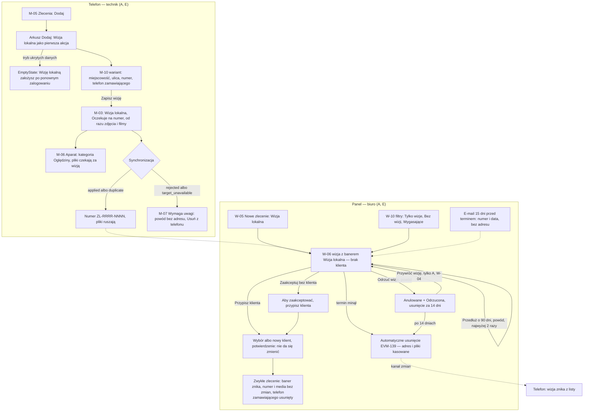

# 17 — Wizja lokalna (E15): aplikacja, panel, przypomnienie i przedłużenie

> Dokument żywy (EVM-137, EVM-138, EVM-140; wkład `ux-designer` na start realizacji, 2026-11-16) · przepływ 17 · kanały: mobile i web · ekrany: **M-10** (wariant „Wizja lokalna”), **M-05**, **M-03**, **M-06**, **M-07** oraz **W-10**, **W-05**, **W-06** (baner i dialogi: „Przypisz klienta”, „Odrzuć wizję”, „Przywróć wizję”, „Przedłuż wizję”, „Aby zaakceptować…”) · treść e-maila przypomnienia: [e-maile.md → 10](e-maile.md#10-przypomnienie-o-wygasającej-wizji-lokalnej) · indeks: [README.md](README.md)
> Źródła: [ADR-0024](../../architecture/adr/0024-wizja-lokalna-zlecenie-bez-klienta.md) (wiążący), plan E15 w [M2/README](../../backlog/M2/README.md), historyjki [EVM-137](../../backlog/M2/EVM-137-mobile-wizja-lokalna.md), [EVM-138](../../backlog/M2/EVM-138-web-wizja-lokalna.md), [EVM-140](../../backlog/M2/EVM-140-wizja-lokalna-przypomnienia-przedluzenie-limit.md); wymagania security W1, W2, W5, W7, W8, W9, W10 (ocena `security-engineer` z 2026-11-16); styleguide § 3.1, § 3.7, § 3.13, § 3.19, § 4.4, § 4.11, § 4.13, § 4.15, § 4.16, § 4.18, § 5.4, § 6; makiety [03](03-szczegoly-zlecenia.md) (W-06, M-03), [07](07-lista-zlecen-i-filtry.md) (W-10, M-05), [02](02-nowe-zlecenie-z-szablonu.md) (W-05), [09](09-mobile-zdjecia-filmy-offline.md) (M-06, M-07), [10](10-mobile-szybkie-zlecenie.md) (M-10).
> **Zakres:** wyłącznie dopiski do zaakceptowanych makiet — nie nadpisują ich. Tokeny i komponenty tylko z styleguide'u (nowy jest jeden wariant oznaczenia wyliczanego, opis w [§ 4.4](../styleguide.md#44-statusy-ac5) i w [changelogu](../styleguide.md#8-changelog); bez nowych tokenów). Dane w przykładach — syntetyczne.
> **Stan:** makiety do akceptacji przy demo EVM-137 / EVM-138; rzeczy do potwierdzenia — [lista na końcu](#do-potwierdzenia-przy-demo).

## Zasady wspólne dla wizji lokalnej
1. **Nazwa i słownictwo.** „Wizja lokalna” (zlecenie bez klienta, w statusie „Wycena” — ADR-0024). „Oględziny” zostaje wyłącznie kategorią zdjęć. Nie używamy: „pre-zlecenie”, „wizyta”, „lead”, „oferta” (ofert w systemie nie ma). Klient: „Brak klienta”. Czynności: „Przypisz klienta”, „Przedłuż o 90 dni”, „Odrzuć wizję”, „Przywróć wizję”.
2. **Wizja to zwykłe zlecenie z oznaczeniem, nie nowy status.** Oznaczenie **«Wizja lokalna»** jest wyliczane (jak „Po terminie”, [§ 4.4](../styleguide.md#44-statusy-ac5)): ikona `binoculars` + etykieta, wariant z obrysem `color.feedback.info.border` na `color.feedback.info.bg`, tekst `color.feedback.info.text` (8,01:1), `radius.pill`, `size.badge.height`. Stoi **obok numeru, nigdy zamiast statusu** — status zlecenia („Wycena”, „Wstrzymane”, „Anulowane”) pozostaje własną odznaką StatusBadge. Po przypisaniu klienta oznaczenie znika.
3. **Termin wygaśnięcia** jako tekst z ikoną, nigdy sam kolor: „Wygasa za 80 dni” (`calendar-x`, `color.text.secondary`); od **15 dni i mniej** — `triangle-alert` + `color.text.warning` („Wygasa za 12 dni”); w dniu terminu „Wygasa dziś”; po terminie, a przed usunięciem — „Termin minął — wizja zostanie wkrótce usunięta.”; wizja odrzucona (Anulowane) — „Usunięcie za 14 dni” (`trash-2`). Odmiana: „za 1 dzień”, „za 2 dni”, „za 5 dni”, „za 22 dni” (§ 6.3; `Intl.PluralRules('pl')`). Pełna data w szczegółach i w nazwie dostępnej: „wygasa za 80 dni, dnia 14.02.2027”.
4. **Adres tylko w szczegółach (W5).** Wiersz listy i karta na telefonie, Kolejka, arkusz „Do którego zlecenia?”, tytuł karty przeglądarki, powiadomienia, e-maile, komunikaty błędów i nazwy dostępne **nie zawierają adresu ani telefonu zamawiającego**. Wizję identyfikuje numer (albo „Oczekuje na numer”), oznaczenie i data założenia. Wyjątek (świadomy): lista w panelu ma kolumnę lokalizacji jak każde zlecenie (decyzja 10 w EVM-138).
5. **Telefon zamawiającego** — jedno opcjonalne pole, klawiatura `tel`, format § 6.3, zapis E.164. Podpowiedź przy polu: telefon — „Tylko numer — imion i nazwisk nie wpisuj.”; panel — „Tylko numer — nie wpisuj imion w opisach.” (brzmienia z historyjek, bez zmian). Przy komentarzach i wpisach wizji (M-04, W-08): „Nie wpisuj imion ani telefonów. Nie wpisuj też PESEL, numerów dokumentów ani kodów do bram i alarmów.”
6. **Telefon tylko dodaje.** Z aplikacji nie ma przypisania klienta, odrzucenia, przywrócenia ani przedłużenia (EVM-137 „Poza zakresem”, EVM-140 AC6) — zamiast przycisków krótka informacja: „Klienta uzupełni biuro.”, „Wizję może przedłużyć biuro w panelu.”
7. **Kto widzi.** Panel: Administrator i Edytor; Tylko odczyt — brak dostępu (`404` „Nie znaleziono zlecenia…”, bez śladu wizji na listach, w filtrach i wyszukiwaniu). Telefon: tylko twórca i opiekun (decyzja 9) — pusty stan listy wyjaśnia dlaczego, bo brak „cudzych” wizji inaczej wyglądałby jak błąd synchronizacji.
8. **Funkcja wyłączona (`SITE_SURVEYS_ENABLED`).** Znikają tylko akcje zakładania („Wizja lokalna” w arkuszu „Dodaj” i w W-05). Istniejące wizje, filtry, przypisanie klienta, odrzucenie i przedłużenie działają dalej (ADR-0024, plan wyjścia).

## Przepływ


---

# Aplikacja mobilna (EVM-137)

## M-05 Lista zleceń — wizja lokalna (AC1, AC4)
Dopisek do [M-05](07-lista-zlecen-i-filtry.md#m-05-lista-zleceń) i arkusza „Dodaj”.

- **Cel:** założyć wizję jednym ruchem z listy i w terenie szybko odróżnić wizje od zwykłych zleceń — bez wypisywania adresów na ekranie, który widać z boku.
- **Główna akcja:** „Dodaj” → „Wizja lokalna”.

**Arkusz „Dodaj”** (BottomSheet, § 3.13 / ActionMenu, § 3.20) — kolejność: **Wizja lokalna** (pierwsza) · Nowe zlecenie · Zdjęcie lub film · Wpis. Wiersz `size.touch-target.field`.
```text
┌──────────────────────────────────┐
│ Dodaj                      [✕]   │
│ ‹binoculars› Wizja lokalna       │ ← pierwsza; podtytuł text.body-sm
│   Tylko adres — klienta uzupełni │
│   biuro                          │
│ ‹plus› Nowe zlecenie             │
│ ‹camera› Zdjęcie lub film        │
│ ‹pencil› Wpis                    │
└──────────────────────────────────┘
```
Gdy funkcja jest wyłączona (`feature_disabled`) — wiersza „Wizja lokalna” nie ma. Tryb ukrytych danych — wiersz jest, otwiera ekran niedostępny (niżej).

**Lista z wizjami i chip** (compact)
```text
┌──────────────────────────────────┐
│ Zlecenia        ⟨Zsynchr. 14:05⟩ │
├──────────────────────────────────┤
│ [Szukaj: adres, nazwisko, numer ]│
│ {✓ Wszystkie} {Niewysłane (2)}   │
│ {Wizje lokalne (3)}              │ ← tylko gdy w telefonie jest wizja
│                                  │
│ ┌──────────────────────────────┐ │
│ │ ZL-2026-0051  «Wycena»       │ │
│ │ ‹binoculars›Wizja lokalna    │ │ oznaczenie, § 4.4
│ │ ‹calendar-x› Wygasa za 80 dni│ │
│ │ Założono 16.11.2026          │ │ ← bez adresu
│ └──────────────────────────────┘ │
│ ┌──────────────────────────────┐ │
│ │ ‹clock› Oczekuje na numer    │ │ § 4.15
│ │ ‹binoculars›Wizja lokalna    │ │
│ │ ‹calendar-x› Wygasa za 90 dni│ │
│ │ Zapisano w telefonie 13:40   │ │
│ │ ‹clock› 4 niewysłane         │ │
│ └──────────────────────────────┘ │
│ ┌──────────────────────────────┐ │
│ │ ZL-2026-0049 «Wycena»        │ │
│ │ ‹binoculars›Wizja lokalna    │ │
│ │ ‹triangle-alert› Wygasa za   │ │ ≤ 15 dni: color.text.warning
│ │ 12 dni                       │ │
│ │ Założono 03.11.2026          │ │
│ └──────────────────────────────┘ │
├──────────────────────────────────┤
│ Zlecenia  Kolejka  Więcej        │
└──────────────────────────────────┘
```
- **Chip „Wizje lokalne (n)”** — FilterChip (§ 3.7) w tej samej grupie radio co „Wszystkie” i „Niewysłane (n)”; zawęża listę do otwartych wizji (także „Anulowane” do czasu usunięcia); n = liczba wizji w telefonie; chipa nie ma, gdy w telefonie nie ma żadnej wizji (pozycji bez funkcji nie pokazujemy). **Odstępstwo od układu chipów** (po „Wszystkie / Niewysłane” z odstępstwa EVM-103) — wpis w [changelogu](../styleguide.md#8-changelog), termin usunięcia razem z odstępstwem EVM-103 (M4).
- **Karta wizji:** numer albo „Oczekuje na numer” + StatusBadge zlecenia; oznaczenie „Wizja lokalna”; termin („Wygasa za N dni”; Anulowane: „Usunięcie za N dni” + oznaczenie „Odrzucona”); data założenia (`text.body`, minimum mobile); licznik niewysłanych jak w zwykłej karcie. **Bez adresu, tytułu i telefonu** — tytuł domyślny „Wizja lokalna” powtarza oznaczenie, więc go nie drukujemy.
- **Wyszukiwanie lokalne** obejmuje adres (dane są w zaszyfrowanej bazie telefonu), ale wiersz wyniku nadal nie pokazuje adresu — użytkownik otwiera kartę i widzi adres w szczegółach. (Do potwierdzenia — [punkt 2 listy końcowej](#do-potwierdzenia-przy-demo).)

**Stany M-05 (dopiski)**
| Stan | Zachowanie |
|---|---|
| Pusty | Chip „Wizje lokalne” aktywny, brak wizji (np. po usunięciu ostatniej): EmptyState (§ 3.15, ikona `binoculars`) „Nie masz wizji lokalnych w telefonie. W telefonie widzisz tylko wizje, które założyłeś lub którymi się opiekujesz.” + [Wizja lokalna] (gdy funkcja włączona). Lista „Wszystkie” bez zmian. |
| Ładowanie | Jak M-05: dane z lokalnej bazy od razu; Skeleton kart tylko przy pierwszej synchronizacji. |
| Błąd | Jak M-05 (baner „Nie udało się pobrać zmian…”). Wizja odrzucona przez serwer — Kolejka → „Wymaga uwagi” (M-07), znacznik „Wymaga uwagi” na karcie wizji, dopóki wizja jest na liście. |
| Offline | Jak M-05; zapis wizji działa (kolejka), karta „Oczekuje na numer”. |
| Brak uprawnień | Tylko odczyt — M-02 (`channel_not_allowed`). Tryb ukrytych danych: lista zastąpiona EmptyState (§ 4.18); wizje nie są renderowane w żadnej formie. Wizja, do której telefon utracił dostęp (np. zmiana opiekuna), znika po synchronizacji; niewysłane elementy zostają w Kolejce („Wymaga uwagi”). |

- **Komponenty i tokeny:** ActionMenu / BottomSheet (§ 3.20, § 3.13); FilterChip (§ 3.7, `size.touch-target.min`); Card (§ 3.8, `space.inset.md`, `space.stack.sm`); StatusBadge (§ 3.9); oznaczenie „Wizja lokalna” (§ 4.4); termin: ikona `size.icon.sm` + `text.body`, `color.text.secondary` / `color.text.warning` + `color.icon.warning`; „Oczekuje na numer” (§ 4.15); EmptyState (§ 3.15).
- **Mikrocopy (do wklejenia):** „Wizja lokalna” · „Tylko adres — klienta uzupełni biuro” · „Wizje lokalne (3)” · „Wygasa za 80 dni” · „Wygasa za 1 dzień” · „Wygasa dziś” · „Termin minął — wizja zostanie wkrótce usunięta.” · „Usunięcie za 12 dni” · „Odrzucona” · „Założono 16.11.2026” · „Zapisano w telefonie 13:40” · „Nie masz wizji lokalnych w telefonie. W telefonie widzisz tylko wizje, które założyłeś lub którymi się opiekujesz.”
- **Dostępność:** karta jako jeden element z nazwą „Wizja lokalna, ZL-2026-0051, Wycena, założono 16.11.2026, wygasa za 80 dni, dnia 14.02.2027” (oczekująca: „Wizja lokalna, oczekuje na numer, zapisano w telefonie 13:40, 4 niewysłane”); ≤ 15 dni: „…wygasa za 12 dni — wymaga decyzji biura”; **nazwa nie zawiera adresu**; chip jako radio z nazwą „Filtr: Wizje lokalne, 3”; cele ≥ `size.touch-target.min`; przy 200% czcionki oznaczenie i termin zawijane do kolejnych wierszy, nie skracane; kontrast `warning.text` na `surface` zgodny z § 2.1.4.

## M-10 — wariant „Wizja lokalna” (AC1, AC2, AC5)
Dopisek do [M-10](10-mobile-szybkie-zlecenie.md#m-10-szybkie-zlecenie): ten sam ekran i komponenty, **inny formularz** (nie ma klienta, lokalizacji „Z telefonu”, szablonu, tytułu ani notatki).

- **Cel:** założyć wizję w kilkanaście sekund na oględzinach, także bez zasięgu — i od razu robić zdjęcia.
- **Główna akcja:** „Zapisz wizję” (dolny pasek, `size.touch-target.field`).
- **Hierarchia treści:** 1) „Numer nadamy po synchronizacji.”; 2) adres: miejscowość, ulica, numer budynku (+ numer lokalu); 3) telefon zamawiającego (opcjonalnie) z podpowiedzią; 4) informacja o wygasaniu; 5) status szkicu.

**Makieta (compact)**
```text
┌──────────────────────────────────┐
│ ✕ Wizja lokalna   ⟨Offline · 5⟩  │
├──────────────────────────────────┤
│ Numer nadamy po synchronizacji.  │
│                                  │
│ Adres                            │
│ Miejscowość [Piaseczno_______]   │
│ Ulica [ul. Fikcyjna__________]   │
│ Nr budynku [12_]                 │
│ Nr lokalu (opcjonalnie) [__]     │
│                                  │
│ Telefon zamawiającego            │
│ (opcjonalnie)                    │
│ [+48 600 000 001____________]    │ klawiatura tel
│ Tylko numer — imion i nazwisk    │
│ nie wpisuj.                      │
│                                  │
│ ┃‹info› Klienta uzupełni biuro.  │
│ ┃ Wizja bez klienta zostanie     │
│ ┃ usunięta po 90 dniach.         │
│                                  │
│ Szkic zapisany w telefonie · 13:38│
├──────────────────────────────────┤
│ [[       Zapisz wizję         ]] │
└──────────────────────────────────┘

 Po zapisie → M-03 (Oczekuje na numer):
│ ← ‹clock› Oczekuje na numer ⟨Offline · 6⟩ │
│ ‹binoculars› Wizja lokalna  «Wycena»      │
│ ┃‹info› Zapisano w telefonie. Numer nadamy│
│ ┃ po synchronizacji. Możesz już robić     │
│ ┃ zdjęcia i filmy.                        │
│ [[‹camera› Zrób zdjęcie]]                 │

 Po synchronizacji: toast „Wizja lokalna dostała numer ZL-2026-0051.” (+ ogłoszenie TalkBack)
```
- **Pola:** miejscowość, ulica, numer budynku — wymagane; numer lokalu i telefon — opcjonalne; kod pocztowy, typ obiektu, miejsce postojowe, tytuł, klient, szablon, notatka — **nie ma** (wybór istniejącej lokalizacji z telefonu poza zakresem — dopasowanie robi biuro). Walidacja i klawiatury jak w EVM-106; komunikaty: „Podaj miejscowość.” · „Podaj ulicę.” · „Podaj numer budynku.” · „Podaj numer telefonu, np. 600 123 456.” (tylko gdy pole nie jest puste i jest błędne). Typ obiektu i numer lokalu — punkt 6 [listy końcowej](#do-potwierdzenia-przy-demo).
- **Zapis offline (AC2):** „Zapisz wizję” działa lokalnie (komenda `CreateSiteSurvey` pierwsza w kolejce), przycisk wyłączony na czas zapisu (bez podwójnego zapisu), przejście do M-03 z „Oczekuje na numer”; formularz nie ma stanu ładowania (zapis lokalny jest natychmiastowy).
- **Wymóg informacyjny (W4):** zdanie o wygasaniu jest widoczne **zawsze** (technik wie, co obiecuje zamawiającemu). Zdanie o karcie informacyjnej dla zamawiającego („Przekaż zamawiającemu kartę informacyjną.”) — treść i obecność ustala EVM-141 (odsyłacz, nie wklejamy karty tutaj).

**Stany M-10 „Wizja lokalna”**
| Stan | Zachowanie |
|---|---|
| Pusty | Pusty formularz, fokus na „Miejscowość”; szkic odtwarzany po powrocie (zaszyfrowana baza, § 4.1). |
| Ładowanie | nd. — zapis lokalny natychmiastowy; formularz nie czyta danych z sieci. |
| Błąd | Podsumowanie błędów na górze (fokus) + komunikaty pod polami (wyżej); brak miejsca: „Brak miejsca — wizja zostaje w szkicu.”; odrzucenie przez serwer — nie tu, tylko Kolejka (niżej, AC6). |
| Offline | Normalna praca; toast „Zapisano w telefonie. Numer nadamy po synchronizacji.” |
| Brak uprawnień | Tylko odczyt — M-02. Funkcja wyłączona — wiersza nie ma w arkuszu „Dodaj”. **Tryb ukrytych danych (AC5, W9):** formularz niedostępny — EmptyState `eye-off`: „Wizję lokalną założysz po ponownym zalogowaniu. Zdjęcia możesz robić dalej.” + akcja wyjścia „Zaloguj się ponownie” (jak M-10; offline wyłączona z podpowiedzią „Zalogujesz się, gdy wróci połączenie.”). |

- **Komponenty i tokeny:** AppBar + SyncIndicator (§ 3.18, § 5.4); TextField (§ 3.2, `size.touch-target.field` w rękawicach), telefon z klawiaturą `tel`; InlineAlert (§ 3.19) `color.feedback.info.*`; Button primary `size.touch-target.field` w dolnym pasku `elevation.bottom-bar`; „Oczekuje na numer” (§ 4.15); Toast (§ 3.14); EmptyState + tryb ukrytych danych (§ 4.18).
- **Mikrocopy:** „Wizja lokalna” · „Numer nadamy po synchronizacji.” · „Adres” · „Miejscowość” · „Ulica” · „Nr budynku” · „Nr lokalu (opcjonalnie)” · „Telefon zamawiającego (opcjonalnie)” · „Tylko numer — imion i nazwisk nie wpisuj.” · „Klienta uzupełni biuro. Wizja bez klienta zostanie usunięta po 90 dniach.” · „Szkic zapisany w telefonie · 13:38” · „Zapisz wizję” · „Zapisano w telefonie. Numer nadamy po synchronizacji. Możesz już robić zdjęcia i filmy.” · „Wizja lokalna dostała numer ZL-2026-0051.” · tryb ukrytych danych — jak wyżej.
- **Dostępność:** `h1` „Wizja lokalna”; pola z widocznymi etykietami (nie placeholderami), `autocomplete` wyłączone dla pól adresu (dane nie trafiają do słowników klawiatury — `importantForAutofill="no"`); podpowiedź przy telefonie powiązana z polem (`accessibilityHint`); błędy z fokusem na podsumowaniu; nadanie numeru ogłaszane raz bez przerywania pracy (§ 4.15); 200% czcionki — etykiety nad polami, „Nr budynku” i „Nr lokalu” jedno pod drugim; cele ≥ 48 dp.

## M-03 Szczegóły wizji (AC2, AC4, AC7)
Dopisek do [M-03](03-szczegoly-zlecenia.md#m-03-szczegóły-zlecenia). **Jedyne miejsce w aplikacji z adresem i telefonem zamawiającego.**

- **Cel:** zobaczyć adres i od razu dokumentować oględziny zdjęciami i filmami.
- **Główna akcja:** „Zrób zdjęcie” (dolny pasek jak w M-03).
- **Hierarchia treści:** 1) numer (albo „Oczekuje na numer”) + status; 2) oznaczenie „Wizja lokalna” i termin; 3) adres (`text.body-lg`); 4) telefon zamawiającego (jeśli jest) jako akcja „Zadzwoń”; 5) „Brak klienta — uzupełni biuro.”; 6) media (liczniki) → M-08; 7) dziennik (wpisy i elementy kolejki) + „Dodaj wpis”.

**Makieta (compact)**
```text
┌──────────────────────────────────┐
│ ← ZL-2026-0051    ⟨Zsynchr. 14:05⟩│
├──────────────────────────────────┤
│ ‹binoculars› Wizja lokalna       │
│ «Wycena»                         │
│ ‹calendar-x› Wygasa za 80 dni    │
│ (14.02.2027)                     │
│                                  │
│ ul. Fikcyjna 12, 05-500          │ text.body-lg (adres: miejscowość,
│ Piaseczno                        │ ulica, numer; bez kodu, jeśli nie podano)
│                                  │
│ Telefon zamawiającego            │
│ [‹phone› +48 600 000 001]        │ ← link tel:, nazwa „Zadzwoń: telefon zamawiającego”
│                                  │
│ ┃‹info› Brak klienta — uzupełni  │
│ ┃ biuro. Biuro przypisze klienta │
│ ┃ po akceptacji oferty.          │
│                                  │
│ Media                            │
│ 12 zdjęć · 2 filmy · 3 niewysłane│ → M-08
│                                  │
│ Dziennik                         │
│ dziś, 9:30 · Piotr Testowy       │
│ Garaż w piwnicy, wejście od      │
│ podwórza.                        │
│ [Dodaj wpis]                     │
├──────────────────────────────────┤
│ [[‹camera› Zrób zdjęcie]]        │
│ [Dodaj wpis]                     │
└──────────────────────────────────┘
```
- **Czego nie ma w wizji:** sekcji „Klient”, „Na kogo czekamy”, „Procesy”, „Zakres”, dokumentów i płatności (wizja ich nie ma — nie pokazujemy pustych sekcji ani tekstu „Biuro uzupełni procesy po synchronizacji…”, który myliłby technika). Status etapu / zlecenia — tylko odznaka (telefon tylko dodaje).
- **Termin ≤ 15 dni:** `triangle-alert` + `color.text.warning`, pod nim zdanie „Wizję może przedłużyć biuro w panelu.” (technik nie ma przycisku przedłużenia — EVM-140 AC6).
- **Wizja odrzucona przez biuro (Anulowane):** oznaczenie „Odrzucona”, termin „Usunięcie za 12 dni”, InlineAlert `info`: „Biuro odrzuciło tę wizję. Zostanie usunięta razem ze zdjęciami i wpisami.” Dodawanie zdjęć i wpisów działa jak w każdym zleceniu zamkniętym (poza zakresem — bez dodatkowej blokady).
- **Po przypisaniu klienta (AC7):** po synchronizacji znikają oznaczenie „Wizja lokalna”, termin i „Brak klienta…”; pojawia się sekcja „Klient” z nazwą i telefonem jak w zwykłym zleceniu, numer, zdjęcia i wpisy zostają. Zmiana bez toastu i bez ogłoszenia (to zdarzenie w tle, nie wynik działania użytkownika) — ekran odświeża się w miejscu.
- **Przy numerze „Oczekuje na numer”:** InlineAlert z M-10 + pliki w kolejce „Wyślemy po utworzeniu wizji” (wariant tekstu z [09](09-mobile-zdjecia-filmy-offline.md)); aparat działa od razu (AC3).

**Stany M-03 „wizja”**
| Stan | Zachowanie |
|---|---|
| Pusty | Brak mediów: „Ta wizja nie ma jeszcze zdjęć ani filmów. [Zrób zdjęcie]”. Brak telefonu zamawiającego — wiersz pomijamy. |
| Ładowanie | Dane z lokalnej bazy od razu; miniatury — Skeleton (tylko online). |
| Błąd | „Nie udało się otworzyć wizji. [Spróbuj ponownie]”; wizja usunięta albo poza zakresem — „Nie znaleziono zlecenia. Twoje niewysłane zdjęcia i wpisy z tego zlecenia są w Kolejce. [Przejdź do kolejki]” (bez adresu i bez słowa „wizja” w nazwie dostępnej wiersza kolejki, jeśli dane są ukryte). |
| Offline | Jak M-03: wszystko lokalnie, miniatury „Podgląd po połączeniu”, zapisy do kolejki. |
| Brak uprawnień | Tylko odczyt — M-02. Tryb ukrytych danych: ekran niedostępny — EmptyState `eye-off` „Dane zleceń są ukryte… Aparat i kolejka działają.” (§ 4.18); **adres, telefon i oznaczenie nie są renderowane**, nazwa dostępna bez adresu. |

- **Komponenty i tokeny:** AppBar z SyncIndicator; oznaczenie „Wizja lokalna” (§ 4.4); StatusBadge (§ 3.9); adres `text.body-lg`; Button tertiary z ikoną `phone` (`size.touch-target.min`) — telefon zamawiającego; InlineAlert (§ 3.19) `color.feedback.info.*`; Card (§ 3.8); przyciski dolnego paska jak w M-03.
- **Mikrocopy:** „Wizja lokalna” · „Wygasa za 80 dni (14.02.2027)” · „Wizję może przedłużyć biuro w panelu.” · „Telefon zamawiającego” · „Brak klienta — uzupełni biuro. Biuro przypisze klienta po akceptacji oferty.” · „Ta wizja nie ma jeszcze zdjęć ani filmów.” · „Biuro odrzuciło tę wizję. Zostanie usunięta razem ze zdjęciami i wpisami.”
- **Dostępność:** kolejność czytania: numer → status → oznaczenie → termin → adres → telefon → informacja; telefon jako przycisk „Zadzwoń: telefon zamawiającego” (numer czytany cyframi, bez imienia); informacja „Brak klienta…” jako zwykły tekst (nie `alert`); 200% czcionki — adres zawijany, nie skracany; kontrast ≥ 7:1 (§ 5.3).

## M-06 Aparat i M-07 Kolejka — dopiski (AC3, AC5, AC6)
**M-06 (z wizji):** kamera działa bez zmian (zdjęcia, filmy bez dźwięku, „Filmy tylko przez Wi-Fi”). **Domyślna kategoria „Oględziny”** — chip kategorii wybrany od otwarcia, pozostałe kategorie dostępne; ogłoszenie „Kategoria: Oględziny”. Górny pasek pokazuje tylko numer (albo „Oczekuje na numer”) — **bez adresu** (jak dziś). Arkusz „Do którego zlecenia?” wyświetla wizję jako numer / „Oczekuje na numer” + oznaczenie „Wizja lokalna” + datę założenia (bez adresu; pytanie 2). Pliki czekają za utworzeniem wizji: w wierszu pliku „Wyślemy po utworzeniu wizji”. Tryb ukrytych danych: aparat do istniejącej wizji działa; arkusz i Kolejka — tylko numer / „Oczekuje na numer” i liczby (§ 4.18).

**M-07 Kolejka**
```text
│ Wymaga uwagi (2)                                             │
│ ┃ ‹triangle-alert› Wizja lokalna · ZL-2026-0049              │
│ ┃ Wizja lokalna nie została utworzona — sprawdź adres        │
│ ┃ i numer telefonu.                                          │
│ ┃ Czekają z nią 3 elementy.                                  │
│ ┃ [Usuń z telefonu]                                          │
│ ┃ ‹triangle-alert› Zdjęcie · ZL-2026-0047                    │
│ ┃ Wizja została usunięta — zdjęcie nie zostało wysłane.      │
│ ┃ [Usuń z telefonu]                                          │
```
- **Wiersz komendy:** typ „Wizja lokalna” + numer (albo „Oczekuje na numer”) + wiek („Dodano w telefonie 16.11.2026”). **Nigdy adresu ani telefonu** — także w normalnym trybie (W5).
- **Odrzucenie przez serwer (AC6):** element trafia do „Wymaga uwagi” z powodem po polsku i jedyną akcją „Usuń z telefonu” (dialog z liczbą zależnych elementów, § 4.11). Bez „Utwórz ponownie” (poza zakresem — zwykłe „Usuń z telefonu” i nowa wizja) i **bez „Dodaj do innego zlecenia”** dla zdjęć i wpisów z wizji: przeniesienie zdjęć domu do zlecenia innej osoby byłoby wyciekiem (security — IDOR, § 3). Zależne pliki i wpisy dostają ten sam powód i grupują się pod elementem nadrzędnym; nie ponawiają się (status „odrzucony”).

| Kod (`rejected`) | Komunikat w „Wymaga uwagi” (bez adresu) |
|---|---|
| `validation_failed` | „Wizja lokalna nie została utworzona — sprawdź adres i numer telefonu.” |
| `id_conflict` | „Ta wizja nie mogła zostać zapisana — załóż ją ponownie.” |
| `feature_disabled` | „Wizja lokalna nie została utworzona — funkcja jest wyłączona. Zapytaj administratora.” |
| `sync_quota_exceeded` | „Dziś założono zbyt wiele nowych lokalizacji z tego telefonu. Spróbuj ponownie jutro albo usuń wizję z telefonu.” |
| `site_survey_limit_exceeded` | „Masz za dużo otwartych wizji (limit 20). Poproś biuro o przypisanie klienta albo odrzucenie wizji i spróbuj ponownie.” (wariant dla telefonu — pytanie 3; w panelu brzmienie z EVM-140 AC4 bez zmian) |
| `target_unavailable` (wizja usunięta) — wizja | „Wizja lokalna została usunięta — biuro mogło ją odrzucić albo minął jej termin.” |
| `target_unavailable` — zdjęcie, film, wpis | „Wizja została usunięta — zdjęcie nie zostało wysłane.” / „…film nie został wysłany.” / „…wpis nie został wysłany.” |

**Dialog „Usuń z telefonu”** (§ 4.11, AlertDialog, `size.touch-target.field`): tytuł „Usunąć wizję z telefonu?”; treść „Wizja nie zostanie wysłana. Razem z nią usuniemy z telefonu 3 elementy: 2 zdjęcia i 1 wpis. Tego nie da się cofnąć.” (odmiana § 6.3); przyciski [Anuluj] (fokus) · [[Usuń z telefonu]] (danger). Dla elementu pojedynczego: „Usunąć zdjęcie z telefonu? Nie zostanie wysłane. Tego nie da się cofnąć.”

- **Stany M-07:** pusty / ładowanie / offline / brak uprawnień — bez zmian względem [09](09-mobile-zdjecia-filmy-offline.md#m-07-kolejka) (tryb ukrytych danych: ikony typu zamiast miniatur, tylko numery i liczby).
- **Dostępność:** nazwa dostępna wiersza „Wizja lokalna, ZL-2026-0049, wymaga uwagi: wizja lokalna nie została utworzona, sprawdź adres i numer telefonu” — komunikat nie zawiera adresu, tylko prośbę o jego sprawdzenie; pojawienie się elementów „Wymaga uwagi” ogłaszane raz, zbiorczo (§ 5.4).

---

# Panel web (EVM-138, EVM-140)

## W-10 Lista zleceń — wizje (EVM-138 AC1)
Dopisek do [W-10](07-lista-zlecen-i-filtry.md#w-10-lista-zleceń).

- **Cel:** zobaczyć, które wizje czekają na decyzję, zanim znikną.
- **Główna akcja:** wybór wiersza; „Nowe zlecenie” (jak dotąd — wizję zakłada się w W-05).
- **Hierarchia treści:** zapisane widoki (nowy: „Wygasające (n)”) → pasek filtrów (nowa grupa „Wizje lokalne”) → licznik → tabela.

**Makieta (expanded, fragment)**
```text
Widoki: {Wszystkie niezamknięte} {Czekamy na OSD > 14 dni} {Po terminie} {Nieopłacone} {Moje} {Wygasające wizje (3)}
┌────────────────────────────────────────────────────────────────────────────────────────┐
│ [Szukaj: numer, tytuł, klient, adres… ‹search›]   Status [Niezamknięte ▾]               │
│ Wizje lokalne:  (•) Wszystkie zlecenia  ( ) Tylko wizje  ( ) Bez wizji                   │
│ Aktywne: {Tylko wizje ✕} {Wygasają w ciągu 15 dni ✕}                  Wyczyść filtry     │
└────────────────────────────────────────────────────────────────────────────────────────┘
 3 wizje do rozstrzygnięcia — wygasają w ciągu 15 dni     Sortuj: Termin wygaśnięcia ▾
┌───────────────────────────────┬──────────────────┬──────────┬────────────┬────────────┬─────────┐
│ Zlecenie                      │ Klient           │ Status   │ Czekamy na │ Termin     │ Płatność│
├───────────────────────────────┼──────────────────┼──────────┼────────────┼────────────┼─────────┤
│ ZL-2026-0049                  │ Brak klienta     │ «Wycena» │ —          │ —          │ —       │
│ Wizja lokalna                 │ ul. Próbna 5,    │          │            │            │         │
│ «‹binoculars›Wizja lokalna»   │ Piaseczno        │          │            │            │         │
│ ‹triangle-alert› Wygasa za 12 │                  │          │            │            │         │
│ dni                           │                  │          │            │            │         │
├───────────────────────────────┼──────────────────┼──────────┼────────────┼────────────┼─────────┤
│ ZL-2026-0047                  │ Brak klienta     │«Anulowane»│ —         │ —          │ —       │
│ Wizja lokalna                 │ ul. Dalsza 2,    │          │            │            │         │
│ «Wizja lokalna» «Odrzucona»   │ Łódź             │          │            │            │         │
│ ‹trash-2› Usunięcie za 9 dni  │                  │          │            │            │         │
└───────────────────────────────┴──────────────────┴──────────┴────────────┴────────────┴─────────┘
```
- **Wiersz wizji:** w komórce „Zlecenie” trzy linie — numer, tytuł, oznaczenia i termin (oznaczenie „Wizja lokalna”; „Odrzucona” przy Anulowane; termin jak w zasadzie 3). Komórka „Klient”: tekst „Brak klienta” (`color.text.secondary`, ikona `user-x`) + lokalizacja jak w innych zleceniach (jedyne miejsce adresu w W-10). „Czekamy na”, „Termin”, „Płatność”: „—” (wizja nie ma etapów ani transz).
- **Filtry:**
  - **„Wizje lokalne”** — grupa radio w pasku filtrów (wartości: „Wszystkie zlecenia” domyślnie, „Tylko wizje”, „Bez wizji”; parametry `siteSurvey=only|exclude`); wartości bez danych osobowych, więc mogą być w URL (§ 3.7).
  - **„Wygasające wizje (n)”** — zapisany widok = otwarte wizje (bez „Odrzucona”), termin ≤ 15 dni, sortowanie po terminie rosnąco; (n) = licznik „do rozstrzygnięcia”. Aktywny widok pokazuje pod paskiem „3 wizje do rozstrzygnięcia — wygasają w ciągu 15 dni” (odmiana: 1 wizja / 2–4 wizje / 5 wizji). Odrzucone wizje już mają decyzję, więc nie liczą się do „do rozstrzygnięcia” (pytanie 4).
  - Sortowanie: dodajemy „Termin wygaśnięcia” (tylko gdy aktywny „Tylko wizje” albo „Wygasające”); domyślne „Najpilniejsze” bez zmian.
  - Wyszukiwanie po adresie znajduje wizję (`POST …/search`, bez frazy w URL).
- **Dla Tylko odczyt:** wizji ani grupy filtrów nie ma (wizje niewidoczne, nie „puste”).
- **Gdy funkcja wyłączona:** grupa filtrów „Wizje lokalne” zostaje, jeśli istnieją wizje; w przeciwnym razie jest ukryta.

**Stany W-10 (dopiski)**
| Stan | Zachowanie |
|---|---|
| Pusty | „Tylko wizje” bez wyników: EmptyState (§ 3.15, ikona `binoculars`) „Brak wizji lokalnych.” + „Wizje zakłada się w aplikacji na telefonie albo w oknie „Nowe zlecenie”.” + [Nowa wizja lokalna] (A, E, funkcja włączona). Widok „Wygasające wizje”: „Żadna wizja nie wygasa w ciągu 15 dni.” + [Pokaż wszystkie wizje]. Połączenie filtrów bez wyników — „Brak zleceń spełniających filtry” + „Wyczyść filtry” (bez zmian). |
| Ładowanie | Skeleton wierszy (jak W-10); filtry aktywne w trakcie. |
| Błąd | Jak W-10: alert w sekcji z „Spróbuj ponownie”; `429` — komunikat z README. |
| Offline | Baner § 4.10, dane z pamięci karty z „Dane mogą być nieaktualne (z 14:05)”. |
| Brak uprawnień | Tylko odczyt — brak wizji i filtrów, wejście z adresu wizji → `404` „Nie znaleziono zlecenia…” (bez danych wizji, tytuł karty „Nie znaleziono · EVia Manager”). |

- **Komponenty i tokeny:** DataTable (§ 3.6); FilterChip / radio w `fieldset` (§ 3.7, § 3.4); oznaczenie „Wizja lokalna”, StatusBadge (§ 3.9, § 4.4); ikony `binoculars`, `user-x`, `calendar-x`, `triangle-alert`, `trash-2`; EmptyState; `color.text.warning` dla ≤ 15 dni.
- **Mikrocopy:** „Wizje lokalne” · „Wszystkie zlecenia” · „Tylko wizje” · „Bez wizji” · „Wygasające wizje (3)” · „Wygasają w ciągu 15 dni” · „3 wizje do rozstrzygnięcia — wygasają w ciągu 15 dni” · „Termin wygaśnięcia” · „Brak klienta” · „Wygasa za 12 dni” · „Usunięcie za 9 dni” · „Odrzucona” · „Brak wizji lokalnych.” · „Żadna wizja nie wygasa w ciągu 15 dni.”
- **Dostępność:** link wiersza z nazwą „ZL-2026-0049, Wizja lokalna, brak klienta, Wycena, wygasa za 12 dni”; grupa filtrów `fieldset` z legendą „Wizje lokalne”; zmiana licznika wyników ogłaszana `aria-live="polite"`; ikony zawsze z tekstem; tytuł karty „Zlecenia · EVia Manager”.

## W-05 Nowe zlecenie — „Wizja lokalna” (EVM-138 AC2, EVM-140 AC4)
Dopisek do [W-05](02-nowe-zlecenie-z-szablonu.md#w-05-nowe-zlecenie).

- **Cel:** założyć wizję ze zgłoszenia telefonicznego (np. zamawiający dzwoni do biura) tak, by technik miał ją na telefonie.
- **Główna akcja:** „Załóż wizję lokalną”.
- **Hierarchia treści:** 0) wybór rodzaju; 1) lokalizacja; 2) telefon zamawiającego; 3) opiekun.

**Makieta (expanded; wybór rodzaju nad formularzem — pozostałe sekcje W-05 znikają)**
```text
Zlecenia / Nowe zlecenie
┌──────────────────────────────────────────────────┐
│ Nowe zlecenie                                    │
│ Numer zlecenia nadamy po zapisie.   Szkic w tej karcie · 14:05 ‹info›│
│                                                  │
│ Rodzaj                                           │
│ ┌(•) Zlecenie z szablonu ───────────────────────┐│
│ │ Klient, lokalizacja, zakres i procesy         ││
│ └───────────────────────────────────────────────┘│
│ ┌( ) Wizja lokalna ─────────────────────────────┐│
│ │ Oględziny bez klienta — tylko adres i zdjęcia ││
│ │ Klienta przypiszesz po akceptacji oferty      ││
│ └───────────────────────────────────────────────┘│
│                                                  │
│ ── po wyborze „Wizja lokalna”: ──                │
│ 1. Lokalizacja                                   │
│ (•) Istniejąca lokalizacja   ( ) Nowa lokalizacja│
│ Lokalizacja [Szukaj adresu… ‹search› ▾]          │
│ ── albo nowa: ──                                 │
│ Typ obiektu [Dom jednorodzinny ▾]                │
│ Ulica [ul. Testowa______]  Nr budynku [7__]      │
│ Nr lokalu (opcjonalnie) [__]                     │
│ Kod pocztowy [00-001]  Miasto [Warszawa______]   │
│ Nr miejsca postojowego (opcjonalnie) [__]        │
│ ┃‹info› W systemie jest już lokalizacja pod tym  │
│ ┃ adresem: ul. Testowa 7, Warszawa   [Użyj tej]  │ ← podpowiedź podobnej
│                                                  │
│ 2. Zamawiający                                   │
│ Telefon zamawiającego (opcjonalnie)              │
│ [+48 600 000 001______________]                  │
│ Tylko numer — nie wpisuj imion w opisach.        │
│                                                  │
│ 3. Opiekun                                       │
│ Opiekun [Anna Testowa ▾]  (lub „Bez opiekuna”)   │
│ ┃‹info› Wizja będzie widoczna na telefonie       │
│ ┃ opiekuna.                                      │
│   (po wyborze „Bez opiekuna”: „Bez opiekuna wizja│
│   nie będzie widoczna na żadnym telefonie.”)     │
│                                                  │
│ [Anuluj]                    [[ Załóż wizję lokalną ]]│
└──────────────────────────────────────────────────┘
```
- **Wybór rodzaju:** dwie SelectableCard (§ 3.22) jako grupa radio; domyślnie „Zlecenie z szablonu” (dotychczasowy W-05 bez zmian). Wybór „Wizja lokalna” ukrywa sekcje Klient, Szablon i Zlecenie (tytuł, planowana data, opis); wpisana lokalizacja zostaje w szkicu. Funkcja wyłączona — wyboru rodzaju nie ma (sam formularz zlecenia). Adres docelowy bez danych osobowych: `…/zlecenia/nowe?rodzaj=wizja` (tylko rodzaj).
- **Lokalizacja:** jak sekcja „2. Lokalizacja” W-05, ale **bez** OSD, zarządcy, mocy, PPE i notatek lokalizacji (biuro uzupełni je w [W-20](14-edycja-lokalizacji-i-strony.md) po przypisaniu klienta; wizja ma być lekka). „Podpowiedź” = InlineAlert z istniejącą lokalizacją o podobnym adresie i akcją „Użyj tej lokalizacji” (analogia „Podobny klient”); bez historii zleceń tej lokalizacji (SR-AUTHZ-08).
- **Telefon zamawiającego:** pole opcjonalne, klawiatura `tel`, walidacja „Podaj numer telefonu, np. 600 123 456.”
- **Opiekun:** Select (domyślnie zalogowana osoba; pozycja „Bez opiekuna”). Podpowiedź zależna od wyboru: osoba — „Wizja będzie widoczna na telefonie: Piotr Testowy.” (tylko jeśli ta osoba ma aplikację — nie sprawdzamy, bez zgadywania: tekst ogólny „Wizja będzie widoczna na telefonie opiekuna.”); „Bez opiekuna” — „Bez opiekuna wizja nie będzie widoczna na żadnym telefonie.” (InlineAlert `info`, `role="status"`, ogłaszany przy zmianie).
- **Po zapisie** (`POST /site-surveys` → `201`): przejście do W-06 wizji, toast „Utworzono wizję lokalną ZL-2026-0051.”, fokus na nagłówku.

**Stany W-05 „wizja”**
| Stan | Zachowanie |
|---|---|
| Pusty | Pusty formularz; opiekun = zalogowana osoba. |
| Ładowanie | Przycisk „Załóż wizję lokalną” w stanie ładowania, formularz zablokowany do odpowiedzi; opcje comboboxów — Skeleton 3 wierszy. |
| Błąd | Walidacja: podsumowanie błędów na górze + komunikaty pod polami („Podaj adres lokalizacji.”, „Podaj numer telefonu, np. 600 123 456.”); błąd serwera: „Nie udało się założyć wizji. Spróbuj ponownie — nie założymy jej dwa razy.” (ponowienie z tym samym kluczem idempotencji); **limit (`409 site_survey_limit_exceeded`):** InlineAlert błędu na górze (`role="alert"`): „Masz za dużo otwartych wizji — przypisz klienta, odrzuć lub poczekaj na wygaśnięcie.” + link „Pokaż wizje lokalne” (W-10 z filtrem „Tylko wizje”); dane formularza zostają; po zwolnieniu miejsca ten sam przycisk działa ponownie; `409 feature_disabled`/`404` (funkcja wyłączona w trakcie wypełniania): „Wizje lokalne są teraz wyłączone. Załóż zwykłe zlecenie albo zapytaj administratora.” |
| Offline | Baner § 4.10 „Brak połączenia. Wpisane dane zostają w tej karcie — zapisz je, gdy połączenie wróci.”; „Załóż wizję lokalną” wyłączony z podpowiedzią „Zapiszesz po powrocie połączenia.” |
| Brak uprawnień | Tylko odczyt — jak W-05 (`403`: „Nie możesz tworzyć zleceń.”). |

- **Komponenty i tokeny:** SelectableCard (§ 3.22), Combobox / Select (§ 3.3), TextField (§ 3.2), radio w `fieldset` (§ 3.4), InlineAlert (§ 3.19) `color.feedback.info.*` / `error.*`, Button primary / tertiary (§ 3.1), Toast (§ 3.14), szkic w pamięci karty (§ 4.1); odstępy i nagłówki jak W-05.
- **Mikrocopy:** „Rodzaj” · „Zlecenie z szablonu — klient, lokalizacja, zakres i procesy” · „Wizja lokalna — oględziny bez klienta, tylko adres i zdjęcia. Klienta przypiszesz po akceptacji oferty.” · „Zamawiający” · „Telefon zamawiającego (opcjonalnie)” · „Tylko numer — nie wpisuj imion w opisach.” · „Opiekun” · „Bez opiekuna” · „Wizja będzie widoczna na telefonie opiekuna.” · „Bez opiekuna wizja nie będzie widoczna na żadnym telefonie.” · „Załóż wizję lokalną” · „Utworzono wizję lokalną ZL-2026-0051.” · „W systemie jest już lokalizacja pod tym adresem: …” · „Użyj tej lokalizacji”.
- **Dostępność:** grupa radio „Rodzaj” ze strzałkami; zmiana rodzaju ogłasza „Formularz wizji lokalnej” (`aria-live="polite"`), fokus zostaje na wybranej karcie; podsumowanie błędów z fokusem; podpowiedź opiekuna `role="status"`; alert limitu `role="alert"` z fokusem; tytuł karty „Nowe zlecenie · EVia Manager”; szkic tylko w pamięci karty.

## W-06 Szczegóły wizji (EVM-138 AC3–AC6, EVM-140 AC6)
Dopisek do [W-06](03-szczegoly-zlecenia.md#w-06-szczegóły-zlecenia).

- **Cel:** zobaczyć dokumentację z oględzin i **rozstrzygnąć wizję**: przypisać klienta, przedłużyć albo odrzucić — zanim zniknie.
- **Główna akcja:** „Przypisz klienta” (jedyny przycisk primary na widoku).
- **Hierarchia treści:** nagłówek (numer, tytuł, oznaczenie, status, lokalizacja) → **baner „Wizja lokalna — brak klienta”** z akcjami → zakładki (Przegląd — brak procesów i transz; Dziennik; Media i dokumenty) → kolumna boczna: „Klient: Brak klienta”, telefon zamawiającego, lokalizacja.

**Makieta (expanded, wizja otwarta)**
```text
Zlecenia / ZL-2026-0049
┌──────────────────────────────────────────────────────────────────────────────────────────┐
│ ZL-2026-0049 · Wizja lokalna  «‹binoculars› Wizja lokalna»   «Wycena ▾»            ⋮    │
│ Brak klienta · ul. Próbna 5, 05-500 Piaseczno                                            │
│ Opiekun: Piotr Testowy · Utworzono 03.11.2026                                            │
├──────────────────────────────────────────────────────────────────────────────────────────┤
│ ┃‹triangle-alert› Wizja lokalna — brak klienta                                           │
│ ┃ Wizja zostanie trwale usunięta dnia 14.02.2027 (za 12 dni) — razem ze zdjęciami,       │
│ ┃ filmami i wpisami — jeśli nie przypiszesz klienta. Przedłużono 0 z 2 razy.             │
│ ┃ [[ Przypisz klienta ]]  [ Przedłuż o 90 dni ]  [ Odrzuć wizję… ]                      │
├───────────────────────────────────────────────────────────────┬──────────────────────────┤
│ [Przegląd] [Dziennik (3)] [Media i dokumenty (14)]            │ Klient                   │
│                                                               │ Brak klienta             │
│ Wizja lokalna nie ma procesów ani płatności.                  │ Telefon zamawiającego    │
│ Dokumentację z oględzin znajdziesz w zakładkach „Dziennik”    │ +48 600 000 001   [Edytuj]│
│ i „Media i dokumenty”.                                        │                          │
│                                                               │ Lokalizacja   [Edytuj]   │
│ Płatności                                                     │ Dom jednorodzinny        │
│ Płatności dodasz po przypisaniu klienta.   [Dodaj transzę]    │ ul. Próbna 5, 05-500     │
│                                          (wyłączony, z podp.) │ Piaseczno                │
└───────────────────────────────────────────────────────────────┴──────────────────────────┘
```
- **Baner** (Banner § 3.19): ton `info` (`color.feedback.info.*`, ikona `info`); gdy do terminu **≤ 15 dni** — ton `warning` (`color.feedback.warning.*`, ikona `triangle-alert`). Nad kartą podsumowania i pod nagłówkiem; tytuł `text.label-lg` „Wizja lokalna — brak klienta”; treść z datą (`DD.MM.RRRR`) i licznikiem dni; „Przedłużono 1 z 2 razy” (od pierwszego przedłużenia).
  - **Przypisz klienta** — Button primary (otwiera dialog niżej, `aria-haspopup="dialog"`).
  - **Przedłuż o 90 dni** — Button secondary (otwiera dialog przedłużenia; po dwóch przedłużeniach wyłączony z podpowiedzią „Przypisz klienta albo odrzuć wizję.”; offline — „Przedłużysz po powrocie połączenia.”).
  - **Odrzuć wizję…** — Button tertiary w odmianie `danger` (tekst `color.action.danger.*`); otwiera dialog odrzucenia. Menu statusu wizji **nie ma** pozycji „Anuluj zlecenie…” (jedna droga — odrzucenie z powodem).
  - Wszystkie trzy akcje tylko dla A i E; Tylko odczyt nie ma dostępu do wizji.
- **Nagłówek:** menu statusu (§ 3.20) wizji: „Zaakceptuj” (→ dialog „Aby zaakceptować, przypisz klienta”), „Wstrzymaj…”; dla Wstrzymane — „Wznów”. Menu `⋮` nagłówka: „Edytuj dane zlecenia…” jak dziś (tytuł nie jest edytowany — wizja ma tytuł domyślny).
- **Kolumna boczna:** karta „Klient” — tekst „Brak klienta” (bez przycisku, żeby nie powielać nazwy „Przypisz klienta”) i wiersz „Telefon zamawiającego” (link `tel:`, nazwa „Zadzwoń na telefon zamawiającego”); „Edytuj” przy telefonie — **wariant warunkowy** (rozstrzygnięcie Tech Leada z delegacji: A i E; zakres do potwierdzenia przy demo, [opis dialogu niżej](#dialog-edytuj-telefon-zamawiającego-wariant-warunkowy)). Karta „Lokalizacja” — jak dziś, z „Edytuj” (W-20).
- **Reguła akceptacji w interfejsie (AC4):** płatności, dokumenty i eksport ZIP są wyłączone z podpowiedzią (przyciski `aria-disabled` z widocznym opisem po fokusie / najechaniu, § 4.13): „Dodaj transzę” — „Płatności dodasz po przypisaniu klienta.”; zakładka „Media i dokumenty”: „Dodaj dokument” — „Dokumenty dodasz po przypisaniu klienta.”, „Eksport ZIP” — „Eksport ZIP będzie dostępny po przypisaniu klienta.”; zdjęcia, filmy, wpisy i komentarze działają normalnie (nie ma zablokowanych sekcji ani pustych tabel — zamiast sekcji „Płatności” jedno zdanie).

### Dialog „Aby zaakceptować, przypisz klienta” (AC4)
AlertDialog `size.dialog.width.sm`; otwiera się po wyborze „Zaakceptuj” z menu statusu oraz po odpowiedzi `409 customer_required` (jedno wspólne brzmienie).
```text
┌ Aby zaakceptować, przypisz klienta                [x] ┐
│ Wizja lokalna nie ma klienta. Przypisz klienta,       │
│ a potem zaakceptuj zlecenie.                          │
│                       [Anuluj]  [[ Przypisz klienta ]] │
└────────────────────────────────────────────────────────┘
```
„Przypisz klienta” zamyka ten dialog i otwiera dialog przypisania (bez dialogu na dialogu, § 3.13 — jeden dialog w danej chwili; po zamknięciu przypisania fokus wraca do nagłówka). Fokus startowy: „Przypisz klienta”.

### Dialog „Przypisz klienta” (AC3)
Dialog `size.dialog.width.md`, dwa widoki w jednym dialogu: (1) wybór lub dodanie klienta, (2) potwierdzenie. Operacja **nieodwracalna** (decyzja 11): klienta nie da się potem zmienić, a telefon zamawiającego jest czyszczony.
```text
┌ Przypisz klienta                                          [x] ┐
│ ┃‹triangle-alert› Klienta możesz przypisać tylko raz — nie    │
│ ┃ da się go później zmienić.                                  │
│ Klient                                                        │
│ [Szukaj: nazwisko, firma, telefon… ‹search› ▾]                │
│   Brak wyników dla „Przykł”. [Dodaj nowego klienta]           │
│ albo [Dodaj nowego klienta]                                   │
│                                          [Anuluj] [[ Dalej ]] │
└────────────────────────────────────────────────────────────────┘
 Widok „Dodaj nowego klienta” (w tym samym dialogu; pola jak „Dodaj klienta” w W-05):
│ ← Wróć do wyboru                                              │
│ Dodaj nowego klienta                                          │
│ Rodzaj (•) Osoba ( ) Firma · Imię · Nazwisko · Telefon [+48 600 000 001] │
│ ┃‹info› Telefon podstawiliśmy z wizji — sprawdź go.           │ (tylko gdy był)
│ ▸ Adres korespondencyjny (opcjonalnie) · E-mail · Notatki      │
│                              [Anuluj] [[ Dodaj klienta ]]     │
 Widok „Potwierdzenie”:
│ Przypisać klienta do wizji ZL-2026-0049?                      │
│ Klient: Jan Przykładowy                                       │
│ Tego nie da się cofnąć ani zmienić. Wizja przestanie wygasać  │
│ i stanie się zwykłym zleceniem; telefon zamawiającego         │
│ zostanie usunięty. Zdjęcia, filmy, wpisy i numer zostają.     │
│                    [Wróć]  [[ Przypisz klienta ]]             │
```
- **Przebieg:** wybór istniejącego klienta → „Dalej” → potwierdzenie → „Przypisz klienta” (`PUT /work-orders/{id}/customer` z `version`). „Dodaj nowego klienta” zapisuje klienta od razu („Dodano klienta.” w dialogu) i wraca do widoku potwierdzenia z tym klientem — klient nie ginie, jeśli przypisanie się nie powiedzie (można wybrać go z listy). Podpowiedź „Podobny klient” jak w W-05 / W-14.
- **Po sukcesie:** dialog się zamyka, baner znika, nagłówek pokazuje klienta, karta „Klient” jak w zwykłym zleceniu, znikają oznaczenie „Wizja lokalna”, termin i telefon zamawiającego; numer i media bez zmian; toast „Przypisano klienta. Wizja jest teraz zwykłym zleceniem.”; fokus na nagłówku zlecenia (przycisk, który otworzył dialog, już nie istnieje).
- **Stany dialogu:** pusty (lista wyboru bez zapytania — „Wpisz nazwisko, nazwę firmy albo telefon, aby wyszukać.”); ładowanie (Skeleton opcji, przycisk „Przypisz klienta” w stanie ładowania, dialog zablokowany); błąd — alert w dialogu, dane zostają: `412`/`409 version` „To zlecenie zmieniono w międzyczasie. Sprawdź jego aktualny stan i spróbuj ponownie.” + „Odśwież zlecenie”; `409 customer_already_set` „Ta wizja ma już klienta. Odśwież stronę, aby zobaczyć aktualny stan.”; klient usunięty w międzyczasie (`404`) „Nie znaleziono wybranego klienta. Wybierz innego.”; `403` „Nie możesz przypisać klienta. Poproś administratora.”; błąd serwera „Nie udało się przypisać klienta. Spróbuj ponownie — nie przypiszemy go dwa razy.”; offline — przyciski „Dalej” i „Przypisz klienta” wyłączone z podpowiedzią „Przypiszesz po powrocie połączenia.”; brak uprawnień — Tylko odczyt nie widzi wizji.
- **Dostępność:** `role="dialog"` z nazwą „Przypisz klienta”, pułapka fokusu, Esc zamyka (z danymi — zasada 17 README); przejście między widokami ogłasza nowy tytuł i przenosi fokus na tytuł widoku; ostrzeżenie o jednorazowości jest tekstem (nie tylko ikona i kolor); klient w potwierdzeniu w nagłówku widoku (czytnik czyta go przed przyciskiem); przycisk „Przypisz klienta” w potwierdzeniu ma nazwę dostępną „Przypisz klienta Jan Przykładowy do wizji ZL-2026-0049 — nieodwracalnie” (dwa przyciski o tej samej nazwie nigdy w jednym widoku: baner jest za scrimem).

### Dialog „Przedłuż wizję” (EVM-140 AC6)
Dialog `size.dialog.width.sm`; otwierany z „Przedłuż o 90 dni” (licznik 0 lub 1). Powód — wybór **z listy zamkniętej**, bez pola swobodnego (W8).
```text
┌ Przedłuż wizję o 90 dni                                   [x] ┐
│ Termin usunięcia: 14.02.2027 → 15.05.2027.                    │
│ To przedłużenie 1 z 2 — po drugim nie przedłużysz wizji        │
│ ponownie.                                                     │
│ Powód przedłużenia                                            │
│ (•) Czeka na decyzję klienta                                  │
│ ( ) Czeka na uchwałę wspólnoty lub zarządcy                   │
│ ( ) Wymaga drugiej wizyty                                     │
│                      [Anuluj]  [[ Przedłuż o 90 dni ]]        │
└────────────────────────────────────────────────────────────────┘
```
- **Zachowanie:** brak domyślnego wyboru (powód to świadoma decyzja) — „Przedłuż o 90 dni” wyłączony do wyboru powodu albo walidacja „Wybierz powód przedłużenia.” (rekomendacja: walidacja przy zatwierdzeniu, nie wyłączony przycisk, WCAG 3.3.1); drugie (ostatnie) przedłużenie ma zdanie „To ostatnie przedłużenie — potem zostaje przypisanie klienta albo odrzucenie wizji.” Po zapisie toast „Przedłużono wizję do 15.05.2027.”, baner pokazuje nowy termin i „Przedłużono 1 z 2 razy”; po drugim przedłużeniu przycisk w banerze wyłączony. Wpis dziennika (zdarzenie systemowe, forma bezosobowa): „Przedłużono wizję o 90 dni — powód: Czeka na decyzję klienta.”
- **Stany:** pusty (brak wyboru); ładowanie („Przedłuż o 90 dni” w stanie ładowania); błąd — alert w dialogu: `409 extension_limit_reached` „Ta wizja była już dwukrotnie przedłużona. Przypisz klienta albo odrzuć wizję.”; `409` (wizja odrzucona, z klientem) „Tej wizji nie można już przedłużyć. Odśwież stronę.”; `412` jak wyżej; `400` powód nieznany / błąd serwera „Nie udało się przedłużyć wizji. Spróbuj ponownie.” + „Spróbuj ponownie”; offline — wyłączone z podpowiedzią; brak uprawnień — Tylko odczyt nie ma dostępu; kanał mobile — brak akcji.
- **Dostępność:** `fieldset` z legendą „Powód przedłużenia”, `aria-required`, strzałki zmieniają wybór; fokus na pierwszej opcji; daty także jako tekst („do 15 maja 2027” w nazwie dostępnej); po zapisie ogłoszenie przez toast `role="status"`, fokus wraca do nagłówka banera.

### Dialog „Odrzuć wizję” (AC5)
AlertDialog `size.dialog.width.sm`; **bez drugiego potwierdzenia** (jak zwykłe anulowanie — rozstrzygnięcie Tech Leada), ale z jednoznacznym skutkiem.
```text
┌ Odrzuć wizję lokalną                                      [x] ┐
│ Wizja zostanie trwale usunięta po 14 dniach — razem ze         │
│ zdjęciami, filmami i wpisami. Przywrócić ją w tym czasie może  │
│ tylko administrator.                                           │
│ Powód                                                          │
│ ( ) Oferta odrzucona                                           │
│ ( ) Rezygnacja klienta                                         │
│                       [Anuluj]  [[ Odrzuć wizję ]] (danger)    │
└────────────────────────────────────────────────────────────────┘
```
- **Skutek po zatwierdzeniu:** zlecenie „Anulowane” + oznaczenie „Odrzucona” + „Usunięcie za 14 dni (30.12.2026)”; toast **bez „Cofnij”** (przywrócenie wymaga Administratora ze step-upem): „Odrzucono wizję. Zostanie usunięta dnia 30.12.2026.” Baner zmienia się na wariant „Odrzucona”.
- **Stany:** bez wyboru powodu — „Wybierz powód odrzucenia.” (fokus na grupie); ładowanie; błąd (`412` „Tę wizję zmieniono w międzyczasie…” + „Odśwież zlecenie”; błąd serwera „Nie udało się odrzucić wizji. Spróbuj ponownie.”); offline — wyłączone „Odrzucisz po powrocie połączenia.”; brak uprawnień — Tylko odczyt nie ma dostępu.
- **Dostępność:** `role="alertdialog"`, fokus startowy na pierwszej opcji powodu; przycisk „Odrzuć wizję” `danger` z tekstem (nie tylko kolor); po zamknięciu fokus na nagłówku banera „Wizja odrzucona”.

### Wizja odrzucona i „Przywróć wizję” (AC5)
```text
│ ┃‹ban› Wizja odrzucona — powód: Oferta odrzucona                                         │
│ ┃ Wizja zostanie trwale usunięta dnia 30.12.2026 (za 14 dni) — razem ze zdjęciami,       │
│ ┃ filmami i wpisami.                                                                     │
│ ┃ [[ Przywróć wizję… ]]   ← Administrator ↑ (W-04); Edytor: wyłączony z podpowiedzią     │
│ ZL-2026-0047 · Wizja lokalna «Anulowane» «Wizja lokalna» «Odrzucona»                     │
```
- **Baner „Odrzucona”:** ton `info`; bez „Przypisz klienta” i „Przedłuż” (nie działają na anulowanej wizji — EVM-140 AC3); jedyna akcja „Przywróć wizję…” (zastępuje „Przywróć zlecenie…” z menu statusu dla wizji — jedna droga). Edytor: przycisk wyłączony z podpowiedzią „Przywrócić wizję może tylko administrator.” (spójnie z „Przywróć zlecenie…”; do potwierdzenia, czy Edytor ma widzieć przycisk, czy nie — pytanie 5).
- **Dialog „Przywróć wizję”** (AlertDialog `size.dialog.width.sm`, potem W-04): „Przywrócić wizję? Wizja wróci do statusu „Wstrzymane”, a termin jej usunięcia zostanie ustawiony od nowa (nie krótszy niż 14 dni).” [Anuluj] · [[Przywróć wizję]] → ponowne uwierzytelnienie [W-04](01-logowanie-mfa.md#w-04-ponowne-uwierzytelnienie) (passkey). Toast: „Przywrócono wizję. Termin usunięcia: 15.12.2026.” Błędy: jak „Przywróć zlecenie…” (README zasada 16).

### Dialog „Edytuj telefon zamawiającego” (wariant warunkowy)
Wchodzi tylko jeśli Tech Lead / web-developer uzna koszt za mały (rekomendacja: tak — brak edycji zmusza do usuwania wizji przy literówce w numerze). Dialog `size.dialog.width.sm`: jedno pole „Telefon zamawiającego (opcjonalnie)”, podpowiedź „Tylko numer — nie wpisuj imion w opisach.”, [Anuluj] · [[Zapisz]]; puste pole usuwa numer; konflikt `412` wg zasady 16 README; toast „Zapisano telefon zamawiającego.”; Tylko odczyt nie ma dostępu. Telefon nie trafia do wpisów dziennika ani audytu (W5) — wpis „Zmieniono telefon zamawiającego.” bez wartości.

**Stany W-06 „wizja” (zbiorczo)**
| Stan | Zachowanie |
|---|---|
| Pusty | Wizja bez zdjęć: w „Media i dokumenty” „Brak zdjęć i filmów. Zdjęcia z oględzin dodasz tu z komputera albo zrobi je technik w aplikacji.”; zamiast sekcji „Płatności” zdanie „Płatności dodasz po przypisaniu klienta.”; zakładka „Przegląd” — „Wizja lokalna nie ma procesów ani płatności.” |
| Ładowanie | Najpierw nagłówek (Skeleton), potem baner (Skeleton wiersza z przyciskami) i sekcje (§ 4.12). |
| Błąd | Nie wczytano zlecenia — EmptyState `circle-alert` „Nie udało się wczytać zlecenia. [Spróbuj ponownie]”; błędy dialogów — w dialogach (wyżej); `429` wg README. |
| Offline | Baner § 4.10; dane z pamięci karty; „Przypisz klienta”, „Przedłuż o 90 dni”, „Odrzuć wizję…” wyłączone z podpowiedzią „…po powrocie połączenia.” |
| Brak uprawnień | Tylko odczyt: `404` „Nie znaleziono zlecenia. Mogło zostać usunięte albo nie masz do niego dostępu. [Wróć do listy]” (bez śladu wizji). Edytor: „Przywróć wizję…” wyłączony z podpowiedzią. Wizja usunięta automatycznie — to samo `404`. |

**Role (W-06 „wizja”, EVM-138 AC5–AC6, EVM-140 AC2–AC3)**
| Akcja | Operacja | A | E | R |
|---|---|---|---|---|
| Podgląd wizji, media, wpisy | odczyt zlecenia | tak | tak | brak dostępu (`404`) |
| Przypisz klienta | `PUT /work-orders/{id}/customer` | tak | tak | brak dostępu |
| Przedłuż o 90 dni | `POST /work-orders/{id}/site-survey/extensions` (kod powodu) | tak | tak | brak dostępu |
| Odrzuć wizję | przejście do `cancelled` z powodem | tak | tak | brak dostępu |
| Przywróć wizję | `cancelled → on_hold` | tak ↑ (W-04) | wyłączone | brak dostępu |
| Zaakceptuj bez klienta | `409 customer_required` → dialog | tak | tak | brak dostępu |
| Edytuj telefon zamawiającego (wariant) | edycja pola `requesterPhone` | tak | tak | brak dostępu |

- **Komponenty i tokeny:** Banner (§ 3.19) `color.feedback.info.*` / `warning.*`; Button primary / secondary / tertiary-danger (§ 3.1); Dialog / AlertDialog (§ 3.13) `size.dialog.width.sm|md`; radio (§ 3.4) w `fieldset`; Combobox (§ 3.3); Toast (§ 3.14); oznaczenie „Wizja lokalna” i „Odrzucona” (§ 4.4); StatusBadge; ActionMenu (§ 3.20); Disabled z podpowiedzią (§ 4.13); W-04; ikony `binoculars`, `user-x`, `calendar-x`, `trash-2`, `thumbs-down`, `triangle-alert`, `info`.
- **Mikrocopy zbiorcze:** „Wizja lokalna — brak klienta” · „Wizja zostanie trwale usunięta dnia 14.02.2027 (za 12 dni) — razem ze zdjęciami, filmami i wpisami — jeśli nie przypiszesz klienta.” · „Przedłużono 1 z 2 razy” · „Przypisz klienta” · „Przedłuż o 90 dni” · „Odrzuć wizję…” · „Przywróć wizję…” · „Aby zaakceptować, przypisz klienta” · „Płatności dodasz po przypisaniu klienta.” · „Dokumenty dodasz po przypisaniu klienta.” · „Eksport ZIP będzie dostępny po przypisaniu klienta.” · „Przypisz klienta albo odrzuć wizję.” · „Przywrócić wizję może tylko administrator.” · powody przedłużenia: „Czeka na decyzję klienta”, „Czeka na uchwałę wspólnoty lub zarządcy”, „Wymaga drugiej wizyty” · powody odrzucenia: „Oferta odrzucona”, „Rezygnacja klienta” · „Wizja zostanie trwale usunięta po 14 dniach” · toasty: „Utworzono wizję lokalną ZL-2026-0051.”, „Przypisano klienta. Wizja jest teraz zwykłym zleceniem.”, „Przedłużono wizję do 15.05.2027.”, „Odrzucono wizję. Zostanie usunięta dnia 30.12.2026.”, „Przywrócono wizję. Termin usunięcia: 15.12.2026.”
- **Wpisy dziennika (zdarzenia systemowe, bez adresu, telefonu i nazwy klienta; formy bezosobowe — propozycja dla EVM-135/136/140):** „Założono wizję lokalną.” · „Przypisano klienta.” · „Przedłużono wizję o 90 dni — powód: Czeka na uchwałę wspólnoty lub zarządcy.” · „Odrzucono wizję — powód: Rezygnacja klienta.” · „Przywrócono wizję.”
- **Dostępność:** `h1` numer i tytuł; baner jako `section` z nazwą „Wizja lokalna — brak klienta” (nie `alert`; aktualizacja terminu po przedłużeniu ogłaszana przez toast); oznaczenia z pełnym tekstem w nazwie dostępnej („Oznaczenie: Wizja lokalna”); termin ≤ 15 dni ma tekst „wymaga decyzji” w nazwie dostępnej baneru (kolor i ikona nie są jedynym nośnikiem); kolejność Tab: nagłówek → baner (Przypisz klienta → Przedłuż → Odrzuć) → zakładki → kolumna boczna; wyłączone przyciski fokusowalne (`aria-disabled`, opis w `aria-describedby`); fokus po każdej operacji — na nagłówku zlecenia albo banera; 200% czcionki / `breakpoint.compact` — przyciski banera jeden pod drugim na pełną szerokość, `size.control.height.web.md`; tytuł karty „ZL-2026-0049 · EVia Manager” (bez adresu).
- **Responsywność:** `breakpoint.expanded` jak makieta; `breakpoint.medium` — kolumna boczna pod treścią, baner na pełną szerokość; `breakpoint.compact` — przyciski banera stos, dialogi pełnoekranowe (§ 3.13), radio w jednej kolumnie.

---

## Limit otwartych wizji (EVM-140 AC4) — zestawienie komunikatów
| Miejsce | Komunikat | Akcja |
|---|---|---|
| Panel — W-05, `409 site_survey_limit_exceeded` | „Masz za dużo otwartych wizji — przypisz klienta, odrzuć lub poczekaj na wygaśnięcie.” (InlineAlert błędu na górze formularza, dane zostają) | „Pokaż wizje lokalne” → W-10 „Tylko wizje” |
| Telefon — Kolejka („Wymaga uwagi”) | „Masz za dużo otwartych wizji (limit 20). Poproś biuro o przypisanie klienta albo odrzucenie wizji i spróbuj ponownie.” (wariant dla telefonu, bez nieosiągalnych akcji — pytanie 3) | „Usuń z telefonu” |
Przypisanie klienta albo odrzucenie zwalnia miejsce (limit liczy otwarte wizje bez klienta i bez anulowania); zwykłe zlecenia nie podlegają limitowi. Przy liczbie granicznej komunikat jest identyczny (limit twórcy i limit globalny nie są rozróżniane w tekście).

## Pokrycie historyjek (makieta → AC)
| Historyjka / AC | Gdzie w tym dokumencie |
|---|---|
| EVM-137 AC1 (wejście, formularz) | M-05 „Arkusz Dodaj”, M-10 „Wizja lokalna” |
| EVM-137 AC2 (offline, numer) | M-10 (zapis offline, po zapisie → M-03), M-03 „Oczekuje na numer” |
| EVM-137 AC3 (zdjęcia i filmy) | M-06 i M-07 — dopiski (kategoria „Oględziny”, pliki czekają) |
| EVM-137 AC4 (lista, szczegóły, prywatność) | M-05 (karta, chip), M-03; zasada wspólna 4 |
| EVM-137 AC5 (tryb ukrytych danych) | M-10 „Brak uprawnień”, M-03, M-06/M-07; styleguide § 4.18 |
| EVM-137 AC6 (odrzucenie, usunięcie) | M-07 — tabela komunikatów i „Usuń z telefonu” |
| EVM-137 AC7 (po przypisaniu klienta) | M-03 „Po przypisaniu klienta” |
| EVM-138 AC1 (lista, filtry) | W-10 |
| EVM-138 AC2 (założenie) | W-05 „Wizja lokalna” |
| EVM-138 AC3 (szczegóły, przypisanie) | W-06 baner, dialog „Przypisz klienta” |
| EVM-138 AC4 (reguła akceptacji) | W-06 — „Aby zaakceptować, przypisz klienta” i blokady sekcji |
| EVM-138 AC5 (odrzucenie, przywrócenie) | W-06 — „Odrzuć wizję”, „Przywróć wizję” |
| EVM-138 AC6 (dostęp i stany) | tabele stanów i ról W-10, W-05, W-06 |
| EVM-140 AC1, AC5 (przypomnienie) | [e-maile.md → 10](e-maile.md#10-przypomnienie-o-wygasającej-wizji-lokalnej) |
| EVM-140 AC2, AC3, AC6 (przedłużenie) | W-06 — dialog „Przedłuż wizję”, baner |
| EVM-140 AC4 (limit) | W-05 (błąd), M-07 (telefon), zestawienie wyżej |

## Do potwierdzenia przy demo
1. **Chip „Wizje lokalne (n)” w M-05** (rozstrzygnięcie Tech Leada z delegacji, EVM-137) — odstępstwo od układu chipów zapisane w changelogu styleguide'u.
2. **Identyfikacja wizji bez adresu na liście i w arkuszu wyboru** — przy kilku otwartych wizjach (do 20 na osobę) technik odróżnia je tylko po godzinie założenia. Rekomendacja: zostawić (decyzja 10, W5) i ocenić w teście EVM-112; jeśli zawiedzie — dodać samą miejscowość.
3. **Komunikat limitu na telefonie** — wersja z AC EVM-140 („przypisz klienta, odrzuć…”) kieruje technika do akcji, których nie ma w aplikacji. Rekomendacja: wariant telefonu z tabeli wyżej; panel bez zmian.
4. **„Wygasające wizje” bez odrzuconych** — odrzucona wizja ma zawsze ≤ 14 dni, więc włączona do widoku „do rozstrzygnięcia” zawyżałaby licznik i zasłaniała wizje wymagające decyzji.
5. **Przycisk „Przywróć wizję…” dla Edytora** — wyłączony z podpowiedzią (spójnie z „Przywróć zlecenie…”) zamiast ukrytego.
6. **Typ obiektu w formularzu telefonu** i **numer lokalu** — AC1 wylicza tylko miejscowość, ulicę i numer; rekomendacja: numer lokalu opcjonalny (garaże w blokach), typ obiektu ustawia serwer (domyślnie „Inny obiekt”), do uzgodnienia z EVM-135.
7. **Zdanie o karcie informacyjnej w M-10** — obecność i treść: EVM-141.
8. **Edycja telefonu zamawiającego w panelu** — wariant warunkowy (EVM-138, „Decyzje i ograniczenia”).
